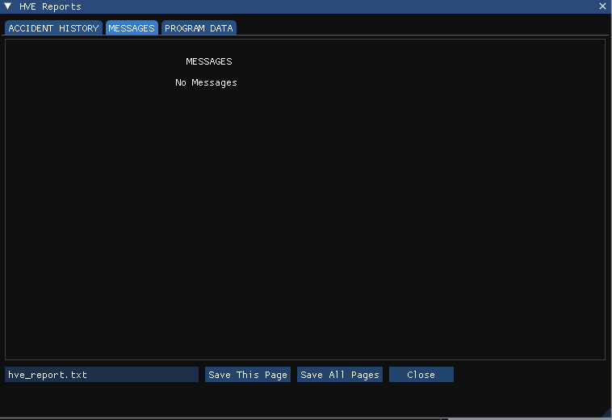

# Chapter 3 — Program Output Results

This chapter defines the outputs available from an EDGEN event. In HVE the reports are available in the Playback Editor; in HVE Studio they are on the **Output** and **View** menus once the event has been run.

## Overview

EDGEN produces three types of output reports:

- **Alpha-Numeric Reports** — Reports containing text and numeric information, such as vehicle positions and orientations
- **Variable Output Tables** — Reports containing tabular simulation results as a function of time
- **Trajectory Simulations** — Viewers containing dynamic, 3-D visual simulations

In HVE Studio, after running the event:

| Report | Where in HVE Studio |
|---|---|
| Alpha-numeric reports (Messages, Accident History, Program Data) | **Output › HVE Reports...** — one tab per page, as EDGEN built it |
| Variable output | **Key Results** (its *Trajectory* section: the chosen channels at every output step, with **Select Variables...**) and **Output › Output Graph...** (graphs) |
| Trajectory simulation | The viewport itself, driven by the playback bar |

!!! note "HVE Studio"
    HVE Studio does not print. In HVE Reports, **Save This Page** and **Save
    All Pages** write the pages to a text file; Key Results exports CSV
    (**Export CSV...**). The report pages
    are in HVE's units; the other outputs follow Tools › Preferences.

## Alpha-Numeric Reports

EDGEN produces the following alpha-numeric reports:

- **Messages** — A list of messages produced by the current run
- **Accident History** — A table of positions and velocities for each human or vehicle
- **Program Data** — A table containing program control information for the current run

Examples of each of these numeric output reports from EDGEN are described below.

### Messages

The Messages Report lists any diagnostic messages produced during the run. For a complete listing of messages issued by EDGEN, see [Chapter 6, Messages](06-messages.md).

*Figure 3-1: Messages report for the EDGEN tutorial's Taurus event in HVE Studio's HVE Reports window.*

### Accident History

The Accident History Report displays a table containing each of the user-entered positions and velocities for the human or vehicle. For each entered position (Posn. 1, Posn. 2, ...), the report lists the computed time (sec), X, Y, Z coordinates (ft), Roll, Pitch, Yaw angles (deg), total velocity V-tot (mph), Sideslip (deg), u-, v-, w- velocity components (mph), and Roll, Pitch and Yaw angular velocities (deg/sec).

*Figure 3-2: Accident History report for the EDGEN tutorial's Taurus event.*

### Program Data

The Program Data Report includes the simulation control parameters used for the current EDGEN event: Object Name, Max Run Time (sec), Calculation Interval (sec), Output Interval (sec), Linear Term Vel (mph) and Path Model (Linear Interpolation or 3-D Spline Interpolation).

*Figure 3-3: Program Data report for the EDGEN tutorial's Taurus event.*

## Graphic Reports

EDGEN produces no Graphic Output Reports.

> **NOTE:** Graphs of simulation results vs time may be produced using the Variable Output window (see next section). *(In HVE Studio: Output › Output Graph.)*

## Variable Output Table

EDGEN produces a Variable Output table containing the time-dependent simulation results. Variable Output displays the Kinematics output group for the human or vehicle.

!!! note "HVE Studio"
    The variable output table is the **Key Results** panel (View › Key
    Results): **Select Variables...** opens **Select Output Variables**, where
    the channels are chosen by object and group, and **Follow playback
    time** makes the table follow the playback. **Output › Output Graph...**
    graphs channels against time, with its own **Select Variables...**.

> **NOTE:** If the object is a human, the kinematics are displayed for the human Pelvis segment.

A detailed listing of each Variable Output parameter produced by EDGEN is found in Table 3-1.

**Table 3-1: Variable Output Data**

| Parameter | Description |
|---|---|
| Human or Vehicle Kinematic Data | X, Y, Z coordinates; $\phi, \theta, \psi$ angles; Total velocity, fwd, side, vert components; $\dot\phi, \dot\theta, \dot\psi$ angular velocities; Total acceleration, fwd, side, vert components; $\ddot\phi, \ddot\theta, \ddot\psi$ angular accelerations |

## Trajectory Simulations

EDGEN produces a trajectory simulation. A trajectory simulation is a 3-D visualization of the data displayed in the Variable Output table (see previous section). In HVE Studio it is played in the viewport of the Event editor.

*Figure 3-5: The viewport during playback of the EDGEN tutorial's child event.*

### Displaying a Trajectory Simulation

The trajectory simulation is controlled using the playback bar under the viewport.

*Figure 3-6: The playback bar.*

The playback bar's controls have the following functions:

- **Run** and **Reset** — Execute the event, and discard its results so it can be edited and run again
- **|<** — Rewind to the start of the simulation
- **<<** and **>>** — Step back or forward one output step
- **Play** / **Pause** — Play the simulation forwards, or pause it
- **>|** — Advance to the end of the simulation
- The time slider — Move to any time

> **NOTE:** Several events are played together in the **Playback (F6)** editor. **File › Record Animation...** writes the playback to an AVI video; for a rendered movie, export the animated scene with **File › Export Scene for Blender** and render it there.

<!-- NAV -->

---

← Previous: [Chapter 2 — Program Input Parameters](02-program-input.md)  |  [Index](README.md)  |  Next: [Chapter 4 — Calculation Method](04-calculation-method.md) →

<!-- /NAV -->
