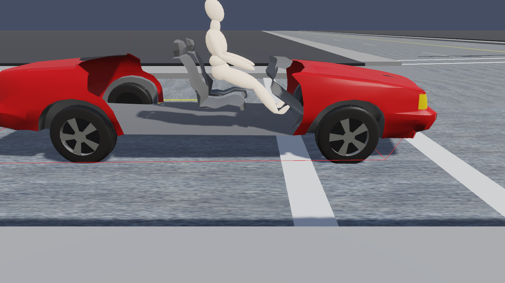

# Chapter 1 — EDHIS Program Description

## Overview

**EDHIS** (**E**ngineering **D**ynamics Corporation **H**uman **I**mpact **S**imulator) is a 3-dimensional analysis of the response of a human occupant or pedestrian during a motor vehicle collision. EDHIS is based on the HSRI-3D model [2,3] developed at the University of Michigan Transportation Research Institute, and includes several extensions and refinements produced by Engineering Dynamics Corporation [1,6]. The model was developed as a tool to study advanced safety concepts and designs of seat restraint systems from the viewpoint of occupant protection [2]. EDHIS employs airbag and belt (torso and lap) models useful for studying issues related to restraint system effectiveness. EDHIS is useful for predicting and visualizing occupant and pedestrian motion during impact. The model also provides important injury predictions, including HIC, Chest SI and Maximum Femur Load.

EDHIS computes human kinematics (position, velocity and acceleration vs time), joint angles and torques, and contact force between the human and vehicle.

The EDHIS human model includes 12 degrees of freedom. The human is represented by three inertial segments (head, torso and lower extremities) and 2 joints (neck and hip). The body is visualized using the HVE 15-segment, 14-joint model by combining the head and neck into a single segment called the head; the HVE pelvis, abdomen and chest are combined to form the EDHIS torso; and the right and left upper legs, lower legs and feet are combined to form the lower extremities. 3-dimensional ellipsoids may be attached to any of these three segments to sense force-producing interactions with the vehicle interior or exterior.

*Figure 1-1: EDHIS event in HVE Studio — the driver of the EDHIS tutorial's rear-struck Buick at t = 0.20 s (EdhisTutorialEDC, event "Buick Occupant").*

The motion of the vehicle is defined by a 6 degree-of-freedom collision pulse (acceleration vs time history). The vehicle has attached to it a number of planar contact surfaces that may be arranged to form interior surfaces, such as seats, dashboards and windshields, and exterior surfaces, such as bumper, grill, hood and windshield. Forces are applied to the human whenever interaction is sensed between the human ellipsoids and the vehicle contact surfaces.

The motion and forces resulting from human vs vehicle interactions are recorded as EDHIS output tracks; the resulting motion is also visualized in the 3-D viewport.

## Model Inputs

EDHIS inputs include one human, one vehicle, and an optional environment. Event set-up parameters include initial position and velocity for the human and vehicle, a collision pulse (the source may be a user-entered table or taken directly from another HVE event, such as EDSMAC4 [5]), an optional inhibition of selected human ellipsoid vs vehicle contacts, and restraint system in-use factors.

!!! note "HVE Studio"
    In HVE Studio the collision pulse is entered or imported in **Event › Collision Pulse**, or taken from another event of the same case that runs the same vehicle (*Take pulse from this event*). A pulse taken from another event carries that run's forward and lateral acceleration and its yaw acceleration; vertical, roll and pitch are left at zero because the stored run holds none of them. EDHIS reads an **acceleration** pulse only. See [Chapter 2](02-program-input.md#collision-pulse).

## Model Outputs

EDHIS output reports include the Accident History, Event Data, Human and Vehicle Data, Injury Predictions, Variable Output and Trajectory Simulation.

!!! note "HVE Studio"
    The engine's own report pages (Accident History, Event Data, Human Data, Injury Data, Vehicle Data, Program Data, Messages) are under **Output › HVE Reports**. The time histories are in **Output › Key Results** and **Output Graph**, and the trajectory simulation plays in the viewport. See [Chapter 3](03-program-output.md).

## Validation

EDHIS was validated first by direct comparison with HSRI-3D to ensure the basic model was intact after porting the original FORTRAN code to C and making the model HVE-compatible. Additional validation was performed comparing EDHIS results to other models as well as direct comparison with staged collision tests. Validation results are reported in reference 1.

## Basic Procedure

The procedure for using EDHIS in HVE Studio is:

1. In the **Human (F2)** editor, open **Occupant › Human Information** (the *Occupants* panel) and click **Add Occupant**. HVE Studio generates the body with GEBOD from the Subject Type, Age Group and Weight/Height Percentile. Optionally edit the segments, joints, ellipsoids and injury tolerances (*Body Segments…*, *Joint Properties…*, *Injury Tolerances…*).
2. In the **Vehicle (F3)** editor, add the vehicle. Give it interior (occupant) or exterior (pedestrian) contact surfaces with **Vehicle › Editors › Contact Surfaces**. Optionally install a belt (**Vehicle › Editors › Belt Restraint**) and/or an airbag (**Vehicle › Editors › Airbags**) for the occupant's seat.
3. Optionally, set up an environment in the **Environment (F4)** editor.

   > **NOTE:** Although an environment is unnecessary, it provides a visual context for the movement of objects computed by EDHIS.

4. In the **Event (F5)** editor, set up the EDHIS event in the Event Information panel:
   - Add an event (the **+** beside *Active Event*) and choose **EDHIS** as the Calculation Method
   - Under *Vehicles in Event*, choose one vehicle
   - Under *Humans in Event*, add one human; choose the vehicle it **Occupies** (or *Pedestrian (no vehicle)*), its seat X/Y and the **Restraint (this event)**; use **Pose** to orient its segments and, for a pedestrian, to enter its walking velocity
   - Under *Vehicle Initial Conditions*, give the vehicle its initial position and velocity
   - For occupant simulations, assign a collision pulse (**Event › Collision Pulse**)
5. Run the event (**Run** on the playback bar, or **Output › Run Simulation**).
6. Edit and re-run the event, if necessary, to achieve the desired match between simulation results and the actual event. A solved event's inputs are read-only until you press **Reset**.
7. Finally, review the results on the **Output** menu and play the event back in the viewport. If desired, record a movie with **File › Record Animation**.

!!! note "HVE Studio"
    HVE's Contacts (contact inhibition) dialog is **Event › Contacts...** for an EDHIS event: a grid of the occupant's segments against the vehicle's contact surfaces. See [Chapter 2, Contacts](02-program-input.md#contacts).

---
*Next: [Chapter 2 — EDHIS Program Input](02-program-input.md)*

<!-- NAV -->

---

← Previous: [EDHIS — Human Impact Simulator](README.md)  |  [Index](README.md)  |  Next: [Chapter 2 — EDHIS Program Input](02-program-input.md) →

<!-- /NAV -->
