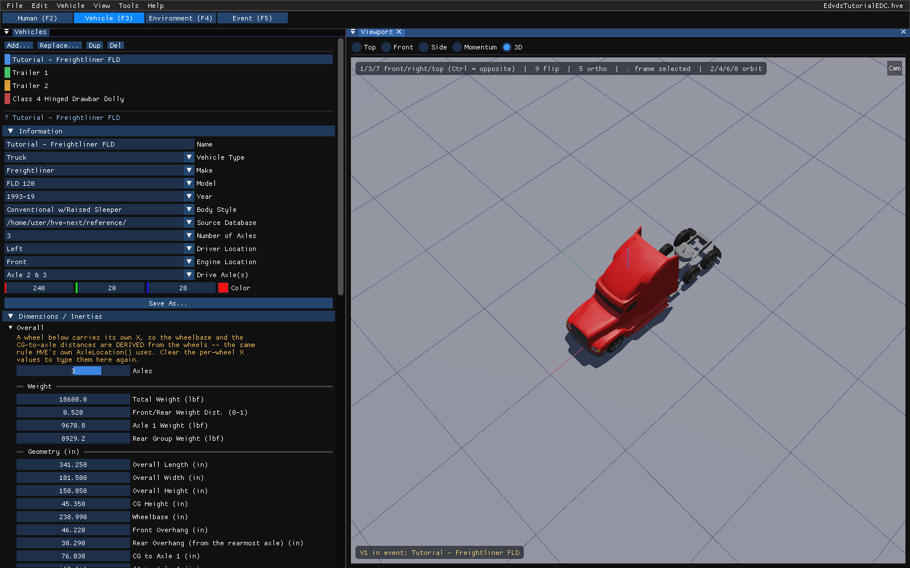
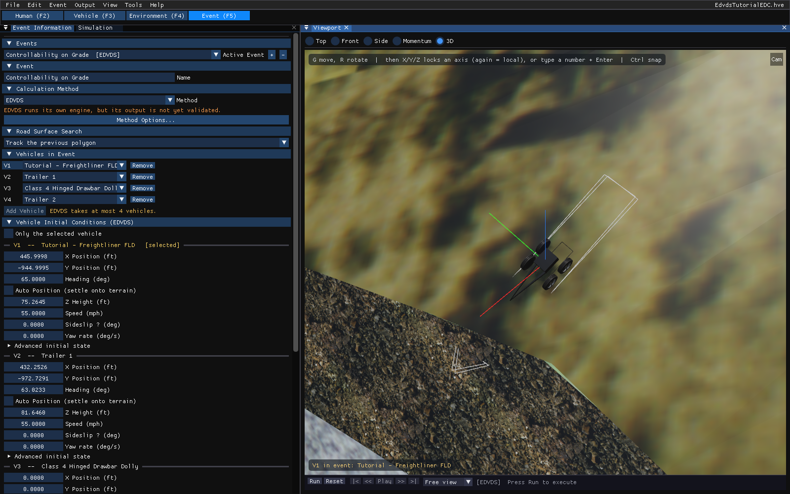
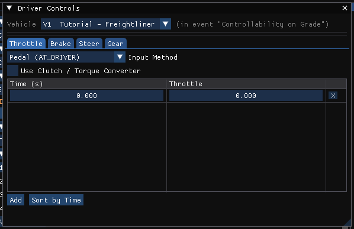

# Chapter 5 — EDVDS Tutorial

## Description

This tutorial examines the use of EDVDS to study the controllability of a truck tractor towing a set of 45-foot highway doubles down a mountain road. The vehicle is attempting to negotiate a down-hill curve to the right; the maneuver is further complicated by a substantial super-elevation, a narrow shoulder, and a near-vertical cliff at the shoulder's edge. Ultimately, the combination vehicle leaves the road and rolls over (one question we wish to address in our simulation analysis is whether the vehicle rolled over *before* or *after* it left the road), tumbling down the steep embankment. This sequence of events serves to illustrate the sophisticated capabilities of EDVDS.

Like all EDVDS events, the procedure involves the following basic steps:

- Create the vehicle(s)
- Create the environment
- Execute the EDVDS event(s)
- Review the EDVDS output reports

This basic procedure is described in detail in this tutorial.

> **NOTE:** We assume that HVE Studio is up and running, and that you are familiar with its basic features: the five editor tabs under the menu bar, the docked panels and the viewport. The purpose of this tutorial is to illustrate those features while setting up and executing an EDVDS event.

!!! note "HVE Studio"
    This chapter has been rewritten for HVE Studio around EDC's own finished tutorial case, `EdvdsTutorialEDC.hve`, which HVE Studio opens directly. One thing in HVE's original walkthrough cannot be repeated from scratch in HVE Studio: the Rowena Point site geometry is stored only inside the case file. So the tutorial opens the finished case and goes through each step of the original — what it sets, and where that setting is in HVE Studio — before running the event and reviewing the results. Where HVE's walkthrough and the saved case disagree, the case is followed.

## Getting Started

Open the tutorial case:

- Choose **File › Open Case…** and open `EdvdsTutorialEDC.hve` from the `supportfiles\case` folder of your HVE installation. HVE Studio reads HVE's `.hve` case files directly; saving writes HVE Studio's own `.hvex` or `.json` format, never `.hve`.

> **NOTE:** When the case opens, HVE Studio reports in its status what it imported, for example that two event-vehicle slots carry a payload and that some vehicle placements were settled by HVE's run.

HVE's tutorial set a list of user options before starting. In HVE Studio:

- **Units** — **Tools › Preferences** (U.S. or SI). This chapter quotes U.S. units, as the original does.
- **AutoPosition** — a per-vehicle checkbox, **Auto Position (settle onto terrain)**, in each vehicle's initial conditions in the Event editor. The tutorial case enters the tractor's Z, roll and pitch itself, so the box is off.
- **Key Results** — **Output › Key Results…** (or **View**).
- **Skidmarks, velocity vectors, rendering options** — **View › Scene Display › Skidmarks**, **View › Scene Display › Vectors**, **View › Scene Display › Rendering**.

## Creating the Vehicles

The tow vehicle is a 1994 Freightliner FLD-120 conventional tractor; the trailers are both 45-ft semi-trailers. The second semi-trailer is supported at the front by a converter dolly.

In the finished case these are already present. Choose the **Vehicle (F3)** editor tab: the **Vehicles** panel lists *Tutorial - Freightliner FLD*, *Trailer 1*, *Trailer 2* and *Class 4 Hinged Drawbar Dolly* (Figure 5-1). Click a name to select that vehicle; the viewport shows it and the panel shows its data.


*Figure 5-1: The tutorial's vehicles in the HVE Studio Vehicle editor, with the Freightliner tractor selected.*

To build the same vehicles yourself, use **Add…** on the **Vehicles** panel. The picker searches the loaded vehicle databases and offers HVE's Generic vehicles by type and class: the trailers are Generic *Trailer*, Class 4, and the dolly a Generic *Dolly*, Class 4 Hinged Drawbar. Rename a vehicle in the **Name** field of the panel's **Identity** section.

> **NOTE:** A 'tractor' is a 'truck' with a fifth wheel; there is no need for a separate 'tractor' vehicle type.

### Editing the Vehicles

HVE's walkthrough makes the following edits. Each is already in the finished case; this is where to find it in HVE Studio.

- **Color** — the **Color** field in the **Vehicles** panel's **Identity** section.
- **Geometry file** — the trailers use EDC's `TLVdsTutorTrlr45Van.h3d`. It is set in the panel's **3D Geometry** section (**Mesh File**: **...** or **Library...**) or on the File & Placement tab of **Vehicle › Editors › Vehicle Mesh…**, then **Load 3D File** there. HVE Studio opens `.h3d` files directly.
- **Trailer weight** — 13 135 lb for each trailer, in the panel's **Size & Weight** section, or the **Inertia / Mass** dialog (**Inertia › Edit…**).
- **Trailer 1 front connection height** — z = 15 in, to match the tractor's fifth wheel. Connections are edited with **Components › Connections…** (Front Connection X / Y / Z). The dialog shows each connection's height above ground; for EDVDS the fifth wheel and kingpin heights must agree to within 0.1 in.
- **Trailer 2 left rear brake time lag** — 0.305 sec, in **Vehicle › Editors › Brakes › Brake Assembly…** (Time Lag, per wheel).
- **Dolly drawbar length** — the dolly's front connection x = 120 in, in **Connections…** for the dolly.

> **NOTE:** Changing a connection does not redraw a custom 3-D geometry file; the drawn model is not used by EDVDS.

## Creating the Environment

The environment is HVE's *Rowena Point* site near Hood River, Oregon — a downhill curve to the right with a substantial super-elevation, a narrow shoulder and a near-vertical cliff at its edge. Choose the **Environment (F4)** editor tab to see it (Figure 5-2), and **Environment › Environment…** for its location, date, time and physical data.


*Figure 5-2: The tutorial's environment in the HVE Studio Environment editor. The original 3-D geometry was obtained with a total station; the textures are photos taken at the scene.*

> **NOTE:** The Rowena Point geometry is stored inside the tutorial case; there is no separate `RowenaPoint.h3d` file to open. A case you save carries its site in the same way (**File › Embed the environment in the case**, on by default).

> **NOTE:** The location, date, time and the angle of the X axis are used to position the sun in the scene.

## Saving the Case

Choose **File › Save Case As…** to save your working copy as an HVE Studio case (`.hvex`), or **File › Save Case As JSON…** for the text format. HVE Studio does not write `.hve` files, so the original is left unchanged.

> **NOTE:** When a case is saved after a run, the results are saved beside it and are restored the next time the case is opened, as long as its inputs have not changed.

## Creating the Event

The event simulates the loss of control of a set of highway doubles while attempting to negotiate the curve. Choose the **Event (F5)** editor tab (Figure 5-3).


*Figure 5-3: The tutorial event in the HVE Studio Event editor: the Event Information panel (left) with the event, its calculation method, its four vehicles and their initial conditions.*

In the **Event Information** panel:

- **Events** — the case's one event, *Controllability on Grade [EDVDS]*.
- **Calculation Method** — **EDVDS**.
- **Vehicles in Event** — V1 *Tutorial - Freightliner FLD*, V2 *Trailer 1*, V3 *Class 4 Hinged Drawbar Dolly*, V4 *Trailer 2*.

> **NOTE:** The vehicles **must** be in that order: the slot order is the order of the combination vehicle. To create such an event yourself, click **+** beside **Active Event**, choose **EDVDS**, and use **Add Vehicle** four times in train order.

### Positioning the vehicles

HVE's walkthrough drags the tractor to its starting point with AutoPosition on. In the finished case the tractor's initial conditions (Event Information › Vehicle Initial Conditions, V1) are:

- X Position `446.0` ft, Y Position `-945.0` ft, Heading `65.0` deg
- Speed `55.0` mph

The trailers and dolly start in line behind it on the slope; Trailer 1's heading is about 2° less than the tractor's.

In HVE Studio, select the tractor in the viewport (or its row in Vehicle Initial Conditions) and press **G** to move it or **R** to rotate it; the trailers and dolly follow as a rigid train, and the Auto Position checkbox, when ticked, settles each unit onto the terrain. Typed values are often easier: enter X, Y and Heading directly in Vehicle Initial Conditions.

> **NOTE:** EDVDS takes the position and velocity of the tow vehicle only. For each trailer it reads the roll, pitch and heading; for the dolly it reads nothing, since the dolly's pose follows from its connections.

### Payloads

Each trailer carries a 25 000 lb payload with roll, pitch and yaw moments of inertia of 200 000, 1 500 000 and 1 500 000 lb-sec²-in.

!!! note "HVE Studio"
    The tutorial case's payloads are imported from the `.hve` file and are used by the run (they appear in the report's Vehicle Data page); view or edit them with **Event › Payload…**, choosing the unit in its **Vehicle** list.

### Driver controls

Choose **Event › Driver Controls…** (Ctrl+D). The dialog has a **Vehicle** list, and **Throttle**, **Brake**, **Steer** and **Gear** tabs (Figure 5-4). For the Freightliner:

**Table 5-1: Steering Table for the Freightliner tractor** (Steer tab, steering-wheel angle)

| Time (sec) | Steering Wheel Angle (degrees) |
|-----------|-------------------------------|
| 0.00 | 75.0 |
| 2.00 | 180.0 |
| 5.00 | 220.0 |

**Table 5-2: Brake Table entries for the Freightliner tractor** (Brake tab, Input Method *Pedal (AT_DRIVER)*)

| Time (sec) | Brake Pedal Force (lb) |
|-----------|------------------------|
| 0.00 | 0.00 |
| 3.50 | 0.00 |
| 3.60 | 65.00 |

> **NOTE:** For trucks with air brake systems, the vehicle's brake pedal ratio is 1.0, so the entered pedal force equals the treadle valve pressure.


*Figure 5-4: The HVE Studio Driver Controls dialog for the Freightliner, Throttle tab. The Steer and Brake tabs hold Tables 5-1 and 5-2.*

Use **Add** to add a row and **Sort by Time** to order the rows.

### Key Results

To watch the vertical tire loads while the event runs, open **Output › Key Results…** and click **Select Variables…**. In the **Select Output Variables** dialog, type `Fz` or a tire group name in the search field and tick the tire Fz' variables for the tractor's three axles, then for Trailer 1's tires.

## Executing the Event

- Click **Run** on the playback bar under the viewport (or **Output › Run Simulation…**, Ctrl+R). The event runs to its 5.0 s maximum time.
- The solved event then plays back in the viewport; use **Play**, the step buttons and the time slider.

In HVE's original walkthrough the vehicle is leaving the road at about t = 3.5 seconds. Drag the time slider to 3.5 s to see the same instant in HVE Studio. *(The printed manual's Figure 5-21, a screenshot of HVE at that instant, is not reproduced.)*

> **NOTE:** By reviewing the individual vertical wheel loads, Fz', in Key Results, we can see which wheel lifts first — it is the one whose Fz' falls to zero.

!!! note "HVE Studio"
    This run follows the trajectory HVE saved in `EdvdsTutorialEDC.hve` to within about 2 cm. At its 5.0 s end the tractor and both trailers have rolled over (roll angles near 180°); see the Accident History below.

## Viewing Results

EDVDS produces the following reports:

- **Messages** — A list of messages produced by the current run
- **Accident History** — A table of initial and final positions and velocities
- **Vehicle Data** — A series of tables containing the vehicle data used by EDVDS
- **Program Data** — A table containing program control information
- **Variable Output** — A table containing user-selected, time-dependent simulation results
- **Trajectory Simulation** — A 3-D visualization of the event, displayed at a user-selectable time interval

In HVE Studio the reports are not in Playback mode (F6, which plays several events in sequence), and there is no Report Window Information dialog. The reports are on the Event editor's **Output** menu as soon as the event has been run:

- **Output › HVE Reports…** — the pages EDVDS itself builds: Accident History, Driver Data, Environment Data, Messages, Program Data and Vehicle Data, one tab each.
- **Output › Key Results…** and **Output › Output Graph…** — the Variable Output.
- The viewport — the Trajectory Simulation.

### Messages

EDVDS produces a number of messages, depending on the outcome of the event. For a complete list and explanation of these messages, see [Chapter 6](06-messages.md). Open **Output › HVE Reports…** and choose the **MESSAGES** tab:

```text
                                  MESSAGES

                                 No Messages
```
*Figure 5-5: Messages page for EDVDS, Controllability on Grade.*

### Accident History

The Accident History report displays the time and total distance traveled, as well as position and velocity at the start and end of the run. Choose the **ACCIDENT HISTORY** tab:

```text
                                                                        ACCIDENT HISTORY

Total Distance Travelled :   434.32
Time :                       5.0056

                                                       Position                                                     Velocity
                                ----------------------------------------------------     -------------------------------------------------------------
Initial Conditions:                    X         Y        Z     Roll    Pitch  Heading    V-tot    u-vel    v-vel    w-vel      p-vel      q-vel      r-vel
                                    (ft)      (ft)     (ft)    (deg)    (deg)    (deg)    (mph)    (mph)    (mph)    (mph)  (deg/sec)  (deg/sec)  (deg/sec)
Tutorial - Freightliner FLD       446.00   -945.00   -75.26     6.09    -9.19    65.00    55.00    55.00     0.00     0.00       0.00       0.00       0.00
Trailer 1                         432.25   -972.73   -81.65     5.77    -9.28    63.02    55.00    55.00     0.00     0.00       0.00       0.00       0.00
Trailer 2                         409.56  -1017.36   -89.90     5.17    -9.42    63.02    55.00    55.00     0.00     0.00       0.00       0.00       0.00

Final Conditions:
Tutorial - Freightliner FLD       459.02   -532.68     3.74  -178.33    11.55   161.85    57.60    16.54    42.55   -35.13    -153.20     -10.25     -22.95
Trailer 1                         486.84   -546.66     7.03  -184.13    -2.40   147.45    66.30    35.59    48.22   -28.35    -144.74      -6.37     -39.08
Trailer 2                         519.88   -581.53     9.06  -195.34    -2.62   113.61    82.36    67.04    40.19   -25.96    -146.97      -8.87       0.35
```
*Figure 5-6: Accident History page for EDVDS, Controllability on Grade, as HVE Studio shows it (U.S. units).*

### Vehicle Data

The Vehicle Data report for EDVDS displays the sprung mass, payload, drivetrain, suspension, tire and brake parameters for each vehicle in the event. Choose the **VEHICLE DATA** tab and scroll; the trailers' sections show the 25 000 lb payloads.

### Program Data

The Program Data report contains the simulation controls used by the EDVDS event. Choose the **PROGRAM DATA** tab:

```text
                             GENERAL INFORMATION

HVE Version:
EDVDS Version:
Date of Execution:
Time of Execution:
Tire Model Method:  Semi-empirical
Dimension Basis:    Sprung Mass CG


                             SIMULATION CONTROLS

Maximum Simulation Time :        5.0000
Integration Time Step :          0.0025
Output Interval :                0.1000
Linear Termination Velocity :    2.0000
Velocity Convergence Crit:       0.1200
Maximum Bisections:                  12
```
*Figure 5-7: Program Data page for EDVDS, Controllability on Grade. In HVE Studio the version, date and time lines are blank, and the Tire Model Method is always Semi-empirical.*

The simulation controls themselves are in the **Simulation** panel (a tab beside Event Information).

### Variable Output

The purpose of our event is to determine the vehicle's propensity for rollover, so let's display the velocities, accelerations and vertical tire forces:

- Choose **Output › Variable Selection…**. The **Select Output Variables** dialog is displayed.
- Search for and tick *V-tot*, *Fwd Acc* and *Lat Acc* in the Kinematics group for the Freightliner.
- Tick *Fz'* for each of the Freightliner's tires (axles 1, 2 and 3), and then for Trailer 1's tires.
- Choose **Output › Key Results…** to see the values at each output time. To plot them, open **Output › Output Graph…** and tick them with its own **Select Variables…** button.

**Output › Export Variables…** writes the selected variables to a file.

### Trajectory Simulation

The trajectory simulation is the Event editor's viewport. To visualize the motion as the tractor-trailer attempts to negotiate the down-hill curve:

- Click **|<** to return to the start.
- Click **Play**. The simulation plays at the current playback rate (**Output › Playback Options…**).
- Click **Pause**, and use **<<** and **>>** to step one output interval at a time, or drag the time slider.
- Click **>|** to advance to the end of the run.

> **NOTE:** There is no reverse-play button in HVE Studio.

### Printing

HVE Studio has no Print command. To keep a report, save it as text from **Output › HVE Reports…** (the file name field and button below the page), or export variables with **Output › Export Variables…**, and print the file from another program. **File › Record Animation…** records the playback as a video.

<!-- NAV -->

---

← Previous: [Chapter 4 — Calculation Method](04-calculation-method.md)  |  [Index](README.md)  |  Next: [Chapter 6 — Messages](06-messages.md) →

<!-- /NAV -->
