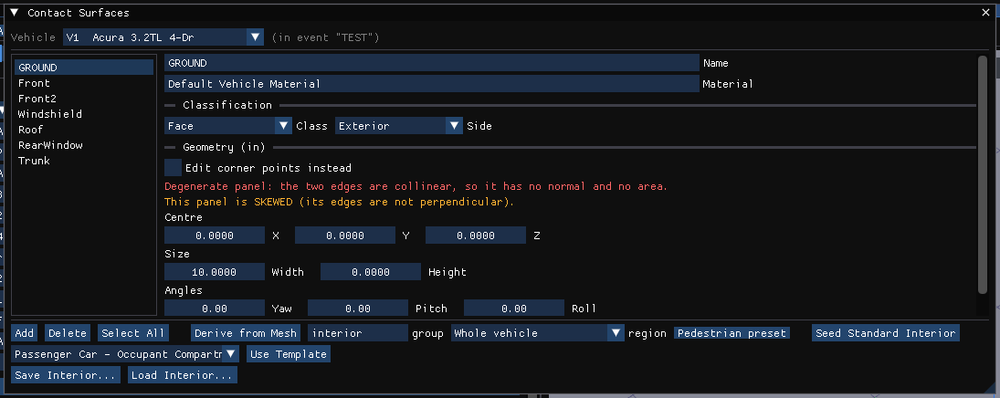
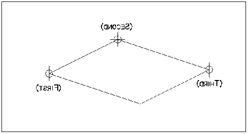
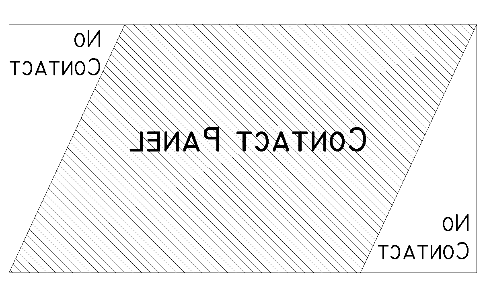
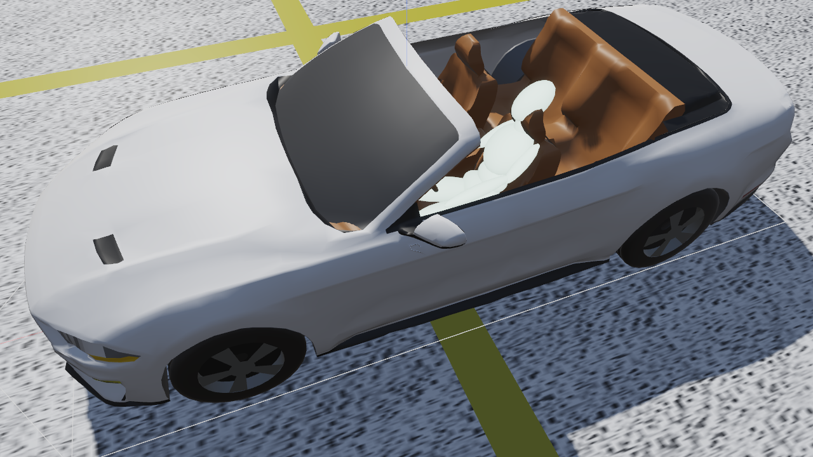
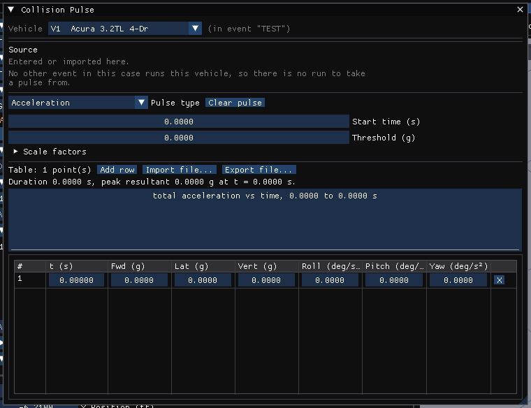

# Chapter 5 — Tutorial

This tutorial provides examples illustrating two common applications of GATB: occupant modeling and pedestrian modeling.

Creating GATB events involves the following basic steps:

- Create the humans.
- Create the vehicles.
- Create the environment.
- Create and execute the GATB event.

Once the event has been executed, the output reports can be viewed on HVE Studio's **Output** menu. These reports were discussed in [Chapter 3, Program Output](03-program-output.md).

The basic procedure for creating GATB events is described in detail in this tutorial.

> **NOTE:** It is assumed that HVE Studio is up and running, and that the user is familiar with its basic features: the editor tabs (Human F2, Vehicle F3, Environment F4, Event F5), the docked panels and the 3-D viewport. The purpose of this tutorial is to illustrate these features while setting up and executing a GATB event.

> **NOTE:** Environments are not required in the creation of a GATB event and are not discussed here.

!!! note "HVE Studio"
    This chapter follows the GATB tutorial in HVE Studio. HVE's step-by-step case files for it (`GATBcreateHuman`, `GATBcreateVehicles`, … `GATBcreatePedestrianImpact`) and its vehicles (a Buick Skylark, a Chevrolet Caprice and a Dodge Dakota from HVE's vehicle database) are not part of the HVE support files HVE Studio carries, so this chapter gives each step in HVE Studio terms and keeps the tutorial's numbers. Any vehicle with suitable geometry can stand in for the tutorial's.

    Two finished GATB cases from HVE's support files open directly in HVE Studio with **File › Open Case** and are used for this chapter's figures: **`GATB.hve`** (a driver in a Ford Mustang, and a pedestrian) and **`GATB-PedImpact.hve`** (a pedestrian struck by an Acura 3.2TL).

    GATB is part of HVE Studio; nothing needs to be installed or switched on to run this tutorial.

## Getting Started

The first step is to set the user options.

> **NOTE:** Most options simply affect the appearance in the viewport. Some affect the data used in the analysis — for example, a vehicle's *Auto Position (settle onto terrain)* setting in its initial conditions — so check that they are set as intended.

In HVE Studio, set the following:

- **Tools › Preferences** — Units equals US
- **View › Key Results** — on
- **View › Scene Display › Occupant Equipment** — on, to show the contact panels, belt anchors and airbag
- **View › Scene Display › Vectors › Velocity** — off
- **View › Scene Display › Skidmarks** — on
- **View › Scene Display › Rendering** — *Phong*
- **View › Scene Display › Humans Through Bodywork** — on, to see the occupant inside the car
- **Output › Playback Options** — a frame step to suit (HVE's tutorial plays back at 0.0333 sec)

The remaining options will automatically initialize to their default conditions. We're now ready to proceed with the tutorial.

## Occupant Simulation Tutorial

### Creating the Humans

To create the human occupant in the collision, choose the **Human (F2)** editor and open **Occupant › Human Information**. The *Occupants* panel is displayed.

- Click **Add Occupant**. A new human is added and its body is generated with GEBOD.

Choose the following human attributes (Figure 5-1):

- Location = *Front Right*
- Subject Type = *Male*
- Age Group = *Adult (18-64)*
- Weight Percentile = *50th*
- Height Percentile = *5th*

*Figure 5-1: The Occupants panel.*

> **NOTE:** The passenger's position is assumed to be on the right side of the vehicle.

> **NOTE:** An occupant is drawn in a seated posture (upper legs pitched 90° forward); a pedestrian is drawn standing.

### Creating the Vehicles

Now that we have our human, let's add our vehicles: a Buick Skylark 4-Door (Passenger Car, Buick, Skylark, 1985-1991, 4-Door) and a Chevrolet Caprice 4-Door (Passenger Car, Chevrolet, Caprice, 1991-1997, 4-Door).

- Choose the **Vehicle (F3)** editor.
- In the *Vehicles* panel, click **Add…**, and search the loaded vehicle databases (or choose one of HVE's generic vehicles by type and class). Add each vehicle.
- Orbit and zoom the viewport to look at each vehicle, and then to look into the interior of the Caprice.

> **NOTE:** In HVE Studio, **View › Scene Display › Humans Through Bodywork** and **View › Scene Display › Occupant Equipment Through Bodywork** show the occupant and the contact panels through the body, which replaces HVE's trick of moving the camera inside the vehicle's shell.

### Contact Panels

The contact panels will be entered for the right front seat position in the Chevrolet Caprice. This can be done using numerical values from the computer mesh if it has been measured in a CAD package, or it can be done visually, which is the way we will proceed in this tutorial. We will first position a contact panel for the seat cushion on the right front seat.

- Select the Caprice and open **Vehicle › Editors › Contact Surfaces**. The Contact Surfaces dialog is displayed (Figure 5-6).
- Click **Add** to add a contact surface.
- Enter the **Name** `RF Seat Cushion`, and set **Side** to *Interior*.

> **NOTE:** The surface's own material is in the dialog's *Material Properties* section; for this tutorial the default material is used for all surfaces. What GATB uses for the occupant against a surface is the event's *combined* material, Event Information › **Combined Contact Materials**; a surface with none stated uses its own material.

*Figure 5-6: Contact Surfaces dialog in HVE Studio (the Acura of `GATB-PedImpact.hve`).*

To create the surface for the right front seat cushion, tick **Edit corner points instead** and enter the following three points as **P1**, **P2** and **P3** (first, second and third in the table). They generate a surface with the correct orientation when viewed from the top:

| Corner (selection order) | x (in) | y (in) | z (in) |
|---|---|---|---|
| Left front corner of seat (First) | -2 | 2 | -2 |
| Left rear corner of seat (Second) | -18 | 2 | 1 |
| Right rear corner of seat (Third) | -18 | 22 | 1 |

*Figure 5-9: Contact Surface corners and selection order.*

> **NOTE:** Figure 5-9 depicts the proper order for entering the corner coordinates. These corners must be entered in a counter-clockwise order in order to create the positive side of the surface facing upward. The positive side of the surface is the side of the surface that will be pushing the object. In HVE Studio the dialog shows the resulting **Normal** and can **Flip** it.

> **NOTE:** There are other combinations that would produce a correctly oriented contact panel.

While the dialog is open the panel is drawn on the vehicle in the 3-D view, with an arrow along its normal. It is obvious that this first attempt at making the Right Front Seat Cushion contact panel creates a surface that is too narrow and does not extend rearward enough. This panel is also slightly above the seat cushion. By modifying one of the corner positions at a time, the correct seat panel can be determined visually.

Adjust the following corner coordinates:

| Corner (selection order) | x (in) | y (in) | z (in) |
|---|---|---|---|
| Left front corner of seat (First) | -3 | 2 | -1 |
| Left rear corner of seat (Second) | -20 | 2 | 1.5 |
| Right rear corner of seat (Third) | -20 | 26 | 1.5 |

You can see that the flat contact panel does an adequate job of approximating the complex surface geometry of the seat cushion.

Create the remaining contact panels in the same manner as the Right Front Seat Cushion panel. The names and coordinates for the remaining panels are given in Table 5-1.

**Table 5-1: List of Contact Surface corner points**

| Name | Coord | First | Middle | Third | Material |
|---|---|---|---|---|---|
| RF Seat Back | X | -20.0 | -20.0 | -28.0 | Default Vehicle |
|              | Y | 26.0 | 2.0 | 2.0 | |
|              | Z | 1.5 | 1.5 | -25.0 | |
| Floor | X | 45.0 | -30.0 | -30.0 | Default Vehicle |
|       | Y | -32.0 | -32.0 | 32.0 | |
|       | Z | 8.5 | 8.5 | 8.5 | |
| Toe Pan | X | 34.0 | 30.0 | 30.0 | Default Vehicle |
|         | Y | -32.0 | -32.0 | 32.0 | |
|         | Z | 2.0 | 8.5 | 8.5 | |
| Rt. Side | X | 44.0 | 44.0 | -40.0 | Default Vehicle |
|          | Y | 32.0 | 32.0 | 32.0 | |
|          | Z | -12.0 | 8.5 | 8.5 | |

> **NOTE:** The 3 points entered for each contact surface define a parallelogram contact surface. For example, the side window contact surface in this example is not rectangular in shape.

> **NOTE:** The GATB program will not calculate a force if the contact occurs in the areas of no contact demonstrated in Figure 5-16.

*Figure 5-16: Parallelogram contact surface.*

!!! tip "New in HVE Studio"
    The Contact Surfaces dialog can also build a set of interior panels for you — **Seed Standard Interior**, **Derive from Mesh**, and interior templates (**Use Template**) — and **Save Interior…** / **Load Interior…** keep a set for reuse.

!!! note "HVE Studio"
    HVE Studio does not pre-screen surfaces by *Side* (Interior/Exterior) for an event built in HVE Studio: until you edit the list in **Event › Contacts...**, every ellipsoid of the pelvis, abdomen, chest, neck, head and upper legs is tested against every surface of the vehicle. Give the vehicle only the panels the occupant should strike.

### Creating and executing the Events

We will now create the simulations necessary for a head-on collision. The collision pulse needed can be directly obtained by using the EDSMAC4 collision simulator.

> **NOTE:** HVE ships this pulse as `GATBTutorialPulse1`. That file is in HVE's binary pulse format, which HVE Studio's Collision Pulse dialog cannot import (its *Import file…* reads a text table), so run the EDSMAC4 event.

In the **Event (F5)** editor, in the Event Information panel:

- Click **+** beside *Active Event* to add an event, and name it `Frontal Impact`.
- Choose **EDSMAC4** as the *Method*.
- Under *Vehicles in Event*, choose the Buick Skylark and add the Chevrolet Caprice.

Now we're ready to set up the event. Under *Vehicle Initial Conditions*, enter for the Buick Skylark:

- X Position (ft) = 30
- Y Position (ft) = -6
- Heading (deg) = 180
- Speed (mph) = 25

and for the Chevrolet Caprice:

- X Position (ft) = 15
- Y Position (ft) = -6
- Heading (deg) = 0
- Speed (mph) = 30

In the **Simulation** panel, change the following:

- Separation Timestep (s) = 0.001
- Trajectory Timestep (s) = 0.001
- Output Timestep (s) = 0.002
- Duration (s) = 0.5

> **NOTE:** We reduced the output interval because we're going to use the acceleration output from this simulation as the collision pulse for our occupant simulation. Because we want more detail, we select the smaller output interval. This provides the acceleration at 0.002 second increments rather than the default value, 0.1 second.

> **NOTE:** The entire duration of a collision is only about 0.1 second, so the default interval might actually skip over the entire collision!

- Click **Run** on the playback bar to execute the event.

### Occupant Simulation

The EDSMAC4 event has provided us with the collision pulse. Now, let's use GATB to study the passenger's behavior during impact.

- Add an event, name it `RF Passenger`, and choose **GATB** as the *Method*.
- Under *Vehicles in Event*, choose the Chevrolet Caprice; under *Humans in Event*, click **Add Human** and choose the male passenger.

Now, let's set up the occupant simulation event:

- Under *Vehicle Initial Conditions*, enter for the Caprice: X (ft) = 15, Y (ft) = -6, Heading (deg) = 0, Speed (mph) = 0.
- Under *Humans in Event*, set **Occupies** to the Caprice. The human is placed relative to the vehicle: its position is that of the pelvis center of mass with respect to the vehicle center of mass.

> **NOTE:** The occupant's position is relative to the vehicle-fixed coordinate system, in inches with US units.

Enter **Seat X from CG** (in) = `-14` and **Seat Y from CG** (in) = `16`. The human moves from the center of mass of the vehicle to a position approximately in the right front seat.

> **NOTE:** The legs may be embedded in the floor and the human not in a normal seated position, where the torso is approximately parallel with the seat back.

Click **Pose** beside the human. In the *Body Pose* dialog, tick **Pose this body**, then:

- Change the pitch angle of the pelvis to 25 degrees.
- Set the pitch of the Left Upper Leg to 80 degrees and of the Left Lower Leg to -50 degrees.
- Make the same changes to the Right Upper Leg (80 degrees) and Right Lower Leg (-50 degrees).

> **NOTE:** In HVE Studio each angle in the Body Pose dialog is relative to the segment's parent segment.

HVE's tutorial then moves the pelvis up to z = -4.6 in and back to x = -16 in, so that it is not embedded in the seat cushion or in front of the seat back, and adjusts the upper legs to 75 degrees. In HVE Studio set **Seat X from CG** to `-16`, **Seat Z from CG** to `-4.6` and the upper-leg pitches to `75` degrees.

!!! note "HVE Studio"
    The vertical position is **Seat Z from CG** in the human's row of the Event Information panel. HVE Studio uses SAE axes, so +z is down: HVE's z = −4.6 in is entered as `-4.6`. A human can be dragged across the ground in the 3-D view, but its height is typed.

- In the same dialog, leave the *Initial velocity* at 0.

> **NOTE:** Because the human is defined as an occupant (as opposed to a pedestrian), the initial velocity is defined relative to the vehicle.

Let's attach a camera to the vehicle to better see the human.

> **NOTE:** This tip really helps while positioning occupants because it allows you to move the camera relative to the vehicle; thus you can quickly focus on the interaction between the human and the seat cushion, an important part of placing the human in an equilibrium position.

- Open **Tools › Cameras**, click **Add**, and under *Attachment* set *View From* and *Look At* to the Chevrolet Caprice, so the camera rides with the vehicle. HVE's tutorial uses camera coordinates x = -1.0, y = -10.0, z = -1.0 (ft) and picture center x = 0.0, y = 0.0, z = -1.0.

*Figure 5-23: A GATB occupant seated at t = 0 in HVE Studio (the driver of `GATB.hve`).*

In the **Simulation** panel set:

- Output Timestep (sec) = 0.002
- Duration (sec) = 0.25

GATB requires that some information be entered in the Collision Pulse dialog in order for the simulation to run properly. We will initialize this event with a zero collision pulse in order to examine the interaction between the stationary human and the vehicle contact panels.

- Open **Event › Collision Pulse** (with the Caprice selected in its *Vehicle* list).
- Select *Acceleration* as the *Pulse type*.
- Ensure that the table has only one row, for time 0.000, with all of the columns set to 0.000 (**Add row** adds one).

*Figure 5-28: Collision Pulse dialog with a single zero row.*

Once this has been completed, the occupant is close to equilibrium. We can now execute the simulation and examine how the occupant limbs move and adjust with the interacting forces from the contact panels.

> **NOTE:** Details of establishing an initial equilibrium for the occupant are beyond the scope of this simple tutorial.

> **NOTE:** In general, the linear and angular accelerations of every mass segment should be as small as possible in comparison to the acceleration pulse that will be used.

> **NOTE:** In low speed collisions, it is absolutely critical that the linear and angular accelerations be as close to zero as possible.

#### Establishing initial equilibrium

The basic equilibrium requirement is that any motion caused by being slightly out of equilibrium is negligible compared to the motion caused by the crash.

As a practical matter, the user will never be able to produce exact equilibrium (i.e., all linear and angular accelerations equal to zero).

Every analysis is different and there are no strict guidelines that define when the human position is close enough to equilibrium. In general, compare the linear acceleration for all the human segments to the linear acceleration of the crash pulse and ensure the human accelerations are much smaller.

In addition, the linear acceleration of all segments should be at least under 0.5 g's, with the possible exception of the feet, which should be at least under 1.0 g's.

> **NOTE:** On humans with small abdomens, it may not be possible to achieve 0.5 g's. In this case make it as low as possible, but certainly under 1.0 g's.

The basic procedure for establishing equilibrium is:

- Position the vehicle so that the roll, pitch, yaw and acceleration pulses are all zero.
- Set the initial velocity of the vehicle to zero.
- Run the event for a short time.

> **NOTE:** The exact termination time is not critical. In HVE Studio the shortest *Duration* the Simulation panel accepts is 0.1 sec.

- Choose **Output › HVE Reports** and click the **Results** tab. The Results page lists the linear and angular accelerations of every segment.

In HVE's example, the initial human position has the pelvis accelerating downward in the positive Z direction at approximately 0.62 g's. In order to position the occupant where this downward acceleration is smaller, HVE's tutorial moves the pelvis down a small amount (z = -4.6 in to -4.5 in), resets, re-runs, and reads the Results page again: the pelvis Z acceleration falls, while its X acceleration rises from 0.145555 g's to 0.161370 g's. Moving the pelvis further, to z = -4.0 in, drives the feet into the floor so the floor pushes back very hard, and the angular accelerations of the legs and feet and the linear accelerations of the feet become very large.

> **NOTE:** When you move the pelvis on a human, all of the other segments move also because they are all linked in a hierarchy where the pelvis is the dominating mass.

In HVE Studio the same procedure applies, with **Reset** on the playback bar before each re-run and the Results page read after it; the vertical adjustments are made in **Seat Z from CG** (see the note above).

For this example, we will not spend any additional effort in attempting to produce smaller linear accelerations.

Once the initial equilibrium has been established, the vehicle can then be positioned to the appropriate place in the environment with the appropriate orientation to match the event being modeled.

> **NOTE:** Recall that we changed the initial angles — roll, pitch, and yaw values — to zero degrees, the velocity to zero, and the crash pulse to zero, in order to help us obtain the initial equilibrium of this human.

#### Applying the crash pulse

The next step is to apply a crash pulse to the vehicle. This involves two parts.

The first part is to set up the initial speed of the vehicle to match that of the crash being simulated. In this example, recall from the EDSMAC4 run that the initial speed is 30 mph.

- Press **Reset**, and under *Vehicle Initial Conditions* set the Caprice's Speed to 30 mph.
- Open **Event › Collision Pulse**, select *Acceleration* as the *Pulse type*, choose *Frontal Impact* in the *Source* list and click **Take pulse from this event**.

> **NOTE:** A pulse taken from an EDSMAC4 run carries the forward and lateral acceleration and the yaw acceleration; vertical, roll and pitch are zero, since EDSMAC4 is a planar model.

You can now execute the event, which demonstrates occupant motion in a frontal car crash.

A side view from the left side of the vehicle helps you to visualize the forward motion. The camera for the left side view rides with the Chevrolet Caprice with the following camera coordinates:

- Camera Coordinates: x = -1, y = -10, z = -1
- Picture Center: x = 0, y = 0, z = -1

Another view that is helpful to demonstrate the side motion which occurs is positioned with the camera attached to the Chevrolet Caprice as follows:

- Camera Coordinates: x = -5, y = 2, z = -10
- Picture Center: x = 0, y = 2, z = -1

#### Changing the principal direction of force

To explain how the principal direction of force affects occupant motion, return to the EDSMAC4 event (make *Frontal Impact* the *Active Event*).

- Under *Vehicle Initial Conditions*, change the Buick Skylark to: X (ft) = 23, Y (ft) = 3.5, Heading (deg) = 270.
- Press **Reset** and **Run** to execute the EDSMAC4 event again.
- Make the GATB event active, open **Event › Collision Pulse** and click **Take pulse from this event** again, so that the pulse is taken from the new run.
- Press **Reset** and **Run** to execute the GATB event with the new collision pulse.

Notice that the occupant moves forward and to the right in this new collision configuration, as opposed to the purely frontal impact previously modeled.

This completes the examples of the occupant simulation.

You may wish to modify the crash pulse by rerunning the EDSMAC4 event and changing the direction of the crash pulse, and then taking it again as previously described. You can also change the camera positions and explore other aspects of the occupant motion.

## Pedestrian Simulation Tutorial

Using GATB to simulate a pedestrian impact is very similar to the previous occupant simulation.

- Save any previous work you would like to keep (**File › Save Case**).

To create the human pedestrian in this example:

- In the **Human (F2)** editor, open **Occupant › Human Information** and click **Add Occupant**.

Choose the following human attributes:

- Location = *Pedestrian*
- Subject Type = *Male*
- Age Group = *Adult (18-64)*
- Weight Percentile = *50th*
- Height Percentile = *50th*

> **NOTE:** HVE's tutorial checks that the moment of inertia data for the right and left upper legs are Ixx = 1.3599, Jyy = 1.4348 and Kzz = 0.3769 lb-sec²-inch. In HVE Studio, read them in the *Occupants* panel's **Body Segments…** dialog (*Inertia* tab, with the Right or Left Upper Leg chosen). HVE Studio generates the body with its own built-in GEBOD tables, so compare the values rather than assume them.

### Creating the Vehicle

- In the **Vehicle (F3)** editor, click **Add…** in the *Vehicles* panel and add a Dodge Dakota Fleetside 4x4 pickup (Pickup, Dodge, Dakota, 1987-1996, Fleetside 4x4), or a comparable pickup.
- Create the exterior contact panels using the data from Table 5-2, in **Vehicle › Editors › Contact Surfaces**.

> **NOTE:** Make sure to set **Side** to *Exterior* when creating your contact surfaces.

!!! tip "New in HVE Studio"
    The Contact Surfaces dialog's **Pedestrian preset** sets the mesh-derivation options for a pedestrian's exterior panels, for use with **Derive from Mesh**.

**Table 5-2: Contact Surfaces to use in Pedestrian impact example**

| Name | Coord | First | Middle | Third | Material |
|---|---|---|---|---|---|
| Bumper-Front | X | 80.5 | 80.5 | 77.0 | Default Vehicle |
|              | Y | 0.0 | 0.0 | -25.0 | |
|              | Z | -4.0 | 3.0 | 3.0 | |
| Grill | X | 77.7 | 77.7 | 74.5 | Default Vehicle |
|       | Y | 0.0 | 0.0 | -25.0 | |
|       | Z | -15.0 | -2.0 | -2.0 | |

> **NOTE:** HVE's pedestrian example also relies on a contact panel named **GROUND**: when a panel has that name, GATB builds a flat ground panel 200 ft × 200 ft at z = 0 under the vehicle (see [Chapter 2](02-program-input.md#3-d-surface-geometry)). `GATB-PedImpact.hve` carries one.

### Creating the Event

- In the **Event (F5)** editor, add an event, name it `Pickup/Pedestrian Impact`, and choose **GATB** as the *Method*.
- Under *Vehicles in Event*, choose the pickup; under *Humans in Event*, add the pedestrian.

In the **Simulation** panel, change the following:

- Output Timestep (sec) = 0.002
- Duration (sec) = 1.0

Now, let's set up the pedestrian simulation event. Under *Vehicle Initial Conditions*, enter for the pickup:

- X Position (ft) = 15.0
- Y Position (ft) = -5.0
- Heading (deg) = 0.0
- Speed (mph) = 15.0

> **NOTE:** HVE's tutorial also sets z (ft) = -2.094, roll = 0 and pitch = 0. In HVE Studio roll and pitch are under *Advanced initial state*; the vehicle's elevation has no control for a GATB event (a case imported from HVE keeps its stored value).

Next, position the pedestrian. Under *Humans in Event*, set **Occupies** to *Pedestrian (no vehicle)*.

!!! note "HVE Studio"
    **A GATB pedestrian is placed from the vehicle's CG.** The two position fields read *X from vehicle CG* and *Y from vehicle CG*: GATB measures a pedestrian from the first vehicle's CG and converts it to the scene itself. (EDHIS, by contrast, takes a pedestrian's position in scene coordinates.)

HVE's tutorial enters the pedestrian at x = 7.15 ft, y = -1.5 ft, z = -1.0 ft, yaw = 120 degrees, with an initial velocity of 1.0 mph:

- Enter **X from vehicle CG** = 85.8 in (7.15 ft) and **Y from vehicle CG** = -18 in (-1.5 ft). These fields are measured from the vehicle's CG, so they are in inches, like the seat positions.
- Click **Pose**, tick **Pose this body**, and set the pelvis yaw to `120` degrees.
- In the same dialog, under *Initial velocity (segment frame, u/v/w)*, enter u = `1.0` mph.

!!! note "HVE Studio"
    **The pedestrian's walking speed reaches GATB** — it is the pelvis velocity in the body's own frame. The pedestrian's vertical position is **Z from vehicle CG** (SAE: + is down).

*Figure 5-36: A GATB pedestrian in front of the striking vehicle at t = 0 (`GATB-PedImpact.hve` in HVE Studio).*

*Figure 5-36a: The pedestrian's placement in Event Information (`GATB-PedImpact.hve`).*

- Open **Event › Collision Pulse**, select *Acceleration* as the *Pulse type*, and make sure the table has only one row, at time 0.000, with all columns 0.000.

HVE's tutorial next uses the *Contacts* dialog to allow all of the human's ellipsoids to interact with all of the pickup's contact surfaces.

!!! note "HVE Studio"
    Open **Event › Contacts...** and click **Arm All**: every ellipsoid of every segment is armed against every contact surface of the pickup, which is what this step of the tutorial selects. (An event with nothing stored arms only the pelvis, abdomen, chest, neck, head and upper legs; the dialog says so.) Un-tick any pair you want GATB to ignore — see [Chapter 2, Contacts](02-program-input.md).

In HVE the interaction between the pedestrian and the GROUND contact panel is then checked with the Key Results window, showing the total force on each foot ellipsoid against GROUND, and the pedestrian's height adjusted until the two feet together carry about the pedestrian's weight (173.5 lbs in this example; the tutorial moves the pedestrian from z = -1.0 ft to z = -1.053 ft).

!!! note "HVE Studio"
    Set the pedestrian's height with **Z from vehicle CG** in the human's row of the Event Information panel (SAE: + is down, so a body above the datum is negative). The contact force is offered per interaction rather than per ellipsoid: in **Output › Variable Selection**, tick **Cont F tot, sum of pairs** in the **Occupant Contacts** group for the GROUND interaction. That is both feet together, which is the quantity to compare with the pedestrian's weight; the force on each foot separately is not available.

We will use the collision pulse to approximate the vehicle braking.

- Enter the following collision pulse for the pickup (Table 5-3) in **Event › Collision Pulse**, with **Add row** for each row.

> **NOTE:** HVE ships this pulse as `GATBTutorialPulse3`, in its binary format; HVE Studio cannot import that file, so type the four rows. Execute the run to analyze pedestrian behavior in this type of crash. The speeds of the vehicle and pedestrian can be modified, as well as braking effort on the pickup.

**Table 5-3: Collision pulse to approximate hard braking by pickup**

| Time (s) | Forward Acceleration (g's) |
|---|---|
| 0.0 | -0.75 |
| 0.2 | -0.75 |
| 0.4 | -0.75 |
| 0.6 | -0.75 |

- Click **Run** on the playback bar, then play the event back.

Try several different scenarios, increasing and decreasing the speed of the pickup. Also try changing the initial velocity of the pedestrian to study how the motion across the vehicle changes.

This completes the examples of the pedestrian simulation.

<!-- NAV -->

---

← Previous: [Chapter 4 — Calculation Method](04-calculation-method.md)  |  [Index](README.md)  |  Next: [Chapter 6 — Messages](06-messages.md) →

<!-- /NAV -->
