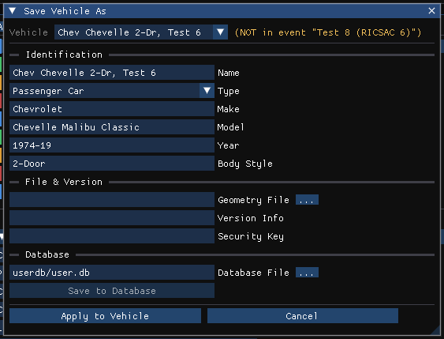

# Saving Vehicles

**Save Vehicle As Dialog**

New vehicles may be added to a vehicle database file (by default `user.db` in the user database folder), extending the vehicle library. The dialog is opened with **Vehicle › Save Vehicle As...** in the Vehicle Editor, with the **Save As...** button in the Vehicle Information dialog, or with **Save As...** in the Information section of the Vehicles panel. The fields start with the selected vehicle's own identification.

This dialog contains the following items:

## Identification

### Name
The name stored with the saved vehicle.

### Type
The basic type of the vehicle being saved (Passenger Car, Pickup, etc.).

### Make
Specify the vehicle manufacturer.

### Model
Specify the vehicle model.

### Year
Specify the model year.

### Body Style
Specify the vehicle body style (e.g., 2-Door, 4-Door Sedan, etc.).

## File & Version

### Geometry File
The 3-D geometry file name to record with the vehicle. **...** opens a file browser.

### Version Info
Version information for the vehicle, so revisions of the same vehicle can be identified.

### Security Key
The security key for the vehicle, which HVE uses to restrict access to proprietary vehicle data.

## Database

### Database File
The database file the vehicle is written to. **...** opens a file browser. The default is `user.db` in the writable user database folder, never a database in the installed (read-only) data. A database file that does not exist is created.

### Save to Database
Writes the vehicle to the database file under the keys entered above, then reloads the vehicle databases. A status line reports the result. The button is enabled only when a Name and a Database File are entered and the vehicle's current Make, Model, Year and Body Style match a record in a loaded database.

## Apply to Vehicle / Cancel

**Apply to Vehicle** copies the Name, Type, Make, Model, Year and Body Style entered here to the vehicle in the case and closes the dialog, without writing any database. **Cancel** closes the dialog without changes.

!!! warning "Not in HVE 2027"
    **Save to Database copies the database record the vehicle was loaded from**, under the new keys, together with the vehicle's current number of axles, driver location, engine location, drive axle(s) and color. Other changes made to the vehicle in HVE 2027 (dimensions, inertias, suspension, tires, brakes and so on) are **not** written to the database; they are saved with the case. A vehicle that did not come from a loaded database cannot be saved to one.

    **Geometry File, Version Info and Security Key** are shown but are not written to the saved record.

    If a record with the same keys already exists, HVE asks whether to overwrite it. HVE 2027 does not ask and does not overwrite: the new record is appended to the database file.

!!! tip "New in HVE 2027"
    The destination **Database File** can be chosen, and **Apply to Vehicle** renames and re-keys the vehicle in the case without touching any database.

<!-- NAV -->

---

← Previous: [Vehicle Inertia Dialog](VehInerDlg.md)  |  [Index](README.md)

<!-- /NAV -->
