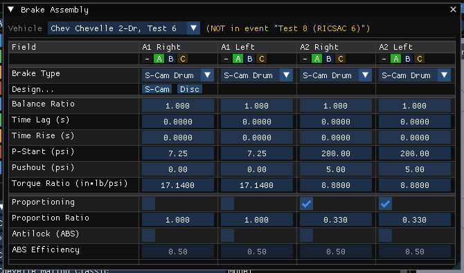

# Brake Assembly Dialog Box

The Brake Assembly properties of the wheels are displayed and edited using the **Brake Assembly** dialog. Open it in the Vehicle Editor (**Vehicle (F3)**) with **Vehicle › Brakes › Brake Assembly...**, or with **Brakes...** › **Brake Assembly...** under **Components** in the Vehicles panel. The **Vehicle** list at the top selects the vehicle.

Where HVE edits one wheel at a time, HVE 2027 shows a table with one column per wheel (**A1 Right**, **A1 Left**, **A2 Right**, ...). Pressures and torque ratios are shown in the units set in Preferences. Values take effect as they are typed; while results are on screen the vehicle is locked.

This dialog contains the following parameters.

## Link Group

Four small buttons per wheel: **-**, **A**, **B** and **C**. Wheels in the same group share their values: an edit in one column is copied to every other wheel in the group, and moving a wheel into a group that already has a member copies that member's values to it. **By default every wheel is in group A**, so an edit applies to all wheels until wheels are moved to other groups or to **-**. This replaces HVE's *Copy to Other Side* and *Copy to Other Axles*.

## Brake Type & Design

### Brake Type
HVE's brake type for each wheel, listed with HVE's own labels: **Generic Brake**, **Disc Brake**, **Duo-Servo Brake**, **Duplex Brake**, **Single Piston, Leading/Trailing Shoe**, **Dual Piston, 2 Leading Shoes**, **S-Cam**, **Single Wedge**, **Dual Wedge** or **Air Disc Brake** (shortened in the table cell, for example *1-Piston*). It is the same setting as the **Brake Design** list of the [Brake Designer](DiskBreakDlg.md).

- **Generic**: the **Pushout** and **Torque Ratio** below are what the engine brakes with, as you enter them.
- **A design**: choosing it computes the Pushout and Torque Ratio from the wheel's design (as HVE does on the same change), and they are shown read-only. Edit the design with **Design...**.

### Design...
One button per wheel. It opens the **Brake Designer** on that wheel, in its design. It is greyed for a Generic wheel, which has nothing to design.

### Temperature Model
Shown, not edited: **Drum** or **Disc**, which brake temperature model the engines run. A design sets it; a Generic wheel keeps the case's. The engines take **one per axle, from the right wheel**, and a note says so when the right and left wheels of an axle differ (HVE warns about this too). The brake temperature channels read *(no thermal data)* either way: the model needs data no case states.

## Actuation

### Balance Ratio (unused)
Shown greyed: it is not one of HVE's brake fields and no engine reads it. The ratios that set brake torque are **Torque Ratio** and, with proportioning on, **Proportion Ratio**.

### Time Lag (s)
Time required before the driver's brake pedal inputs reach the wheel.

### Time Rise (s)
Time required for the brake system pressure at the wheel to begin causing the maximum brake torque as specified by the Brake Torque Ratio.

### P-Start
Proportioning starting pressure: beginning at this level of system pressure, any additional master cylinder pressure is reduced (when Proportioning is on).

### Pushout
Brake system pressure required to begin causing brake torque (any system pressure below this point is simply taking out the slack in the system).

### Torque Ratio
Wheel brake torque per unit of system pressure at the wheel. The actual braking torque at the wheel is the product of the current wheel system pressure and the Brake Torque Ratio. **Apply to Wheel** in the Brake Designer writes the designed Torque Ratio and Pushout here.

## Options

### Proportioning
Check if the system pressure at the wheel is reduced by a proportioning value.

### Proportion Ratio
At master cylinder pressure above P-Start, additional pressure is reduced by this ratio: the wheel sees P-Start + (P − P-Start) × ratio. A ratio of 1.0 reduces nothing, and a note says so when Proportioning is on at 1.0 (HVE's own cases use 0.16 to 0.33). A ratio of **0** is valid: it caps the wheel pressure at P-Start.

### Antilock (ABS)
Check if the wheel has an anti-lock device. Checking it enables ABS Efficiency. EDSVS and EDVTS use it wheel by wheel. SIMON regulates **every** wheel once any wheel's box is checked, or once the vehicle's **ABS Installed** is (**Vehicle › Brakes › ABS / Brake Design... › ABS System...**); the dialog says so under the table. EDVDS has no ABS model.

### ABS Efficiency
The ability of the anti-lock system to achieve and hold the wheel at its peak frictional force, even if the driver braking input exceeds the available frictional force (0 to 1). A 100% effective anti-lock system maintains a longitudinal wheel force associated with the peak coefficient of friction. A 0% effective system maintains a longitudinal wheel force associated with the slide coefficient of friction. A 50% effective system would maintain a longitudinal force halfway between that associated with peak and slide friction.

The detailed per-wheel ABS data (HVE's **ABS Designer...** button) are in **Vehicle › Brakes › ABS / Brake Design... › ABS Designer...**.

!!! warning "Not in HVE 2027"
    - The rule that enables the antilock controls only when **ABS Installed** is checked: they are always enabled. ABS Installed is in **Vehicle › Brakes › ABS / Brake Design... › ABS System...** (see [Brake System Pressure vs Pedal Force](BrkSysVsPedFrcDlg.md)).

!!! tip "New in HVE 2027"
    All wheels in one table, Link Groups, the Temperature Model row, and the note on a proportioning ratio of 1.0.

!!! note "Changed in HVE 2027 2026-10-09"
    The **S-Cam Brake** and **Disc Brake** tables are no longer opened from here: they were offered for every brake at once. The one that matches a wheel's type is in the Brake Designer, for that wheel, as **Drum data slots** or **Disc data slots**. Those values reach no engine output.

<!-- NAV -->

---

← Previous: [Brakes & Powertrain](README.md)  |  [Index](README.md)  |  Next: [Brake Designer Material Properties Dialog Box](BrkMatPropDlg.md) →

<!-- /NAV -->
