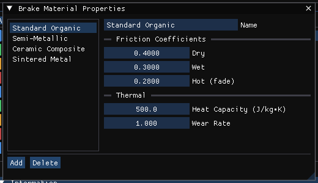

# Brake Designer Material Properties Dialog Box

In HVE this dialog displays the material properties used by the Brake Designer for thermal calculations, and is opened by the **Material ...** button of any Brake Designer dialog. In HVE 2027 the same properties are the **Material Properties** section of the **Brake Designer** dialog (**Vehicle › Brake Designer...**; click the section heading to expand it). The section is shown for every brake design except Generic. The properties are divided into two groups: Drum / Rotor and Lining / Pad.

## Drum / Rotor

**Density**
Density of rotor or drum material (used for calculating the mass of the rotor or drum). Shown in the units set in Preferences.

**Specific Heat (J/kg·K)**
Change in enthalpy of the brake rotor or drum material with respect to temperature at constant pressure.

**Conduction (W/m·K)**
Energy transfer coefficient through the brake rotor or drum material.

**Convection (W/m²·K)**
Static convective energy transfer coefficient between the brake rotor or drum surface and adjacent air.

**Convection Vel. Dep.**
Velocity-dependent energy transfer coefficient between the brake rotor or drum surface and adjacent air (i.e., this coefficient is multiplied by vehicle linear velocity to determine the convection rate).

## Lining / Pad

**Density**, **Specific Heat (J/kg·K)**, **Conduction (W/m·K)**, **Convection (W/m²·K)**, **Convection Vel. Dep.**
The same five properties for the brake lining or pad material.

!!! warning "Not in HVE 2027"
    - Only Density follows the Preferences units. Specific heat, conduction and convection are always entered in the SI units shown in their labels, where HVE uses in-lb, hr and °F units.
    - The material properties are kept with the vehicle but do not affect the Brake Designer's results and are not passed to the engines.

## Brake Material Properties (Vehicle menu)

**Vehicle › Brake Material Props...** opens a different window, **Brake Material Properties**, that has no HVE counterpart. It holds a list of named brake friction materials (it starts with Standard Organic, Semi-Metallic, Ceramic Composite and Sintered Metal) with **Name**, **Dry**, **Wet** and **Hot (fade)** friction coefficients, **Heat Capacity (J/kg·K)** and **Wear Rate**, and **Add** and **Delete** buttons.

!!! warning "Not in HVE 2027"
    The Brake Material Properties list is not saved with the case and is not used by the Brake Designer, any other dialog or any engine, so the window is shown greyed and says so. A wheel's brake material is set in **Vehicle › Brake Designer** › *Material Properties*.

<!-- NAV -->

---

← Previous: [Brake Assembly Dialog Box](BrkAsmblyDlg.md)  |  [Index](README.md)  |  Next: [Brake Designer Single Piston Dialog Box](BrkSingPistDlg.md) →

<!-- /NAV -->
