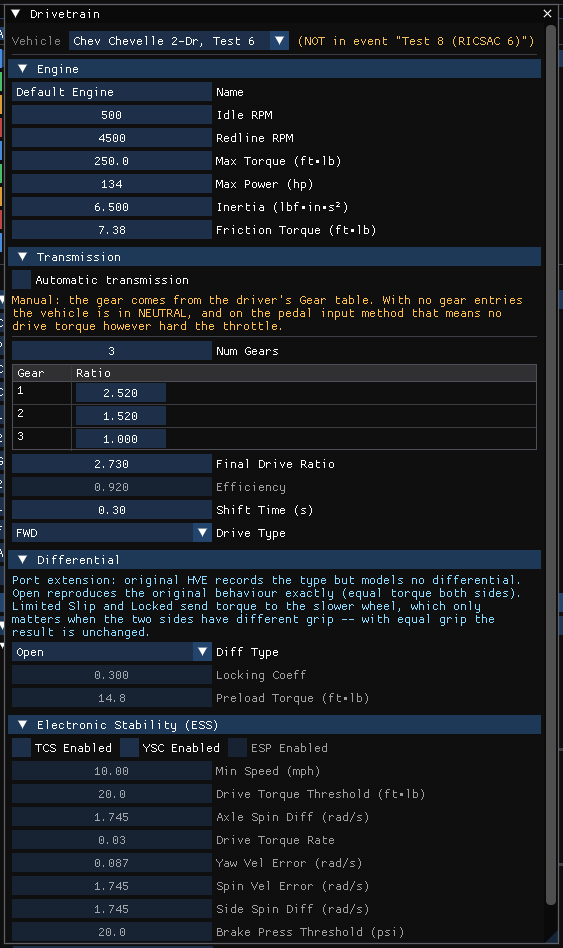

# Drive Train Dialog Box

The drivetrain parameters for the current vehicle are displayed and edited using the **Drivetrain** dialog. Open it in the Vehicle Editor (**Vehicle (F3)**) with **Vehicle › Drivetrain...**. The **Vehicle** list at the top selects the vehicle. The drivetrain is composed of components that HVE edits in separate dialogs and HVE 2027 shows as collapsible sections of one dialog:

- **Engine**
- **Transmission** — see [Transmission Data Dialog Box](TransDataDlg.md)
- **Differential** — see [Differential Data Dialog Box](DiffDataDlg.md)
- **Electronic Stability (ESS)** — HVE's TCS/YSC dialog

Torques and inertias are shown in the units set in Preferences. Values take effect as they are typed.

## Engine

### Name
User-editable description of the engine (drivetrain) for the current vehicle.

### Idle RPM
Idle speed of the engine.

### Redline RPM, Max Torque
Used only for a vehicle that has **no engine table**: HVE 2027 then builds a simple three-point wide-open-throttle table from the idle speed, the redline and the maximum torque. A vehicle read from an HVE file carries HVE's own engine tables, which are used instead.

### Max Power
Stored with the vehicle. No engine reads it.

### Inertia
Rotational inertia of the drivetrain components (HVE's *Drivetrain Inertia*).

### Friction Torque
Used only for a vehicle that has **no closed-throttle table**: the closed-throttle (engine braking) torque is then this constant value at every speed.

### Engine Tables
HVE's engine tables, one for each **Throttle Position**:

- **Throttle Position** — **Wide Open** or **Closed**: which of the two tables the grid shows.
- The grid — one row per point: **Speed (RPM)**, **Torque** (in the torque units set in Preferences) and **Power** (hp or kW). Speed and torque are edited; **Power** is shown greyed and follows torque × speed, because no engine reads it (SIMON, EDVSM and EDVDS read the speed and torque columns only). **X** deletes a row, **Add Row** appends one (up to 15, HVE's limit).

A table needs at least two rows to be used; with fewer, the engines get the stand-in described under Redline RPM / Max Torque (wide open) or Friction Torque (closed), and a note under the grid says which applies. Speeds must increase down the table (the engines interpolate torque on engine speed); an orange note says so when they do not. The tables act only on the **Pedal** input method in Driver Controls: the %-friction method takes drive torque from tire friction and reads no engine curve.

The tables of a vehicle read from an HVE vehicle or case are imported as HVE stores them.

## Transmission, Differential

See [Transmission Data Dialog Box](TransDataDlg.md) and [Differential Data Dialog Box](DiffDataDlg.md).

## Electronic Stability (ESS)

HVE's TCS/YSC dialog. SIMON implements traction control (TCS) and yaw stability control (YSC).

### TCS Enabled, YSC Enabled
Whether traction control and yaw stability control are installed. **ESP Enabled** is shown greyed: no engine reads it.

### Min Speed
Below this speed the systems stay inactive (enabled when TCS or YSC is on).

### Drive Torque Threshold, Axle Spin Diff (rad/s), Drive Torque Rate
TCS thresholds and rate (enabled when TCS is on): TCS engages above the drive torque threshold; the rate is the torque removed per unit of spin error.

### Yaw Vel Error (rad/s), Spin Vel Error (rad/s), Side Spin Diff (rad/s), Brake Press Threshold, Brake Press Rate
YSC thresholds and rate (enabled when YSC is on); the rate is the brake pressure applied per unit of yaw error.

With **View › Show Guidance Text** on, an orange note in the section states the conditions under which these systems act: they require **Driver Controls › Input Method = Pedal** (TCS runs only when the throttle is driven by the driver model and YSC only when the brake is); TCS rebalances torque between drive axles, so it needs more than one; and YSC's pressure branch acts only while the driver is already braking. Both rates default to 0: if TCS or YSC is enabled with its rate at 0, an orange warning says that the system will report itself active and change nothing.

!!! warning "Not in HVE 2027"
    - The engine chart, **Apply** and **Print...**. (The engine tables themselves are edited in the grid above; the **Power** column cannot be edited, because no engine reads it.)
    - **Transmission...**, **Differential...** and **TCS/YSC...** buttons (the sections are in this dialog).

!!! tip "New in HVE 2027"
    Redline RPM, Max Torque and Friction Torque, which give a vehicle without engine tables a usable engine.

<!-- NAV -->

---

← Previous: [Disk Brake Dialog Box](DiskBreakDlg.md)  |  [Index](README.md)  |  Next: [Dual Piston Brake Dialog Box](DualPistBrkDlg.md) →

<!-- /NAV -->
