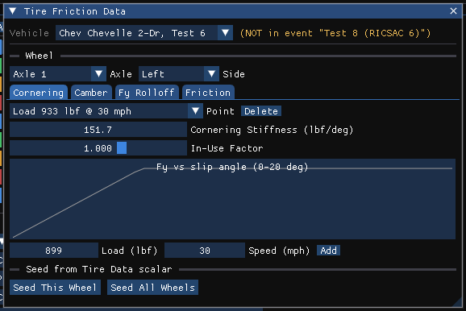

# Tire Friction Data Dialog

The tire friction table for one wheel position: friction parameters stored at a
set of test loads and road speeds, interpolated by the physics at run time.

!!! note "HVE 2027"
    Open it in the Vehicle editor (F3) with **Vehicle › Tire Tables...**. The
    window is titled **Tire Friction Data** and holds HVE's four tire-table
    dialogs as tabs: **Cornering** (Fy vs slip angle), **Camber**
    ([Fy vs inclination angle](FyVsInclAngDlg.md)), **Fy Rolloff**
    ([slip vs roll-off](SlipVsRollOffDlg.md)) and **Friction** (this page).
    Loads and speeds are shown in the units set in Tools › Preferences.

While a solved run is on screen the window is read-only; reset the run to edit
it.

## Wheel

**Axle** and **Side** choose the wheel whose tables are shown, on every tab.

!!! note "HVE 2027"
    **Right** is listed first because the calculation models number the right
    wheel (+y) first; it is the column headed **Right** in the Tire Properties
    table.

## Table Point (load / speed)

Each row of HVE's table is one **point**: a load and a speed with its own set of
friction parameters. **Point** lists them as "Load … @ …" in load-then-speed
order; select one to edit it. **Delete** removes the selected point.

To add a point, enter its **Load** and **Speed** and press **Add**. The new
point is seeded from the wheel's scalar friction values (Tire Properties) and
inserted in order. With no points at all the physics uses those scalar values.

!!! note "HVE 2027"
    HVE limits the table to 3 loads × 3 speeds and adds, deletes or edits a
    whole load or speed at a time. HVE 2027 keeps a list of individual
    load/speed points instead; an existing point's load or speed cannot be
    edited — delete it and add it again.

## Seed from Tire Data scalars

Builds a realistic table from the scalar values in one step. **Seed This
Wheel** replaces the selected wheel's table; **Seed All Wheels** does every
wheel of the vehicle. The table gets three load rows at one half, one and one
and a half times the vehicle's nominal wheel load (the rows are listed beside
the buttons); with **Include a speed axis (0 / 30 / 60 mph)** checked it also
gets three speed columns. The buttons are disabled until the vehicle has a mass.

!!! tip "New in HVE 2027"
    HVE has no seeding. Every vehicle in EDC's reference cases carries three load
    rows, and a single point claims friction is independent of load and speed.
    SIMON interpolates both axes; EDSMAC and EDSMAC4 read the middle load row and
    reduce speed to a single slope, so for them a speed axis changes the answer
    and the load axis does not.

## Friction Values

For the selected point:

**Peak Long. Friction** — Maximum value of Fx/Fz at the
given load and speed.

**Peak Lat. Friction** — Maximum value of Fy/Fz at the
given load and speed.

**Slide Friction** — Value of Fx/Fz at 100 percent
longitudinal slip. It is held at or below Peak Long. Friction.

**Slip at Peak** — Longitudinal slip at which the peak longitudinal friction is
reached.

**Long. Stiffness** — Slope of the Friction vs. Slip curve at the origin, as a
force per unit slip.

**In-Use Factor** — Multiplier for the dependent values (peak and slide
friction, longitudinal stiffness).

!!! note "HVE 2027"
    In HVE the In-Use Factor applies to the whole table. In HVE 2027 it is
    stored with each point.

## Friction vs. Longitudinal Slip

A preview of friction against longitudinal slip for the selected point, with the
In-Use Factor applied: a rise to the peak at the slip at peak, then a straight
fall to the slide value at full slip. It redraws as you edit; there is no Apply
button. It shows the longitudinal curve only.

!!! warning "Not in HVE 2027"
    **Print...** (use a screen capture), **Apply** (the preview is live) and
    **OK / Cancel** (edits apply immediately; **Edit › Undo**, Ctrl+Z, takes one
    back).

## Cornering tab

HVE's *Fy vs Slip Angle* dialog. Cornering stiffness is stored per
load/speed point, in the same way as the friction table: choose a **Point**,
edit its **Cornering Stiffness** and **In-Use Factor**, add points with
**Load**, **Speed** and **Add**, or remove one with **Delete**. A new point
starts at the wheel's scalar Cornering Stiffness. **Seed This Wheel** / **Seed
All Wheels** create three load rows from the scalar.

With no points, most engines use the scalar Cornering Stiffness from Tire
Properties. EDVSM needs three load rows; it fits its stiffness-vs-load curve
over them and seeds them itself at run time if the case has fewer.

The plot shows Fy against slip angle from 0 to 20 degrees: linear at
the stiffness, limited at Peak Lat. Friction times the point's load.

!!! warning "Not in HVE 2027"
    HVE's table of slip angle vs Fy points for each load/speed is
    not available; each point carries its stiffness only.

<!-- NAV -->

---

← Previous: [Slip vs Roll-Off Dialog](SlipVsRollOffDlg.md)  |  [Index](README.md)  |  Next: [Tire Information Dialog](TireInfoDlg.md) →

<!-- /NAV -->
