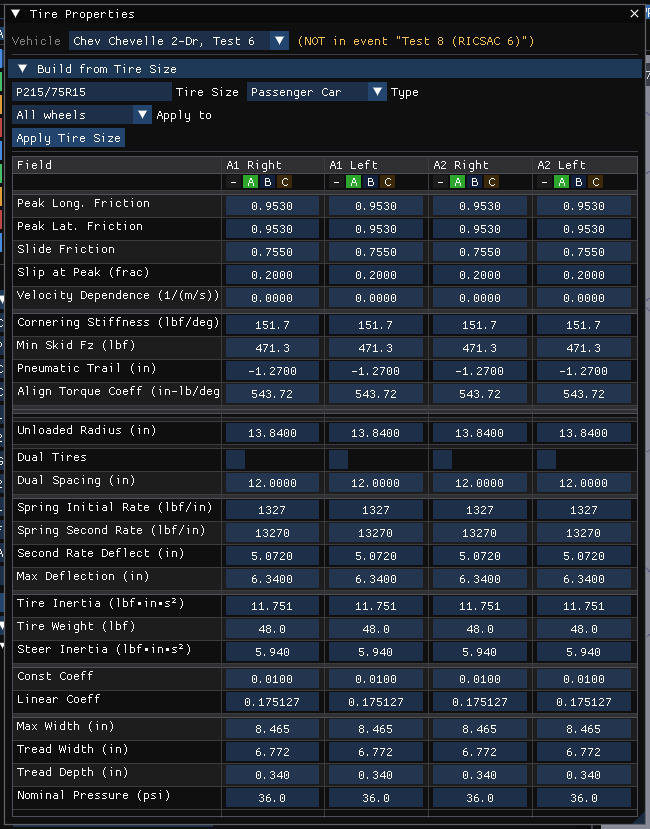

# Tire Physical Data Dialog

In HVE the Tire Physical Data dialog edits one tire's physical parameters. In
HVE 2027 the same parameters are rows of the **Tire Properties** table (Vehicle
editor, **Vehicle › Tire Data (Detailed)...**), with one column per wheel, so
every wheel of the vehicle is visible and editable at once. Each value is a
drag field: drag it, or double-click (Ctrl+click) and type. Values follow the
units set in Tools › Preferences; the unit is shown in each row label.

!!! note "HVE 2027"
    Columns that share a link group (the **– A B C** buttons at the top of the
    table) change together. See [Tire Information](TireInfoDlg.md) for the link
    groups and the **Build from Tire Size** section, which fills the radius,
    widths, tread depth and pressure from a size designation.

The rows, in table order:

## Friction rows

These are the tire's scalar friction values. They are used when the tire has no
load/speed friction table of its own (see [Tire Friction Data](TireFrictDataDlg.md)),
and they seed the table when one is created there.

- **Peak Long. Friction** — maximum Fx/Fz.
- **Peak Lat. Friction** — maximum Fy/Fz.
- **Slide Friction** — Fx/Fz at 100 percent longitudinal slip.
- **Slip at Peak (frac)** — longitudinal slip at which the peak occurs.

**Velocity Dependence** — the change in friction per unit speed (s/in or s/m).
It is the field of HVE's 2-D Tire Data dialog, and as in HVE a non-zero value
is turned into a second speed column of the friction table, moving peak and
slide friction together; HVE 2027 does this when the event is run. It is
greyed for a wheel whose friction table already has two or more speeds.

## Cornering Stiffness

Slope of the Fy vs slip-angle curve at zero slip, entered per degree
in US units. It is used when the tire has no cornering table, and seeds one
when it is created.

Camber stiffness has no scalar field: it exists only as the load × speed table
on the **Camber** tab of the Tire Friction Data window.

## Min Skid Fz

Minimum vertical tire force required to leave a visible tire mark on the road.

## Pneumatic Trail

Longitudinal distance from the center of the tire contact patch to the center of
pressure. Pneumatic trail increases the self-aligning tendency of a steerable
wheel. The value is signed; HVE's own vehicle data usually carry a negative
trail, and it is kept with its sign.

## Align Torque Coeff

Self-aligning torque coefficient due to mechanical and pneumatic trail.

## Unloaded Radius

Undeflected tire radius (no-load condition).

## Static Deflection

Shown read-only. It is not an input:
as in HVE, the static deflection is computed from the wheel's share of the
vehicle weight and the initial deflection rate.

## Dual Tires / Dual Spacing

See [Tire Information](TireInfoDlg.md).

## Spring Initial Rate

The initial tire spring rate (vertical tire load per unit of tire deflection).
HVE's *Initial Deflection Rate*.

## Spring Second Rate

The spring rate under conditions of excessive tire vertical load. HVE's
*Secondary Deflection Rate*.

## Second Rate Deflect

Tire deflection at which the secondary rate begins. HVE's *Deflection at
Secondary Rate*.

## Max Deflection

Tire maximum deflection. This value is normally used to terminate execution,
indicating the probability of a damaged or broken wheel rim.

## Tire Inertia

Tire rotational inertia about its spin axis. HVE's *Spin Inertia*.

## Tire Weight

Total weight of the wheel assembly (tire plus rim). For an independent
suspension, the value reflects the total unsprung mass. For a solid axle
suspension system, the axle weight is added to the wheel weight to determine
unsprung mass.

## Steer Inertia

Tire rotational inertia about its steering axis.

## Rolling Resistance: Const Coeff

Tire rolling resistance constant force coefficient (a fraction of the vertical
load).

## Rolling Resistance: Linear Coeff

Tire rolling resistance linear, velocity-dependent force coefficient.

## Max Width

Maximum section width of the tire. Filled by **Build from Tire Size**; editable.

## Tread Width

Width of the tire tread.

## Tread Depth

Depth of the tire tread.

## Nominal Pressure

Nominal (rated) inflation pressure of the tire.

!!! note "HVE 2027"
    Each value is clamped to the range set for it in **Tools › Limits Editor**
    as you edit it, instead of being range-checked when the dialog is closed.
    There is no OK/Cancel: edits apply immediately, and **Edit › Undo** (Ctrl+Z)
    takes one back.

<!-- NAV -->

---

← Previous: [Tire Information Dialog](TireInfoDlg.md)  |  [Index](README.md)  |  Next: [Tire Save As Dialog](TireSaveAsDlg.md) →

<!-- /NAV -->
