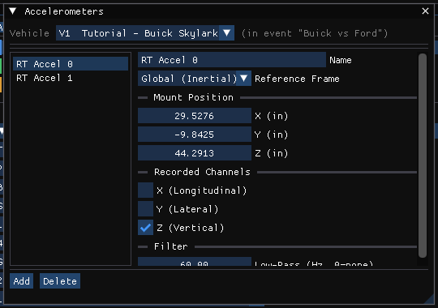

# Accelerometers Dialog

Accelerometers are points on the vehicle at which the simulation reports
velocity and acceleration. HVE assigns up to five per vehicle, in event mode.

!!! note "HVE 2027"
    Open the **Accelerometers** window from **Vehicle › Accelerometers...** in the
    Vehicle editor (F3), or **Event › Accelerometers...** in the Event editor
    (F5; available for the dynamic calculation methods). Both open the same
    window. Accelerometers are mounted on the **vehicle**, so they apply to
    every event the vehicle appears in; the window warns when the vehicle shown
    is not in the active event. Coordinates follow the units set
    in Tools › Preferences. While a solved run is on screen the window is
    read-only.

## Accelerometer list

The list on the left holds the vehicle's accelerometers by name; select one to
edit it. This replaces HVE's **Location No.** list.

**Add** creates a new accelerometer ("Accel 1", "Accel 2", …) and **Delete**
removes the selected one. An accelerometer in the list is in use; there is no
separate **Device In Use** check box.

!!! warning "Five reach the engine"
    The physics programs accept five accelerometers per vehicle. The list may
    hold more, but only the first five are passed to the run.

## Name

A name for the accelerometer, used in the list.

## Mount Position X / Y / Z

Coordinates of the accelerometer relative to the vehicle CG: X forward,
Y right, **Z up**.

!!! note "HVE 2027"
    HVE's vehicle-fixed z axis points down; this dialog's Z is measured
    **upward** from the CG and is converted to HVE's frame for the run. A point
    above the CG has a positive Z here.

## Reference Frame, Recorded Channels, Filter

!!! tip "New in HVE 2027"
    **Reference Frame** (Vehicle Body or Global (Inertial)), **Recorded
    Channels** (X (Longitudinal), Y (Lateral), Z (Vertical)) and **Low-Pass (Hz,
    0=none)** are stored with the accelerometer, but no physics program or
    output reads them yet: every accelerometer is passed to the run with its
    position only.

!!! warning "Not in HVE 2027"
    - **Device In Use**: an accelerometer in the list is in use.
    - Accelerometer locations stored in an HVE case (`.hve`) are not imported;
      add them here.
    - The Z field is not made read-only for calculation methods that do not
      compute 3-D position and velocity.

<!-- NAV -->

---

← Previous: [Safety Systems](README.md)  |  [Index](README.md)  |  Next: [Air Bag Restraints Dialog Box](AirBagDlg.md) →

<!-- /NAV -->
