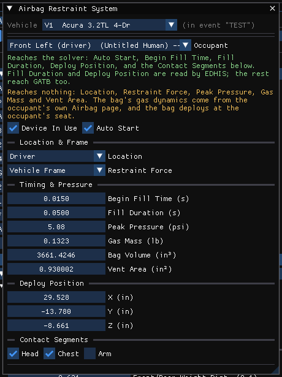

# Airbag Restraint System Dialog Box

In HVE the Airbag Restraint System dialog places an installed airbag in use for
an occupant in the event, selects the body ellipsoids that may contact it, and
sets when it deploys.

!!! note "HVE 2027"
    Open the **Airbag Restraint System** window from **Vehicle › Airbag
    Restraint...** in the Vehicle editor (F3), or **Event › Restraints... ›
    Airbag Restraint...** in the Event editor (F5; available for the dynamic
    calculation methods). The settings are stored with the vehicle, one set per
    occupant, so they apply to every event the vehicle appears in; the window
    warns when the vehicle shown is not in the active event. Lengths follow the
    units set in Tools › Preferences. While a solved run is on screen the window
    is read-only.

    The bag's own properties (volume, gas, vent, membrane, reaction panel) are
    in the occupant's [Airbag Restraints](AirBagDlg.md) window.

!!! warning "When the bag is used"
    A bag is deployed in a run only when the occupant's restraint in that event
    is **Airbag + Belt** — set with **Restraint In Use** in the
    [Belt Restraint System](BeltResSysDlg.md) window or in Event Information.
    **Device In Use** below does not switch the bag on.

## Occupant

HVE's *Airbag Restraints For*. The list names each occupant of the vehicle by
seat and name, followed by the bag location stored for them ("-- Driver bag",
with "(not fitted)" when Device In Use is off). Occupants who ride in this
vehicle in the active event come first; below a separator are pedestrians,
humans not in the event and humans in another vehicle. Selecting an occupant
also selects them in the Occupants panel.

## Device In Use

Marks the bag as fitted. It controls the drawn bag only; see the warning above.

## Auto Start

When checked, deployment is started automatically by the simulation. HVE's
*AutoStart*.

!!! note "HVE 2027"
    HVE disables the two fill-time fields when AutoStart is checked; HVE 2027
    leaves them editable.

## Begin Fill Time (s)

The simulation time at which the airbag begins to fill. Default 0.001 s.

## Fill Duration (s)

The length of time over which the airbag fills, limited to HVE's own range of
0.0001–0.20 s. Default 0.05 s. Read by EDHIS.

## Deploy Position X / Y / Z

The vehicle-fixed coordinates, relative to the CG, from which the bag deploys —
HVE's *Deploy Coords* from the vehicle Air Bag dialog. Read by EDHIS.

## Contact Segments

**Head**, **Chest**, **Arm** — the body segments that may contact the bag (Arm
covers both upper and lower arms on both sides). Only the selected segments
develop contact forces with the bag. With none selected, the run status notes
it.

!!! note "HVE 2027"
    HVE lists every contact ellipsoid of the occupant for individual selection;
    HVE 2027 offers these three groups, each using the segment's first
    ellipsoid.

## Fields that reach no physics program

!!! warning "Stored but not used"
    The window lists these at its top:

    - **Bag Volume** — not used by the physics or the drawing; the bag is drawn
      at the **Full Inflated Volume** of the occupant's Airbag Restraints window,
      the volume the engine inflates it to.
    - **Location** (Driver, Passenger, Side Left, Side Right), **Restraint
      Force** (Vehicle Frame, Ground Frame), **Peak Pressure**, **Gas Mass** and
      **Vent Area** — reach nothing. The bag's gas dynamics come from the
      occupant's Airbag Restraints window, and the bag deploys at the
      occupant's seat.

<!-- NAV -->

---

← Previous: [Air Bag Restraints Dialog Box](AirBagDlg.md)  |  [Index](README.md)  |  Next: [Belt Restraint System Dialog Box](BeltResSysDlg.md) →

<!-- /NAV -->
