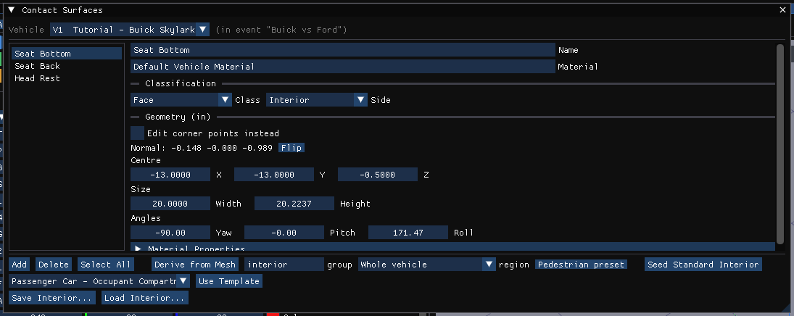

# Material Properties Dialog

The material of a vehicle contact surface: the force–deflection law and friction
used when an occupant or pedestrian strikes that surface.

!!! note "HVE 2027"
    These are the **Material Properties** section of the
    [Contact Surfaces](ContSurfDlg.md) window (Vehicle editor, **Vehicle ›
    Editors › Contact Surfaces...**): select a surface in the list and expand **Material
    Properties**. The material's name is the **Material** field at the top of
    the window. Values follow the units set in Tools › Preferences.

## Force Constant

The force required to initiate deflection. HVE's *Constant*.

## Linear Stiffness

The first-order force–deflection coefficient.

## Quadratic Stiffness

The second-order force–deflection coefficient.

## Cubic Stiffness

The third-order force–deflection coefficient.

## Damping Rate

The velocity-dependent force contribution. HVE's *Damping Constant*.

## Friction

Friction coefficient for the contact surface. HVE's *Friction Constant*.

## Max Force (0=inf)

The maximum (saturation) force the material can develop. 0 means no limit.

## Max Deflection

The deflection at which maximum force is reached. A value of 0 is replaced with
0.25 m for occupant contact; the field notes this.

## Unloading Stiffness

The first-order unloading coefficient, applied beginning at maximum deflection.
HVE's *Unloading Slope*.

## Max Penetration

The penetration beyond which EDHIS computes no contact force for the surface:
deeper than this, the contact is skipped. HVE's dialog lists this value as
*Max Defl / Time Step*. A value of 0 takes Max Deflection, or 0.25 m when that
is 0 as well.

!!! note "Occupant contact"
    For an occupant contact pair imported from an HVE case, EDHIS and GATB use
    the combined occupant–surface material stored with the pair.

!!! warning "Not in HVE 2027"
    - The **force–deflection graph**, **Print** and **Apply**.
    - **New**, **Open...** and **Save As...** of material files (`*.matl`).
      A new surface starts with the default values; the whole set of a
      vehicle's surfaces can be saved and loaded with **Save Interior...** and
      **Load Interior...** in the Contact Surfaces window.
    - **OK / Cancel**: edits apply when a field is left; **Edit › Undo**
      (Ctrl+Z) takes one back.

<!-- NAV -->

---

← Previous: [Lining Friction Properties Dialog](LinFriPropDlg.md)  |  [Index](README.md)  |  Next: [New Ellipsoid Dialog](NewEllpDlg.md) →

<!-- /NAV -->
