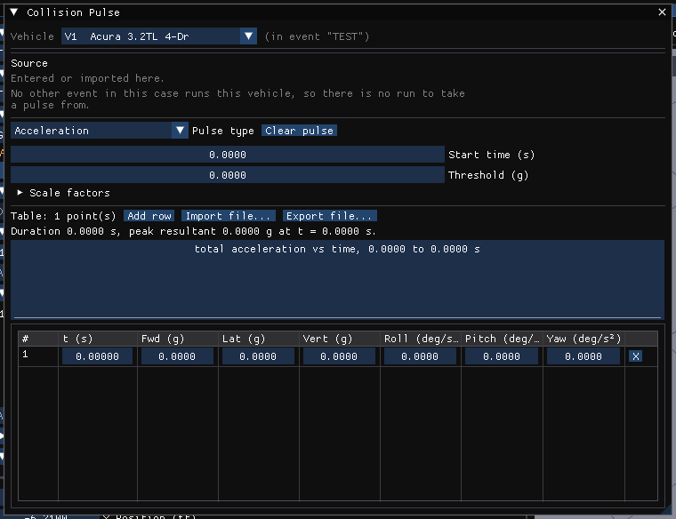

# Collision Pulse

The **Collision Pulse** dialog assigns a collision pulse to a vehicle in the
active event, for use by the occupant simulation models (and, as an impulse
table, by SIMON). Open it from **Event › Collision Pulse...** in the Event
editor (F5); it is enabled for EDCRASH, SIMON, EDHIS and GATB events.

The vehicle header at the top picks one of the event's vehicles; the pulse is
stored per event per vehicle. The dialog is locked while the event's results are
on screen.

With no pulse stated the occupant run still completes, and the occupant
responds to the vehicle's own prescribed motion only; nothing is made up in its
place, and the run status says so.

!!! note "HVE 2027"
    HVE's separate **Options...** and **Factors...** dialogs are part of this
    dialog in HVE 2027: see [Collision Pulse Options](ColPulOptDlg.md) and
    [Collision Pulse In-Use Factors](ColPulFact.md). There is no OK, Cancel or
    Apply; edits take effect immediately.

## Source (Pulse Data Source)

A line says where the current pulse came from: *Generated from event n*,
*Entered or imported here*, or *No pulse stated*.

The drop-down lists every **other** event in the case that includes this
vehicle. **Take pulse from this event** builds the pulse from that event's
solved run: forward and lateral acceleration from the run, and yaw acceleration
from differentiating its yaw rate. Vertical, roll and pitch are left at zero
because the stored run holds none of them. The result is an Acceleration pulse.
If the chosen event has no stored run, the dialog says why it cannot.

## Pulse type

**Position**, **Velocity**, **Acceleration** or **Impulse** (HVE's *Force/Moment*).
**Clear pulse** empties the table.

Which engine reads which type:

- **EDHIS** reads an **Acceleration** pulse only, and refuses another type by
  name.
- **GATB** reads Position, Velocity or Acceleration.
- **SIMON** reads the **Impulse** table only; any other type does not move the
  vehicle.
- No other method reads a collision pulse; the pulse is kept with the case.

The dialog warns when the selected type does not suit the event's method.

!!! note "HVE 2027"
    Changing the type does not discard the table. The table's columns change
    unit with the type: an **Acceleration** pulse is entered in **g** and
    deg/s²; **Position** in the length unit and degrees; **Velocity** per second;
    **Impulse** in the force unit and lbf·in (N·m in SI).

## Start time, Threshold, Impulse centre, Scale factors

See [Collision Pulse Options](ColPulOptDlg.md) and
[Collision Pulse In-Use Factors](ColPulFact.md).

## The table

**Table: n point(s)**, then:

- **Add row** — appends a row 5 ms after the last.
- **Import file...** — reads a text file of 7 numbers a line (time, then the
  six degrees of freedom); lines that are not 7 numbers are skipped and
  counted.
- **Export file...** — writes the table in the same format.

A summary line gives the pulse duration and its peak resultant. A graph of the
resultant draws straight lines between the stated points.

**For a GATB event the graph is not always what the engine applies.** GATB
does not join the rows with straight lines: ATB fits a cubic spline through
them and drives the vehicle with the fit (HVE's GATB does the same). A spline
through sparse rows rings between them, and past the last row ATB
*extrapolates* the last piece of the fit rather than holding the last value.
So a table that stops before the end of the run, or has a long gap after a
sharp change, can be applied as something it never says. Measured examples:

- a 2 ms half-sine of 10 g that ends at 0.1 s, in a 0.5 s run, is applied as
  -2952 g at 0.5 s;
- five rows (0, then -2 g from 10 to 100 ms, then 0 at 110 and 500 ms) are
  applied as +75 g at 0.358 s.

When that happens the dialog says so in orange, naming the column, the
instant, the value and how far it leaves the vehicle off the table's speed. It
also offers **Resample onto ATB's grid**, which rewrites the table as these
straight lines at every instant ATB tabulates, out to the end of the run, so
that what runs is what is plotted. The run's status says the same before its
peaks: *COLLISION PULSE NOT AS STATED*. A short spike that changes the
vehicle's speed by less than 1 mph, or a rotation rate by less than 10 deg/s,
is not reported: HVE's own EDHIS tutorial pulse has such a spike in its yaw
column. EDHIS interpolates its table in straight lines, so for an EDHIS event
the graph is what runs.

The grid has one row per time point: **#**, **t (s)**, and the six
degree-of-freedom columns for the selected type; **X** deletes a row.

!!! warning "Not in HVE 2027"
    - **Print...** — there is no print; use **Export file...**.
    - HVE's pulse file types (`.PosPulse`, `.VelPulse`, `.AccPulse`,
      `.ImpPulse`) are not distinguished; one plain text format serves all four
      types.
    - **New** — use **Clear pulse**.

<!-- NAV -->

---

← Previous: [Collision Pulse Options Dialog Box](ColPulOptDlg.md)  |  [Index](README.md)  |  Next: [Common Reports Dialog Box](CommRepDlg.md) →

<!-- /NAV -->
