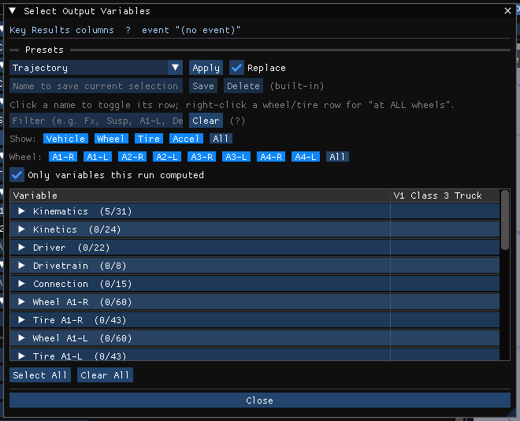

# Selecting Variables

The **Select Output Variables** window chooses the variables shown as columns of
the **Key Results** time table or as traces of the **Output Graph**. Open it with
**Select Variables...** in either of those panels (it then edits that panel's
selection), or from **Output › Variable Selection...** (which edits the Key
Results columns of the active event). A line at the top says which selection is
being edited and for which event; each event keeps its own selections.

The available groups and variables are those of the active event's calculation
method.

## Presets

A drop-down of saved selections, with **Apply** and **Replace** (on: the preset
becomes the whole selection; off: it is added to what is already selected).
Type a name and press **Save** to save the current selection as a preset;
**Delete** removes a saved preset (built-in presets are marked and cannot be
deleted).

## Filter

Type in the filter box to show only matching variables; **Clear** empties it.
It matches the variable name or its group, and HVE's own variable names work
too (for example *Delta*, *Gamma*, *Spin*, *V-tot*). **Select All** / **Clear All**
then apply to just the matching rows.

## Show and Wheel

**Show:** limits the list to the **Vehicle**, **Wheel**, **Tire**, **Accel** or
**Occupant** families (**All** for all). **Wheel:** limits wheel and tire variables to one
position (*A1-R*, *A1-L*, ...; R is the right wheel).

**Only variables this run computed** hides variables that the last run left at
zero, and says how many are hidden.

## Variable list

The variables are grouped (Kinematics, Kinetics, Driver, Drivetrain, Connection,
and one group per wheel and tire, ...). Each group header shows how many of its
variables are selected. There is one check-box column per vehicle in the event,
so a variable is selected per vehicle.

### Occupant variables

After an **EDHIS** or **GATB** run (or any run that moves a human) the list also
carries the occupant's own output, as HVE's human output groups do:

- **Occupant Pelvis** ... **Occupant Left Lower Arm** — one group per body
  segment: position, roll/pitch/yaw, velocity, acceleration, angular velocity
  and acceleration, kinetic energy, plus **Acc Resultant (from Fwd/Lat/Vert)**,
  the resultant of the three acceleration components (EDHIS writes *Acc Tot*
  for its torso only; this resultant is the head acceleration the run's
  occupant peak is taken from).
- **Occupant Joint L5-S1** ... **Occupant Joint Left Elbow** — joint angles,
  moments and forces.
- **Occupant Contacts, Interaction 1-4** — the contact force of each
  interaction, summed over its contact pairs and as its largest single pair.
- **Occupant Belt Right Torso / Left Torso / Right Lap / Left Lap** and
  **Occupant Airbag** — the restraint at the occupant's seat.

The occupants get check-box columns of their own after the vehicles' — **H1**,
**H2**, ... with each human's name — and their columns in Key Results, the
Output Graph and the exported files are labelled *H1* likewise (for example
*Head Acc Tot H1*). Names and units are HVE's own (accelerations in g,
segment velocities in in/s or km/h, positions in in or cm). A position is
relative to the vehicle for an occupant (*x*, *y*, *z*) and to the earth for an
EDHIS pedestrian (*X*, *Y*, *Z*), as HVE shows them.

A segment or variable the engine does not compute reads **--** (EDHIS moves
three segments — torso, head and legs — so its arms are empty), as does any
instant outside the occupant's run. With **Only variables this run computed**
on, those rows are hidden.

- Click a variable's name to toggle its whole row (every vehicle).
- Right-click a wheel or tire variable for **Select at ALL wheels** / **Clear at
  all wheels**.
- Hover a name for its group and, where it differs, HVE's own name for it.

**Select All** / **Clear All** select or clear every variable shown (when a filter
or family is active they read **Select Shown** / **Clear Shown**). **Clear
Everything** clears the whole selection. **Close** closes the window; the
selection takes effect immediately.

!!! note "HVE 2027"
    HVE selected variables per object, one group at a time, with an **Object
    Name** list, a **Current Group** field and **OK** / **Cancel**. HVE 2027 shows
    every group of every vehicle in one table. There is no separate
    export-only mode: **Output › Export Variables...** writes this same
    selection.

<!-- NAV -->

---

← Previous: [Variable Output: Graph Dialog](VarOutGraphDlg.md)  |  [Index](README.md)

<!-- /NAV -->
