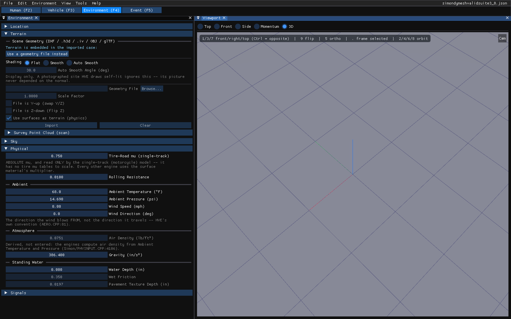
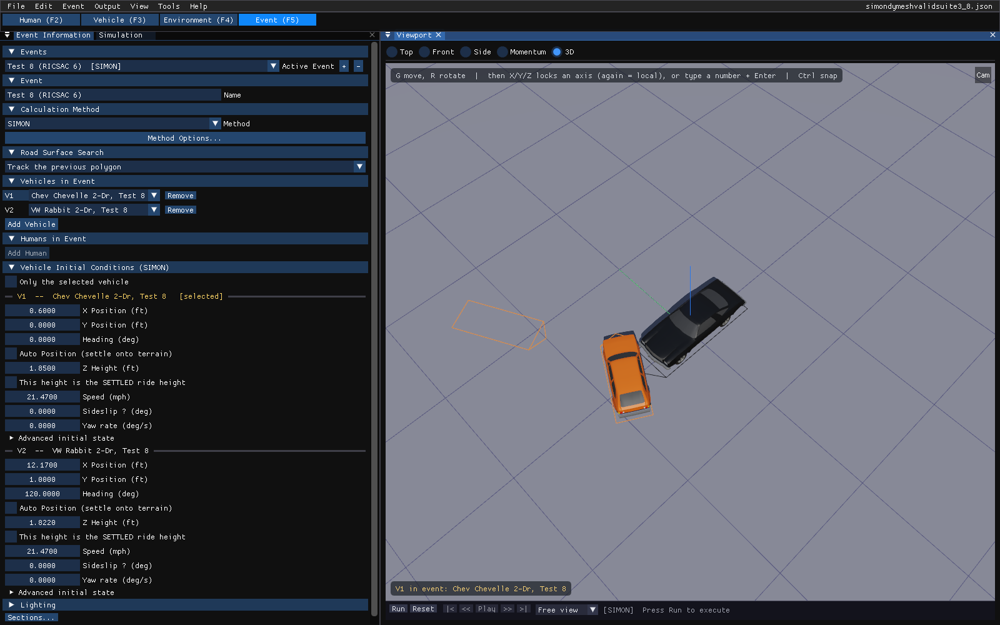

# Chapter 1 — What Is HVE?

*The HVE 2027 edition of the HVE User's Manual (HVE Version 5, Seventh Edition,
January 2006), Chapter 1, pages 1-1 through 1-7.*

## Overview

HVE is a computer environment for studying interactions between humans,
vehicles and their environment. HVE stands for *Human-Vehicle-Environment*, the
three factors which influence a crash. HVE allows the user to create detailed,
3-dimensional models of humans, vehicles and environments, study their
interaction using HVE-compatible reconstruction and simulation models, and to
combine the results of several interactions involving multiple humans and
vehicles into a single coherent sequence.

HVE 2027 keeps this model unchanged. A **case** holds the **humans**, the
**vehicles** and the **environment**, and any number of **events**. An event is
one reconstruction or simulation: it selects humans and vehicles from the case
and a **calculation method** — one of HVE's physics programs — to study their
interaction in the environment. HVE 2027 runs HVE's own physics programs, built
from HVE's source code; what is new is the user interface around them (see
[What is HVE 2027?](../../getting-started/01-what-is-hve-2027.md)).

HVE is essentially five editors: the Human, Vehicle, Environment, Event and
Playback Editors. HVE 2027 has all five as **editor tabs** in one window, and
also plays a single event's results back in the Event editor itself:

| HVE editor | HVE 2027 | Used for |
|---|---|---|
| Human Editor | **Human (F2)** | creating and editing 3-D models of humans |
| Vehicle Editor | **Vehicle (F3)** | creating and editing 3-D models of vehicles |
| Environment Editor | **Environment (F4)** | creating and editing the environment |
| Event Editor | **Event (F5)** | setting up and executing reconstruction and simulation models |
| Playback Editor | **Playback (F6)**; a single event plays back in the Event editor's viewport, with the **Output** menu | reviewing and combining the results of events |

Each editor is described briefly here. For a complete description, refer to the
editor's section in this manual.

## Human Editor

**Human (F2).** The **Occupants** panel lists the case's humans, with **Add
Occupant** and **Remove** — HVE's Add Human and Delete Human — and an occupant
list that plays the part of HVE's Active Humans List and Current Human label.
The selected human's identity and anthropometry (subject type, age group, weight
and height percentiles) are edited in the panel; **Regenerate GEBOD Body** builds
the body from them; and **Injury Tolerances...**,
**Body Segments...**, **Joint Properties...** and **Body Pose...** open the
detailed dialogs. The human is shown in the viewport.

*The Human editor (F2) with the Occupants panel.*

Which vehicle an occupant rides in, and where, is part of the event, not of the
human: it is set in Event Information's **Humans in Event**.

*See also the dialog reference:
[Humans](../../07-humans/README.md), in particular
[Human Information Dialog](../../07-humans/HumanInfoDlg.md), and the
[Occupant menu](../02-menu-reference/04c-vehicle-environment-occupant-menus.md#occupant-menu).*

## Vehicle Editor

**Vehicle (F3).** The **Vehicles** panel lists the case's vehicles, with
**Add...** (from the vehicle databases, or one of HVE's generic vehicles),
**Replace...**, **Dup** and **Del**, and shows the selected vehicle's
information below the list. The **Vehicle** menu opens the detailed dialogs —
suspension, steering, tires, brakes, drivetrain, mesh, contact surfaces and
restraints. The vehicle is shown in the viewport.

*The Vehicle editor (F3).*

*See also: [Vehicles](../../02-vehicles/README.md), in particular
[Vehicle Information Dialog](../../02-vehicles/VehicleInfoDlg.md), and the
[Vehicle menu](../02-menu-reference/04c-vehicle-environment-occupant-menus.md#vehicle-menu).*

## Environment Editor

**Environment (F4).** The **Environment** panel holds the site's location, the
terrain (the site geometry file, a survey point cloud and the surface
materials), the sky, the physical properties and the friction zones. The
**Environment** menu adds an aerial image and simple scene boxes.

*The Environment editor (F4) with the Environment panel.*

!!! warning "Not in HVE 2027"
    HVE's 3-D Editor (launched from the Environment Editor to build geometry from
    boxes, cylinders, cones, spheres and surfaces) is not in HVE 2027. Site
    geometry is imported — from the HVE case itself, or from a DXF, `.h3d`,
    `.iv`, OBJ or glTF file — and the Scene Box Editor adds simple boxes for the
    picture.

*See also: [Environment](../../08-environment/README.md), in particular
[Environment Information Dialog](../../08-environment/EnvtInfoDlg.md).*

## Event Editor

**Event (F5).** The Event editor is used to study (i.e., simulate or
reconstruct) the interactions between any of the case's humans, vehicles and
environment. An event is defined by selecting one or more humans and vehicles
and a calculation method.

The **Event Information** panel holds HVE's Active Event List and Current Event
label (the *Active Event* list), with **+** to add an event and **−** to delete
it; the event's name; its **Calculation Method**; the vehicles and humans in it;
and their initial conditions or measured scene data. The **Event** menu holds the
event set-up dialogs (HVE's Set-up menu). HVE's Event Controller becomes the
**playback bar** under the viewport, with **Run** to execute the event and
**Reset** to return to editing, and the **Simulation** panel, which also holds
the simulation controls.

*The Event editor (F5): Event Information on the left, the viewport and playback
bar on the right.*

!!! note "HVE 2027"
    HVE's Copy Event button has no equivalent; add a new event with **+**.

*See also: [Events & Driver Controls](../../09-events-driver-controls/README.md), in
particular [Event Information Dialog](../../09-events-driver-controls/EventInfo.md),
and the [Event menu](../02-menu-reference/04a-setup-menu.md).*

### Calculation methods

The calculation method of an event selects the physics program that runs it. The
methods HVE 2027 can run are HVE's, plus one new one:

| Method | Kind |
|---|---|
| EDCRASH | reconstruction from damage and scene data |
| EDSMAC | 2-D collision simulation |
| EDSMAC4 | 2-D multi-vehicle collision simulation |
| SIMON | 3-D vehicle simulation, with DyMESH collisions |
| EDSVS | single-vehicle simulation |
| EDVSM | 3-D single-vehicle simulation |
| EDVTS | vehicle-trailer simulation |
| EDVDS | multi-unit (heavy) vehicle simulation |
| EDGEN | path generator for vehicles and humans |
| EDHIS | occupant simulation |
| GATB | articulated occupant and pedestrian simulation (ATB) |
| SINGLETRACK | motorcycle simulation — new in HVE 2027 |
| READDATAFILE | replays a trajectory data file (`.dat`); solves nothing |

The Method list marks a method whose output has not yet been checked against HVE
as *(unvalidated)*, and a method the event's vehicles cannot use as *N/A for
these vehicles*. An HVE event that uses a program HVE 2027 does not recognise
opens and displays but cannot be run. The program manuals
describe each method: see the [program manuals](../../programs/README.md).

## Playback Editor

!!! note "HVE 2027"
    A single event's results play back in the Event editor, with its reports
    on the Output menu. Combining events into one sequence is the
    **Playback (F6)** editor.

- **Trajectory simulations** — once an event has been run, it plays back in the
  Event editor's viewport. The playback bar has **|<** (start), **<<** and
  **>>** (step), **Play**/**Pause** and **>|** (end), a time slider, and the
  camera list.
- **Report windows** — HVE's numeric reports, graphic reports and variable
  output tables are the **Key Results**, **Output Graph** and **Timestep Data**
  panels and the report dialogs on the **Output** menu (Variable Report,
  Accident History Report, HVE Reports, Damage Studio).
- **Playback windows** — combining several events into one sequence, with
  multiple humans and vehicles from any number of events, is the **Playback
  (F6)** editor and its **Playback › Playback Sequence...** panel.

*A solved SIMON event playing back in the Event editor, with Key Results below
the viewport. While results are on screen the event's inputs are locked; Reset
Run to Edit (top left) or Reset (playback bar) unlocks them.*

!!! note "HVE 2027"
    HVE's Playback Window also provided video output. In HVE 2027 that is
    **File › Record Animation**, which records the playback to a video file;
    for a rendered animation, export the scene to Blender (File › Export Scene
    for Blender).

*See also: [Reports & Output](../../11-reports-output/README.md),
[Playback Controls](../../01-user-interface/PlayBackControls.md) and the
[Output menu](../02-menu-reference/04d-output-menu.md).*

<!-- NAV -->

---

← Previous: [Using HVE — High-Level Overview](00-using-hve.md)  |  [Index](README.md)  |  Next: [Chapter 2 — How To Use HVE](02-how-to-use-hve.md) →

<!-- /NAV -->
