# Chapter 2 — How To Use HVE

*The HVE 2027 edition of the HVE User's Manual (HVE Version 5, Seventh Edition,
January 2006), Chapter 2, pages 2-1 through 2-104. Because of its length,
Chapter 2 is split into three parts:*

| Part | Contents |
| --- | --- |
| [Part A (this file)](#getting-started) | Getting Started, the Menu Bar, the editors, Starting a New Case, Creating Humans/Vehicles/Environments, Creating Events, Setting Up Events, Executing Events, Choosing Options |
| [Part B — 02b](02b-how-to-use-hve.md) | Reports and playback, the Playback Controller, combining events, the Audit Log, case files, databases, printing, setting the view |
| [Part C — 02c](02c-how-to-use-hve.md) | User options (Key Results, display switches, units, rendering, simulation controls, playback, calculation options, DyMESH, preferences), getting help, video |

Using HVE 2027 involves the same steps as using HVE:

- Use the **Human** editor (F2) to select and create all the humans involved in
  your study.
- Use the **Vehicle** editor (F3) to select and create all the vehicles involved
  in your study.
- Use the **Environment** editor (F4) to create the environment.
- Use the **Event** editor (F5) to set up and execute reconstruction and
  simulation models which analyze the interactions between the selected humans,
  vehicles and environment, and to play back and report their results.
- Use the **Playback (F6)** editor to combine multiple events into a single
  coherent sequence.

Very often the starting point is an existing HVE case: **File › Open Case...**
reads an HVE `.hve` file directly, with its humans, vehicles, environment and
events, and the event can be run straight away.

## Getting Started

Start HVE 2027 as described in
[Installing and running](../../getting-started/02-installing-and-running.md). The window
opens in the Vehicle editor, with the menu bar, the editor tabs, the Vehicles
panel and the viewport.

*Figure 2-1: HVE 2027, ready to begin, in the Vehicle editor. The editor tabs
under the menu bar select the current editor.*

## HVE Menu Bar

The HVE 2027 menu bar has the following menus:

- **File** — opening, saving and publishing cases; export to Blender
- **Edit** — undo and redo
- **Vehicle**, **Environment**, **Occupant** — the current editor's dialogs
  (Vehicle, Environment and Human editors respectively)
- **Event** — event set-up (HVE's Set-up menu), in the Event editor
- **Output** — reports, graphs, tables, playback and running, in the Event editor
- **Playback** — playback sequences, in the Playback editor
- **View** — panels and what the viewport draws (most of HVE's Options menu
  display switches)
- **Tools** — preferences and units, cameras, the audit log and other tools
- **Help** — License, About HVE 2027

Each menu is described in the [Menu Reference](../02-menu-reference/README.md).

!!! note "HVE 2027"
    HVE's Mode, Set-up, 3-D Edit and Options menus are not on HVE 2027's menu
    bar. Modes are the editor tabs; Set-up is the Event menu; there is no 3-D
    Editor; and the Options items are mapped one by one in
    [Where HVE's Options menu went](../02-menu-reference/06-options-menu.md).

## HVE Modes

HVE's functional design is based on five modes. HVE 2027 has five **editors**,
selected with the tabs under the menu bar or the function keys:

- **Human (F2)** — the Human editor
- **Vehicle (F3)** — the Vehicle editor
- **Environment (F4)** — the Environment editor
- **Event (F5)** — the Event editor, which also plays back results
- **Playback (F6)** — the Playback editor, which combines events into one
  sequence (see [Chapter 1](01-what-is-hve.md#playback-editor))

## Starting A New Case

A *case* is a file holding the humans, vehicles, environment and events of a
study. HVE 2027 opens with an empty case. To work on an existing one, choose
**File › Open Case...** (Ctrl+O): HVE 2027's file browser opens, and lists
HVE 2027 cases (`.hvc`, `.json`) and HVE cases (`.hve`). Double-click a file, or
select it and choose **Open**. **File › Open Recent** lists recent cases.

*Figure 2-2: Open Case uses HVE 2027's file browser.*

**File › New Case** (Ctrl+N) starts a new case at any time; you are asked first
if the open case has unsaved changes.

## Creating Humans, Vehicles and Environments

The first step is to create the humans, vehicles and environment to be studied.

### Creating Humans

Humans are created and edited in the Human editor. To create a human:

1. Choose the **Human (F2)** tab. The **Occupants** panel opens.
2. Choose **Add Occupant**.
3. Choose the human's **Location**: any of nine occupant positions (Front, Rear
   and Back rows; Right, Center, Left) or **Pedestrian**.
4. Choose the **Subject Type**, **Age Group**, **Weight Percentile** and
   **Height Percentile**, and choose **Regenerate GEBOD Body** to build the body
   from them.

The human is now displayed in the viewport. At this point you may edit the
human's properties with the panel's **Body Segments...**, **Joint
Properties...**, **Body Pose...** and other buttons (see the Human Editor
section of this manual and the
[Human Information dialog reference](../../07-humans/HumanInfoDlg.md)). Repeat
for each human in the study.

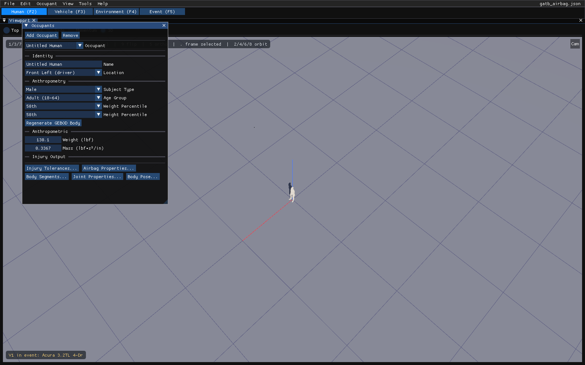
*Figure 2-3: The Human editor and its Occupants panel.*

!!! note "HVE 2027"
    The Location is the seat the occupant nominally occupies. Which vehicle the
    human rides in, and where, is set per event in Event Information's **Humans
    in Event**.

### Creating Vehicles

Vehicles are created and edited in the Vehicle editor. To create a vehicle:

1. Choose the **Vehicle (F3)** tab.
2. In the **Vehicles** panel, choose **Add...**. Search the loaded vehicle
   databases, or choose one of HVE's generic vehicles by type and class.
3. The vehicle's information (name, type, make, model, year, body style,
   number of axles, driver location, engine location, drive axles, colour) is
   shown below the list and can be edited there or in **Vehicle › Vehicle
   Information...**.

The vehicle is now displayed in the viewport. At this point you may edit its
properties with the Vehicle menu (see the Vehicle Editor section of this manual;
see also the [Vehicle Information dialog reference](../../02-vehicles/VehicleInfoDlg.md)).
Repeat for each vehicle; **Dup** copies the selected vehicle and **Del** removes
it.

> **NOTE:** A multi-vehicle train (e.g., a tractor-trailer) is created by
> creating its individual vehicle units, one at a time, in the Vehicle editor.

*Figure 2-4: The Vehicle editor: the Vehicles panel with the selected vehicle's
information, and the vehicle in the viewport.*

### Creating Environments

To create the environment:

1. Choose the **Environment (F4)** tab. The **Environment** panel opens.
2. In **Location**, enter the environment's name, the date and time, and the
   latitude, longitude and elevation (or paste a coordinate, or search an
   address).
3. In **Terrain**, choose the site geometry file (DXF, `.h3d`, `.iv`, OBJ or
   glTF), its scale and axis options, and **Import** it. A case opened from an
   HVE `.hve` file brings its site with it.
4. In **Physical**, enter the ambient temperature and pressure, the wind speed
   and direction, gravity, and any standing water. The air density is derived
   from the temperature and pressure, as the engines do.
5. Use **Environment › Aerial Image...** to lay a photograph over the site.

> **NOTE:** The latitude, longitude, date and time position the sun. The
> direction of north, and the sun and sky themselves, are set in the Shader
> Editor's Sun & Sky panel (View › Shader Editor).

The environment is now displayed in the viewport.

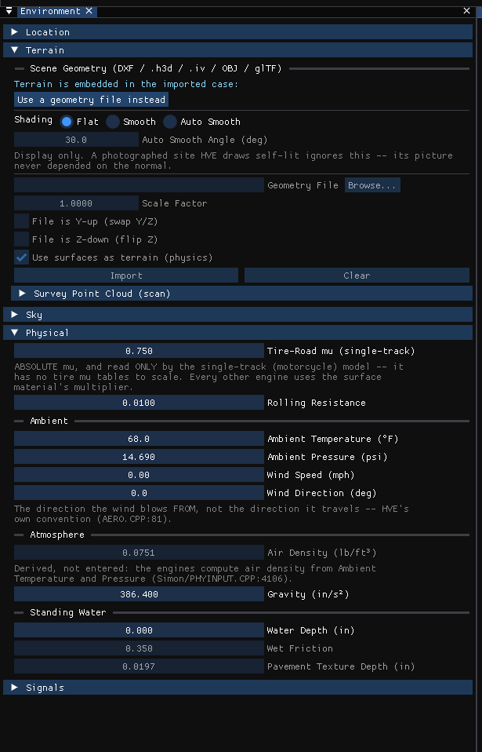
*Figure 2-5: The Environment panel.*

*See also: [Environment Information dialog
reference](../../08-environment/EnvtInfoDlg.md).*

### 3-D Editor

!!! warning "Not in HVE 2027"
    HVE's 3-D Editor — a modelling tool with four viewers and manipulators for
    building and editing environment geometry and its surface friction — is not
    in HVE 2027. Environment geometry is imported, its surfaces' materials are
    set in the Environment panel's **Surface Materials** section and in **View ›
    Outliner**, and **Environment › Scene Box Editor...** adds simple boxes for
    the picture (they are not drivable).

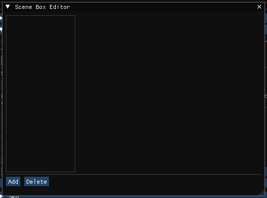
*Figure 2-6: The Scene Box Editor, the only geometry editor in HVE 2027.*

## Creating Events

An HVE event is a single reconstruction or simulation analysis of one or more
humans and vehicles in the current environment. The Event editor is where all
the action (or *interaction*) is. The calculation model is executed in the Event
editor.

To create an event:

1. Choose the **Event (F5)** tab. The **Event Information** panel opens.
2. Choose **+** beside *Active Event* to add an event, and give it a **Name**.
3. Choose the **Calculation Method** (see below).
4. In **Vehicles in Event**, choose **Add Vehicle** and pick the vehicle for each
   slot; in **Humans in Event**, add the humans (for the methods that solve an
   occupant).
5. Choose **Method Options...** to display and edit the method's calculation
   options.

*Figure 2-7: The Event Information panel — events, name, calculation method,
vehicles and humans in the event, and their initial conditions.*

*See also: [Event Information](../../09-events-driver-controls/EventInfo.md)
and the per-model [Calculation Options](../../10-calculation-options/README.md)
references.*

### Choosing A Calculation Model

The choice of calculation models is dependent upon the needs of the study.
Normally, reconstruction models are executed first, because they provide part or
all of the initial conditions required to execute simulations. The methods
HVE 2027 can run are listed in [Chapter 1](01-what-is-hve.md#calculation-methods);
the Method list greys a method the event's vehicles cannot use and says why.

#### Reconstruction Models

According to SAE [6.4], a *reconstruction* is the determination of initial
conditions (usually impact speed) based on post-accident evidence. To execute a
reconstruction program, the user normally supplies (for each vehicle) some or
all of the following information:

- Pre-impact position
- Impact position
- Path positions between impact and rest
- Rest position
- Vehicle damage

> **NOTE:** The actual requirements are dependent on the particular
> reconstruction method.

The reconstruction calculations usually provide some or all of the following
results:

- Initial Velocity
- Velocity at Begin Perception
- Velocity at Begin Reaction
- Velocity at Begin Braking
- Velocity at Impact
- Velocity at Separation
- Final Velocity
- Delta-V during Impact
- Energy absorbed during Impact
- PDOF during Impact

#### Simulation Models

According to SAE [6.4], a *simulation* is the prediction of human or vehicle
paths and damage based on initial conditions (position and velocity). To execute
a simulation program, you will usually supply (for each human and/or vehicle)
some or all of the following information:

- Initial position and velocity
- Driver Controls (for vehicles)
- Collision Pulse (for vehicles)
- Mesh (for vehicles)
- Payload (for vehicles)
- Wheels (for vehicles)
- Accelerometers (for vehicles)
- Restraints (for occupant simulation)
- Contacts (for occupant and pedestrian simulation)

> **NOTE:** The actual requirements are dependent on the particular simulation
> method.

The simulation calculations usually provide some or all of the following results
(reported as a function of time):

- Sprung Mass Kinematics (position, velocity and acceleration)
- Sprung Mass Kinetics (forces)
- Accelerometers (velocity and acceleration)
- Damage (vehicle exterior crush geometry and force)
- Tire Conditions (contact patch location, forces, slip angles, skidding)
- Wheel Conditions (position and orientation, forces and moments at wheels and
  suspensions)
- Connections (articulation angles, forces and moments)
- Driver Controls (throttle, braking, steering and gear selection, HVE Driver
  Path Follower results)
- Contact Surface Data (force, deflection)
- Belt Data (stretch and tension)
- Airbag Data (pressure, radius, force)

#### User-written Reconstruction and Simulation Models

!!! warning "Not in HVE 2027"
    HVE's open architecture for user-written reconstruction and simulation
    models (the HVE Developer's Toolkit) is not supported: HVE 2027 runs the
    methods listed in [Chapter 1](01-what-is-hve.md#calculation-methods) only.

## Setting Up Events

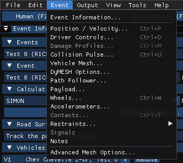
*Figure 2-8: The Event menu holds the event set-up options. Items the event's
calculation method does not use are greyed.*

Events are *set up* after the objects (humans and vehicles) and calculation
method are selected. Event set-up involves the following steps:

1. Assign the required positions and velocities for each object
2. Assign the desired driver controls (throttle, braking, steering and gear
   selection tables for simulations; wheel data for EDCRASH)
3. Assign any damage profile data
4. Assign any payload data
5. Assign any collision pulse
6. Assign any mesh data
7. Assign any wheel data (tire blow-out, wheel damage, brakes, tire-terrain)
8. Assign any accelerometer positions
9. Assign restraints (belt and airbag usage) for occupant simulations
10. Assign contacts for occupant and pedestrian simulation

Event set-up options are on the **Event** menu, which is described item by item,
with the methods each applies to, in
[Chapter 4 of the Menu Reference](../02-menu-reference/04a-setup-menu.md). Most
set-up dialogs act on the **selected vehicle**: click it in the viewport, or
pick it in the dialog's vehicle list.

### Assigning Positions and Velocities

Every simulation or reconstruction model requires positioning of humans and/or
vehicles within the environment. Simulations and some reconstruction models also
require that velocities be entered. Positioning is always the first step during
event set-up.

For a simulation, each vehicle's starting state is in Event Information's
**Vehicle Initial Conditions**: X and Y position, heading, Z height or **Auto
Position** (settle onto the terrain), speed, sideslip and yaw rate, with the
remaining components under *Advanced initial state*. **Event › Position /
Velocity...** edits the initial position and speed in a small dialog of its own.

A vehicle can also be positioned by direct manipulation: click it in the
viewport and drag it, or use the gizmo — drag an arrow to move along that axis
or the rotation handle to turn it; press **G** to move or **R** to rotate,
optionally **X**, **Y** or **Z** to lock an axis, and type a value and **Enter**.
Hold **Ctrl** to snap.

*Figure 2-9: The Position / Velocity dialog.*

> **NOTE:** For occupant simulations, the human is positioned relative to the
> vehicle. Therefore, the vehicle should be positioned first.

HVE allows the user to enter positions and velocities for the following path
locations, and so does HVE 2027:

- Initial Position
- Begin Perception
- Begin Braking
- Impact
- Separation
- Point On Curve
- End Of Rotation
- Final/Rest

For EDCRASH, the impact and rest positions, the impact speed and the measured
damage are entered in Event Information's **Vehicle Impact Setup**. The other
positions are ticked and entered in the vehicle's **Scene positions** list in
Event Information. Simulations *require* only initial positions and velocities;
reconstructions normally *require* impact and rest positions.

*See also: [Position/Velocity dialog
reference](../../09-events-driver-controls/PosVelDlg.md).*

#### Target Positions

Every scene position that is set is drawn in the viewport as a *ghost* of the
vehicle — HVE's target positions — so a simulated path can be compared with the
measured one. **View › Scene Display › Scene Ghosts** chooses outline, translucent vehicle, both
or none. Target positions also guide the path follower: its waypoints are set in
**Event › Path Follower...**.

### Assigning Driver Controls

**Event › Driver Controls...** holds the driver's inputs for the selected vehicle
as tables against time, one page each: **Throttle**, **Brake**, **Steer** and
**Gear** (and **Lean** for a motorcycle). Each table has an input method chosen
on its page — for example the brake as pedal force, wheel force or percent of
available friction. For an EDCRASH event the dialog has a single **Wheel Data**
page instead: the wheel lock-up and steer angles used on the post-impact path.

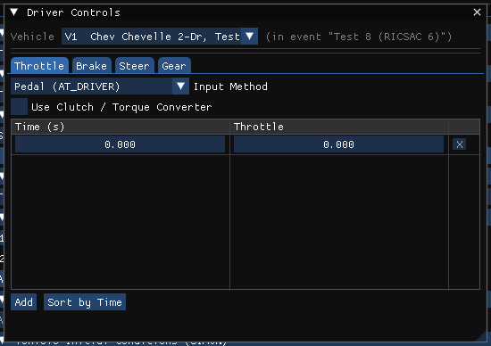
*Figure 2-11: The Driver Controls dialog.*

The HVE Path Follower steers a vehicle along a path through waypoints; in
HVE 2027 it is **Event › Path Follower...**, with pages for the method, steering,
the path, the speed follower and the neuromuscular filter.

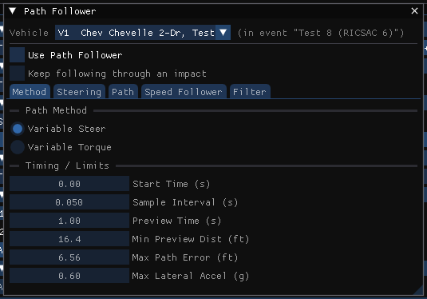
*Figure 2-15: The Path Follower dialog.*

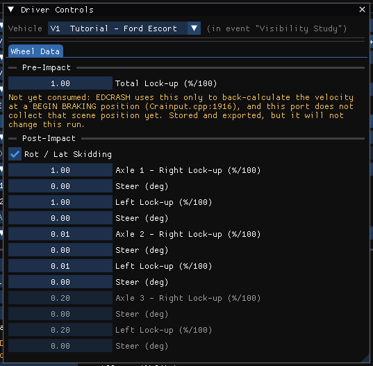
*Figure 2-16: The Wheel Data page, used by EDCRASH.*

HVE's Figures 2-12 to 2-14 showed the individual Brake, Steer and Gear tables;
in HVE 2027 they are the other pages of the same dialog.

*See also: [Driver Controls](../../09-events-driver-controls/DriverControls.md)
and [Event Menu — Driver Controls](../02-menu-reference/04a-setup-menu.md#driver-controls).*

### Assigning a Vehicle Damage Profile

Reconstruction methods use the measured damage of each vehicle. For an EDCRASH
event it is entered in Event Information's **Vehicle Impact Setup**: the **CDC**,
the **PDOF** (or *Auto-calculate PDOF from the other vehicle*), the damage
**basis** (EES or damage profile), and under **Measured Crush** the damage width,
offset and crush depths.

#### Damage Results

The reconstructed Delta-V, PDOF and energy appear in **Key Results** after the
event is run (see [Part C](02c-how-to-use-hve.md#key-results-windows)).

#### Stiffness Coefficients

For an EDCRASH event, the A and B stiffness are entered with the damage in
Vehicle Impact Setup, and per zone in Measured Crush; **Event › Damage
Profiles...** opens that section. The vehicle's own crush stiffness, used by the
simulations — A, B and Kv for each side, and the 3-D node stiffness DyMESH
uses — is a property of the vehicle, entered in **Vehicle › Crush
Stiffness...** in the Vehicle editor.

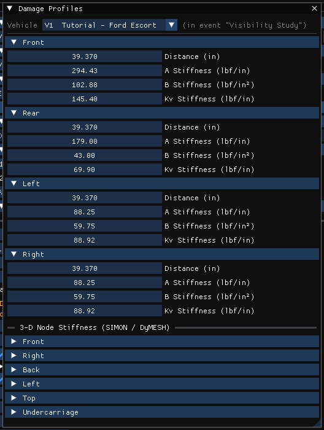
*Figure 2-17: The Crush Stiffness dialog (captured under its earlier title,
Damage Profiles).*

*See also: [Damage Data](../../11-reports-output/DamageData.md) and
[Stiffness Coefficients](../../02-vehicles/StiffCoeffDlg.md).*

### Assigning a Collision Pulse

An occupant simulation is driven by the vehicle's motion, given as a collision
pulse. **Event › Collision Pulse...** (EDCRASH, SIMON, EDHIS and GATB events)
shows and edits the pulse of the selected vehicle.

#### Pulse Data Source

The pulse can be entered or imported with the case, or taken from another event
of the case that runs the same vehicle: choose that event as the source and
**Take pulse from this event**.

#### Pulse Type

The **Pulse type** says how the table is interpreted. **Clear pulse** removes it.

#### Collision Pulse Factors

Under **Scale factors**, each column of the pulse is multiplied by its factor.

#### Collision Pulse Options

**Start time** and **Threshold (g)**, and for the impulse pulse type the
**Impulse centre** (X, Y, Z from the CG), which only that type reads.

The pulse table itself can be edited row by row, and **Import file...** and
**Export file...** read and write it as a text file.

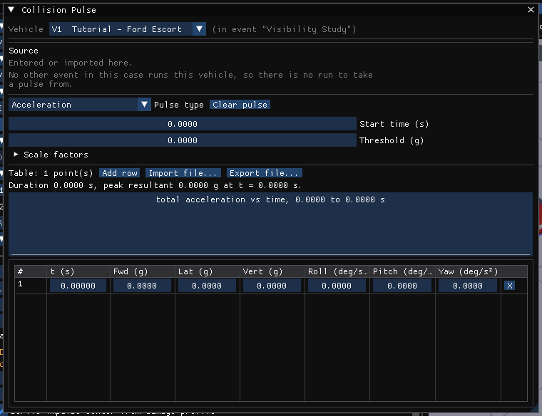
*Figure 2-19: The Collision Pulse dialog.*

### Vehicle Mesh

**Event › Vehicle Mesh...** assigns the vehicle's 3-D body mesh and prepares it
for DyMESH contact (tessellation, maximum side length, vertex weld distance).
The inter-vehicle contact options are in **Event › DyMESH Options...**.

*Figure 2-22: The Vehicle Mesh dialog.*

### Assigning Payloads

**Event › Payload...** (SIMON, EDSMAC4, EDSVS, EDVDS and EDVTS) adds a load to the selected vehicle
for this event: tick **Payload Exists** and enter its weight, CG and rotational
inertia.

*Figure 2-23: The Payload dialog.*

### Wheel Data Options (Set-up, Wheels)

**Event › Wheels...** holds per-wheel conditions for the event, one page per
option, with a column per wheel.

#### HVE Tire Blow-out Model

The **Tire Blowout** page.

#### Wheel Damage Option

The **Wheel Damage** page.

#### Wheel Brake Option

The **Brake** page: initial lining and drum temperatures, initial stroke, brake
failure, and an antilock override.

#### Wheel Tire-Terrain Option

The **Terrain Model** page: point contact, radial spring (with or without
sidewall impact) or soft soil.

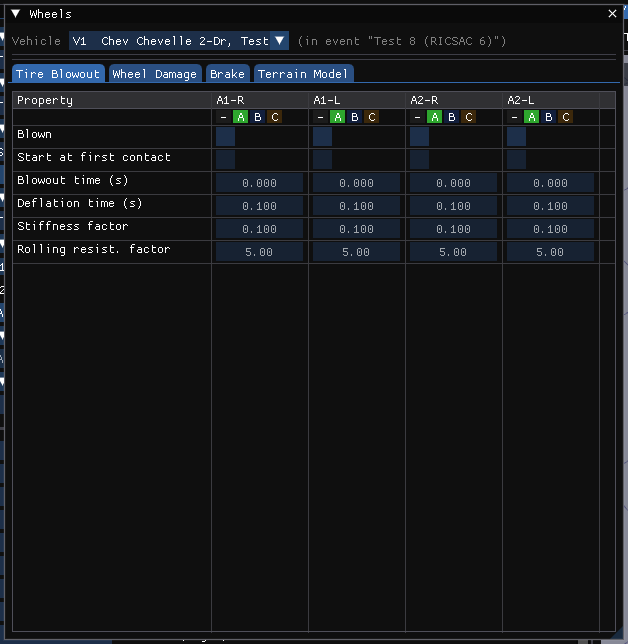
*Figure 2-24: The Wheels dialog.*

### Accelerometers

**Event › Accelerometers...** (or Vehicle › Accelerometers...) places
accelerometers on the vehicle; **View › Scene Display › Accelerometer Path** draws their paths
after a run.

*Figure 2-28: The Accelerometers dialog.*

### Assigning Restraint System Usage

**Event › Restraints... › Airbags...** and **Belt Restraint...** (or the
same items on the Vehicle menu) set up the vehicle's airbags and belts for its
occupants.

*Figure 2-29: The Belt Restraint System dialog.*

### Assigning Contacts

!!! note "HVE 2027"
    For an EDHIS or GATB event, **Event › Contacts...** opens the Occupant
    Contacts dialog: a grid of the human's segments against the vehicle's
    contact surfaces, where a ticked box is an armed pair, and for GATB a
    second grid of body segment against body segment. An imported HVE case
    shows the interactions it states; an event built in HVE 2027 shows the
    default the run generates until it is edited. Combined material properties
    are in Event Information › **Combined Contact Materials**. The vehicle's
    contact surfaces are edited with Vehicle › Contact Surfaces..., and for an
    EDSMAC4 event **Event › Contacts...** lists the surfaces.

## Executing Events

After an event has been set up, it is ready for execution. For simulation models,
this means running the simulation and watching the viewport to study the
interactions between the human(s), vehicle(s) and environment. The goal is to
match the simulated trajectories and damage profiles with the measured
trajectories and damage. For reconstruction models, this means using the
measured path positions and damage profiles to estimate the initial velocities
and velocity changes.

### Event Controller

HVE's Event Controller is replaced by the **playback bar** under the viewport and
the **Simulation** panel:

- **Run** — execute the active event (HVE's Play, the first time). Output ›
  Run Simulation... does the same.
- **Pause** / **Resume** and **Cancel** — while a run is in progress (Pause where
  the method allows it). **Esc** also cancels.
- **Reset** — discard the results and return to editing (HVE's Reset).
- **|<**, **<<**, **Play**/**Pause**, **>>**, **>|** — once the event has run,
  play back from the start, step back and forward by output steps, play, and go
  to the end (HVE's Rewind, Play and Advance To End). A time slider and the
  current time follow.

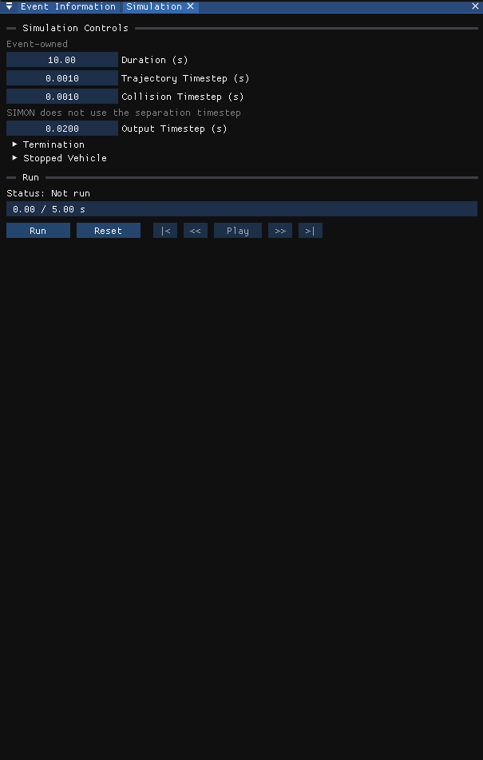
*Figure 2-31: The Simulation panel: the simulation controls, the Run controls and
the last result.*

To execute an event:

1. Choose **Run**. The status shows progress; when the run ends, the event plays
   back in the viewport and Key Results fills in.
2. To change the set-up, choose **Reset** (or **Reset Run to Edit** in Event
   Information), make the changes, and choose **Run** again.

!!! note "HVE 2027"
    While an event's results are on screen its inputs are **locked**: the
    set-up dialogs are greyed and show a banner. In HVE, changes made without
    pressing Reset were silently ignored; HVE 2027 does not let them be made.
    With several events solved, everything a solved event used stays locked
    until that event is reset; the banner says which events.
    Running an event never changes its inputs, and opening a saved case does not
    re-run it.

!!! warning "Not in HVE 2027"
    HVE's **Reverse** button (running the simulation backwards) and the
    calculation-speed control are not available; step back with **<<**, and set
    the playback speed in **Output › Playback Options...**.

## Choosing Options

HVE provided a number of display options on its Options menu. In HVE 2027 they
are switches on the **View** menu:

- **Key Results** — View › Key Results (or Output › Key Results...)
- **Coordinate Axes** — View › Scene Display › Axes
- **Contacts** and **Belt Anchors** — View › Scene Display › Occupant Equipment
- **Velocity Vectors** — View › Scene Display › Vectors › Velocity Vectors
- **Skidmarks** — View › Scene Display › Skidmarks
- **Targets** — View › Scene Display › Scene Ghosts

These options are described in [Part C](02c-how-to-use-hve.md) and in the
[Menu Reference](../02-menu-reference/05-view-menu.md). The complete map of HVE's
Options menu is in
[Where HVE's Options menu went](../02-menu-reference/06-options-menu.md).

*Chapter 2 continues in [Part B](02b-how-to-use-hve.md): Reports and Playback.*

<!-- NAV -->

---

← Previous: [Chapter 1 — What Is HVE?](01-what-is-hve.md)  |  [Index](README.md)  |  Next: [Chapter 2: How To Use HVE — Part B](02b-how-to-use-hve.md) →

<!-- /NAV -->
