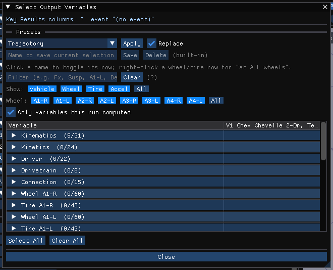

# Chapter 2: How To Use HVE — Part B

*The HVE 2027 edition of the HVE User's Manual, Seventh Edition (Jan 2006),
printed pages 2-40 through 2-69.*

*Part A: [Basic concepts through executing events](02-how-to-use-hve.md) •
Part C: [Selecting User Options, Getting Help, Video](02c-how-to-use-hve.md)*

## Contents (Part B)

- [Creating Report and Playback Windows](#creating-report-and-playback-windows)
- [Creating Case Files](#creating-case-files)
- [Creating Databases](#creating-databases)
- [Printing Results](#printing-results)
- [Setting the View](#setting-the-view)

---

## Creating Report and Playback Windows

In HVE, Playback Mode was used after creating one or more events to prepare
output reports, view trajectory simulations and combine multiple simulation
events into a single, coherent sequence, by creating **Report Windows** and
**Playback Windows**.

!!! note "HVE 2027"
    HVE 2027 has no report or playback windows to create. A single event's
    results are shown in the **Event editor** as soon as it has been run: the
    event plays back in the viewport, and the reports are panels and dialogs on
    the **Output** menu. Combining events is the **Playback (F6)** editor (see
    [Creating a Playback Window](#creating-a-playback-window)).

*Figure 2-32: A solved event playing back in the Event editor, with the Key
Results panel below the viewport.*

### Creating Report Windows

Each kind of HVE report window has an HVE 2027 panel or dialog. All of them show
the **active event** (the one selected in Event Information):

| HVE report window | HVE 2027 |
|---|---|
| Numeric reports (Accident History, Key Results and other numeric output) | **Output › Key Results...**, **Output › HVE Reports...** (Accident History is its ACCIDENT HISTORY page) |
| Graphic reports | **Output › Output Graph...** |
| Variable Output Table | **Output › Key Results...** (its *Trajectory* section), with **Select Variables...** |
| Trajectory Simulation | the Event editor's viewport |
| Damage reports | **Output › Damage Studio Report...** |

### Numeric Outputs

The **Key Results** panel shows the event's main results — for a collision,
Delta-V, PDOF, impact duration and force, energy and the like, one column per
vehicle, and each selected variable at every output step.
**Output › HVE Reports...** shows the report pages the calculation program
builds itself, in its own layout, among them the engine's own ACCIDENT HISTORY
page.

### Graphic Outputs

**Output › Output Graph...** plots any output variables against time.
**Select Variables...** chooses them, and **Format...** changes the
appearance.

!!! warning "Not in HVE 2027"
    HVE's graphic report types that drew a site drawing or other diagram (for
    example EDCRASH's Site Drawing, HVE's Figure 2-35) are not available as
    reports; the viewport's view cube **Top** face (or key **7**) and the scene
    ghosts show the scene.

### Variable Output Table

The **Key Results** panel's *Trajectory* section (Output › Key Results...) lists
the selected variables at each output time. **Select Variables...** (or **Output ›
Variable Selection...**) chooses the variables (HVE's Variable Selection
dialogs); **Copy CSV** and **Export CSV...** take the table out.

*Figure 2-37: The Select Output Variables dialog.*

### Trajectory Simulation

A run's trajectory plays back in the Event editor's viewport — HVE's Trajectory
Simulation window. Choose the view with the view cube in the viewport's
top-right corner (click a face for that view, drag it to orbit), or a saved
camera from the playback bar's camera list.

### Creating a Playback Window

HVE's Playback Window combined trajectory simulations from several events into
one window. In HVE 2027 this is the **Playback (F6)** editor: in its
**Playback Sequence** panel create a sequence with **New**, choose **Add Event**
for each event, and tick the events to include. **Run All Events** solves every event the sequence uses, one after
another.

*Figure 2-41: The Playback Sequence dialog.*

### Playback Controller

The **playback bar** under the viewport is HVE's Playback Controller:

- **|<** — jump to the start
- **<<** / **>>** — step back / forward by output steps (the number of steps is
  the Frame Step in Output › Playback Options...)
- **Play** / **Pause**
- **>|** — jump to the end
- the time slider, with **<** and **>** to step one frame
- the camera list (**Free view** or a saved camera)

The Simulation panel carries the same buttons. Playback speed, frame step and
looping are in **Output › Playback Options...**.

### Combining and Editing Multiple Events

The timing of each event in a playback sequence is set in the Playback Sequence
dialog's table:

- **Offset (s)** — delays the onset of the event on the master timeline (HVE's
  *Tdelay*)
- **Start (s)** and **End (s)** — play only a portion of the event (HVE's
  *Tstart* and *Tend*)
- **On** — includes or leaves out the event; **Result** shows the event's run
  length, or *not solved* if it has not been run

> **NOTE:** Tstart and Tend allow you to select a specific portion of the event.
> For example, an occupant simulation may contain 50 milliseconds of irrelevant
> motion while the human settles into the seat and reaches equilibrium. By
> selecting Tstart as 50 milliseconds after the output begins, you can remove
> this undesired motion.

As in HVE, the times in the table are on the master timeline. The dialog also
draws a timeline strip with each event as a bar, which can be dragged to move the
event in time.

### Audit Trail

!!! warning "Not in HVE 2027"
    HVE's Audit Trail — the table of which event drives which object over which
    time interval in a Playback Window — has no separate display; the Playback
    Sequence dialog's table and timeline show which events play when.

!!! note "HVE 2027"
    **Tools › Audit Log** is something else: a time-stamped log of what was done
    in the session (cases opened and saved, undo and redo, exports). See
    [Tools menu](../02-menu-reference/06b-tools-menu.md#audit-log).

*Tools › Audit Log.*

---

## Creating Case Files

HVE 2027 saves a case file containing all the humans, vehicles, the environment
and the events. Playback sequences, cameras and other display settings of the
case are saved in it too.

### Opening Cases

**File › Open Case...** (Ctrl+O) opens an HVE 2027 case (`.hvex` or `.json`) or an
HVE case (`.hve`). See [File Menu](../02-menu-reference/03-files-menu.md#open).

### Saving Cases

**File › Save Case** (Ctrl+S) saves the case to its current file. When the case
has been run, the results of every solved event are saved beside it in a
`.hver` file and come back when the case is opened — each event's unless its
inputs have changed since.

!!! note "A case opened from an HVE `.hve` file"
    The first Save Case opens the save dialog with the same name ending
    `.hvex`; the `.hve` itself is never overwritten. See
    [File Menu — Save](../02-menu-reference/03-files-menu.md#save).

### Save As

**File › Save Case As...** saves under a new name in HVE 2027's binary format;
**File › Save Case As JSON...** saves as text. **File › Embed the environment in
the case**, on by default, makes a save carry the site geometry and photograph
inside the case, as an HVE `.hve` does; untick it and the save names the site
file instead. **File › Publish Bundle...** writes the case, its geometry and its results
into one folder for the viewer. See [Cases and files](../../getting-started/04-cases-and-files.md).

### Starting New Cases

**File › New Case** (Ctrl+N). You are asked first if the open case has unsaved
changes.

### Configuration File

HVE 2027 keeps its own settings — panel layout, preferences such as the unit
system, the recent-file list, the vehicle database folders — between sessions.
They are not part of any case. See
[Installing and running](../../getting-started/02-installing-and-running.md).

---

## Creating Databases

HVE organizes humans, vehicles and tires in databases.

### Human Database

HVE 2027 builds a human from its anthropometry: in the Occupants panel choose
the subject type, age group, weight and height percentiles, and **Regenerate
GEBOD Body**. Humans in an imported HVE case come with the case.

### Vehicle Database

**Add...** in the Vehicles panel opens the **Add Vehicle** dialog. It reads every
`.db` vehicle database in the folders configured there (**Add** or **Browse...**
a folder, **Remove** one; the list is kept between sessions), and lists their
vehicles with a **Filter**; **Generics** shows HVE's generic vehicles, and a
**Built in** list offers vehicles that need no database. **Replace...** fills the
selected vehicle from a database record.

### Tire Database

A vehicle's tires come with its vehicle record. To fit a different tire, open
**Vehicle › Tires...**: its **Tire Database** section lists the
tires in the loaded vehicle databases, and **Apply Tire** puts the chosen tire,
with its tables, on all wheels or one axle. Tire data is edited there: the
scalar data in the per-wheel grid, and the load/speed tables in the **Load &
Speed Tables** panel below it.

### Generic Databases

HVE's generic vehicles are offered in the Add Vehicle dialog (**Generics**).

### Custom Databases

**Vehicle › Save Vehicle As...** writes the selected vehicle into a `.db`
database file chosen in the dialog (HVE's Options › Create DB and vehicle Save
As).

*Figure 2-49: The Save Vehicle As dialog.*

### User Databases

**Vehicle › Save to My Vehicles...** keeps the selected vehicle, as edited in the
case, in your own database: `MyVehicles.hvedb`, or another one you name. Your
own databases are kept in your `userdb` folder and listed in the Add Vehicle
dialog without any setup, as is a database written with Save Vehicle As into
that folder. A database someone else gives you (a classic `.db` or an `.hvedb`)
is copied into the same folder with **Import database...** under **Database
folders** in the Add Vehicle dialog; a database in another folder is read once
that folder is added to the list (see
[Save to My Vehicles](../04-vehicle-editor/10-creating-editing-vehicles.md#save-to-my-vehicles)).

### Case Database

!!! warning "Not in HVE 2027"
    HVE's Case Database selection dialog is not available. Open cases with File ›
    Open Case... and File › Open Recent.

---

## Printing Results

!!! warning "Not in HVE 2027"
    HVE 2027 does not print, either from its windows or from dialogs, and has no
    Print To File. Save the output instead and print it from another program:

    - **Key Results**: **Export CSV...** (or **Copy CSV**)
    - **Selected variables**: **Output › Export Variables...**
    - **HVE Reports** (including the Accident History): **Save This Page**,
      **Save All Pages** (text), **Save Page as HTML**, **Save All Pages as
      HTML** (the "all pages" files in the order set with **Print Order...**),
      and **Export Run Report (HTML)** for HVE 2027's own printable run
      summary; open an HTML file in a browser to print it or save it as PDF

    For a picture of the scene, export it to Blender (File › Export Scene for
    Blender) and render it there.

---

## Setting the View

Every 3-D view in HVE 2027 is the viewport. Click a face of the view cube in
its top-right corner for a preset view in orthographic projection, or drag the
cube to orbit; the buttons under the cube zoom, pan, look through the scene
camera and switch between perspective and orthographic. In the view,
left-drag to orbit, right-drag to pan, and use the wheel to zoom; the number
keys give standard views (see [Window Basics](00-using-hve.md#keyboard)).

### Object-based Cameras

**Tools › Cameras...** (or right-click the viewport › **Camera Properties...**)
keeps named cameras. A camera's **View From** and **Look At** can each be
attached to the earth or to an object, so a camera can ride with a vehicle during
playback. The camera list on the playback bar switches between **Free view** and
the saved cameras; **C** and **Shift+C** step through them.

*Figure 2-54: The Cameras dialog.*

### Overlays

HVE's overlays were named sets of 3-D Editor objects that could be shown or
hidden. In HVE 2027, the site's layers and surfaces are shown and hidden in
**View › Outliner**; scene boxes are made in the Scene Box Editor.

### Scanned Image Overlay

**Environment › Aerial Image...** lays an image over the site, placed by its
world bounds (upper-left and lower-right corners).

*Figure 2-56: The Aerial Image Options dialog.*

!!! warning "Not in HVE 2027"
    An image registered to the camera position and focal length from which a
    photograph was taken (HVE's scanned background image) is not available.

<!-- NAV -->

---

← Previous: [Chapter 2 — How To Use HVE](02-how-to-use-hve.md)  |  [Index](README.md)  |  Next: [Chapter 2: How To Use HVE — Part C](02c-how-to-use-hve.md) →

<!-- /NAV -->
