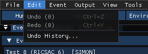
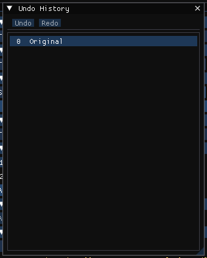

# Chapter 3B: Edit Menu

*HVE User's Manual — Section Two: Menu Reference, HVE 2027 edition. A new
chapter: HVE's Edit menu served its 3-D Editor and has no chapter of its own in
the HVE manual.*

The Edit menu undoes and redoes changes to the case. It is on the menu bar in
every editor of the workstation build.

*The Edit menu. The numbers in brackets are how many steps can be undone and
redone.*

| Item | Shortcut | What it does |
|---|---|---|
| **Undo (*n*)** | Ctrl+Z | Takes back the last change to the case |
| **Redo (*n*)** | Ctrl+Y or Ctrl+Shift+Z | Re-applies a change that was undone |
| **Undo History...** | — | Opens the Undo History panel |

---

## UNDO / REDO

**Menu Option:** Edit › Undo (Ctrl+Z), Edit › Redo (Ctrl+Y)

**Purpose:** Step backwards and forwards through your edits.

**Description:** Every change to the case — a value typed in a dialog, a vehicle
dragged in the viewport, a vehicle added — is a step. Undo restores the case as
it was before the last step; Redo re-applies it. Making a new change after
undoing discards the steps that could have been redone.

While the cursor is in a text field, Ctrl+Z and Ctrl+Y act on that field's text
instead of on the case.

While results are on screen, Undo and Redo step only over changes that no
program reads -- the sun and sky, the location, cameras and scene boxes, which
stay editable then -- and over changes to events that have not been run, such
as moving a vehicle in another event. A step that changes an input of an event
that holds results is **locked**: undoing it would change the inputs of that
run. Press **Reset** (on
the playback bar or in the Simulation panel) first. Opening or saving a case
clears the undo history.

---

## UNDO HISTORY

**Menu Option:** Edit › Undo History...

**Purpose:** See the edit history and jump to any point in it.

**Description:** The Undo History panel lists every step, newest first, named
after the dialog in which the change was made (for example *Tire Properties*).
The highlighted row is the state now in effect; rows above it are steps that
can be redone. Click any row to go straight to that state, or use the panel's
**Undo** and **Redo** buttons. Like the menu items, the panel is locked while
results are on screen.

*The Undo History panel.*

!!! tip "New in HVE 2027"
    HVE's Edit menu also has Undo (Ctrl+Z) and Redo (Ctrl+Y). The Undo History
    panel has no counterpart in HVE.

!!! warning "Not in HVE 2027"
    HVE's Edit menu provided the editing functions used in other parts of HVE,
    such as the 3-D Editor. HVE 2027 has no 3-D Editor; see
    [Chapter 6](06-options-menu.md) and
    [Environment › Scene Box Editor](04c-vehicle-environment-occupant-menus.md#scene-box-editor).

<!-- NAV -->

---

← Previous: [Chapter 3: File Menu](03-files-menu.md)  |  [Index](README.md)  |  Next: [Chapter 4: Event Menu (Part A)](04a-setup-menu.md) →

<!-- /NAV -->
