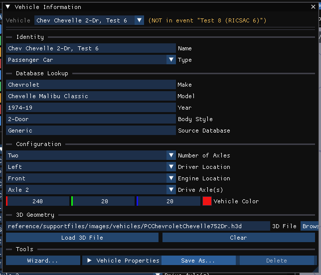

# Chapter 4C: Vehicle, Environment and Occupant Menus

*HVE User's Manual — Section Two: Menu Reference, HVE 2027 edition. A new
chapter. In HVE these dialogs were reached from each editor's own dialog and
viewer (clicking a vehicle's engine, for example, opened the Drivetrain dialog).
In HVE 2027 each editor has a menu that lists them.*

Each of these menus appears only in its own editor: **Vehicle** in the Vehicle
editor (F3), **Environment** in the Environment editor (F4), **Occupant** in the
Human editor (F2). The dialogs edit the vehicle, environment or human selected in
that editor. Vehicle data is locked while a solved run that used the vehicle is
on screen; press **Reset** in the Event editor to edit it.

---

## VEHICLE MENU

*The Vehicle menu (Vehicle editor).*

The Vehicle editor's **Vehicles** panel lists the case's vehicles, with **Add...**
(choose a vehicle from the loaded databases or one of HVE's generic vehicles),
**Replace...** (replace the selected vehicle's data with a database record),
**Dup** (copy the selected vehicle) and **Del**, and below the list the selected
vehicle's information. The Vehicle menu opens the detailed dialogs for that
vehicle:

| Item | Opens | Dialog reference |
|---|---|---|
| **Vehicle Information...** | Vehicle Information: identity, configuration, the 3-D geometry file, database lookup and search, and the vehicle's properties | [Vehicle Information](../../02-vehicles/VehicleInfoDlg.md) |
| **Save Vehicle As...** | Save Vehicle As: identification, geometry file, and **Save to Database** — HVE's Options › Create DB and the vehicle Save As | [Vehicle Save As](../../02-vehicles/VehSaveAs.md) |
| **Edit Mode (materials per part)** (Tab) | Switches the viewport to selecting parts of the vehicle body, to assign materials per part (as Blender's Edit Mode); new in HVE 2027 | — |
| **Vehicle Lights...** | Vehicle Lights: each light's type, intensity, direction, spot parameters, position and colour | — |
| **Advanced Suspension...** | A hub opening Jounce / Rebound, Camber vs Deflection, Roll Steer and Anti-Pitch | [Suspension and Steering](../../03-suspension-steering/README.md) |
| **ABS / Brake Design...** | A hub opening ABS System and ABS Designer | [ABS](../10-brake-designer/31-abs.md) |
| **Accelerometers...** | Accelerometers | [Accelerometers](../../06-safety-systems/AcclMtrsDlg.md) |
| **Steering System...** | Steering System | [Steering System](../../03-suspension-steering/SteerSysDlg.md) |
| **Suspension Data...** | Suspension Data | [Suspension](../../03-suspension-steering/SuspDlg.md) |
| **Tire Data (Detailed)...** | Tire Properties | [Tire Information](../../05-tires-wheels/TireInfoDlg.md) |
| **Tire Tables...** | Tire Friction Data | [Tire Friction Data](../../05-tires-wheels/TireFrictDataDlg.md) |
| **Brake Assembly...** | Brake Assembly | [Brake Assembly](../../04-brakes-powertrain/BrkAsmblyDlg.md) |
| **Brake Designer...** | Brake Designer | [Brake Designer](../10-brake-designer/29-brake-designer.md) |
| **Brake System Pressure...** | Brake System Pressure | [Brake System vs Pedal Force](../../04-brakes-powertrain/BrkSysVsPedFrcDlg.md) |
| **Brake Material Props...** | Brake Material Properties: friction coefficients and thermal properties | [Brake Material Properties](../../04-brakes-powertrain/BrkMatPropDlg.md) |
| **Drivetrain...** | Drivetrain | [Drivetrain](../../04-brakes-powertrain/DriveTraDlg.md) |
| **Aero Dynamic Drag...** | Aerodynamic Drag | [Vehicle Drag](../../02-vehicles/VehDragDlg.md) |
| **Body Torsion...** | Body Torsion | [Body Torsion](../../02-vehicles/BodyTorDlg.md) |
| **Crush Stiffness...** | Crush Stiffness: A, B and Kv for each side and the 3-D node stiffness for each zone, with **From crash tests...** (CRASH3 A and B from staged barrier tests) | [Stiffness Coefficient Dialog](../../02-vehicles/StiffCoeffDlg.md) |
| **Vehicle Mesh...** / **Advanced Mesh Options...** | Vehicle Mesh (both items open the same dialog; see [Chapter 4, Part B](04b-setup-menu.md#vehicle-mesh)) | — |
| **Contact Surfaces...** | Contact Surfaces: the vehicle's interior surfaces for occupant simulations | [Contact Surfaces](../../08-environment/ContSurfDlg.md) |
| **Airbags...** | Airbags | [Airbag System](../../06-safety-systems/AirBagSysDlg.md) |
| **Belt Restraint...** | Belt Restraint System | [Belt Restraint System](../../06-safety-systems/BeltResSysDlg.md) |

*Vehicle › Vehicle Information...*

!!! note "HVE 2027"
    The Accelerometers, Vehicle Mesh, Airbags and Belt Restraint
    dialogs are also on the Event menu. While Contact Surfaces, Airbags
    or Belt Restraint is open, that equipment is drawn in the
    viewport; View › Scene Display › Occupant Equipment draws it at any time.

---

## ENVIRONMENT MENU

*The Environment menu (Environment editor).*

| Item | Opens |
|---|---|
| **Environment...** | The **Environment** panel (it opens by itself when you enter the Environment editor): **Location**, **Terrain** (the site geometry — DXF, `.h3d`, `.iv`, OBJ or glTF — a survey point cloud, and the surface materials), **Sky**, **Physical** (ambient conditions and wind, atmosphere and gravity, standing water) and **Signals** |
| **Aerial Image...** | Aerial Image Options: an image file laid over the site, with its world bounds (upper-left and lower-right corners) |
| **Scene Box Editor...** | Scene Box Editor: named boxes with a position, size, rotation and colour (or wireframe), drawn in the scene |

*The Environment panel.*

### Scene Box Editor

HVE's 3-D Editor built environment objects from boxes, cylinders, cones, spheres
and surfaces. HVE 2027 has none of those editors; the Scene Box Editor makes
simple boxes for the picture. Each has a **Name**, a **Position** (x forward,
y right, z up), a **Size**, a **Rotation** and an **Appearance**; **Add** and
**Delete** manage the list.

!!! warning "Not in HVE 2027"
    Scene boxes are drawn but are not terrain: no engine drives on them or
    collides with them. Drivable geometry comes from the site file imported in
    the Environment panel's Terrain section, or from the imported HVE case.

*Environment › Scene Box Editor...*

See the dialog reference: [Environment](../../08-environment/README.md),
[Environment Information](../../08-environment/EnvtInfoDlg.md).

---

## OCCUPANT MENU

*The Occupant menu (Human editor).*

| Item | Opens |
|---|---|
| **Human Information...** | The **Occupants** panel, if it has been closed (it opens by itself when you enter the Human editor) |

The Occupants panel holds what HVE's Human Editor and Human Information dialog
held: **Add Occupant** and **Remove**, the occupant list, **Identity**
(Location), **Anthropometry** (subject type, age group, weight and height
percentiles, and **Regenerate GEBOD Body**), and buttons for **Injury
Tolerances...**, **Airbag Properties...**, **Body Segments...**, **Joint
Properties...** and **Body Pose...**. Which vehicle an occupant rides in, and
where, is set in the event (Event Information › Humans in Event).

See the dialog reference: [Humans](../../07-humans/README.md),
[Human Information](../../07-humans/HumanInfoDlg.md).

<!-- NAV -->

---

← Previous: [Chapter 4: Event Menu (Part B)](04b-setup-menu.md)  |  [Index](README.md)  |  Next: [Chapter 4D: Output Menu](04d-output-menu.md) →

<!-- /NAV -->
