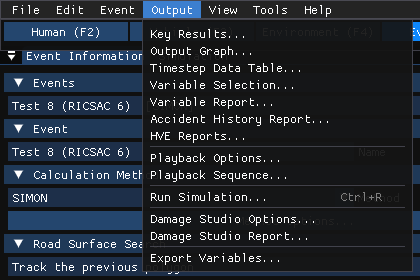
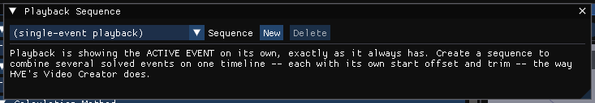
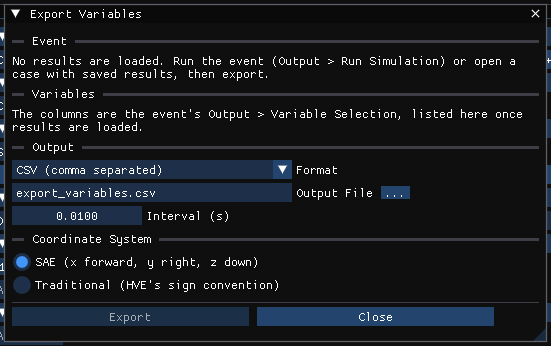

# Chapter 4D: Output Menu

*HVE User's Manual — Section Two: Menu Reference, HVE 2027 edition. A new
chapter. In HVE, results were viewed in the Playback Editor by adding Report
Windows and Playback Windows; in HVE 2027 they are panels and dialogs on the
Output menu.*

The Output menu appears only in the **Event editor** (F5). Its reports and
tables show the results of the **active event** after it has been run; before
that they say there is nothing to show.

*The Output menu.*

| Item | What it does | HVE equivalent |
|---|---|---|
| **Key Results...** | The Key Results panel — key results, and in its *Trajectory* section the selected variables at each output time | Options › Show Key Results; Key Results windows; Variable Output Table |
| **Output Graph...** | The Output Graph panel — variables plotted against time | Variable Graphing window |
| **Variable Selection...** | Select Output Variables, for Key Results | Variable Selection dialog |
| **HVE Reports...** | The report pages the engine itself builds, among them its ACCIDENT HISTORY page | the engine's report windows, including the Accident History numeric report |
| **Compare Runs...** | Runs the active event with two physics (HVE, HVE-reference, or HVE's own saved run) and shows the differences — see [COMPARE RUNS](#compare-runs) | *(new)* |
| **Playback Options...** | Playback speed, frame step, loop, CG path | Options › Playback |
| **Run Simulation...** | Opens the Simulation panel and runs the active event | the Event Controller's execute button |
| **Damage Studio Options...** | What the Damage Studio displays | Damage Studio |
| **Damage Studio Report...** | The Damage Studio report | Damage Studio |
| **Export Variables...** | Export output to a file | File › Export |

The panels — Key Results, Output Graph and Simulation — can also
be shown and hidden from the **View** menu, and dock below the viewport by
default.

---

## KEY RESULTS

**Menu Option:** Output › Key Results... · View › Key Results

**Description:** A table of the active event's key results, one column per
vehicle — for a collision, for example, Delta-V, PDOF, impact duration and
force, energy, maximum speed, distance travelled and heading change. With
**Follow playback time** ticked, time-dependent values follow the playback bar.
**Select Variables...** chooses what is listed, **Group columns by** arranges
the columns, **Vehicle name in column titles** labels them, and **Export CSV...**
or **Copy CSV** take the table out. **Sections...** hides and shows sections.
Right-click a section header for **Move up**, **Move down**,
**Hide this section**, **Show all sections** and **Reset order** (or drag one
header onto another to reorder).

*A solved SIMON event part-way through playback, with the Key Results panel
below the viewport.*

See the dialog reference: [Key Results](../../01-user-interface/KeyResDlg.md).

---

## OUTPUT GRAPH

**Menu Option:** Output › Output Graph... · View › Output Graph

**Description:** Plots output variables against time. **Select Variables...**
chooses the variables; **Fit**, **Reset** and **Whole run** set the axes;
**Format...** and **Reset formatting** change the appearance (gridlines,
colours); **Vehicle name in the legend** labels the traces. **Other Events...**
draws the same traces from up to four other events that have results, dashed
in each trace's colour over the active event's solid ones -- for instance an
event and a copy of it (the **Copy** button beside **+** and **−** on the
Events row) with one input changed. Vehicle and occupant traces alike; a
trace is matched by its vehicle slot or occupant.

See the dialog reference: [Variable Output Graph](../../11-reports-output/VarOutGraphDlg.md).

---

## HVE REPORTS

**Menu Option:** Output › HVE Reports...

**Description:** The report pages the calculation engine builds itself, from its
own resource strings — for example Accident History, Vehicle Data, Driver Data,
Environment Data, Messages, Program Data, References and Results. These are
HVE's pages, not HVE 2027's reconstruction of them, laid out as tables in the
units set in Preferences.

- **Each page is its own window**, docked in HVE Reports as a row of tabs.
  Drag a page's tab to the side of another page to show the two side by side,
  to its top or bottom edge to stack them, or out of the window to float it.
  **Reset Layout** puts every page back as one row of tabs.
- **Print Order...** sets the order in which **Save All Pages** and **Save All
  Pages as HTML** write the pages, and which pages they leave out. The order is
  kept for each engine, in the preferences.
- **Save This Page** (text) and **Save Page as HTML** write *this page* — the
  page last clicked, which the window names. **Save All Pages** and **Save All
  Pages as HTML** write every page in print order (the HTML with a list of
  contents); a browser prints the HTML or saves it as PDF. **Export Run Report
  (HTML)** writes `run_report.html`, HVE 2027's own printable summary of the
  run (inputs, key results, plan view of the trajectories), in the units set in
  Tools › Preferences, with an EDR delta-V section for each EDR record kept for
  a vehicle of the event.
- A file name without a folder is saved beside the case file, and the window
  shows the full path of every file written.

Before a run, or when a run built no pages, the dialog says so; the motorcycle
(SINGLETRACK) model is not one of HVE's engines and builds none.

The **ACCIDENT HISTORY** page is the accident history of the active event as
the engine itself builds it. There is one accident history in HVE 2027; save it
with **Save This Page** (text) or **Save Page as HTML** — see
[Accident History](../../11-reports-output/AcciHistDlg.md).

See the dialog reference: [Common Reports](../../11-reports-output/CommRepDlg.md).

---

## COMPARE RUNS

**Menu Option:** Output › Compare Runs...

**Description:** Answers the active event twice: once with the physics
**shown**, whose run is left on screen, and once with the one it is
**compared against**, which is kept as the comparison and drawn as an orange
ghost in the viewport. The choices are **HVE** (the physics as it now stands),
**HVE-reference** (the same engines frozen as they were validated against
original HVE) and **HVE (imported)** (original HVE's own saved run of the event,
played rather than solved).

| Control | Does |
|---|---|
| **Shown (the run on screen)** | The event's own physics: the same setting as Event Information › **Physics**, used by **Run** and saved with the case. Locked while the event holds results |
| **Compared against (the ghost)** | *the other physics* (the default), or one of the three; the one shown cannot also be the ghost |
| **Compare Runs** | Solves the event with the comparison first, then with its own physics. Greyed, with the reason, while a run is in progress, when the event is already solved (press **Reset** first) or when the comparison cannot run |

When both runs are done the window names the event and the two physics, and
shows the differences between the two runs for each vehicle, and for each
occupant both runs carry (GATB, EDHIS). Every number is read from the two runs'
own trajectories and outputs. If the run on screen is of another event, the
window says so; press Compare Runs again for this one.

Under **A channel from both runs**, choose a vehicle (or, after the vehicles,
an occupant) and one of its output channels: the window plots that channel
from both runs over time (the run on screen in blue, the comparison in
orange) and states the time and value range, the largest difference and when
it occurs, and each run's peak with its own instant.

An *HVE-reference* comparison needs `hve-solver-reference.exe` beside the
program, and *HVE (imported)* a case opened from a `.hve` saved after the event
was executed (see
[Event Information](../../09-events-driver-controls/EventInfo.md#calculation-method)).

!!! tip "New in HVE 2027"
    HVE has no counterpart: HVE 2027 carries both its current physics and the
    physics as it was validated against HVE.

---

## PLAYBACK OPTIONS

**Menu Option:** Output › Playback Options... · *HVE: Options › Playback*

**Description:** **Speed** (0.1× to 10×), **Frame Step** (how many output steps
each step button moves), **Loop**, and **CG Path** (draw each vehicle's CG path up
to the current time; the same switch as View › Scene Display › CG Path).

*The Playback Options dialog.*

---

## PLAYBACK SEQUENCE

**Menu Option:** Playback › Playback Sequence... (the **Playback (F6)** editor)

!!! note "HVE 2027"
    This used to be an Output item in the Event editor, where choosing a
    sequence silently switched the Event viewport to the combined timeline. It
    is the Playback editor's panel now, and the editor decides what plays: the
    Event editor always plays its active event.

**Description:** Combines several solved events of the case into one playback
timeline — what HVE did with a Playback Window and the Video Creator's table.
Create a sequence with **New** (or pick one in **Sequence**; **Delete** removes
it), then **Add Event** for each event, tick the ones to include, and set where
each starts on the master timeline (**Offset**) and which part of it plays
(**Start**, **End**). **Run All Events** solves every event the sequence uses, one after another.
**Add All Events** adds the case's events that are not yet in it, **Stack Sequentially** plays
them one after another, and **Align at Impact** slides each so its impact falls
at the same master time (for comparing reconstructions).
A timeline strip shows each event as a bar that can be dragged.

*The Playback Sequence dialog.*

!!! note "HVE 2027"
    HVE's Playback Window could also record the sequence to video. In
    HVE 2027 the active sequence is recorded with **File › Record
    Animation...** from the Playback editor (see
    [Chapter 3](03-files-menu.md#video-creator)).

---

## RUN SIMULATION

**Menu Option:** Output › Run Simulation...

**Description:** Brings up the **Simulation** panel and runs the active event —
the same as pressing **Run** on the playback bar under the viewport or in the
Simulation panel. While it runs, the progress bar advances and **Pause** /
**Resume** (where the method allows) and **Cancel** are offered; **Esc** also
cancels. When it finishes, the event plays back in the viewport and its inputs
are locked until **Reset**.

!!! note "HVE 2027"
    **Ctrl+R** runs the simulation from anywhere in the Event editor.

---

## DAMAGE STUDIO OPTIONS / DAMAGE STUDIO REPORT

**Menu Option:** Output › Damage Studio Options... · Output › Damage Studio Report...

**Description:** **Damage Studio Options** chooses how the PDOF and the crush
vectors are displayed and which key results to show. **Damage Studio Report**
shows the report; **Save...** writes it to a text file.

---

## EXPORT VARIABLES

**Menu Option:** Output › Export Variables... · *HVE: File › Export*

**Description:** Writes the selected output variables of one event to a file,
one column per variable and one row per time step, for use in other programs
(e.g., Excel or MATLAB).

The dialog's sections:

- **Event** — the event whose results are on screen. As in HVE, one event is
  exported per file. To export another event, select it and run it (or open
  its saved results) first. With no results loaded, the dialog says so and
  **Export** is unavailable.
- **Variables** — the variables chosen in **Output › Variable Selection...**
  for that event (its **Variable Selection...** button opens the same
  window), grouped by vehicle. The dialog shows how many there are and how
  many change sign under Traditional. With nothing selected, **Export** is
  unavailable; the export never falls back to "every variable".
- **Format** — **CSV** (comma separated), **ASCII text** (tab separated) or
  **MATLAB script** (`.m`). The file name's extension follows the format.
- **Output File** — the file to write; **...** browses.
- **Interval (s)** — the time between rows. It starts at the event's output
  interval. The rows run from 0 to the end of the run:
  *floor(duration / interval) + 1* of them. Values between saved output steps
  are interpolated.
- **Coordinate System** — **SAE (x forward, y right, z down)** writes the
  values as solved. **Traditional (HVE's sign convention)** multiplies by −1
  the variables HVE's own export flips — for example CG Y and Z, pitch and
  yaw, the lateral and vertical velocities, most kinetics forces and moments,
  and the tire contact-patch y and z. Every other variable is written
  unchanged. The tooltip on each choice says the same.

CSV and ASCII files start with four header rows — vehicle, output group,
variable and units (in parentheses) — then the data rows, with time in
seconds in the first column. The values are in the units set in
**Preferences** (imperial or metric), the same units Key Results
shows; units are written in plain text (`ft-lbf`, `deg/s^2`, `degF`). A
MATLAB file assigns the numbers to the matrix `hve_data` (time in column 1)
and the column titles to the cell arrays `hve_columns`, `hve_vehicles`,
`hve_groups`, `hve_names` and `hve_units`. A value the run did not produce is
left empty in CSV and ASCII files and is `NaN` in a MATLAB file.

After **Export**, the dialog reports what it wrote, or why it failed.

!!! note "HVE 2027"
    HVE's dialog lists saved **export formats** (`.hxp` files). An `.hxp` is a
    saved variable *selection*, not a kind of output file; HVE 2027 uses the
    event's Variable Selection instead and writes no `.hxp`. HVE wrote only the
    comma-separated file; the tab-separated and MATLAB forms are HVE 2027
    additions with the same numbers.

!!! note "HVE 2027"
    For **Accelerometer** variables, HVE's Traditional conversion does not
    reliably apply its own list (the source leaves the variable index unset).
    HVE 2027 applies HVE's accelerometer list as written: Y, Z, v, w, Y-dot,
    Z-dot, lateral and vertical acceleration change sign.

*The Export Variables dialog, before the event has been run: Export is unavailable and the dialog says why.*

<!-- NAV -->

---

← Previous: [Chapter 4C: Vehicle, Environment and Occupant Menus](04c-vehicle-environment-occupant-menus.md)  |  [Index](README.md)  |  Next: [Chapter 5: View Menu](05-view-menu.md) →

<!-- /NAV -->
