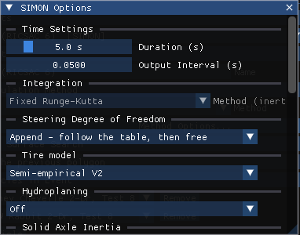

# Chapter 6: Options Menu — Where It Went

*HVE User's Manual — Section Two: Menu Reference, HVE 2027 edition. Replaces
HVE's Chapter 6, Options Menu.*

HVE 2027 has no Options menu. HVE's Options menu mixed display switches, units,
calculation settings and preferences; in HVE 2027 each of these lives next to
what it affects. This chapter takes HVE's Options menu item by item.

| HVE Options item | HVE 2027 |
|---|---|
| Create DB | **Vehicle › Save Vehicle As...** › Save to Database ([details](#create-db)) |
| Show Key Results | **Output › Key Results...** or **View › Key Results** |
| Show Axes | Not in HVE 2027 ([details](#show-axes)) |
| Show Contacts | **View › Scene Display › Occupant Equipment** |
| Show Belt Anchors | **View › Scene Display › Occupant Equipment** |
| Show Velocity Vectors | **View › Scene Display › Vectors › Velocity Vectors** |
| Show Skidmarks | **View › Scene Display › Skidmarks** |
| Show Tracks | **View › Scene Display › Tire Contact Patch Paths** |
| Show CGs / Show CG Paths | **View › Scene Display › CG Path** (no separate CG marker) |
| Show Accelerometers / Show Accelerometer Paths | **View › Scene Display › Accelerometer Path** |
| Show Position Sequences | Not in HVE 2027 |
| Show Targets | **View › Scene Display › Scene Ghosts** |
| Show Connections | Not in HVE 2027 as a display switch; connections are edited in Vehicle Information |
| Distance Tool | Not in HVE 2027 |
| Show Path | The path follower's path is drawn while **Event › Path Follower...** is open |
| AutoPosition | **Auto Position (settle onto terrain)**, per vehicle, in Event Information's Vehicle Initial Conditions |
| Grid | Not in HVE 2027 ([details](#grid)) |
| Units | **Tools › Preferences** › Units ([details](#units)) |
| Shadows | **View › Scene Display › Shadow Coverage**; the sun is set in the Shader Editor's Sun & Sky panel and Event Information › Lighting |
| Render | **View › Scene Display › Rendering** ([details](#render)) |
| Playback | **Output › Playback Options...** |
| Simulation Controls | the **Simulation** panel (View › Simulation) ([details](#simulation-controls)) |
| Calculation Options | **Method Options...** in Event Information › Calculation Method ([details](#calculation-options)) |
| DyMESH | **Event › DyMESH Options...** ([details](#dymesh)) |
| Get Surface Information | Not in HVE 2027 as a probe ([details](#get-surface-information)) |
| Preferences | **Tools › Preferences...** ([details](#preferences)) |
| Add Playback Window (legacy) | the **Playback (F6)** editor's **Playback Sequence** panel |

---

## CREATE DB

**HVE:** Options › Create DB · **HVE 2027:** Vehicle › Save Vehicle As...

The Save Vehicle As dialog sets the identification fields under which the vehicle
is saved (name, type, make, model, year, body style), its geometry file, version
information and security key, and the **Database File**, and **Save to Database**
writes the vehicle into it. The dialog notes that a database write needs the
vehicle's make, model, year and body style to match a loaded database record.
**Apply to Vehicle** copies the identification back to the vehicle.

*Vehicle › Save Vehicle As...*

---

## SHOW AXES

!!! warning "Not in HVE 2027"
    There is no switch for coordinate axes. The coordinate system is described
    in [Appendix III](../11-appendices/appendix-03-coordinate-systems.md).

---

## GRID

!!! warning "Not in HVE 2027"
    The viewport draws a ground grid, but there is no Grid dialog for its
    spacing, colour or extent. (The Output Graph has its own
    gridline settings under **Format...**.)

---

## UNITS

**HVE:** Options › Units · **HVE 2027:** Tools › Preferences › Units

HVE 2027 offers two unit systems: **Metric (m, km/h, kg, N)** and **Imperial
(ft/in, mph, lb, lbf)**. Fields that follow the setting change immediately;
the case itself is stored in SI units either way. HVE's Units dialog, which set
the unit of each quantity separately, is not reproduced.

*Tools › Preferences.*

!!! note "HVE 2027"
    The Preferences dialog notes that some fields still carry a fixed SI label
    while they are being converted.

---

## RENDER

**HVE:** Options › Render (Rendering Options dialog) · **HVE 2027:** View › Scene Display › Rendering

| HVE Rendering Options | HVE 2027 |
|---|---|
| Show As, Render Method (shading) | **Phong**, **Flat** or **Wireframe** (Wireframe is HVE's Hidden Line) |
| Light sources | **Light Sources On** |
| Complexity, Show Only + Faces, Render Quality, Anti-aliasing Level | Not in HVE 2027 |

A vehicle's own shading (as loaded, flat, smooth, auto smooth) is set in its
Vehicle Mesh dialog, and the site's in the Environment panel's Terrain section.

---

## SIMULATION CONTROLS

**HVE:** Options › Simulation Controls · **HVE 2027:** the Simulation panel
(View › Simulation; docked beside Event Information)

The **Simulation Controls** at the top of the Simulation panel belong to the
active event:

- **Duration (s)**, **Trajectory Timestep (s)**, **Collision Timestep (s)**,
  **Separation Timestep (s)** and **Output Timestep (s)** — HVE's integration
  timesteps. A timestep the active method does not use is not shown, and the
  panel says so.
- **Termination** — linear and angular speed limits, each with an **On** switch;
  the run ends once every vehicle is below both armed limits. With both off the
  run integrates to the full duration.
- **Stopped Vehicle** — the linear and angular speeds below which a vehicle is
  reported at rest.
- **Integrator Convergence** — **Maximum Bisections** and **Velocity
  Convergence**, and for EDHIS the **Velocity Change Limit** and **Acceleration
  Change Limit**, shown only for the methods that read them.

Below them are the **Run** controls (status, progress, Run / Reset / Close and the
playback slider) and the **Last Result**.

*The Simulation panel.*

!!! note "HVE 2027"
    Some methods' option dialogs (for example SIMON Options) also carry the
    event's duration and output interval; they edit the same values.

See the dialog reference: [Simulation Controls](../../09-events-driver-controls/SimuCtrlDlg.md).

---

## CALCULATION OPTIONS

**HVE:** Options › Calculation Options · **HVE 2027:** Event Information ›
Calculation Method › **Method Options...**

Opens the options dialog of the active event's method: EDCRASH Options, EDSMAC
Options (also used for EDSMAC4), EDGEN Options, EDHIS Options, SIMON Options,
EDVSM Options, GATB Options or SINGLETRACK Options. EDSVS, EDVDS and EDVTS have
no options dialog in HVE 2027.

*Method Options... for a SIMON event.*

!!! note "HVE 2027"
    Some HVE options are offered with a note that the engine refuses them — for
    example SIMON's **Blythe-Day (refuses the run)** hydroplaning model, which
    HVE's own SIMON does not implement. Such an option is kept because HVE offers
    it, and the dialog says the run will stop. The program manuals describe the
    options themselves.

See the dialog reference: [Calculation Options](../../10-calculation-options/README.md).

---

## DYMESH

**HVE:** Options › DyMESH · **HVE 2027:** Event › DyMESH Options...

HVE's DyMESH dialog had General and Advanced pages (search, pushback,
restitution, timesteps, debug output). HVE 2027's DyMESH Options dialog is one
page with **Start Times**, **Contact Search**, **Contact Model**,
**Restoration**, **Inter-Vehicle Contact (fallback)** and a **Per-pair
override**. The collision timestep is in the Simulation panel. Where the engine
stores an option but does not read it, the dialog says so beside the control.

!!! warning "Not in HVE 2027"
    DyMESH's debug output options are not offered.

---

## GET SURFACE INFORMATION

!!! warning "Not in HVE 2027"
    There is no tool that reports the surface under a picked point. In the
    Environment editor, clicking a surface in the viewport selects it, and the
    Environment panel's Surface Materials section shows its material.

---

## PREFERENCES

**HVE:** Options › Preferences · **HVE 2027:** Tools › Preferences...

| HVE preference | HVE 2027 |
|---|---|
| Diagnostic Level | **Diagnostic Level** — greyed: nothing to control (a run's status always says what it assumed) |
| Auto Backup | **Enable Auto-Save** and **Interval (min)** — a recovery copy, `<case>.autosave.hvc`, written beside the case while there are unsaved changes |
| Date Style | **Date Format** — how dates are shown in the Audit Log, the file browser and the run report |
| Background Color | **Background Color** — the colour of the main window behind the panels |
| Skidmark Height | Not in HVE 2027 |
| Font Size | **Tools › Style Editor** (the interface's live style settings) |
| *(units)* | **Units** — see [UNITS](#units) |

!!! note "HVE 2027"
    Auto-Save never writes the case file itself: **Enable Auto-Save** (on by default) and **Interval (min)** write a recovery copy of the case, `<case>.autosave.hvc` beside it, while there are unsaved changes; the case file itself is never written. Saving the case removes the copy, and opening a case whose recovery copy is newer offers to open the copy.

<!-- NAV -->

---

← Previous: [Chapter 5: View Menu](05-view-menu.md)  |  [Index](README.md)  |  Next: [Chapter 6B: Tools Menu](06b-tools-menu.md) →

<!-- /NAV -->
