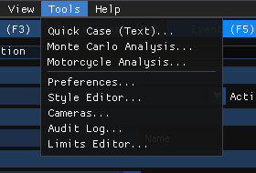
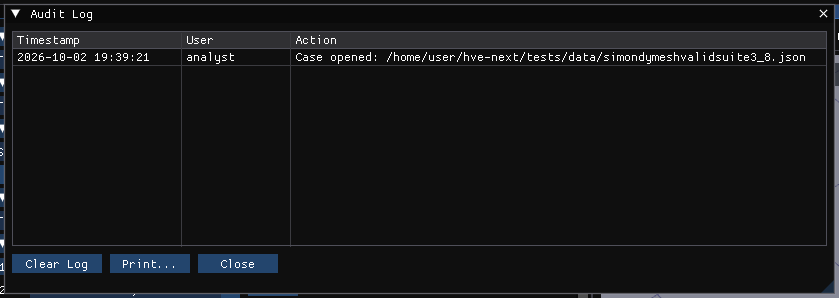

# Chapter 6B: Tools Menu

*HVE User's Manual — Section Two: Menu Reference, HVE 2027 edition. A new
chapter: the Tools menu gathers HVE 2027's preferences and utilities, some of
which were on HVE's Options and View menus.*

The Tools menu is on the menu bar in every editor.

*The Tools menu.*

| Item | What it does | HVE equivalent |
|---|---|---|
| **Quick Case (Text)...** | Builds a case from a typed sentence | *(new)* |
| **Vehicle Package...** | Builds a case vehicle from its VIN or year, make and model, its stated specifications, and who and what it carried | *(new)* |
| **Case Intake...** | Builds an event from the case documents, read by your own AI tool | *(new)* |
| **Provenance...** | Where each value set by those tools came from | *(new)* |
| **EDR Import...** | An event data recorder's pre-crash record into an event vehicle, and its delta-V against the run's | *(new)* |
| **Monte Carlo Analysis...** | Uncertainty analysis by repeated runs with sampled inputs | *(new)* |
| **Motorcycle Analysis...** | Cornering and slide-to-stop calculations for a motorcycle | *(new)* |
| **Preferences...** | Units, date format, background colour, diagnostics, auto-save | Options › Units, Options › Preferences |
| **Style Editor...** | The look of the interface: base theme and live style settings | *(new; Options › Preferences › Font Size)* |
| **Cameras...** | The case's named cameras | View › Set Camera |
| **Audit Log...** | A time-stamped record of what was done in this session | the Audit Trail |
| **Limits Editor...** | The minimum and maximum accepted by input fields | *(new)* |

Quick Case, Vehicle Package, Case Intake, Provenance, EDR Import, Monte Carlo
Analysis and Motorcycle Analysis are not in the viewer product.

---

## QUICK CASE (TEXT)

**Menu Option:** Tools › Quick Case (Text)...

**Description:** Type a description of a case — for example *SIMON event,
vehicle 1 at (0,0) heading 0 speed 50 mph, vehicle 2 at (12,-3) heading 180
speed 30 mph* — and the dialog shows, as you type, what it will build. **Build**
adds the described event and newly built vehicles to the case and makes the
event active; existing events and vehicles are kept.

!!! tip "New in HVE 2027"
    This tool has no counterpart in HVE's menus.

---

## VEHICLE PACKAGE

**Menu Option:** Tools › Vehicle Package...

**Description:** Identify a vehicle by its VIN (checked offline; **Decode with
NHTSA (online)** asks NHTSA's decoder) or its year, make and model; choose the
matching vehicle database record or HVE's generic of its type; enter its
measured specifications, which scale a generic; list its occupants (GEBOD
bodies) and cargo; and **Add to Case**. The occupants are seated, and the cargo
loaded, in a chosen event, or put on the vehicle's Aboard list. Every value set
is listed with where it came from. See
[Vehicle Package](../../new-features/12-case-intake-and-vehicle-data.md#vehicle-package).

---

## CASE INTAKE

**Menu Option:** Tools › Case Intake...

**Description:** Copy the prompt, give it with the case documents to your own
AI tool, and paste its answer. Every value is listed with its citation and
whether it was stated; choose each vehicle's data, then **Build** adds one new
event with those vehicles and their starting conditions. HVE 2027 sends
nothing anywhere. See
[Case Intake](../../new-features/12-case-intake-and-vehicle-data.md#case-intake).

---

## PROVENANCE

**Menu Option:** Tools › Provenance...

**Description:** Every value set by Vehicle Package, Case Intake, EDR Import
and Crush Stiffness from Crash Tests: what it was set to, whether it was
stated, looked up, estimated, a generic's default or unknown, its source, the
tool and the time, and, where the record is about a single field, whether that
field has been changed by hand since. The records are saved with the case. See
[Provenance](../../new-features/12-case-intake-and-vehicle-data.md#provenance).

---

## EDR IMPORT

**Menu Option:** Tools › EDR Import...

**Description:** Read an EDR report's pre-crash record, through your own AI
tool or as a pasted table, and set an event vehicle's initial speed and its
throttle, brake and steering tables from it, with the recorder time the
simulation starts at. After a run, the recorded delta-V is plotted against
the run's. See
[EDR Import](../../new-features/12-case-intake-and-vehicle-data.md#edr-import).

!!! tip "New in HVE 2027"
    Vehicle Package, Case Intake, Provenance and EDR Import have no
    counterpart in HVE's menus.

---

## MONTE CARLO ANALYSIS

**Menu Option:** Tools › Monte Carlo Analysis...

**Description:** Choose the number of runs, a random seed and a sampling method,
and a table of uncertain inputs, each bound to a field of the case with a
distribution. **Run** solves the case that many times, starting from the case's
own values, and shows a confidence-interval table, a tornado chart of the inputs'
influence and a convergence reading. **Export** writes the per-run results as CSV
and a self-contained HTML report.

!!! note "HVE 2027"
    Every run is solved by the active event's own engine. If the case has no
    event, no vehicles, or an event whose method has no engine, **Run Analysis**
    is disabled and the dialog says why.

!!! tip "New in HVE 2027"
    This tool has no counterpart in HVE's menus.

---

## MOTORCYCLE ANALYSIS

**Menu Option:** Tools › Motorcycle Analysis...

**Description:** The two hand calculations a motorcycle case usually needs:

- **Cornering** — could the machine have negotiated a curve at a given speed,
  from the friction available and the lean angle it would have to hold;
- **Slide** — the speed at which the machine went down, worked backwards from
  the rest positions.

For simulating the motorcycle itself, use the SINGLETRACK calculation method.

!!! tip "New in HVE 2027"
    The SINGLETRACK motorcycle model and these calculations are not part of
    HVE; they have no counterpart in HVE's menus.

---

## PREFERENCES

**Menu Option:** Tools › Preferences... · *HVE: Options › Units, Options ›
Preferences*

**Description:**

- **Display** — **Date Format**; **Units**: *Metric (m, km/h, kg, N)* or
  *Imperial (ft/in, mph, lb, lbf)*; **Background Color**
- **Diagnostics** — **Diagnostic Level**
- **Auto-Save** — **Enable Auto-Save** and **Interval (min)**

!!! note "HVE 2027"
    **Diagnostic Level** is greyed (it has nothing to control). **Date Format**
    sets how dates are shown. **Enable Auto-Save** (on by default) and **Interval (min)** write a recovery copy of the case, `<case>.autosave.hvc` beside it, while there are unsaved changes; the case file itself is never written. Saving the case removes the copy, and opening a case whose recovery copy is newer offers to open the copy.

*Tools › Preferences.*

See [Chapter 6](06-options-menu.md#preferences) for the mapping from HVE's User
Preferences dialog.

---

## STYLE EDITOR

**Menu Option:** Tools › Style Editor...

**Description:** **Base Theme** (a preset, kept between sessions) and **Live
Style** — the interface's colours, sizes, spacing and fonts, which apply at once
but are not saved.

---

## CAMERAS

**Menu Option:** Tools › Cameras... · right-click the viewport › Camera
Properties... · *HVE: View › Set Camera*

See [Chapter 5, Set Camera](05-view-menu.md#set-camera).

---

## AUDIT LOG

**Menu Option:** Tools › Audit Log... · *HVE: the Audit Trail*

**Description:** A table of the session's actions — for example cases opened
and saved, undo and redo, and exports — each with its time and user. **Clear Log** empties it.

*The Audit Log.*

!!! note "HVE 2027"
    The Audit Log's **Print...** button does nothing in HVE 2027 Preview.

---

## LIMITS EDITOR

**Menu Option:** Tools › Limits Editor...

**Description:** A searchable table of input fields with the **Min** and **Max**
value each accepts, for the fields that use it. **Save to File** keeps the edited
limits; **Reset Defaults** restores HVE 2027's.

!!! tip "New in HVE 2027"
    This tool has no counterpart in HVE's menus.

<!-- NAV -->

---

← Previous: [Chapter 6: Where HVE's Options Menu Went](06-options-menu.md)  |  [Index](README.md)  |  Next: [Chapter 7: Help Menu](07-help-menu.md) →

<!-- /NAV -->
