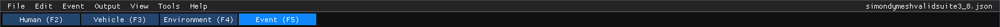

# HVE User's Manual — Section Two: Menu Reference

This section is the HVE 2027 edition of Section Two of the *HVE User's Manual*
(HVE Version 5, Seventh Edition, January 2006). HVE's menu bar was **File, Edit,
View, Mode, Set-up, 3-D Edit, Options, Help**. HVE 2027's menu bar is
different, and part of it changes with the editor you are in:

| Menu | Shown | Replaces in HVE |
|---|---|---|
| **File** | always | File |
| **Edit** | always (workstation build) | Edit (undo only; HVE's 3-D editing functions are not in HVE 2027) |
| **Vehicle** | Vehicle editor (F3) | Vehicle Editor's dialogs and toolbar, Options › Create DB |
| **Environment** | Environment editor (F4) | Environment Editor's dialogs, part of 3-D Edit |
| **Event** | Event editor (F5) | Set-up |
| **Output** | Event editor (F5) | Playback Editor's report windows, Options › Playback, File › Export |
| **Playback** | Playback editor (F6) | Playback Editor's Playback Window and Video Creator table, Options › Playback |
| **Occupant** | Human editor (F2) | Human Editor's dialogs |
| **View** | always | View, and the display toggles of the Options menu |
| **Tools** | always | Options › Units, Options › Preferences, View › Set Camera |
| **Help** | always | Help |

HVE's **Mode** menu has no menu in HVE 2027: the five editors are the tabs
**Human (F2)**, **Vehicle (F3)**, **Environment (F4)**, **Event (F5)** and
**Playback (F6)** on the bar under the menus. A solved event plays back in the
Event editor's viewport; the Playback editor plays a sequence of several solved
events. The name of the open case is shown at the right-hand
end of the menu bar, with a leading `*` when it has unsaved changes.

*The menu bar and the editor tabs in the Event editor. The Event and Output menus
appear only here; in the Vehicle editor the Vehicle menu takes their place.*

!!! note "HVE 2027"
    Several menu items show a keyboard shortcut copied from HVE (Ctrl+P, Ctrl+D,
    Ctrl+M, Ctrl+U, Ctrl+W, Ctrl+T, Ctrl+R). They work in the Event editor,
    each only while its menu item is offered for the event's calculation
    method. **Ctrl+N**, **Ctrl+O**, **Ctrl+S** (File), **Ctrl+Z** and
    **Ctrl+Y** (Edit, also Ctrl+Shift+Z) and **F2–F6** (editors) also act
    from the keyboard. Shortcuts are ignored while you type in a text field.

!!! note "HVE 2027"
    The viewer product (the playback-only build that opens a published bundle)
    has only the File, View, Tools and Help menus: no Edit, Vehicle,
    Environment, Event, Output or Occupant menu, and no Quick Case, Vehicle
    Package, Case Intake, Provenance, EDR Import, Monte Carlo or Motorcycle
    Analysis on the Tools menu. This section describes the full
    workstation build.

## Contents

| Chapter | Menu | HVE chapter it replaces |
|---|---|---|
| [3](03-files-menu.md) | File — New, Open, Open Recent, Save, Save As, Save As JSON, Embed vehicle meshes, Embed the environment, Publish Bundle, Export Scene for Blender, Blender Live Link, Record Animation, Play Video, Exit | File Menu |
| [3B](03b-edit-menu.md) | Edit — Undo, Redo, Undo History | *(new)* |
| [4 (Part A)](04a-setup-menu.md) | Event — Event Information, Position / Velocity, Driver Controls, Path Follower | Set-up Menu (Part A) |
| [4 (Part B)](04b-setup-menu.md) | Event — Damage Profiles, Collision Pulse, Vehicle Mesh, DyMESH Options, Payload, Wheels, Accelerometers, Contacts, Restraints, Lights, Notes, and the method-specific items | Set-up Menu (Part B) |
| [4C](04c-vehicle-environment-occupant-menus.md) | Vehicle, Environment and Occupant menus | *(new; HVE's editor dialogs)* |
| [4D](04d-output-menu.md) | Output — reports, graphs, tables, Compare Runs, playback, Run Simulation, Damage Studio, Export Variables | *(new; HVE's Playback Editor)* |
| [5](05-view-menu.md) | View — panels, paths, vectors, rendering, Outliner, Scene Ghosts | View Menu |
| [6](06-options-menu.md) | *Where HVE's Options menu went* — item-by-item map | Options Menu |
| [6B](06b-tools-menu.md) | Tools — Quick Case, Vehicle Package, Case Intake, Provenance, EDR Import, Monte Carlo, Motorcycle Analysis, Preferences, Style Editor, Cameras, Audit Log, Limits Editor | *(new)* |
| [7](07-help-menu.md) | Help — License, Check for Vehicle Data Updates, About HVE 2027 | Help Menu |

For a first look at the window, panels and viewport, see the
[interface tour](../../getting-started/03-interface-tour.md); for what is different from
HVE in general, see [Differences from HVE](../../getting-started/05-differences-from-hve.md).

## Where each HVE menu went

| HVE menu | HVE 2027 |
|---|---|
| File | **File** ([Chapter 3](03-files-menu.md)); File › Export became **Output › Export Variables**; printing is not in HVE 2027 |
| Edit | **Edit** › Undo / Redo / Undo History ([Chapter 3B](03b-edit-menu.md)) |
| View | **View** ([Chapter 5](05-view-menu.md)); Set Camera became **Tools › Cameras** |
| Mode | the **editor tabs** Human (F2), Vehicle (F3), Environment (F4), Event (F5), Playback (F6) |
| Set-up | **Event** ([Chapter 4](04a-setup-menu.md)) |
| 3-D Edit | not in HVE 2027; scene objects are boxes made in **Environment › Scene Box Editor**, and objects are moved with the viewport gizmo |
| Options | spread over **View**, **Tools**, **Output** and the **Event Information** panel ([Chapter 6](06-options-menu.md)) |
| Help | **Help › About HVE 2027** ([Chapter 7](07-help-menu.md)) |

<!-- NAV -->

---

Next: [Chapter 3: File Menu](03-files-menu.md) →

<!-- /NAV -->
