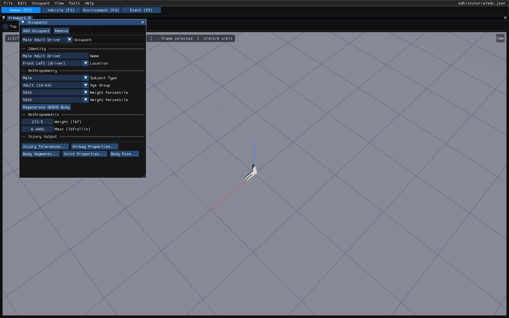

# Chapter 8 — Creating and Editing Humans

*Adapted for HVE 2027 from the HVE User's Manual (HVE Version 5, Seventh
Edition, January 2006), Chapter 8.*

The Human Editor is used for creating and editing the humans of the current
case. This chapter describes how to use it, beginning with its components.

> **NOTE:** Refer to the next chapter, [Human Model
> Definition](09-human-model-definition.md), for a detailed description of
> each human model parameter.

## Human Editor Components

To use the Human Editor, select the **Human (F2)** tab under the menu bar, or
press **F2**. The Human Editor has two components:

- **Occupants panel** — Used for adding humans to the case, removing them,
  selecting the current human and editing its basic attributes. It takes the
  place of HVE's Human Editor dialog and its GEBOD Human Information dialog.
  If it has been closed, reopen it with **Occupant › Human Information**.
- **Viewport** — Displays the current human. Clicking a body segment in the
  viewport selects that segment in the Body Segments dialog (see Selecting
  and Editing Humans, below).

*Figure 8-1: HVE 2027 Human Editor — the Occupants panel over the viewport.*

!!! note "HVE 2027"
    The Occupants panel floats over the viewport when the Human editor is
    first opened. Like every HVE 2027 panel it can be docked by dragging its
    title bar onto the dock area.

### Occupants Panel

The Occupants panel manages all the humans in the current case. It contains:

- **Add Occupant** — Adds a new human to the case and generates its body with
  GEBOD (see Adding New Humans, below).
- **Remove** — Removes the current human from the case.
- **Occupant** — A list of the names of all the humans in the case. Select a
  different name to make it the current human.
- **Identity** — Name and Location (see below).
- **Anthropometry** — The GEBOD inputs: Subject Type, Age Group, Weight
  Percentile, Height Percentile, and the **Regenerate GEBOD Body** button.
- **Anthropometric** — The human's total Weight and Mass.
- **Injury Tolerances…, Airbag Properties…, Body Segments…, Joint
  Properties…, Body Pose…** — Buttons that open the human's data dialogs.

> **NOTE:** Removing a human removes it only from the current case. Events
> that used it are updated so that their remaining humans keep their
> assignments.

!!! note "HVE 2027"
    HVE does not allow a human that is used in an event to be deleted;
    HVE 2027 does, and removes it from those events. While the results of a
    simulation are on screen, Add Occupant and Remove are disabled, and the
    human data that run used is read-only until the run is reset.

> **NOTE:** Although every human's properties are defined using the Human
> Editor, humans are not positioned using the Human Editor. The position of a
> human in any event is an event-related issue, and is performed using the
> Event Editor. Think of it this way: At this point, we don't care what the
> human is doing. All we care about is that the human is a male, weighs 180
> pounds and has other properties of our choosing.

!!! note "HVE 2027"
    Which vehicle a human rides in is set in the Event Editor, in Event
    Information's **Humans in Event** section. That section's **Pose** button
    opens the Body Pose dialog for the event; the same dialog opens from the
    Occupants panel's **Body Pose…** button and edits the pose in the active
    event. A human's pose and the restraint it wears are stored per event.

## Adding New Humans

To add a new human, press **Add Occupant** in the Occupants panel. HVE 2027
adds a human named "Occupant *n*" and immediately generates its 15-segment
body with GEBOD from the current Anthropometry settings. Then edit its
attributes in the panel:

- **Name** — A user-editable field for the human's name. The name identifies
  the human in each event as well as in all output reports.
- **Location** — The seat position the human occupies: Front Right, Front
  Center, Front Left (driver), Rear Right, Rear Center, Rear Left, Back Right,
  Back Center, Back Left, or Pedestrian.

  > **NOTE:** If a seat position is selected, the human is a vehicle occupant
  > and its motion is defined relative to the vehicle. If Pedestrian is
  > selected, the human's motion is defined relative to the earth. Occupants
  > are drawn and solved seated, pedestrians standing.

  > **NOTE:** The Location also selects which seat's airbag the Airbag
  > Properties dialog edits for this human. A pedestrian has no seat and no
  > airbag.

- **Subject Type** — Male or Female.
- **Age Group** — Child (0-12), Teen (13-17), Adult (18-64) or Senior (65+).
- **Weight Percentile** — 5th, 25th, 50th, 75th or 95th.
- **Height Percentile** — 5th, 25th, 50th, 75th or 95th.

> **NOTE:** Regarding Weight and Height Percentiles: 50 percentile is
> average; 5 percentile means that only 5 percent of the population is
> smaller; 95 percentile means that only 5 percent of the population is
> larger.

Changing Subject Type, Age Group or either percentile regenerates the body
at once, so the segments, inertias, ellipsoids and joints always correspond
to the anthropometry shown. **Regenerate GEBOD Body** regenerates it on
demand, which discards any edits made to the segment and joint data. The text
beside the button reports whether the human has a body. The Body Segments
dialog offers the same as **Re-seed GEBOD**, and **Re-seed from occupant
mass**, which builds a simplified body from standard segment mass fractions
scaled by the human's mass (a fallback, not GEBOD).

!!! warning "Not in HVE 2027"
    HVE's GEBOD Human Information dialog offers a **Basis** selector, age in
    months or years, weight and standing height entered either as a
    percentile or directly in pounds and inches, and a User-defined subject
    file. HVE 2027 has none of these: an adult body is always generated from
    the two percentiles (HVE's "All" basis), and a child from age alone. The
    percentiles offered are the five listed above.

!!! note "HVE 2027"
    How the four Anthropometry settings reach GEBOD:

    - **Adult** and **Senior** generate a male or female adult from the weight
      and height percentiles. Senior generates the same body as Adult.
    - **Child** and **Teen** generate GEBOD's child subject on the age basis,
      as a 6-year-old and a 12-year-old respectively. The Subject Type and the
      percentiles are not used for a child.
    - A body imported with a case and posed in an event is not regenerated
      when these settings change, so its imported segment data is kept.
      Regenerate GEBOD Body replaces it explicitly.

- **Weight** and **Mass** (Anthropometric) — The human's total weight and
  mass, in the units set in Preferences; either may be edited and the other
  follows through the case's gravity. Once a body exists this is the sum of
  the 15 segment masses, which GEBOD recomputes, so a typed value is replaced
  when the body is regenerated.

The tables below are HVE's human database keys, kept for reference when
reading an older HVE case.

**Table 8-1: Human Dummy Data, Child**

| Age (years) | Height (in) | Weight (lb) |
|---|---|---|
| 3 | 38.94 | 23.08 |
| 6 | 45.26 | 46.93 |
| 9 | 51.58 | 70.78 |
| 12 | 57.91 | 94.63 |

**Table 8-2: Human Dummy Data, Adult**

| Size (%-ile) | Female Height (in) | Female Weight (lb) | Male Height (in) | Male Weight (lb) |
|---|---|---|---|---|
| 2.5 | 51.19&dagger; | 94.75 | 65.04 | 131.50 |
| 5.0 | 59.94 | — | 65.81 | — |
| 50.0 | 63.82 | 127.24 | 69.82 | 173.50 |
| 95.0 | 67.70 | — | 73.83 | — |
| 97.5 | 68.45 | 159.70 | 74.60 | 215.50 |

*&dagger; Value as printed in the original manual; it is inconsistent with
the 5.0 percentile value (59.94 in) and appears to be a misprint in the
original edition.*

### Human Database

In HVE, Sex, Age, Weight Percentile and Height Percentile were keys used to
select a human from the Human Database; the keys provide inputs to the GEBOD
program [3.10] that calculates anthropomorphic data for the 15-segment,
14-joint human model described in the next chapter. HVE 2027 runs GEBOD
directly from the Anthropometry settings, using HVE's own GEBOD regression
data, which is built into the program.

The properties of the generated human may be edited. Each human belongs to
the case; editing it does not affect any other case.

## Adding Humans From Previous Cases

!!! warning "Not in HVE 2027"
    HVE 2027 has no Previous Human Selection dialog (HVE's Add › Previous).
    To reuse a human from another case, open that case with **File › Open**
    (an HVE `.hve` case or an HVE 2027 `.hvc`/`.json` case) and work from it.

## Selecting and Editing Humans

The last human added becomes the current human. To select and edit any
human:

1. Choose its name in the **Occupant** list of the Occupants panel. The
   selected human becomes the current human and is displayed in the
   viewport.
2. If desired, change its Identity and Anthropometry in the panel, as
   described above.
3. If desired, edit the human's properties with the buttons at the bottom of
   the panel. These replace HVE's segment pop-up menu (see the [Human CG
   Dialog reference page](../../07-humans/HumCGDlg.md)):
   - **Body Segments…** — Inertial properties, segment color, contact
     ellipsoids and joint locations of each segment. Select the segment in
     the dialog's **Segment** list, or click the segment in the viewport.
   - **Joint Properties…** — The physical properties of each of the 14
     joints.
   - **Injury Tolerances…** — The injury tolerances of the current human.
   - **Airbag Properties…** — The airbag at the human's seat (see
     [Airbag Restraints](../04-vehicle-editor/11a-sprung-mass.md#airbag-restraints)).
   - **Body Pose…** — The human's pose in the active event: an angle for
     each segment, and the initial velocity (a pedestrian's walking speed).

Each of these data categories is described in detail in the following
chapter, [Human Model Definition](09-human-model-definition.md).

!!! tip "New in HVE 2027"
    In the Human editor a click on a body segment in the viewport selects it,
    both in the Body Segments dialog and in the **Shader Editor** (View ›
    Shader Editor), where each of the 15 segments can be given its own
    display material.

<!-- NAV -->

---

← Previous: [Section Three: Human Editor](README.md)  |  [Index](README.md)  |  Next: [Chapter 9 — Human Model Definition](09-human-model-definition.md) →

<!-- /NAV -->
