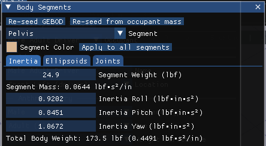
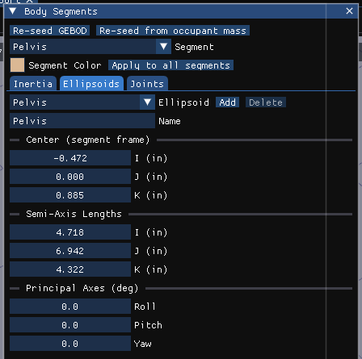
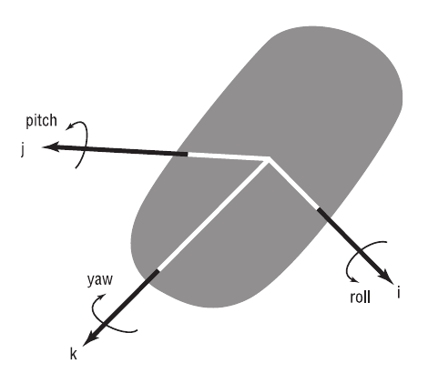
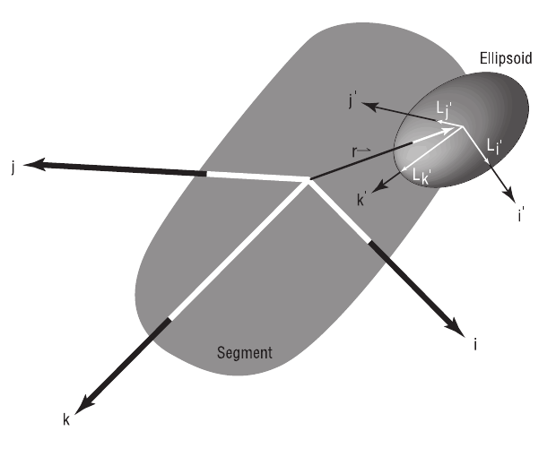
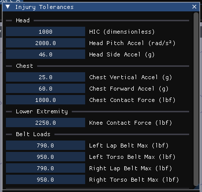
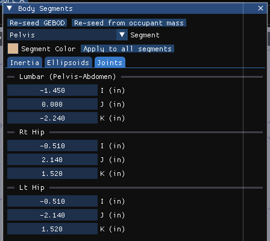
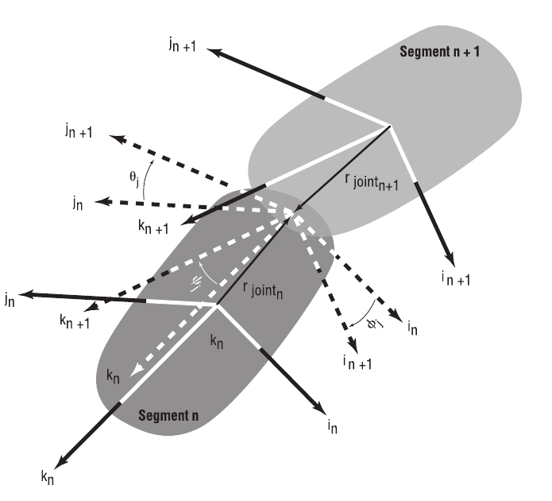
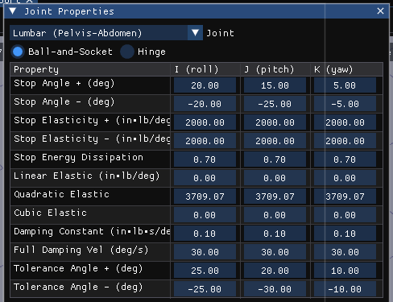

# Chapter 9 — Human Model Definition

*Adapted for HVE 2027 from the HVE User's Manual (HVE Version 5, Seventh Edition, January 2006), Chapter 9.*

## Overview

The Human Editor displays the current human in the viewport (see
Figure 9-1). The HVE Human model is a physical/mathematical model based on
GEBOD [3.9, 3.10], a program developed at Wright-Patterson Air Force Base
under Federal sponsorship. The model has 15 segments and 14 joints. A
schematic diagram of the HVE Human Model is shown in Figure 9-2. The original
purpose of GEBOD was to produce anthropomorphically correct models of human
pilots for purposes of design of the cockpits of fighter aircraft, although
GEBOD is now used by several occupant dynamics simulators used in the study of
motor vehicle safety [3.15, 3.16].

In HVE the parameters are selected by clicking on the individual segment CG
spheres in the Human Viewer, which displays an option list of parameter
groups for that segment (see the [Human CG Dialog reference
page](../../07-humans/HumCGDlg.md)). In HVE 2027 they are reached from the
buttons of the Occupants panel (see [Chapter 8](08-creating-editing-humans.md)):
**Body Segments…** for the per-segment groups, **Joint Properties…** and
**Injury Tolerances…**. In the Body Segments dialog a segment is chosen from
its **Segment** list or by clicking the segment in the viewport. The Human
Model parameters are divided into the following groups:

- Inertial Properties for each segment
- Color for each segment
- Contact Ellipsoid Properties for each segment
- Injury Tolerances for the selected human
- Joint Properties for each segment

These categories, and their associated parameters, are described in the
following sections.

*Figure 9-1: The Body Segments dialog (HVE 2027), opened from the Occupants panel. The segment is chosen from the Segment list or by clicking it in the viewport.*

The HVE Human Model has 15 segments and 14 joints; it [3.9] is based on
GEBOD [3.10]. The 15 segments are: Pelvis, Abdomen, Chest, Neck, Head, right
and left Upper Legs, right and left Lower Legs, right and left Feet, right
and left Upper Arms, and right and left Lower Arms. The 14 joints are Lumbar
(Pelvis–Abdomen), Waist (Abdomen–Chest), Lower Neck (Chest–Neck), Upper Neck
(Neck–Head), right and left Hip, Knee and Ankle, and right and left Shoulder
and Elbow.

!!! note "HVE 2027"
    HVE's schematic of the 15-segment model (the original Figure 9-2) is not
    reproduced here; the segment and joint names above are the ones the
    HVE 2027 dialogs use.

## Inertial Properties

Inertial parameters for the HVE Human Model are defined for each of the 15
segments. To view and edit them, open **Body Segments…** from the Occupants
panel, select the segment, and choose the **Inertia** tab (Figure 9-1). The
individual parameters are described in Table 9-1. See also the [Inertial Data
Dialog reference page](../../07-humans/Human.md).

**Table 9-1: Inertial Parameters for each human segment**

| Parameter | Unit Name | Description |
|---|---|---|
| Weight | UtHumForce | Weight of selected segment (HVE calculates and stores the segment mass by dividing the entered weight by the current acceleration of gravity) |
| Rotational Inertias | UtHumInertia | Rotational inertias about the segment i, j and k (roll, pitch and yaw) axes |

The tab also displays the read-only Segment Mass and the read-only Total
Body Weight of the entire human (the sum of all 15 segment masses multiplied
by the case's acceleration of gravity, with the total mass beside it).
Weights and inertias are shown in the units set in Preferences.

## Segment Color

The color of each of the 15 segments is user-definable. In HVE 2027 the
**Segment Color** swatch is at the top of the Body Segments dialog, above
the tabs (Figure 9-1). Click the swatch to open a color picker; **Apply to
all segments** copies the current segment's color to all 15.

!!! note "HVE 2027"
    Segment color is display only. A segment that has been given a material
    in the Shader Editor (View › Shader Editor) is drawn in that material
    instead. The picker edits the color directly; HVE's separate intensity
    slider is part of the color value here.

**Table 9-2: Color Parameters for each human segment**

| Parameter | Unit Name | Description |
|---|---|---|
| RGB Color Values | UtNone | Red, green and blue color values for the selected segment |
| Color Intensity | UtNone | Brightness (0 = dark, 1 = bright); in HVE 2027 part of the color value |

## Contact Ellipsoid Properties

Ellipsoid properties for the HVE Human Model are defined for each of the 15
segments. To view and edit them, open **Body Segments…**, select the segment
and choose the **Ellipsoids** tab (Figure 9-5). The individual parameters are
described in Table 9-3. See also the [Contact Ellipsoids Dialog reference
page](../../07-humans/Human1.md).

*Figure 9-5: Ellipsoids tab of the Body Segments dialog.*

Up to three individual ellipsoids may be supplied for each segment. To create
a new ellipsoid, click **Add**; it is named after the segment and may be
renamed in the **Name** field. Select an existing ellipsoid from the
**Ellipsoid** list; **Delete** removes it (a segment keeps at least one).
The center (I, J, K), the semi-axis lengths (I, J, K) and the principal axes
(roll, pitch, yaw, in degrees) are edited below the list.

!!! note "HVE 2027"
    The occupant engines test contact against each segment's FIRST ellipsoid
    only; this is HVE's own behavior, and HVE 2027 names in the run status
    any contact pair that refers to a second or third ellipsoid.

**Table 9-3: Contact Ellipsoid Parameters for each human segment**

| Parameter | Unit Name | Description |
|---|---|---|
| Ellipsoid Name | 30-character text string | User-supplied names for each contact ellipsoid |
| Center Coordinates | UtHumDispLength | The coordinates of the center of the selected ellipsoid, defined relative to the segment principal axis system |
| Semi-axis Length | UtHumDispLength | The semi-axis i, j and k lengths of the selected ellipsoid |
| Principal Axes | UtHumDispAngle | The angles of the i, j and k ellipsoid axis system relative to the segment axis system (see Figure 9-6) |
| Ellipsoid Material Name | UtNone | Name for material attached to current ellipsoid (not in HVE 2027; see below) |

*Figure 9-6: Human Segment Coordinate System.*

*Figure 9-7: Human Contact Ellipsoids Coordinate System.*

### Contact Ellipsoid Material Properties

In HVE each contact ellipsoid has material attributes, assigned by selecting
a material file, and edited in the Human Materials dialog (Material button of
the Contact Ellipsoids dialog). The material attributes are defined in
Table 9-4. See also the [Human Material Properties Dialog reference
page](../../07-humans/HumMatProp.md).

!!! warning "Not in HVE 2027"
    HVE 2027 has no per-ellipsoid material and no Human Materials dialog. The
    occupant–vehicle contact materials of an HVE case (the combined material
    of each contact pair) are imported with the `.hve` file and reach the
    occupant engines; for an EDHIS or GATB event they are edited in Event
    Information › **Combined Contact Materials**. The vehicle side of a contact is
    edited with the vehicle's [Contact
    Surfaces](../04-vehicle-editor/11a-sprung-mass.md#contact-surfaces).

**Table 9-4: Human Contact Ellipsoid Material Parameters**

| Parameter | Unit Name | Description |
|---|---|---|
| Material Name | UtNone | User-editable material name |
| Constant | UtHumForce | Force required to initiate deflection |
| Linear Stiffness | UtHumMatLinear | Linear material deformation coefficient |
| Quadratic Stiffness | UtHumMatQuad | Quadratic material deformation coefficient |
| Cubic Stiffness | UtHumMatCubic | Cubic material deformation coefficient |
| Damping Constant | UtHumMatDamp | Material velocity-dependent deformation constant |
| Friction Constant | UtNone | Inter-segment friction coefficient |
| Maximum Force | UtHumForce | Force at which 3rd-order force-deflection relationship is abandoned |
| Maximum Deflection | UtHumDispLength | Deflection at which 3rd-order force-deflection relationship is abandoned *(updated: unit name was listed as UtHumDispLinear in the original manual; HVE now uses UtHumDispLength)* |
| Unloading Slope | UtHumMatLinear | Linear unloading slope beginning at maximum deflection |

## Injury Tolerances

Injury Tolerances may be defined for the current human. These injury
tolerances are used during the current event as guidelines to estimate when
specific injuries might occur.

> **NOTE:** Injury Predictions are an available Output Report.

To view and edit the current human's injury tolerances, press **Injury
Tolerances…** in the Occupants panel. The individual parameters are displayed
in the Injury Tolerances dialog, as shown in Figure 9-9 and Table 9-5. See
also the [Injury Tolerance Data Dialog reference
page](../../07-humans/Human2.md).

*Figure 9-9: Injury Tolerances dialog (HVE 2027).*

!!! note "HVE 2027"
    The dialog groups the tolerances under Head, Chest, Lower Extremity and
    Belt Loads. Labels and units differ from HVE's dialog in three places:
    Head Pitch Concussion is entered in rad/s² (HVE's default, 114591.6
    deg/s², is 2000 rad/s²); Chest SI is labelled **Chest Vertical Accel
    (g)**; and Max Knee Force is **Knee Contact Force**. Forces follow the
    units set in Preferences. The defaults are HVE's: HIC 1000, head side
    46 g, chest 25 g, chest force 1800 lb, chest forward 60 g, knee
    2250 lb, lap belts 790 lb and torso belts 950 lb.

**Table 9-5: Injury Tolerance Parameters for the current human**

| Parameter | Unit Name | Description |
|---|---|---|
| HIC | n/a | Head Injury Criterion, an empirically derived index [6.1] used to estimate the probability of a closed head injury |
| Head Pitch Concussion | UtHumAccelAngular (deg/sec²) | Angular acceleration of the head about the pitch axis of the neck |
| Head Side Acceleration | UtHumAccelLinear (g) | Linear acceleration of the head in the direction of the head-fixed j-axis |
| Chest SI | UtHumChestSI (g) | Chest Severity Index, an injury index indicating the maximum chest acceleration |
| Chest Force | UtHumForce | The tolerance for peak force against the chest in the direction of the chest-fixed i-axis |
| Chest Forward Acceleration | UtHumAccelLinear (g) | The tolerance for peak chest acceleration in the direction of the chest-fixed i-axis |
| Maximum Axial Femur Load (Max Knee Force) | UtHumForce | The tolerance for peak axial loading of the femur *(updated: labeled "Max Knee Force" in the current dialog)* |
| Maximum Lap Belt Force — Left Belt / Right Belt | UtHumForce | The tolerance for lap belt tension, above which injury is expected to occur to the abdomen |
| Maximum Torso Belt Force — Left Belt / Right Belt | UtHumForce | The tolerance for torso belt tension, above which injury is expected to occur to the torso |

*(updated: the original manual listed a single Maximum Lap Belt Force and a
single Maximum Torso Belt Force. The current human model uses four separate
belt injury tolerances — left lap, right lap, left torso and right torso —
and the current dialog provides separate left-belt and right-belt entries for
both the lap and torso webbing.)*

*(updated: the unit names for the head and chest acceleration tolerances were
listed in the original manual as UtHumAccelAngle and UtHumAccelLength; HVE
now uses UtHumAccelAngular and UtHumAccelLinear, and Chest SI has its own
unit type, UtHumChestSI.)*

## Joint Parameters

Joint parameters for the HVE Human Model are defined for each of the 14
joints. To view and edit the joint locations, open **Body Segments…**, select
the segment and choose the **Joints** tab (Figure 9-10). The tab lists every
joint attached to the selected segment (a segment may have up to 4 attached
joints), each with its I, J, K coordinates relative to the segment coordinate
system (see Figure 9-11). See also the [Joint Data Dialog reference
page](../../07-humans/Human3.md).

*Figure 9-10: Joints tab of the Body Segments dialog.*

**Table 9-6: Joint Parameters for each human segment**

| Parameter | Unit Name | Description |
|---|---|---|
| Joint Coordinates | UtHumDispLength | i, j and k coordinates of selected joint, defined relative to the segment principal axis system |

*Figure 9-11: Human Joint Coordinate System.*

### Joint Properties

Each joint is defined by a number of physical properties. To view and edit
these properties, press **Joint Properties…** in the Occupants panel and
choose the joint from the **Joint** list. The Joint Properties dialog is
shown in Figure 9-12; the individual properties are defined in Table 9-7.
Except for the joint type (Ball-and-Socket or Hinge), each property is
entered separately for rotation about the joint's I (roll), J (pitch) and
K (yaw) axes. See also the [Joint Properties Dialog reference
page](../../07-humans/HumJntPropDlg.md).

*Figure 9-12: Joint Properties dialog (HVE 2027).*

!!! note "HVE 2027"
    Angles are in degrees. Stop Elasticity and Linear Elastic are shown in the
    torsional-stiffness unit set in Preferences (in-lb/deg in US units) and
    the Damping Constant in its angular-damping unit; the Quadratic and Cubic
    Elastic coefficients are shown as stored, in SI per radian² and per
    radian³, and are not converted. GATB uses the I and K
    axes of the elastic and dissipation terms; the J-axis values are kept.

**Table 9-7: Joint Properties for each joint**

| Parameter | Unit Name | Description |
|---|---|---|
| Joint Type | n/a | Either Ball-and-Socket or Hinge |
| Stop Angle, + Axis Rotation | UtHumDispAngle | The angle at which the joint stop is applied for positive i, j and k segment rotations |
| Stop Angle, − Axis Rotation | UtHumDispAngle | The angle at which the joint stop is applied for negative i, j and k segment rotations |
| Stop Elasticity, + Axis Rotation | UtHumElastLinear | Joint stop linear elastic property for positive rotations about the i, j and k axes |
| Stop Elasticity, − Axis Rotation | UtHumElastLinear | Joint stop linear elastic property for negative rotations about the i, j and k axes |
| Stop Energy Dissipation | UtNone | Ratio of dissipated to total energy at the joint stop |
| Linear Elastic Constant | UtHumElastLinear | Joint linear elastic property during normal range of motion for rotations about the i, j and k axes |
| Quadratic Elastic Constant | UtHumElastQuad | Joint quadratic elastic property during normal range of motion for rotations about the i, j and k axes |
| Cubic Elastic Constant | UtHumElastCubic | Joint cubic elastic property during normal range of motion for rotations about the i, j and k axes |
| Damping Constant | UtHumDamp | Joint damping property during normal range of motion for rotations about the i, j and k axes |
| Full Damping Angular Velocity | UtHumVelAngular | Angular velocity required to achieve full joint damping |
| Joint Injury Tolerance, Max + Rotation Angle | UtHumDispAngle | The positive joint angle which, if exceeded, is predicted to cause injury to the joint |
| Joint Injury Tolerance, Max − Rotation Angle | UtHumDispAngle | The negative joint angle which, if exceeded, is predicted to cause injury to the joint |

<!-- NAV -->

---

← Previous: [Chapter 8 — Creating and Editing Humans](08-creating-editing-humans.md)  |  [Index](README.md)

<!-- /NAV -->
