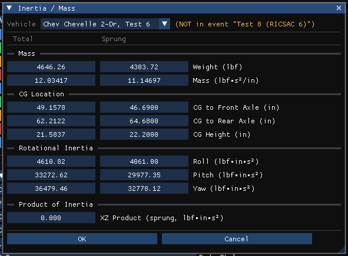
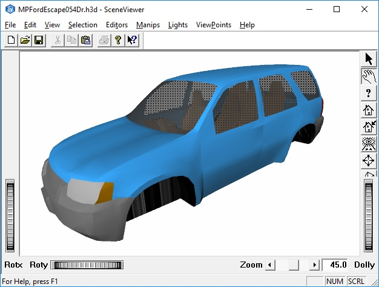
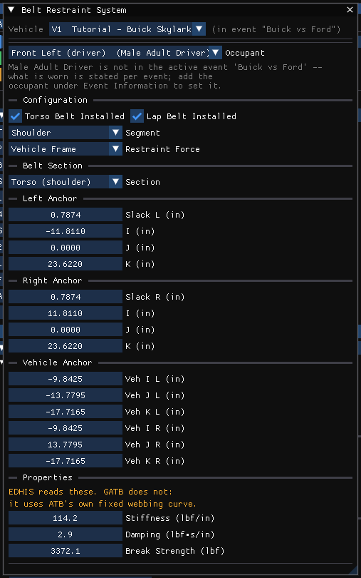
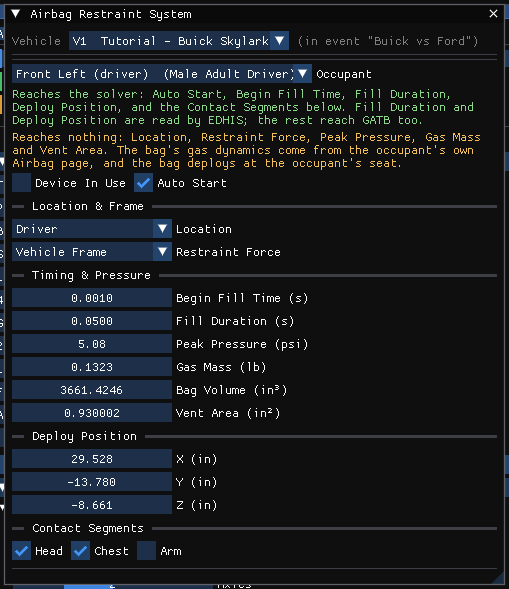
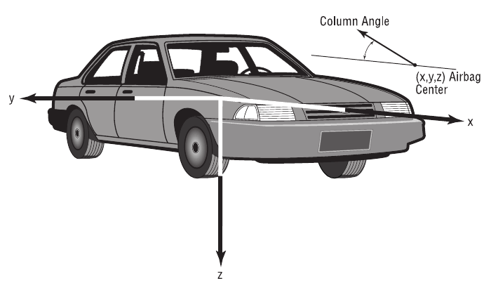
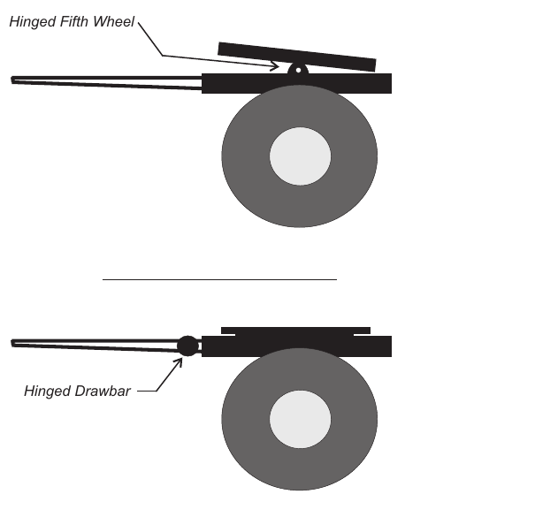
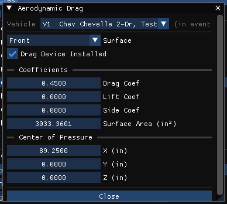

# Chapter 11 — Vehicle Model Definition (Part A: Sprung Mass)

*Adapted for HVE 2027 from the HVE User's Manual (Version 5, Seventh
Edition, Jan 2006), Chapter 11.*

The Vehicle Editor displays the current vehicle in the viewport.
The HVE Vehicle Model is a general purpose physical/mathematical model of a
vehicle developed by EDC. The HVE Vehicle Model applies to any type of
vehicle having left-side and right-side wheels, including passenger cars,
pickups, vans, sport-utility vehicles, trucks, trailers, dollies and
barriers.

The Vehicle Editor allows editing of the parameters which define the HVE
Vehicle Model. The general categories for these parameters are:

- **Sprung Mass** — *Inertias, Move CG, Color, Geometry File, Contact
  Surfaces, Inter-vehicle Connections, Belt Restraints, Airbag Restraints,
  Aerodynamic Drag, Body Torsion* (this part).
- **Unsprung Masses** — *Suspension, Tire, Brake, Wheel x,y,z Coordinates*
  (see [Part C — Suspension](11c-suspension.md) and
  [Part D — Brakes, Tires and Wheels](11d-brakes-tires-wheels.md)).
- **Exterior** — the exterior dimensions and structural stiffness (see
  [Part B — Exterior](11b-exterior.md)).
- **Brake System** — the master cylinder or compressor, and the ABS system
  (see [Part E](11e-drivetrain-steering-brake-system.md)).
- **Steering System** (see [Part E](11e-drivetrain-steering-brake-system.md)).
- **Drivetrain** — *Engine, Transmission, Differential* (see
  [Part E](11e-drivetrain-steering-brake-system.md)).

These categories and their associated parameters are described in this
chapter.

!!! note "HVE 2027"
    In HVE these groups are reached by clicking the vehicle's CG, wheels,
    exterior spheres, master cylinder, steering wheel and engine in the
    Vehicle Viewer. HVE 2027 has no pickable components; each group's dialog
    is opened from the **Vehicle** menu or the **Vehicles** panel. The map
    from HVE's components to HVE 2027's dialogs is in [Chapter 10, Selecting
    and Editing Vehicles](10-creating-editing-vehicles.md#selecting-and-editing-vehicles).
    Every value is shown in the units set in Tools › Preferences; the case
    stores SI.

## Inertial Properties

The inertial properties of the vehicle are displayed and edited using the
**Inertia / Mass** dialog (Vehicles panel › Vehicle Properties › Inertia /
Mass…). It shows paired **Total** (i.e., sprung + unsprung) and **Sprung**
columns side by side for the weight, the mass, the CG location (CG to front
axle, CG to rear axle, CG height) and the roll, pitch and yaw inertias.
Either column may be edited; the other is recalculated from the vehicle's
unsprung masses and their locations. The same Total/Sprung pairs for the
weight and inertias are also in the **Inertia** part of the Vehicles panel's
Dimensions / Inertias section.

!!! note "HVE 2027"
    - There is no Basic/Complex toggle: both columns are always shown.
    - The unsprung mass used for the conversion comes from the tire weights and, on a solid axle, the axle beam mass
      entered in Suspension Data.
    - A roll, pitch or yaw inertia the vehicle does not state is
      **estimated** from the mass and the wheelbase and track, and the
      solver uses the same estimate. Type a measured value to replace it.
    - **Cancel** discards every change made since the dialog was opened.

> **NOTE:** Typically, 2-D models use total vehicle inertial properties; 3-D
> models use the sprung mass properties. Why? The unsprung masses (i.e.,
> wheels and axles) have their own independent equations of motion.

HVE's Inertial Properties dialog also includes a feature that automatically
updates the rotational inertias when the weight is changed (described
below).

!!! warning "Not in HVE 2027"
    HVE 2027 has no **Auto Update When Weight Changes** option: a stated
    rotational inertia is left unchanged when the weight is edited. Scale
    the inertias yourself if the mass distribution is to be kept (an
    *estimated* inertia follows the mass automatically).

*Figure 11-2: Inertia / Mass dialog, with its Total and Sprung columns.*

See also the reference page,
[Vehicle Inertia dialog](../../02-vehicles/VehInerDlg.md).

The Inertial Properties dialog performs a number of calculations, depending
on which values the user edits.

If the sprung weight, $W_{S}$, is edited, the total weight, $W_{T}$, is updated:

$$W_T = W_S + \sum_{n=1}^{NumAxles} W_U$$

where $W_{U}$ = unsprung weight of each wheel (plus axle for solid axle
suspensions).

If the total weight, $W_{T}$, is edited, the sprung weight, $W_{S}$, is updated:

$$W_S = W_T - \sum_{n=1}^{NumAxles} W_U$$

If the sprung rotational inertia, $I_{Sx}$, $I_{Sy}$ or $I_{Sz}$ (roll, pitch or
yaw, respectively), is edited, the total rotational inertia, $I_{Tx}$, $I_{Ty}$
or $I_{Tz}$, is updated using the parallel axis theorem:

    I_T = I_S + Σ(n=1..NumAxles) (I_U + m_U * r_U²)

where

- $I_{U}$ = rotational inertia of each wheel (and axle for solid axle
  suspensions) about its own x, y or z axis
- `m_U` = mass of each wheel (plus axle for solid axle suspensions)
- `r_U` = orthogonal distance from vehicle sprung mass CG to unsprung mass
  CG.

Similarly, if the total rotational inertia, $I_{Tx}$, $I_{Ty}$ or $I_{Tz}$ (roll,
pitch or yaw, respectively), is edited, the sprung rotational inertia,
$I_{Sx}$, $I_{Sy}$ or $I_{Sz}$, is updated using the parallel axis theorem:

    I_S = I_T − Σ(n=1..NumAxles) (I_U + m_U * r_U²)

In HVE, if the *Auto Update When Weight Changes* checkbox is checked, the
rotational inertias are updated as follows (not in HVE 2027):

a) If the sprung weight is edited, the updated sprung rotational inertias
are:

    I_S = I_S0 * (W_S / W_S0)

where

- $I_{S0}$ = sprung rotational inertia before editing sprung weight
- $W_{S0}$ = sprung weight before editing

The total rotational inertias, $I_{T}$, are then calculated using the parallel
axis theorem, as shown above.

b) If the total weight is edited, the updated total rotational inertias are:

    I_T = I_T0 * (W_T / W_T0)

The sprung rotational inertias, $I_{S}$, are then calculated using the
parallel axis theorem, as shown above.

To display or edit the current vehicle's inertial properties, perform the
following steps:

1. In the Vehicles panel, open the **Vehicle Properties** section and press
   **Inertia / Mass…**. The Inertia / Mass dialog will be displayed.
2. View and/or edit the desired properties. The other properties are
   updated as described above as you type.
3. Press *OK* to close the dialog, or *Cancel* to discard the changes.

The Inertial Properties are described below.

- **Weight** — Vehicle total and sprung weight.

  > **NOTE:** HVE divides your entered value by the current gravitational
  > constant (see Environment Editor) and stores the resultant mass. That
  > way, if you take the vehicle to the moon, it will behave correctly!

- **Mass** — Vehicle total and sprung mass (weight/g). In HVE 2027 the mass
  row is editable too; weight and mass follow each other.
- **Roll, Pitch and Yaw Rotational Inertias** — Vehicle total and sprung
  mass rotational inertias.
- **x-z Product of Inertia** — Product of inertia about the y axis. This
  value represents the fact that the x-z plane is not a plane of symmetry
  for the vehicle sprung mass. Entered on the sprung basis only (XZ Product
  (sprung)).

  > **NOTE:** For all practical purposes, a vehicle is symmetrical in the
  > x-y plane (i.e., about the z axis) and in the y-z plane (i.e., about the
  > x axis). Therefore, these inertial products are zero.

**Table 11-1: Inertial Properties**

| Parameter | Unit Name | Description |
| --- | --- | --- |
| Weight | UtVehForce | Vehicle total and sprung weight (HVE calculates and stores the mass by dividing the entered weight by the current acceleration of gravity) |
| Rotational Inertias | UtVehInertia | Vehicle total and sprung rotational inertias about the vehicle x, y and z (roll, pitch and yaw) axes |
| x-z Product of Inertia | UtVehInertia | Inertial product about the y axis |

## Move CG

The default CG (center of gravity) location of the vehicle sprung mass is
determined from raw data (e.g., measured or table values). The user may
choose to edit the CG location using the Move CG dialog. See also the
reference page, [Move CG dialog](../../02-vehicles/MoveCGDlg.md).

!!! note "HVE 2027"
    HVE 2027 has two controls where HVE has one:

    - **Event › Move CG** (in the Event editor, for EDSMAC and EDSMAC4
      events) — HVE's Move CG dialog: ΔX, ΔY and ΔZ move the CG relative to
      the body, and every distance measured from the CG follows; CG Height
      is read-only. The CG location may also be edited directly in the Vehicles
      panel (CG to Axle 1/2, CG Height) and in the Inertia / Mass dialog.
    - **Vehicle › Vehicle Mesh › Move CG** — where the CG sits in the 3-D
      model file's own coordinates, i.e. how the drawn and collided body is
      placed about the CG (see [Geometry File](#geometry-file)).

> **NOTE:** The default location of the CG is determined by the wheel
> locations (which are defined relative to the CG). Refer to the Wheel
> Location parameters for more information.

> **NOTE:** Changing wheel z coordinates or tire radii for any wheel
> location will change the calculated CG height.

To display or edit the current vehicle's CG location (relative to the
default location), perform the following steps:

1. In the Event editor, with an EDSMAC or EDSMAC4 event active, choose
   **Event › Move CG**. The Move CG dialog will be displayed.
2. View and/or edit the desired properties.
3. Press *Apply* to apply the change.

The Move CG parameters are described below.

- **dx** — Moves the CG in the +x or −x direction, relative to the
  vehicle-fixed coordinate system (+x is *forward* in all coordinate
  systems).
- **dy** — Moves the CG in the +y or −y direction, relative to the
  vehicle-fixed coordinate system (+y is *to the right* in the SAE
  coordinate system).
- **dz** — Moves the CG in the +z or −z direction, relative to the
  vehicle-fixed coordinate system (+z is *down* in the SAE coordinate
  system).

**Table 11-2: Move CG Parameters**

| Parameter | Unit Name | Description |
| --- | --- | --- |
| dx, dy, dz | UtVehDispLength | Adjustment of the default CG (center of gravity) location relative to the vehicle-fixed coordinate system |
| CG Height | UtVehDispLength | Approximate CG height, calculated from vehicle wheel positions and tire radius. Tire deflection is ignored. |

## Color

The color of the vehicle is obvious from looking at it. In HVE 2027 it is
edited with the **Color** field in the Information section of the Vehicles
panel, or **Vehicle Color** in the Vehicle Information dialog: three R, G, B
values (0–255) and a swatch. Click the swatch to open a color picker (color
wheel or square, hue, saturation and value, or hexadecimal), or drag or type
in the R, G, B fields.

> **NOTE:** Do not use a fully saturated color if you plan to produce a
> video! Saturated colors (especially red) look bad on video.

!!! tip "New in HVE 2027"
    The vehicle color is what a material-less vehicle is painted with. For
    finer control of how a vehicle looks, give it, or each of its parts,
    a display material (Vehicle › Edit Mode and View › Shader Editor; see
    [Chapter 10](10-creating-editing-vehicles.md#edit-mode-materials-per-part)).

## Geometry File

The current vehicle may be visualized using a simplified vehicle shape or an
actual 3-D geometry file created by digitizing the vehicle. If a 3-D
geometry file is available for the current vehicle, it is assigned in the
**Vehicle Mesh** dialog (Vehicle › Vehicle Mesh, also Vehicle › Advanced
Mesh Options and Event › Vehicle Mesh), or in the 3D Geometry section of the
Vehicles panel and the Vehicle Information dialog.

*Figure 11-5: Vehicle Mesh dialog.*

### Mechanical Properties

The 3-D geometry file is not only used to visualize the vehicle, it is also
used to define the mechanical/structural properties of the vehicle exterior.
Each vertex includes a complete material specification. These material
properties are:

- **x,y,z coordinates** — Vehicle-fixed coordinates for each vertex (a
  typical mesh includes approximately 2500 to 5000 vertices, not including
  the wheels).
- **Force Constant** — K₀, the force required to initiate vertex
  deformation.
- **Linear Stiffness** — F₁, the linear force-deflection constant for the
  vertex.
- **Quadratic Stiffness** — F₂, the 2nd-order force-deflection constant for
  the vertex.
- **Cubic Stiffness** — F₃, the 3rd-order force-deflection constant for the
  vertex.
- **Damping Constant** — The velocity-dependent force constant for the
  vertex.
- **Friction Constant** — The friction multiplier for the vertex.
- **Maximum Force** — Yield force for the vertex.
- **Maximum Deflection** — Yield at failure for the vertex.
- **Unloading Slope** — Linear force-deflection relationship during
  unloading.

*Figure 11-6: View of 3-D geometry file (mesh), shown in HVE's SceneViewer. The mesh provides visual properties, as well as mechanical properties that may be used by collision algorithms.*

These material properties are available for collision algorithms to
simulate collision forces and moments, as well as to visualize the resulting
deformation to the vehicle exterior.

> **NOTE:** For more information regarding these parameters and how they are
> used, refer to the User's Manual for the particular simulation model being
> used.

**Table 11-3: Vehicle 3-D Geometry Mechanical Parameters**

| Parameter | Unit Name | Description |
| --- | --- | --- |
| x,y,z coords | UtVehDispLength | Vehicle-fixed vertex coordinates |
| Material Name | UtNone | Material name |
| Constant | UtVehForce | Force required to initiate deflection |
| Linear Stiffness | UtVehMatLinear | Linear material deformation coefficient |
| Quadratic Stiffness | UtVehMatQuad | Quadratic material deformation coefficient |
| Cubic Stiffness | UtVehMatCubic | Cubic material deformation coefficient |
| Damping Constant | UtVehMatDamp | Material velocity-dependent deformation constant |
| Friction Constant | UtNone | Friction coefficient |
| Maximum Force | UtVehForce | Force at which 3rd-order force-deflection relationship is abandoned |
| Maximum Deflection | UtVehDispLinear | Deflection at which 3rd-order force-deflection relationship is abandoned |
| Unloading Slope | UtVehMatLinear | Linear unloading slope beginning at max deflection |

### Geometry File Options

In HVE, Geometry File offers *New, Open* and *Save-As*. In HVE 2027 the
Vehicle Mesh dialog contains:

- **Mesh Assignment** — **Mesh File**: the 3-D model. **…** browses for a
  file; **Library…** searches the vehicle geometry library by name. HVE's
  `.h3d` files, Open Inventor/VRML (`.iv`, `.wrl`) and `.obj` are read (the
  Vehicles panel's 3D Geometry section lists the same formats).
- **Import Options** — Scale Factor, Smooth normals (use vn), Flip normals,
  Center on CG, Draw wheels (tire radius), Round shell (curved subdivision:
  Off, 1 or 2 levels; needs Smooth normals), LOD Level (High, Medium, Low)
  and Opacity, with **Load 3D File** and **Clear**.
- **Move, Rotate and Scale the Model** — **Move CG** (where the CG sits in
  the model file's own coordinates, HVE's Move CG for the geometry) and
  HVE's Transform Vehicle Geometry: **Translate**, **Rotate** (degrees) and
  **Scale** per axis, applied scale, then rotate, then translate. SAE axes:
  +x forward, +y right, +z down.
- **Shading** — **As Loaded**, **Flat**, **Smooth** or **Auto Smooth**, with
  the **Auto Smooth Angle** (default 60°) for the last. As Loaded uses the
  file's own normals; Auto Smooth smooths across edges whose faces meet
  within the angle and keeps sharper edges creased. Display only.
- **Damage Display** — Smooth crush deformation and its number of passes
  (display only: reported crush depths and energies are the solver's).
- **DyMESH Contact Mesh Preparation** — Tessellate, maximum triangle leg and
  weld distance, for the vehicle and, when the active event states its own,
  for that event (the event's values are the ones the run uses).
- A status line: whether the mesh loaded, or that the vehicle is drawn and
  collided as the generated box.

> **NOTE:** If no file is assigned, or the file cannot be loaded, the vehicle
> is visualized as a simple vehicle body (defined according to its type and
> dimensions) — and DyMESH collides it as that body, not only draws it.

#### New

HVE's *New* removes the 3-D geometry file and replaces it with the simple
vehicle shape. In HVE 2027 press **Clear** in the Vehicle Mesh dialog (or in
the 3D Geometry section).

#### Open

To assign a 3-D geometry file to the current vehicle:

1. Choose **Vehicle › Vehicle Mesh**.
2. Press **…** beside Mesh File and choose the file, or press **Library…**
   and search for it by name.
3. Press **Load 3D File**.

The selected 3-D geometry file is displayed on the current vehicle.

#### Save-As

!!! warning "Not in HVE 2027"
    HVE 2027 does not write vehicle geometry files. The whole scene,
    vehicles included, can be exported as glTF with **File › Export Scene
    for Blender**.

## Contact Surfaces

The current vehicle may include contact surfaces used for simulating
interaction forces between the vehicle and its occupants or pedestrians.

Contact Surfaces are planes defined by 3 corners (the fourth corner is
automatically assigned by assuming a parallelogram). Contact surfaces are
created using the Contact Surfaces dialog (**Vehicle › Contact Surfaces**).

*Figure 11-7: Vehicle contact surfaces — both interior and exterior contact surfaces are permissible (rendered in HVE).*

*Figure 11-8: Contact Surfaces dialog (HVE 2027): the surface list, the selected surface's classification and geometry, and the Derive, template and interior-file controls below.*

The Contact Surfaces dialog lists the vehicle's surfaces on the left; the
selected surface is edited on the right. Click a name to select it;
Ctrl-click and Shift-click select several (for Delete). To create and edit a
contact surface, perform the following steps:

1. Choose **Vehicle › Contact Surfaces**. The Contact Surfaces dialog is
   displayed, and the vehicle's surfaces are drawn in the viewport, each with
   an arrow showing its normal. A surface may also be selected by clicking
   it in the viewport.
2. Press **Add** to add a surface ("Surface *n*"), and enter its **Name**.
   **Material** is the material's name.
3. Set **Class** (*Vertex*, *Face* or *Group* — HVE's Bind Material To) and
   **Side** (*Interior* or *Exterior* — HVE's Location).

   > **NOTE:** The simulation may use this information to reduce the number
   > of contacts for which it must calculate forces, based on whether the
   > human is an occupant or pedestrian. For example, it is unnecessary to
   > calculate the force between a pedestrian and seat cushion, since none
   > will occur. (See Event Editor, Contacts Dialog, for more information.)

4. Enter the geometry, in vehicle-fixed coordinates. By default the surface
   is edited as a rectangle: **Centre** (X, Y, Z), **Size** (Width, Height)
   and **Angles** (Yaw, Pitch, Roll, in degrees, applied 3-2-1). Check
   **Edit corner points instead** to enter HVE's three corners directly:
   **P2 (corner)**, **P3 (+width)** and **P1 (+height)**.

   > **NOTE:** The "right hand rule" is used to determine the positive side
   > of the contact surface. The dialog displays the surface's **Normal**;
   > **Flip** reverses it. Force on the contact surface is only calculated if
   > it is struck on the positive side!

   > **NOTE:** The fourth corner is created automatically assuming a
   > parallelogram. A skewed (non-rectangular) surface is kept only in the
   > corner-point form; editing it as a rectangle squares it up.

   
   *Figure 11-9: Convention for contact surfaces — three consecutive corners are selected; the right hand rule determines the positive side.*

5. Open **Material Properties** and edit the surface's force-deflection,
   damping and friction properties (see below). They apply only to this
   surface.

It is important to confirm the contact surfaces are correctly positioned
and facing the right direction within the vehicle. Carefully view each
surface to ensure its correct position and orientation.

> **NOTE:** The surfaces are drawn while the Contact Surfaces, Belt
> Restraint or Airbag Restraint dialog is open. **View › Occupant
> Equipment** draws them at any time.

Changes take effect as they are made; Edit › Undo reverses them.

!!! tip "New in HVE 2027"
    Below the list:

    - **Derive from Mesh** builds surfaces from the flat regions of a named
      group of the vehicle's 3-D model ("interior" for the cabin, "body" for
      the exterior shell a pedestrian strikes), in the chosen region;
      **Pedestrian preset** sets both for a pedestrian impact. Only the
      geometry is derived, not the material.
    - **Seed Standard Interior** replaces the list with a generic driver
      compartment (seat, floor, toe pan, instrument panel, wheel, glass,
      roof, doors) scaled from the vehicle's dimensions — generic, not
      measured.
    - A template list and **Use Template** replace the list with a set of
      surfaces authored in HVE on a real vehicle, with their materials (not
      rescaled).
    - **Save Interior…** and **Load Interior…** write and read the vehicle's
      contact surfaces as a standalone file, for reuse on another vehicle or
      case (not rescaled).

The Contact Surface parameters are described below.

- **Bind Material To** (HVE 2027: **Class**) — Assigns an attribute,
  *Vertex*, *Face* (polygon) or *Group*; the simulation uses this attribute
  to determine whether the material is associated with the vertex or
  polygonal area.
- **Location** (HVE 2027: **Side**) — Assigns an attribute, either *Interior* or *Exterior*,
  available for use by the simulation model to distinguish between surfaces
  on the vehicle's interior and exterior.
- **Material Name** — Assigns a user-editable name to the material; not
  used in calculations.
- **x,y,z** — Assigns the vehicle-fixed x,y,z coordinates for the three
  corners of the contact surface (the fourth is assigned by assuming a
  parallelogram).
- **Constant** (HVE 2027: **Force Constant**) — The force required to
  initiate deflection.
- **Linear Stiffness** — The first-order force vs deflection constant for
  the current contact surface.
- **Quadratic Stiffness** — The second-order force vs deflection constant
  for the current contact surface.
- **Cubic Stiffness** — The third-order force vs deflection constant for
  the current contact surface.
- **Damping Constant** — The velocity-dependent force contribution for the
  current contact surface.
- **Friction Constant** — Assigns friction characteristics to the surface;
  normally the friction between two surfaces is the arithmetic average of
  their individual friction coefficients.
- **Maximum Force** (HVE 2027: **Max Force (0=inf)**) — The maximum force
  resisted by the contact surface; if exceeded, force remains constant until
  the Maximum Deformation is reached.
- **Maximum Deflection** — The maximum allowable material deformation.
- **Unloading Slope** (HVE 2027: **Unloading Stiffness**) — A value used to
  assign hysteresis. The unloading slope defines the force vs deflection
  relationship during unloading.
- **Max Penetration** — The deepest penetration for which the occupant
  simulation (EDHIS) computes a contact force; HVE's Max Defl/Timestep.

> **NOTE:** The unloading slope should be steeper than the loading slope!

!!! note "HVE 2027"
    - The material properties are edited in the **Material Properties**
      section of the Contact Surfaces dialog; there is no separate material
      dialog, no force-deflection plot and no material database to choose
      from.
    - A Max Deflection of 0 is replaced by 0.25 m for occupant contact, and
      a Max Penetration of 0 by Max Deflection (else 0.25 m).

*Figure 11-11: Typical force vs deflection curve for a contact surface. The loading slope (which occurs during penetration) may be defined by a 3rd-order polynomial: F = ad + bd² + cd³, where a = Linear Stiffness, b = Quadratic Stiffness, c = Cubic Stiffness. During unloading the slope is assumed linear: F = u(d_max − d), where u = Unloading Slope.*

**Table 11-4: Vehicle Contact Surface Parameters**

| Parameter | Unit Name | Description |
| --- | --- | --- |
| Bind To | UtNone | Flag indicating whether material attributes are attached to each vertex or each face |
| Location | UtNone | Flag indicating whether the surface is an interior or exterior surface |
| x,y,z coords | UtVehDispLength | Vehicle-fixed vertex coordinates for each of 3 corners |
| Material Name | UtNone | Material name |
| Constant | UtVehForce | Force required to initiate deflection |
| Linear Stiffness | UtVehMatLinear | Linear material deformation coefficient |
| Quadratic Stiffness | UtVehMatQuad | Quadratic material deformation coefficient |
| Cubic Stiffness | UtVehMatCubic | Cubic material deformation coefficient |
| Damping Constant | UtVehMatDamp | Material velocity-dependent deformation constant |
| Friction Constant | UtNone | Friction coefficient |
| Maximum Force | UtVehForce | Force at which 3rd-order force-deflection relationship is abandoned |
| Maximum Deflection | UtVehDispLinear | Deflection at which 3rd-order force-deflection relationship is abandoned |
| Unloading Slope | UtVehMatLinear | Linear unloading slope beginning at max deflection |

## Belt Restraints

The belt restraint systems of the vehicle are displayed and edited using the
Belt Restraint System dialog (**Vehicle › Belt Restraint**, also Event ›
Restraints › Belt Restraint).

*Figure 11-12: Belt Restraint System dialog (HVE 2027).*

!!! note "HVE 2027"
    In HVE 2027 a belt system is kept per OCCUPANT of the vehicle rather than
    per seat: the dialog's **Occupant** list chooses whose belts are edited
    (it follows the human selected in the Occupants panel). What the occupant
    actually wears is stated per event, in **Restraint In Use** (None, Lap
    Belt, 3-Point Belt, Airbag + Belt), which edits the active event.

To display or edit the current vehicle's belt properties, perform the
following steps:

1. Choose **Vehicle › Belt Restraint**. The Belt Restraint System dialog will
   be displayed, and the belt anchors are drawn in the viewport.
2. Choose the occupant in the **Occupant** list, and set **Restraint In
   Use** for the active event.
3. Check **Torso Belt Installed** and/or **Lap Belt Installed** (HVE's
   Device Installed, per section), and choose the **Segment** (Shoulder,
   Chest, Lap) and the **Restraint Force** frame (Vehicle Frame, Ground
   Frame).
4. Choose the **Section** (Torso (shoulder) or Lap) to edit. Each section
   has its own anchors, slack and webbing; the torso section attaches to the
   chest and the lap section to the pelvis.
5. View and/or edit the section's properties.
6. Repeat for the other section and each occupant.

The Belt Restraint Properties are described below.

- **Occupant** — Whose belt system is edited (HVE: Seat Location).
- **Belt Section** — The section (torso or lap) of the current belt
  restraint system.
- **Torso / Lap Belt Installed** — The vehicle has that belt section.

The following belt properties may be assigned for the left and right sides
of each section:

- **Left / Right Anchor: Slack, I, J, K** — The slack, and the point where
  the belt attaches to the occupant's segment, in the segment's coordinates.
- **Vehicle Anchor: Veh I, J, K (left and right)** — The vehicle-fixed
  coordinates (about the CG) where the belt is attached to the vehicle.
- **Stiffness** — The first-order force vs deflection constant for the belt
  section.
- **Damping** — The velocity-dependent contribution to stiffness for the
  current belt section.
- **Break Strength** — The breaking strength of the belt. If exceeded, belt
  force becomes zero.

!!! warning "Not in HVE 2027"
    The belt's Quadratic and Cubic stiffness and its Unloading Slope have no
    control in HVE 2027. A value imported from an HVE case is kept. As the
    dialog states, EDHIS reads Stiffness, Damping and Break Strength and
    GATB does not: GATB uses ATB's own fixed webbing curve, as HVE does.

**Table 11-5: Belt Restraint System Parameters**

| Parameter | Unit Name | Description |
| --- | --- | --- |
| Location | n/a | Location index (Right Front, Left Front, ..., Left Back) used to assign the location of the current belt section |
| Section | n/a | Torso or Lap belt section |
| Device Installed | BOOLEAN (True or False) | Switch that determines that a restraint is installed at the selected location and section |
| x,y,z | UtVehDispLength | Vehicle-fixed x,y,z coordinates for the anchor point of the belt |
| Linear Stiffness | UtVehMatStiffLinear | First-order force vs deflection constant |
| Quadratic Stiffness | UtVehMatStiffQuad | Second-order force vs deflection constant |
| Cubic Stiffness | UtVehMatStiffCubic | Third-order force vs deflection constant |
| Damping Constant | UtVehMatDamp | Velocity-dependent force contribution |
| Max Force | UtVehForce | Maximum allowable force |
| Unloading Slope | UtVehMatStiffLinear | Force vs deflection constant during unloading |

## Airbag Restraints

The airbag restraint systems are displayed and edited using two dialogs in
HVE 2027:

- **Airbag Restraint System** (**Vehicle › Airbag Restraint**, also Event ›
  Restraints › Airbag Restraint) — the vehicle side, per occupant: Device In
  Use, Auto Start, Location, Restraint Force frame, Begin Fill Time, Fill
  Duration, Peak Pressure, Gas Mass, Bag Volume, Vent Area, Deploy Position
  (X, Y, Z) and the Contact Segments (Head, Chest, Arm).
- **Airbag Restraints** (Human editor, **Airbag Properties…**) — the bag at
  the occupant's seat, with HVE's gas and bag parameters: Device Installed,
  the primary reaction (backside) panel and up to three confining panels, the deploy
  point in the panel's frame, Full Inflated Volume, Initial Radius,
  Passenger Bag Length, Initial Pressure, Gas Density, Mass Flow Rate,
  Specific Heat Ratio, Discharge Coef, Vent Area, Pressure Open Vent, Column
  Angle, Col. Load, Max Col. Disp, Max Penetration, Force Conv. Criterion,
  Bag Membrane Thickness and the Elastic, Rebound and Bottom-out Moduli; and
  an **ATB Gas Dynamics (GATB)** section.

*Figure 11-13: Airbag Restraint System dialog (HVE 2027), the vehicle side.*

*Figure 11-14: Airbag x,y,z deployment coordinates and deployment (column) angle.*

!!! note "HVE 2027"
    The Airbag Restraint System dialog states which of its fields reach the
    solver: Auto Start, Begin Fill Time, Fill Duration, Deploy Position and
    the Contact Segments do (Fill Duration and Deploy Position are read by
    EDHIS); Device In Use and Bag Volume are drawn only; Location, Restraint
    Force, Peak Pressure, Gas Mass and Vent Area reach nothing — the gas
    dynamics come from the occupant's Airbag Restraints dialog, and the bag
    deploys at the occupant's seat. Whether the bag is used in a run is set
    by the occupant's **Restraint In Use** (Airbag + Belt) in the event.

To display or edit an occupant's airbag, perform the following steps:

1. Choose **Vehicle › Airbag Restraint**, choose the occupant in the
   **Occupant** list, and edit the vehicle-side fields.
2. In the Human editor (F2), select the occupant in the Occupants panel and
   press **Airbag Properties…**. Check **Device Installed** and edit the gas
   and bag properties. A pedestrian has no seat and no airbag.

The Airbag Restraint Properties are described below, under HVE's names.

- **Seat Location** — A position index used to determine the location of
  the current airbag restraint system. In HVE 2027 the bag is the one at the
  occupant's seat (the human's Location).
- **Device Installed** — A checkbox to indicate the vehicle has an airbag
  system at the current location.
- **x,y,z Deployment Coordinates** — Assigns the vehicle-fixed x,y,z
  coordinates where the airbag is installed and deployed (HVE 2027: Deploy
  Position, vehicle side).
- **Initial Bag Radius** — Assigns the initial radius for the airbag.
- **Passenger Airbag Length** — Assigns the length for non-driver-side
  airbags.

  > **NOTE:** The driver's position is defined in the Vehicle Information
  > dialog.

- **Initial Pressure** — Assigns the initial pressure for the airbag.
- **Bag Membrane Thickness** — Assigns the material thickness for the
  airbag.
- **Bag Full Inflation Volume** — Assigns the volume inside the airbag when
  fully inflated.
- **Vent Discharge Coefficient** — Assigns the thermodynamic discharge
  coefficient for the airbag vent hole.
- **Vent Discharge Area Coefficient** — Assigns the area of the airbag vent
  hole.
- **Pressure To Open Vent Hole** — Assigns the airbag pressure required to
  cause the vent hole to open.
- **Force Convergence** — Assigns the permissible force imbalance between
  the airbag and contact surfaces.
- **Maximum Penetration** — Assigns the penetration required before any
  force is computed.
- **Bag Elastic Modulus** — Assigns the elastic modulus for the airbag
  material during airbag filling.
- **Bag Rebound Modulus** — Assigns the elastic modulus for the airbag
  material during rebound.
- **Bag Bottom-out Modulus** — Assigns the elastic modulus for the airbag
  material after it has bottomed out.
- **Gas Density** — Assigns the gas density for the airbag filling agent.
- **Gas Mass Flow Rate** — Assigns the mass flow rate for the airbag
  filling rate.
- **Gas Specific Heat** — Assigns the specific heat (ratio) for the airbag
  filling agent.
- **Maximum Column Collapse Distance** — Assigns the maximum distance the
  steering column is allowed to collapse (applies to driver-side airbags
  only).
- **Column Collapse Load** — Assigns the axial load on the steering column
  required to begin collapsing the column (applies to driver-side airbags
  only).
- **Column Angle** — Assigns the steering column angle, about the vehicle's
  pitch axis (normally a negative angle).
- **Backside Contact Surface** — The contact surface supporting the airbag
  (HVE 2027: the reaction panel, chosen from the vehicle's contact surfaces).

> **NOTE:** An airbag must be supported on the backside. Otherwise, the bag
> would simply bounce away from the occupant.

> **NOTE:** This list of backside contact surfaces comes from the vehicle's
> interior contact surfaces.

!!! note "HVE 2027"
    No case in HVE's reference set runs an airbag, so the airbag path has
    been checked for placement and timing but its effect on an occupant has
    not been validated against HVE.

**Table 11-6: Airbag Restraint System Parameters**

| Parameter | Unit Name | Description |
| --- | --- | --- |
| Location | n/a | Location index (Right Front, Left Front, ..., Left Back) used to assign the location of the airbag |
| Device Installed | BOOLEAN (True or False) | Switch that determines that an airbag restraint is installed at the selected location |
| Deploy x,y,z | UtVehDispLength | Vehicle-fixed x,y,z coordinates for the airbag deployment location |
| Initial Bag Radius | UtVehDispLength | Radius of the (spherical) airbag at the start of filling |
| Passenger Bag Length | UtVehDispLength | Length of the (cylindrical) airbag used for passenger-side airbag systems |
| Initial Bag Pressure | UtVehDispPress | Airbag pressure at the start of filling |
| Membrane Thickness | UtVehDispLength | Thickness of the airbag material |
| Full Inflation Vol | UtVehVolume | Volume of the airbag at full inflation |
| Discharge Coef | UtNone | Thermodynamic discharge coefficient of the airbag vent |
| Discharge Area | UtVehArea | Area of the airbag vent |
| Vent Opening Pressure | UtVehPress | Pressure required to open the vent |
| Bag Penetration for Force | UtVehDispLength | Minimum deflection of an ellipsoid into the airbag required to produce a force |
| Force Convergence Criterion | UtVehForce | Allowable difference between force on the airbag and force on the human |
| Bag Elastic Modulus | UtVehMatStiffQuad | Elastic modulus of the airbag membrane material during force application |
| Bag Elastic Modulus on Rebound | UtVehMatStiffQuad | Elastic modulus of the airbag membrane material during unloading |
| Bag Elastic Modulus When Bottomed Out | UtVehMatStiffQuad | Elastic modulus of the airbag membrane material at maximum penetration |
| Gas Density | UtVehDensity | Density of the airbag filling agent |
| Max Column Collapse | UtVehDispLength | Maximum column stroke before it bottoms out |
| Column Collapse Load | UtVehForce | Force required to initiate column collapse |
| Column Angle | UtVehDispAngle | Deployment (pitch) angle |
| Backside Contact | n/a | The name of the contact surface supporting the airbag (no force can exist between the human and airbag unless the airbag is supported on a contact surface that provides a reaction force) |

*(Note: the legacy table listed the Full Inflation Vol unit as UtVehForce;
this is a typo — the quantity is a volume.)*

## Inter-vehicle Connections

The connections between tow vehicles and trailers are displayed and edited
using the Inter-vehicle Connections dialog.

The available inter-vehicle connections are:

- Ball/Hitch
- Fifth Wheel/King Pin
- Pintle Hook/Eye (drawbars may be *Fixed* or *Hinged*)

*Figure 11-15: Vehicle Connections dialog (HVE 2027).*

*Figure 11-16: Converter (hinged fifth wheel) and Fixed (hinged drawbar) dollies.*

To display or edit the current vehicle's connection properties, perform the
following steps:

1. In the Vehicles panel, open **Vehicle Properties** and press
   **Connections…**. The Vehicle Connections dialog will be displayed.
2. To put a connection on the front of a towed vehicle (e.g., a trailer),
   choose a **Front Type** (*None, Hitch, King Pin, Pintle Eye Fixed* or
   *Pintle Eye Hinged*) and enter the vehicle-fixed X / Y / Z coordinates.
3. To put a connection on the rear of a tow vehicle (e.g., a passenger car
   or truck tractor), choose a **Rear Type** (*None, Ball, 5th Wheel* or
   *Pintle Hook*) and enter its coordinates.
4. Press **Properties…** to edit the rear connection's properties in the
   Connection Properties dialog.
5. Press *OK* to close the dialog.

Both type lists offer all the connector types, each labelled *(trailer)* or
*(tow)*. The connection properties belong to the towing end, so they are
set on the tow vehicle's rear connection. With **View › Show Guidance Text**
on, the dialog also shows each connection's height above ground, which must
match the mating connector's.

!!! note "HVE 2027"
    The Connection Properties dialog carries HVE's full set: **Radius**,
    **Friction**; Linear: **Free Play**, **Stiffness**, **Damping**,
    **Breakaway Force**; Angular: **Max Articulation** Roll, Pitch and Yaw,
    **Stiffness**, **Damping**, **Breakaway Torque**. Yaw is the
    jackknife limit the simulations test. Each field's tooltip says which
    simulation reads it; Free Play and the roll and pitch limits are stored
    but no simulation reads them, and the stiffness and damping terms are
    read only under SIMON's Tow Vehicle Properties constraint model. A
    Breakaway Force or Torque of 0 means the connection cannot fail.

The Inter-vehicle Connection Properties are described below.

- **Front Connection Type** — The type of connection on the front of the
  current vehicle. The allowable types are *None, Hitch, King Pin* and
  *Pintle Eye* (fixed or hinged drawbar).
- **Front Connection Coords** — The vehicle-fixed x,y,z coordinates of the
  front connection.
- **Rear Connection Type** — The type of connection on the rear of the
  current vehicle. The allowable types are *None, Ball, Fifth Wheel* and
  *Pintle Hook*.

  > **NOTE:** During Event Mode, the simulation model normally checks to
  > see the user has selected vehicles with compatible connections: a Hitch
  > on the trailer must be connected to a Ball on the tow vehicle; a King
  > Pin on the trailer must be connected to a Fifth Wheel on the tow
  > vehicle; a Pintle Eye on the trailer must be connected to a Pintle Hook
  > on the tow vehicle. Otherwise, the simulation model should issue a
  > message: Incompatible Connections. (In HVE 2027 the Event Information
  > dialog checks the whole rig and says what is wrong.)

- **Rear Connection Coords** — The vehicle-fixed x,y,z coordinates of the
  rear connection.

  > **NOTE:** The earth-fixed elevation of the connection above ground
  > should be approximately equal on the rear connection of the tow vehicle
  > and the front connection of the trailer. Otherwise, the trailer will be
  > pitched up or down as necessary to make the connection. This can cause
  > some physics models to compute an acceleration. For this reason, the
  > physics model may terminate with an error message.

- **Friction** — The friction coefficient at the connection between the tow
  vehicle and trailer.
- **Friction Radius** — The moment arm at which the frictional torque acts
  at the connection between the tow vehicle and trailer.
- **Maximum Articulation Angle** — The maximum articulation angle allowable
  between the tow vehicle and trailer.

**Table 11-7: Inter-vehicle Connection Parameters**

| Parameter | Unit Name | Description |
| --- | --- | --- |
| Front Connection Type | n/a | Type of front connection (None, Hitch, King Pin or Pintle Eye) |
| Front Connection Coordinates | UtVehDispLength | Vehicle-fixed coordinates of the front connection |
| Rear Connection Type | n/a | Type of rear connection (None, Ball, Fifth Wheel or Pintle Hook) |
| Rear Connection Coordinates | UtVehDispLength | Vehicle-fixed coordinates of the rear connection |
| Connection Friction | n/a | Friction coefficient at the connection |
| Connection Friction Radius | UtVehDispLength | Frictional moment arm |
| Maximum Articulation Angle | UtVehDispAngle | Maximum articulation angle between the tow vehicle and trailer |

## Aerodynamic Drag

The vehicle drag associated with aerodynamic pressure. The Aerodynamic Drag
dialog allows the user to view or edit these properties. See also the
reference page,
[Aerodynamic Drag dialog](../../02-vehicles/VehDragDlg.md).

*Figure 11-17: Aerodynamic Drag dialog (HVE 2027).*

To display or edit the current vehicle's drag factors, perform the following
steps:

1. Choose **Vehicle › Aero Dynamic Drag** (or Vehicles panel › Vehicle
   Properties › Aerodynamic Drag…). The Aerodynamic Drag dialog will be
   displayed.
2. Select a **Surface** (by default, the front surface has already been
   assigned those properties associated with velocity-dependent air drag).
3. View and/or edit the desired properties: **Drag Device Installed**,
   **Drag Coef**, **Lift Coef**, **Side Coef**, **Surface Area** and the
   **Center of Pressure** X, Y, Z.
4. Press *Close*.

!!! warning "Not in HVE 2027"
    HVE 2027 offers four surfaces — Front, Rear, Left and Right. HVE's Top,
    Bottom, Front Device and Back Device surfaces have no control.

The Aerodynamic Drag parameters are described below.

- **Surface Option List** — Assigns the selected surface. Available surface
  options are: *Front, Right, Back, Left, Top, Bottom, Front Device, Back
  Device*.
- **Device Installed** — Switch that activates the selected surface.
- **Drag Coefficient** — Assigns the properties resisting motion due to
  dynamic air pressure acting on the selected surface in the direction of
  the vehicle's total velocity vector. The force associated with this
  pressure is proportional to the velocity squared.
- **Lift Coefficient** — Assigns the properties resisting motion due to
  dynamic air pressure acting on the selected surface in the direction
  normal to the vehicle's total velocity vector.
- **Projected Surface Area** — Assigns the projected area parallel to the
  selected surface.
- **Center of Pressure** — Vehicle-fixed coordinates where the effective
  force from aerodynamic pressure is applied.

**Table 11-8: Vehicle Aerodynamic Drag Parameters**

| Parameter | Unit Name | Description |
| --- | --- | --- |
| Surface Name | n/a | Name of selected aerodynamic surface |
| Device Installed | n/a | Flag indicating device is installed and is capable of producing aerodynamic force on the vehicle |
| Drag Coefficient | UtVehDragQuad | Coefficient of aerodynamic drag acting on surface |
| Lift Coefficient | UtVehDragQuad | Coefficient of aerodynamic lift acting on surface |
| Projected Surface Area | UtVehArea | Projected surface area parallel to selected surface |
| Center of Pressure | UtVehDispLength | Vehicle-fixed coordinates where the aerodynamic force is applied |

## Body Torsion

The HVE Vehicle Model includes the capability to model torsional distortion
of the body. By default, the body is assumed to be rigid. However, the user
may wish to edit these default parameters, if the actual torsional stiffness
of the body is known, to study the effect of torsional distortion on vehicle
handling. The Body Torsion dialog is used to edit these properties. See also
the reference page,
[Body Torsion dialog](../../02-vehicles/BodyTorDlg.md).

To display or edit the vehicle's torsional data, perform the following
steps:

1. Choose **Vehicle › Body Torsion**. The Body Torsion dialog will be
   displayed.
2. Edit the **Torsional Stiffness** and the torsional roll axis location
   (**CG to Torsion Axis**).

!!! note "HVE 2027"
    As the dialog states, the body torsion is used only by an articulated
    vehicle: SIMON applies it in the tow/trailer constraint moment and EDVDS
    reports it. A single vehicle ignores it.

**Table 11-9: Vehicle Body Torsion Parameters**

| Parameter | Unit Name | Description |
| --- | --- | --- |
| Axis Location | UtVehDispLength | Vehicle-fixed z-distance from the CG to the torsional roll axis |
| Body Stiffness | UtVehTorque | Torsional stiffness of the body |

<!-- NAV -->

---

← Previous: [Chapter 10 — Creating & Editing Vehicles](10-creating-editing-vehicles.md)  |  [Index](README.md)  |  Next: [Chapter 11 — Vehicle Model Definition (Part B: Exterior)](11b-exterior.md) →

<!-- /NAV -->
