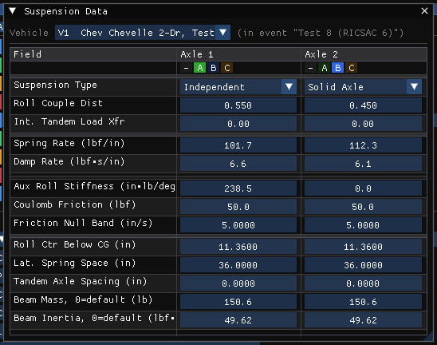
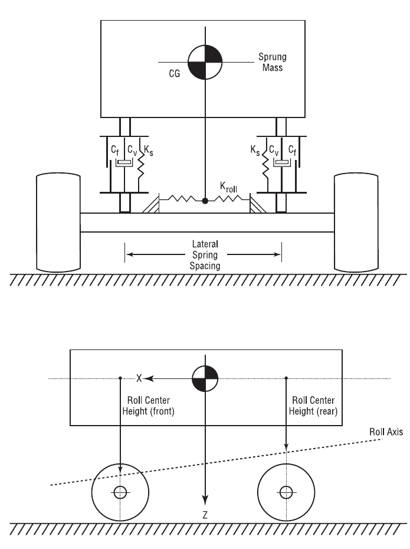
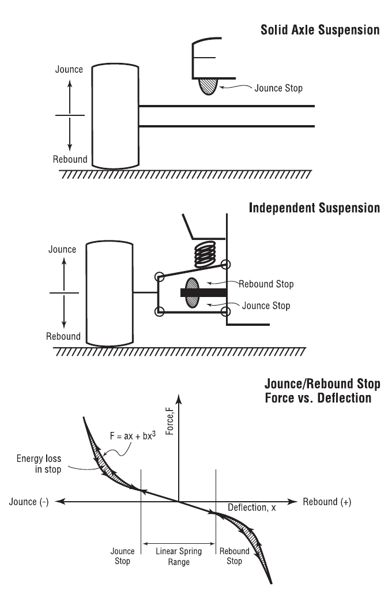
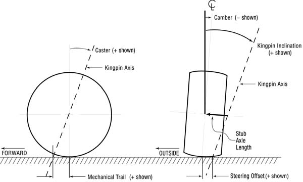
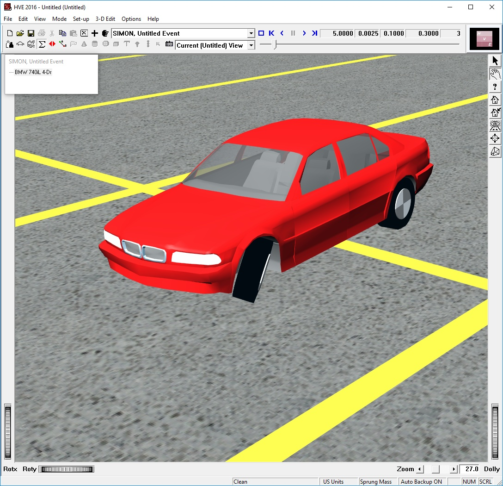

# Chapter 11 — Vehicle Model Definition (Part C: Suspension)

*Adapted for HVE 2027 from the HVE User's Manual (Version 5, Seventh
Edition, Jan 2006), Chapter 11.*

## Suspension Properties

The suspension parameters of the vehicle are displayed and edited using the
Suspension Data dialog. In HVE it is opened by clicking a wheel and is
scoped to that wheel.

!!! note "HVE 2027"
    HVE 2027 shows the whole vehicle in two dialogs, each a table with a
    column per axle or per wheel:

    - **Suspension Data** (**Vehicle › Suspension Data**, or Vehicles panel ›
      Vehicle Properties › Suspension…) — one column per axle: Suspension
      Type, Roll Couple Dist, Int. Tandem Load Xfr; Spring Rate, Damp Rate,
      the derived Static Deflection and Natural Freq (Hz), Aux Roll
      Stiffness, Coulomb Friction, Friction Null Band; and, under Solid Axle,
      Roll Ctr Below CG, Lat. Spring Space, Tandem Axle Spacing, Beam Mass
      and Beam Inertia.
    - The window's other tabs — **Jounce / Rebound**, **Camber vs
      Deflection**, **Roll Steer** and **Anti-Pitch** — each a table with a
      column per wheel (A1 Right, A1 Left, …).

    The spindle axis (alignment and steering stops) is in the **Steering
    System** dialog (see [Part E](11e-drivetrain-steering-brake-system.md)).
    In place of HVE's Copy To Other Side / Copy To Other Axle(s), each table
    has a **Link Group** row: give two or more columns the same group and an
    edit in one is copied to the others. Values are shown in the units set in
    Preferences, and changes apply as they are made.

*Figure 11-22: The Suspension Data dialog (HVE 2027), one column per axle.*

The Suspension Data dialog includes the following suspension properties:

- Suspension Type
- Roll Couple Distribution
- Inter-tandem Load Transfer (Tandem Axle suspension types only)
- Mechanical Properties (Springs and Shocks, Inertias, Jounce/Rebound
  Stops)
- Geometry Properties (Spindle Axis, Camber and Half-track Tables,
  Anti-pitch and Roll Steer)

Each of these properties is described in the following sections. See also
the reference page,
[Suspension Data dialog](../../03-suspension-steering/SuspDlg.md).

### Suspension Type

The HVE Vehicle Model includes the following suspension types:

- **Independent** — The right and left wheels move independently from each
  other.
- **Solid Axle** — The right and left wheels are rigidly connected.
- **Tandem, 4-Spring** — A set of two solid axle suspensions sharing an
  articulated spring support, such that the force on the rear of the
  leading spring is transferred to the front of the trailing spring.
- **Tandem, Walking Beam** — A set of two solid axle suspensions connected
  by a rigid link.

To choose the suspension type for any axle, choose **Vehicle › Suspension
Data** and select the type in the axle's **Suspension Type** cell.

!!! note "HVE 2027"
    HVE offers the tandem types only where a tandem axle set is possible and
    disables Inertia for an independent suspension; HVE 2027 offers all four
    types on every axle. The solid-axle rows (roll center, lateral spring
    spacing, axle mass and inertia) apply only to non-independent axles.

!!! warning "Not in HVE 2027"
    HVE's Figure 11-23, the diagram of the four suspension types, is not
    reproduced here.

### Roll Couple Distribution

The fraction (%/100) of the total sprung mass roll couple (lateral load
transfer) reacted at the selected axle (Suspension Data › **Roll Couple
Dist**, 0 to 1).

!!! note "HVE 2027"
    HVE balances the axles automatically so that the distribution totals
    1.0. HVE 2027 does not: enter values that total 1.0 yourself. A stored
    0 is a valid value (the axle carries none of the roll couple), not
    "unset".

### Inter-tandem Load Transfer

If the selected suspension type is a tandem axle (either 4-Spring or
Walking Beam), the Inter-tandem Load Transfer parameter (%/100) applies to
the selected axle set. Enter it in the axle's **Int. Tandem Load Xfr** cell
of the Suspension Data dialog.

### Springs and Shocks

The Springs and Shocks properties are edited in the Spring & Damper rows of
the Suspension Data dialog (and, for the solid-axle-only rows, under its
Solid Axle heading). See also the reference page,
[Springs and Shocks dialog](../../03-suspension-steering/SprindShocksDlg.md).

!!! note "HVE 2027"
    The rows are per axle; HVE's dialog is per wheel. HVE's names map to
    HVE 2027's as: Ride Rate at Wheel → **Spring Rate**, Damping Rate at
    Wheel → **Damp Rate**, Auxiliary Roll Stiffness → **Aux Roll
    Stiffness**, Roll Center Height → **Roll Ctr Below CG**, Lateral Spring
    Spacing → **Lat. Spring Space**, Coulomb Friction and Friction Null Band
    unchanged. **Static Deflection** and **Natural Freq (Hz)** are derived
    for reference and cannot be edited.

*Figure 11-25: Suspension parameters used in the HVE Vehicle Model. Ks, Cv and Cf are spring rate, damping rate and coulomb friction, respectively, for each wheel position. Kroll is the additional roll stiffness contribution due to an anti-sway bar.*

The Springs and Shocks properties are described below.

- **Ride Rate at Wheel** — Spring rate (force per unit of wheel travel) at
  the selected wheel due to the spring.
- **Auxiliary Roll Stiffness** — Roll stiffness (torque per unit of sprung
  mass roll) added by the addition of an anti-sway bar.
- **Roll Center Height** — Vertical distance from the sprung mass CG down
  (+) to the suspension roll center.
- **Lateral Spring Spacing** — Lateral distance between springs for solid
  axle suspension types.
- **Damping Rate at Wheel** — Velocity-dependent suspension force due to
  shock absorbers.
- **Coulomb Friction** — Friction force required to initiate suspension
  travel.
- **Friction Null Band** — Minimum suspension velocity required for full
  coulomb friction force.

**Table 11-12: Suspension Spring and Shock Parameters**

| Parameter | Unit Name | Description |
| --- | --- | --- |
| Ride Rate | UtSusForce | Linear force vs deflection characteristic effective at the wheel |
| Auxiliary Roll Stiffness | UtSusRollStiff | Moment per unit of body roll produced by an anti-sway bar |
| Roll Center Height | UtSusDispLength | Height of the roll axis measured at the suspension |
| Lateral Spring Spacing | UtSusDispLength | Lateral distance between left and right springs for solid axle suspensions |
| Damping at Wheel | UtSusDamp | Damping rate effective at the wheel |
| Coulomb Friction | UtSusForce | Force required to initiate suspension travel |
| Friction Null Band | UtSusVelLinear | Suspension velocity required for full coulomb friction |

### Axle Inertia

The Suspension Inertial properties of a solid axle are edited in the Solid
Axle rows of the Suspension Data dialog: **Beam Mass, 0=default** (entered
as a weight in US units) and **Beam Inertia, 0=default**. A 0 uses a
default; for the inertia it is a uniform bar across the track, and the run
status says so.

The Suspension Inertial properties are described below.

- **Weight** — Total weight of the axle and springs.

  > **NOTE:** The Vehicle Editor actually divides your entered value by the
  > current gravitational constant (see Environment Editor) and stores the
  > resultant mass. That way, if you take the vehicle to the moon, it will
  > behave correctly!

  > **NOTE:** The weight of the wheels and brakes should not be included
  > here! By convention, the weight of each wheel assembly, including the
  > brake, is to be included in the tire weight (see Tire Physical
  > Parameters).

- **Roll/Yaw Inertia** — Roll and yaw inertia of the axle. Per the above
  note, do not include wheel inertias; they are included with the tires.

  > **NOTE:** The pitch inertia of the axle is assumed to be negligible.

**Table 11-13: Suspension Inertial Parameters**

| Parameter | Unit Name | Description |
| --- | --- | --- |
| Weight | UtSusForce | Weight of the suspension, excluding wheels and brakes |
| Roll/Yaw Inertia | UtSusInertia | Roll and yaw rotational inertias of axle, excluding wheels and brakes |

### Jounce/Rebound

The Jounce and Rebound properties of each wheel are displayed and edited
using the Jounce / Rebound dialog (the **Jounce / Rebound** tab of **Vehicle › Suspension Data…**). Suspension stops are used to limit the travel of the
suspension. See also the reference page,
[Jounce and Rebound dialog](../../03-suspension-steering/JouAndRebDlg.md).

*Figure 11-28: Suspension Jounce and Rebound parameters.*

The dialog has a column per wheel, with a Jounce (Compression) group and a
Rebound (Extension) group of rows: Linear Rate, Cubic Rate, Max Deflection
and Energy Ratio.

!!! note "HVE 2027"
    Enter both travels as POSITIVE distances from the free ride point (HVE
    displays the jounce travel as negative). A travel of 0 disables that
    stop rather than bottoming the vehicle at rest.

The Jounce/Rebound properties are described below.

- **Jounce/Rebound Button** — Type of stop: Jounce (compression travel
  limit) or Rebound (extension travel limit).
- **Maximum Deflection to Stop** — Suspension travel distance from
  equilibrium to selected stop.
- **Stop Linear Rate** — Linear constant (force per unit of wheel travel)
  of the selected suspension stop.
- **Stop Cubic Rate** — Cubic constant (force per unit of wheel travel) of
  the selected suspension stop.
- **Stop Energy Ratio** — Ratio of conserved to total energy (restitution)
  of the selected suspension stop.

**Table 11-14: Suspension Jounce/Rebound Parameters**

| Parameter | Unit Name | Description |
| --- | --- | --- |
| Stop Type | n/a | Location of stop (Jounce or Rebound) |
| Maximum Deflection | UtSusDispLength | Suspension travel from equilibrium to jounce or rebound stop |
| Linear Stop Rate | UtSusRateLinear | Spring linear constant (force per unit of wheel travel) of the selected suspension stop *(the legacy table said "cubic" here — a typo)* |
| Cubic Stop Rate | UtSusRateCubic | Spring cubic constant (force per unit of wheel travel) of the selected suspension stop |
| Energy Ratio | UtSusPercent | Ratio of conserved to total energy (restitution) of the selected suspension stop |

### Spindle Axis

The Spindle Axis geometry properties are displayed and edited in the
Steering System dialog (**Vehicle › Steering System**). See also the
reference page,
[Spindle Axis dialog](../../03-suspension-steering/SpndleAxisDlg.md).

!!! note "HVE 2027"
    HVE keeps the spindle axis under Suspension › Spindle Axis, per wheel.
    In HVE 2027 the per-axle alignment rows (Caster Angle, Kingpin
    Inclination, Camber Angle, Toe Angle, Kingpin Offset) are in the
    Steering System table, and the per-wheel rows (Stub Axle Length,
    Kingpin Friction, Stop Angle Right/Left, Stop Stiffness) are in its
    **Steer-Axis Mechanics (per wheel)** table. They are enabled only for an
    axle marked Steerable. See [Part E](11e-drivetrain-steering-brake-system.md#steering-system-parameters).

*Figure 11-30: Suspension Spindle Axis geometry parameters.*

*Figure 11-31: Effect of suspension alignment (in particular, caster, kingpin inclination and stub axle length) on the geometry of a steered wheel — note left front wheel (rendered in HVE).*

#### Alignment

The Alignment parameters, especially Caster, Camber, Kingpin Inclination
and Steering Offset (see Figure 11-30), play an important role in
determining how tire forces on a steerable axle affect directional
response.

> **NOTE:** Some simulation models assume the wheel steers about a vertical
> axis through the tire plane. This is a simplification. A wheel on a
> steerable axle actually steers about the kingpin axis. Some simulation
> models (e.g., SIMON) rigorously model this behavior.

To display or edit the Alignment parameters, choose **Vehicle › Steering
System** and edit the steerable axle's column.

!!! note "HVE 2027"
    In HVE, Kingpin Inclination, Steering Offset and Stub Axle Length are
    inter-related and editing one recalculates another. HVE 2027 stores and
    edits them independently. Its Toe row is an angle (Toe Angle, degrees)
    where HVE's Toe-in is a distance, and HVE's Steer Axis Friction Torque is
    **Kingpin Friction**.

#### Steering Stops

The Steering Stop parameters define the logical limit to steer angles (+ or
−) at each wheel. They are also used by the Steer DOF model, when it is
employed, to calculate the steering torque that results when a wheel is
steered beyond its limit.

To display or edit the Steering Stop parameters, choose **Vehicle ›
Steering System** and edit **Stop Angle Right (deg)**, **Stop Angle Left
(deg)** and **Stop Stiffness** in the Steer-Axis Mechanics table, per wheel.
Both stop angles are entered as positive numbers.

!!! note "HVE 2027"
    The steer-axis friction and the stops are read only when the axle's
    **Steer DOF** is not Off — a prescribed steer angle cannot be resisted.
    A Stop Stiffness of 0 means no stops. HVE's Stop Energy Ratio has no
    control; the Stop Damping row is shown disabled because no engine reads
    it.

The Spindle Axis Alignment properties are described below.

- **Caster** — The fore-aft angle of the spindle axis (see Figure 11-30).
  This angle is largely responsible for the self-aligning properties of a
  steerable axle.

  > **NOTE:** Caster Angle is defined according to SAE J670e as positive
  > (+) when the top of the axis tilts rearward (see Figure 11-30).

- **Kingpin Inclination** — The angle in front elevation between the
  steering axis and a line parallel to the vehicle-fixed z axis (see Figure
  11-30). This angle, along with the caster angle, is responsible for the
  self-aligning properties of a steerable axle.

  > **NOTE:** Kingpin Inclination Angle is defined according to SAE J670e
  > as positive (+) when the top of the axis tilts inward, regardless of
  > right or left side (see Figure 11-30).

- **Steering Offset (Scrub Radius)** — The distance from the center of the
  tire contact patch to the point where the steering axis intersects the
  ground at equilibrium conditions. This distance produces a steering
  torque (positive or negative, depending on the sign of the scrub radius)
  due to longitudinal tire force (either braking or driving).

  > **NOTE:** This value should be kept small. Otherwise, unwanted steering
  > effects will be introduced on acceleration or braking.

- **Stub Axle Length** — (Also called Kingpin Offset at Wheel Center.) The
  distance from the steering axis to the center of the wheel (see Figure
  11-30). As described above, Kingpin Inclination, Steering Offset and Stub
  Axle Length are inter-related; changes to one of these parameters affect
  the others.
- **Toe-in** — The difference in distance between the center of the tire
  plane at the spindle and the front of the tire.
- **Steer Axis Friction Torque** — The coulomb friction in the steering
  axis. This friction produces torque that resists steering moments, either
  from the tire-terrain interface or from the steering wheel. This
  parameter affects the Steer DOF model.

The Steer Axis Steering Stop parameters are described below.

- **Steering Stop** — This radio button allows the user to select the
  desired stop (Right Steer or Left Steer).
- **Stop Angle** — The vehicle-fixed steering angle at which the stop is
  reached.
- **Stop Stiffness** — The mechanical stiffness of the steering stop.
  Additional steering will be resisted by a torque that attempts to return
  the wheel towards zero steer.
- **Stop Energy Ratio** — The ratio of conserved to total energy of the
  selected steering stop (this property is analogous to Jounce and Rebound
  Stops; see Figure 11-28). This parameter keeps the wheel from bouncing
  off the steering stop.

**Table 11-15: Spindle Axis Parameters**

| Parameter | Unit Name | Description |
| --- | --- | --- |
| Caster | UtSusDispAngle | Fore-aft angle of spindle axis |
| Kingpin Inclination | UtSusDispAngle | Lateral angle of spindle axis |
| Steering Offset (Scrub Radius) | UtSusDispLength | Lateral distance from the steering axis to the center of the tire contact patch, measured at the road plane |
| Stub Axle Length | UtSusDispLength | Distance from the steering axis to the center of the wheel |
| Toe-in | UtSusDispLength | Difference in the lateral distance between the tire centerline, measured at the front and rear of the tire |
| Steering Stop | n/a | Stop selector for right or left steering stop |
| Stop Angle | UtSusDispAngle | Steering angle at which the stop is reached |
| Stop Linear Stiffness | UtVehSteeringStiffness | Mechanical stiffness of the steering stop |
| Stop Energy Ratio | UtNone | Ratio of conserved to total energy in the steering stop |

### Camber & Half-track Table

The Camber properties of each wheel are displayed and edited using the
Camber vs Deflection dialog (the **Camber vs Deflection** tab of **Vehicle › Suspension Data…**). See also the reference page,
[Camber dialog](../../03-suspension-steering/CamberDlg.md).

The dialog has a column per wheel: a **Num Points** row and a table of
deflection against camber angle (degrees), and a **Solid-Axle Const (deg)**
row. Ctrl+click a cell to type a value.

!!! note "HVE 2027"
    - A solid axle does not use the table; SIMON reads only the constant.
    - HVE's half-track change column, its graph and Print have no
      equivalent in this dialog.

The Camber and Half-track Table properties are described below.

- **Jounce/Rebound** — Suspension travel from equilibrium (see Figure
  11-28). Jounce (compression) is negative; rebound (extension) is
  positive.
- **Camber** — Camber angle (see Figure 11-30) at the specified suspension
  deflection.

  > **NOTE:** Camber angle is defined according to SAE J670e as positive
  > (+) when the top of the wheel tilts outward, regardless of right or
  > left side (see Figure 11-30).

- **Half-track Change** — Change in lateral wheel position due to
  suspension jounce or rebound.

**Table 11-16: Camber and Half-track Table Parameters**

| Parameter | Unit Name | Description |
| --- | --- | --- |
| Jounce/Rebound | UtVehDispLength | Suspension travel from equilibrium to Jounce (−) or Rebound (+) stop |
| Camber | UtVehDispAngle | Camber angle of wheel at specified suspension deflection |
| Half-track Change | UtVehDispLength | Change in lateral wheel position due to suspension jounce or rebound |

### Anti-Pitch

The Anti-Pitch properties of each wheel are displayed and edited using the
Anti-Pitch dialog (the **Anti-Pitch** tab of **Vehicle › Suspension Data…**): a
column per wheel with a Num Points row and a table of deflection against
force. See also the reference page,
[Anti-Pitch dialog](../../03-suspension-steering/AntiPitchDlg.md).

!!! note "HVE 2027"
    EDVSM reads the anti-pitch table, as in HVE: the table of each axle's
    right wheel adds an anti-pitch force to that axle's suspension force (and
    to EDVSM's Fz Anti-pitch output). SIMON does not read it.

The Anti-pitch Table properties are described below.

- **Jounce/Rebound** — Suspension travel from equilibrium (see Figure
  11-28). Jounce (compression) is negative; rebound (extension) is
  positive.
- **Anti-pitch** — Anti-pitch force at the specified suspension deflection.

**Table 11-17: Anti-pitch Table Parameters**

| Parameter | Unit Name | Description |
| --- | --- | --- |
| Jounce/Rebound | UtSusDispLength | Suspension travel from equilibrium to Jounce (−) or Rebound (+) stop |
| Anti-pitch | UtSusAntiPitch | Anti-pitch force at given suspension jounce or rebound |

### Roll Steer

The Roll Steer properties of each wheel are displayed and edited using the
Roll Steer dialog (the **Roll Steer** tab of **Vehicle › Suspension Data…**). In HVE
the roll steer dialogs are different for independent and solid axle
suspensions: independent suspensions use a polynomial with a *Roll Steer
vs. Jounce/Rebound* graph; solid axle (and tandem) suspensions use a single
coefficient. See also the reference pages,
[Roll Steer dialog (independent)](../../03-suspension-steering/RollSteerDlg.md)
and
[Roll Steer Properties (solid/tandem axle)](../../03-suspension-steering/RollSteerNewDlg.md).

In HVE 2027 the Roll Steer dialog has a column per wheel with the polynomial
coefficients — Constant, Linear, Quadratic and Cubic — and a Solid axle row.
It draws no graph.

The Roll Steer parameters are described below.

- **Jounce/Rebound** — Suspension travel from equilibrium (see Figure
  11-28). Jounce (compression) is negative; rebound (extension) is
  positive.
- **Roll Steer Coefficients** — For independent suspensions, the constant,
  linear, quadratic and cubic coefficients of the wheel steer angle vs
  jounce/rebound polynomial. For solid axle suspensions, a single roll
  steer coefficient: the ratio of wheel (axle) steer to body roll. *(The
  legacy manual repeated the Anti-pitch description here — a typo.)*

**Table 11-18: Roll Steer Parameters**

| Parameter | Unit Name | Description |
| --- | --- | --- |
| Jounce/Rebound | UtSusDispLength | Suspension travel from equilibrium to Jounce (−) or Rebound (+) stop |
| Constant | UtSusDispAngle | Initial steer angle at zero roll |
| Linear Coef | UtSusLinearRollSteer | Linear roll steer vs jounce/rebound |
| Quadratic Coef | UtSusQuadRollSteer | Quadratic roll steer vs jounce/rebound |
| Cubic Coef | UtSusCubicRollSteer | Cubic roll steer vs jounce/rebound |
| Coefficient (Solid) | UtNone | Ratio of wheel steer to body roll |

<!-- NAV -->

---

← Previous: [Chapter 11 — Vehicle Model Definition (Part B: Exterior)](11b-exterior.md)  |  [Index](README.md)  |  Next: [Chapter 11 — Vehicle Model Definition (Part D: Brakes, Tires and Wheels)](11d-brakes-tires-wheels.md) →

<!-- /NAV -->
