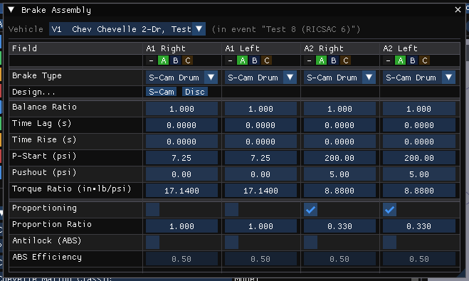
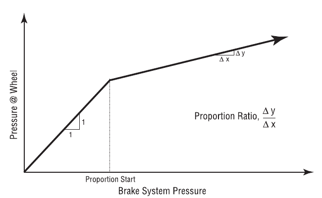
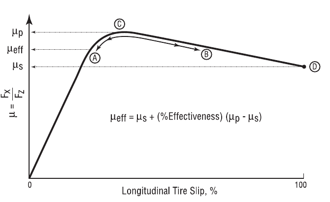
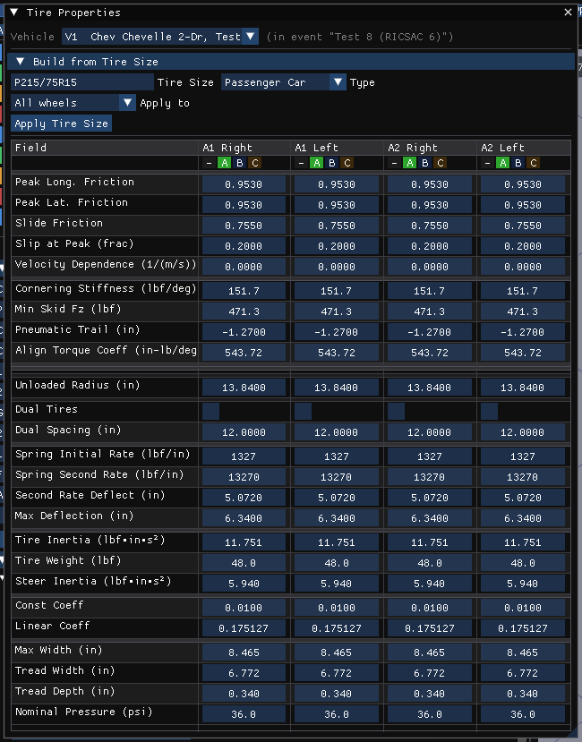
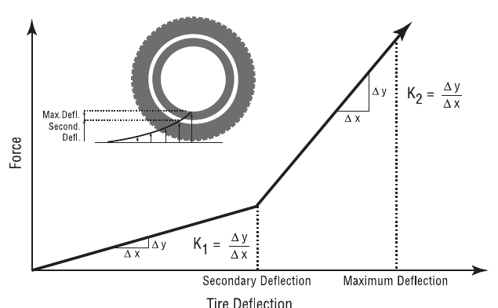
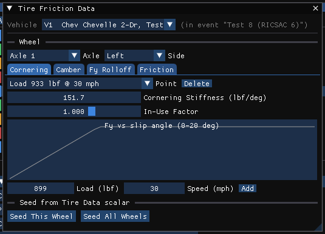
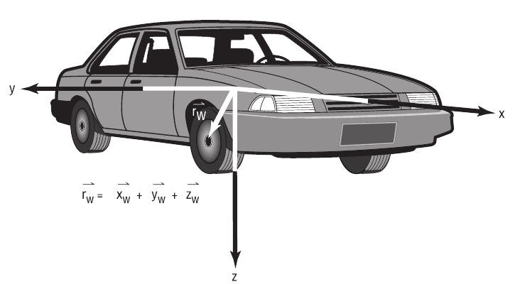
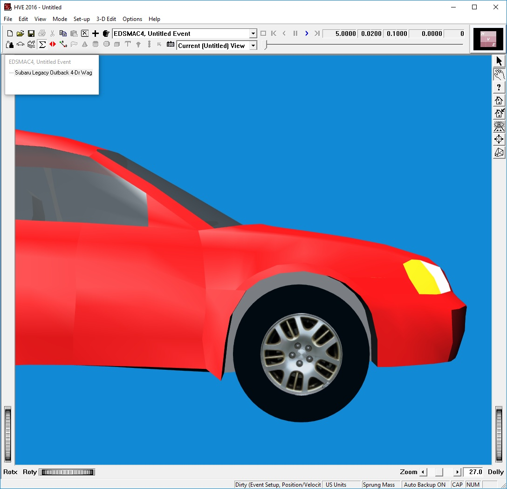

# Chapter 11 — Vehicle Model Definition (Part D: Brakes, Tires and Wheels)

*Adapted for HVE 2027 from the HVE User's Manual (Version 5, Seventh
Edition, Jan 2006), Chapter 11.*

This part covers the unsprung-mass properties HVE edits by clicking on a
wheel in the Vehicle Viewer: the Brake Assembly at each wheel, the Tire
properties, the Wheel Location and the Wheel Image.

!!! note "HVE 2027"
    HVE 2027 edits the brakes and tires of every wheel at once, in tables
    with a column per wheel (A1 Right, A1 Left, …). As in the suspension
    dialogs, a **Link Group** row replaces HVE's Copy To Other Side: columns
    in the same group receive each other's edits. Values are shown in the
    units set in Preferences, and changes apply as they are made.

## Brake Assembly Parameters

The Brake Assembly properties are displayed and edited using the Brake
Assembly dialog (**Vehicle › Editors › Brakes › Brake Assembly**, or Vehicles panel ›
Components › Brakes… › Brake Assembly…). See also the reference page,
[Brake Assembly dialog](../../04-brakes-powertrain/BrkAsmblyDlg.md).

*Figure 11-36: Brake Assembly dialog (HVE 2027), one column per wheel.*

The dialog's rows are: **Brake Type**; **Design…** (a button per wheel that
opens the Brake Designer on that wheel; greyed for a Generic brake);
Actuation — **Balance Ratio** (greyed, unused), **Time Lag (s)**, **Time Rise (s)**,
**P-Start**, **Pushout** and **Torque Ratio**; Options — **Proportioning**,
**Proportion Ratio**, **Antilock (ABS)** and **ABS Efficiency**.

*Figure 11-37: Brake System Proportioning.*

*Figure 11-38: Simple Antilock Model.*

The Brake properties at each wheel are described below.

- **Time Lag** — Time required before the driver's brake pedal inputs reach
  the wheel.
- **Time Rise** — Time required for the brake pressure at the wheel brake
  actuator to reach approximately 90 percent of full system pressure
  (pressure in the air chamber rises at an exponential rate).

  > **NOTE:** If a simulation model does not use HVE's Time Lag or Time
  > Rise parameters, the lag and rise time may be simulated in the Brake
  > Table (see Event Editor, Driver Controls).

- **Brake Type** — An option list displaying the type of brake assembly
  used at the selected wheel location. In HVE the default is *Generic*, in
  which case the Brake Torque Ratio (see below) is defined directly by the
  user. HVE 2027 lists HVE's ten types: *Generic Brake, Disc Brake,
  Duo-Servo Brake, Duplex Brake, Single Piston (Leading/Trailing Shoe), Dual
  Piston (2 Leading Shoes), S-Cam, Single Wedge, Dual Wedge* and *Air Disc
  Brake*.

  > **NOTE:** See the HVE Brake Designer documentation for details on the
  > use of this option. The Push-out Pressure and Brake Torque Ratio of a
  > specific design are computed by the Brake Designer.

  !!! note "HVE 2027"
      The simulations read the wheel's **Pushout** and **Torque Ratio**, as
      HVE's own Generic brake does. A brake design reaches them when its
      computed torque ratio and pushout pressure are written into the Brake
      Assembly — by choosing the design's Brake Type here, or with the Brake
      Designer's **Apply to Wheel** (or Apply to All Wheels); editing a
      design parameter alone changes no result.

- **Push-out Pressure** — Brake system pressure required to begin causing
  brake torque (any system pressure below this point is simply taking out
  the slack in the system).
- **Brake Torque Ratio** — Wheel brake torque per unit of system pressure
  at the wheel. The actual braking torque at the wheel is the product of
  the current wheel system pressure and the Brake Torque Ratio.
- **Proportioning Check Box** — Click on this check box if the system
  pressure at the selected wheel is reduced by a proportioning valve.
- **Proportioning Starting Pressure** — Beginning at this level of system
  pressure, any additional master cylinder pressure will be reduced (see
  Figure 11-37).
- **Proportioning Ratio** — At master cylinder pressures above the
  Proportioning Starting Pressure, additional pressure is reduced by this
  ratio (see Figure 11-37).
- **Anti-lock Check Box** — Click on this check box if the selected wheel
  has a simple (functional) anti-lock device installed.
- **Anti-lock Efficiency** — A 100% effective anti-lock system maintains a
  longitudinal wheel force associated with the peak coefficient of
  friction. A 0% effective system maintains a longitudinal wheel force
  associated with the slide coefficient of friction. A 50% effective system
  would maintain a longitudinal force halfway between that associated with
  peak and slide friction (see Figure 11-38).
- **ABS Designer** — Access to the ABS Wheel Data of the HVE Brake
  Designer: wheel kinematics thresholds (minimum velocity, tire slip range,
  spin acceleration range) and pressure modulation (cycle rate, apply and
  release rates). In HVE 2027 it is **Vehicle › Editors › Brakes › ABS / Brake
  Design**, then **ABS Designer…**.

> **NOTE:** In HVE the Simple Antilock option is not enabled if the vehicle
> is fitted with an ABS brake system, and ABS is installed in the Brake
> System dialog. See Brake System Parameters in
> [Part E](11e-drivetrain-steering-brake-system.md).

!!! note "HVE 2027"
    In HVE 2027 EDSVS and EDVTS apply antilock wheel by wheel, as each
    wheel's **Antilock (ABS)** checkbox here says. SIMON regulates every wheel
    once any of these boxes is ticked, or once the vehicle's **ABS Installed**
    is (Vehicle › Editors › Brakes › ABS / Brake Design › ABS System). EDVDS has no ABS model.

**Table 11-19: Wheel Brake Assembly Parameters**

| Parameter | Unit Name | Description |
| --- | --- | --- |
| Time Lag | UtBraTime | Time required for brake system pressure to reach the wheel |
| Time Rise | UtBraTime | Time required for the brake pressure at the wheel brake actuator to reach approximately 90 percent of full system pressure |
| Push-out Pressure | UtBraPress | Pressure required to begin braking |
| Brake Torque Ratio | UtBraRatio | Brake torque per unit of system pressure at the wheel |
| Proportioning | boolean (TRUE or FALSE) | Flag; if TRUE the wheel pressure is reduced by a proportioning valve |
| Pstart | UtBraPress | Brake system pressure at which proportioning begins for the selected wheel location |
| Proportioning Ratio | UtNone | Ratio of pressure at the wheel to pressure at the master cylinder |
| Antilock | boolean (TRUE or FALSE) | Flag; TRUE if the wheel has an antilock device |
| Anti-lock Efficiency | UtBraPercent | Efficiency of the antilock system at the selected wheel |

### HVE Brake Designer

The HVE Brake Designer provides a detailed brake design capability
integrated directly within the HVE simulation environment. This feature
allows vehicle designers and safety researchers to develop a specific brake
design for each wheel and evaluate the resulting vehicle performance using
a predefined suite of maneuvers or compliance test simulations. The HVE
Brake Designer also includes a detailed tool for simulating ABS.

In HVE 2027 the Brake Designer is **Vehicle › Editors › Brakes › Brake Designer**: choose the
wheel (**Axle**, **Side**) and the **Brake Design**, enter the Design
Parameters, read the **Results**, and press **Apply to Wheel** or **Apply to
All Wheels**. The Brake Designer also opens on a wheel from the Brake
Assembly dialog's Design… row, and a design's lining friction is in its
**Lining Friction Properties** section. HVE's Brake Material Properties
dialog is the Brake Designer's **Material Properties** section: the
**Rotor / Drum** and **Pad / Lining** density, specific heat, conduction
coefficient, convection coefficient and convection velocity term, and under
**Thicknesses** the rotor and pad thicknesses of a disc brake or the drum
thickness, drum width and primary/secondary lining thicknesses of a drum
brake. These are the inputs of SIMON's brake temperature model, which runs
on every pedal-braked wheel whatever the design type; they are shown in
HVE's in-lb units in the US system (lb/in³, in-lb/lb-°F, in-lb/in-s-°F,
in-lb/in²-s-°F) and in SI otherwise. A wheel with a brake design
recomputes its torque from the design at every step, with the lining
friction at the simulated temperature and speed; a Generic wheel uses the
design's torque ratio as a constant.

The Brake Designer dialogs for the individual assembly types are documented
in the HVE reference pages:
[Disc Brake](../../04-brakes-powertrain/DiskBreakDlg.md),
[Duo-Servo](../../04-brakes-powertrain/DueServoBrkDlg.md),
[Duplex](../../04-brakes-powertrain/DuplexBrkDlg.md),
[Single Piston](../../04-brakes-powertrain/BrkSingPistDlg.md),
[Dual Piston](../../04-brakes-powertrain/DualPistBrkDlg.md),
[Dual Wedge](../../04-brakes-powertrain/DualWedgeBrkDlg.md) and
[Brake Material Properties](../../04-brakes-powertrain/BrkMatPropDlg.md).

## Tire Properties

The tire parameters for the current vehicle are displayed and edited using
the Tire Information dialog in HVE. See also the reference page,
[Tire Information dialog](../../05-tires-wheels/TireInfoDlg.md).

!!! note "HVE 2027"
    HVE 2027 has one tire window, **Tire Properties** (**Vehicle › Editors › Tires**,
    or Vehicles panel › Components › Tires…), in two
    parts:

    - The **grid** — the scalar tire data of every wheel, a column per
      wheel: Friction (Peak Long. and Lat. Friction,
      Slide Friction, Slip at Peak, Velocity Dependence), Cornering
      Stiffness (Cornering Stiffness, Min Skid Fz, Pneumatic Trail, Align
      Torque Coeff), Load & Speed Dependence (each wheel's four tables
      summarized, with a button per table that selects that wheel and tab
      in the panel below), Identity (Tire Name, Manufacturer, Model, HVE Version — for
      the reports only), Physical (Size Designation, Tire Type, Unloaded
      Radius, the derived Static Deflection, Dual Tires, Dual Spacing),
      Spring / Deflection, Rotational Properties, Rolling Resistance and
      Physical Dimensions.
    - The **Load & Speed Tables** panel under the grid — the tables of one
      wheel at a time (chosen with the **Wheel:** buttons, **A1 Right**,
      **A1 Left**, ...), on four tabs: **Friction**, **Cornering**,
      **Camber** and **Fy Roll-off**. **Copy to Axle** and **Copy to All
      Wheels** copy the selected wheel's four tables. A drag bar between
      the grid and the panel resizes them. Edits apply immediately and
      **Edit › Undo** takes them back.

*Figure 11-39: Tire Properties dialog (HVE 2027), with Build from Tire Size at the top.*

!!! note "HVE 2027"
    A tire is chosen from the tire tables of the loaded vehicle databases in
    the **Tire Database** section at the top of the Tire Properties dialog:
    narrow the list by **Type** (Passenger Car, Light Truck, Heavy Truck or
    Mobile Home), **Database** (one database file, with its tire count) and
    **Search** (manufacturer, model or size), with a *Showing N of M* line
    while it is narrowed, select a
    tire, choose **Apply to** (all wheels or one axle) and press **Apply
    Tire**. This replaces the tire's data and all four of its tables; each
    wheel keeps its own dual setup. **Build from Tire Size** fills only a
    wheel's dimensions from a size designation: enter the **Tire Size** (for
    example P215/65R15), choose the **Type** and **Apply to**, and press
    **Apply Tire Size**; friction, cornering stiffness and spring rates are
    left unchanged.

For the selected tire, the Tire Information dialog also allows the user to
edit the following specific tire properties:

- Physical Properties
- Frictional Properties
- Cornering Stiffness Table (Fy vs Slip Angle)
- Camber Stiffness Table (Fy vs Inclination Angle)
- Slip vs Rolloff Tables

Each of these is described in the following sections.

> **NOTE:** Contact EDC to obtain an interesting video that shows how these
> tire properties are determined from tests on Calspan's Flatbed Tire
> Testing machine. Ask for EDC Library Ref. No. 1077.

### Tire Physical Data

The Tire Physical parameters are displayed and edited in the Physical,
Spring / Deflection, Rotational Properties and Physical Dimensions rows of
the Tire Properties dialog (**Vehicle › Editors › Tires**). See also
the reference page,
[Tire Physical Data dialog](../../05-tires-wheels/TirePhyDataDlg.md).

The Tire Physical Data parameters are described below.

- **Unloaded Radius** — Undeflected tire radius (no-load condition).
- **Maximum Width** — *(updated: added in Version 7 tire data.)* Maximum
  section width of the tire. This value is display-only; it is computed
  from the tire size designation string.
- **Tread Width** — *(updated: added in Version 7 tire data.)* Width of the
  tire tread contact patch.
- **Tread Depth** — *(updated: added in Version 7 tire data.)* Depth of the
  tire tread.
- **Nominal Pressure** — *(updated: added in Version 7 tire data.)* Nominal
  (rated) inflation pressure of the tire.
- **Initial Deflection Rate** — The initial tire spring rate (vertical tire
  load per unit of linear tire deflection). See Figure 11-41.
- **Secondary Deflection Rate** — The spring rate under conditions of
  excessive tire vertical load. See Figure 11-41.
- **Deflection At Secondary Rate** — Tire deflection at which the secondary
  deflection rate begins. See Figure 11-41.
- **Maximum Deflection** — Tire maximum deflection. This value is normally
  used to terminate execution, indicating the probability of a damaged or
  broken wheel rim. See Figure 11-41.
- **Pneumatic Trail** — Longitudinal distance from the center of the tire
  contact patch to the center of pressure. Pneumatic trail increases the
  self-aligning tendency of a steerable wheel (negative if the center of
  pressure is behind the center of contact).
- **Aligning Torque Stiffness** — Self-aligning torque due to mechanical
  and pneumatic trail.
- **Weight** — Total weight of the wheel assembly (tire plus rim). For an
  independent suspension, this value reflects the total unsprung mass. For
  a solid axle suspension system, the axle weight is added to the wheel
  weight to determine unsprung mass.

  > **NOTE:** The entered value is divided by the current gravitational
  > constant and stored as mass. That way, if you take the vehicle to the
  > moon, it will behave correctly!

- **Spin Inertia** — Tire rotational inertia about its spin axis.
- **Steer Inertia** — Tire rotational inertia about its steering axis.
- **Rolling Resistance Constant** — Tire rolling resistance force
  coefficient.
- **Rolling Resistance Linear Coefficient** — Tire rolling resistance
  linear, velocity-dependent force coefficient.
- **Minimum Fz For Skid** — Minimum vertical tire load, Fz, required in
  order to leave a tire mark on the road surface. If the current vertical
  tire load is less than this value, no tire mark is displayed.

*Figure 11-41: Tire Physical Parameters.*

**Table 11-20: Tire Physical Data Parameters**

| Parameter | Unit Name | Description |
| --- | --- | --- |
| Unloaded Radius | UtTirDispLength | Tire radius in unloaded condition |
| Maximum Width | UtTirDispLength | Maximum section width (computed from size designation) *(updated: Version 7)* |
| Tread Width | UtTirDispLength | Width of the tread contact patch *(updated: Version 7)* |
| Tread Depth | UtTirDispLength | Depth of the tire tread *(updated: Version 7)* |
| Nominal Pressure | UtTirPress | Nominal inflation pressure *(updated: Version 7)* |
| Initial Deflection Rate | UtTirRateLinear | Deflection rate from zero deflection to secondary deflection |
| Secondary Deflection Rate | UtTirRateLinear | Deflection rate after preliminary deflection |
| Deflection At Secondary Rate | UtTirDispLength | Deflection at start of secondary deflection rate |
| Maximum Deflection | UtTirDispLength | Maximum allowable tire deflection |
| Pneumatic Trail | UtTirDispLength | Distance from center of the contact patch to the center of pressure |
| Aligning Torque Stiffness | UtTirAlignTorque | Steering torque produced by tire slip angle |
| Weight | UtTirForce | Total weight of wheel (tire + rim) |
| Spin Inertia | UtTirInertia | Rotational inertia about spin axis |
| Steering Inertia | UtTirInertia | Rotational inertia about steering axis |
| Rolling Constant | UtNone | Ratio of rolling resistance force to total vertical force on tire |
| Rolling Linear Coef | UtTireVelDependence | Velocity-dependent tire rolling resistance force coefficient |
| Min Fz for Skidmark | UtTirForce | Minimum vertical tire force required for a tire to leave a skidmark |

### Tire Friction Data

The tire frictional properties are displayed and edited on the **Friction**
tab of the **Load & Speed Tables** panel at the bottom of the Tire Properties
window (**Vehicle › Editors › Tires**). See also
the reference page,
[Tire Friction Data dialog](../../05-tires-wheels/TireFrictDataDlg.md).

*Figure 11-42: the tire tables (HVE 2027), shown on the Cornering tab. The
screenshot predates their move into the Tire Properties window.*

To display or edit a wheel's tire frictional properties:

1. Choose **Vehicle › Editors › Tires**, and pick the wheel with the
   **Wheel:** buttons of the **Load & Speed Tables** panel (or press that
   wheel's **Friction Table** button in the grid's Load & Speed Dependence
   rows).
2. On the **Friction** tab every table point (load and speed) is a row.
   To add one, enter its **Load** and **Speed** under the table and press
   **Add Row**; the **x** at the end of a row deletes it. Load and speed
   are editable, and the table re-sorts by load, then speed.
3. In each row, view and/or edit the friction values: **Peak Long.**,
   **Peak Lat.**, **Slide**, **Slip at Peak**, **Long. Stiffness** and
   **In-Use** (the In-Use Factor). The In-use Factor acts as a modifier
   that multiplies the current dependent tire data.

   > **NOTE:** For example, let's say you believe a given tire's frictional
   > properties are only 90 percent of the values displayed in the dialog.
   > You could calculate 90 percent of the peak and slide friction and
   > longitudinal stiffness values and edit the current data accordingly,
   > or you could simply choose an in-use factor of 0.90.

4. Click a row's number to plot its friction vs. longitudinal slip curve
   below the table; the graph updates as you edit.

With no table points the simulations use the scalar friction values of the
Tire Properties grid. **Seed This Wheel** and **Seed All Wheels** build a
table from those scalars (three load rows about the vehicle's nominal wheel
load, and with **with a speed axis (0 / 30 / 60 mph)** checked a speed axis
too). With **View › Show Guidance Text** on, the panel explains which
simulations read which axis.

The tire friction parameters are described below.

- **Load** — Vertical tire load at which the frictional values were
  obtained.
- **Speed** — Road speed at which the frictional values were obtained.
- **Peak Longitudinal Friction** — Maximum value of Fx/Fz achieved during
  the test at the given load and speed.
- **Peak Lateral Friction** — Maximum value of Fy/Fz achieved during the
  test at the given load and speed.
- **Slide Friction** — Value of Fx/Fz at 100% longitudinal slip achieved
  during the test at the given load and speed.
- **Slip at Peak Friction** — Longitudinal slip at which the peak
  longitudinal friction was achieved at the given load and speed.
- **Longitudinal Stiffness** — Slope of the Friction vs Slip curve (see
  Figure 11-42) at the graph's origin.

  > **NOTE:** The graph uses the longitudinal stiffness to display the
  > curve up to 0.5 times the Peak Longitudinal Friction.

- **In-use Factor** — Global multiplier for dependent values (Peak and
  Slide Friction, Longitudinal Stiffness).

**Table 11-21: Tire Friction Parameters**

| Parameter | Unit Name | Description |
| --- | --- | --- |
| Load | UtTirForce | Vertical tire load, Fz, during test |
| Speed | UtTirVelLinear | Speed during test |
| Peak Longitudinal Friction | UtNone | Maximum value of Fx/Fz achieved at given load and speed |
| Peak Lateral Friction | UtNone | Maximum value of Fy/Fz achieved at given load and speed |
| Slide Friction | UtNone | Value of Fx/Fz achieved at 100% slip |
| Slip at Peak Long. Friction | UtTirPercent | Longitudinal slip at which Peak Longitudinal Friction was measured |
| Longitudinal Stiffness | UtTirLongStiff | Slope of Friction vs Slip graph at zero slip |
| In-use Factor | UtTirPercent | Multiplier for Peak and Slide Friction and Longitudinal Stiffness |

### Tire Fy vs Slip Angle Table

The Tire Fy vs Slip Angle Data (Cornering Stiffness) for the selected wheel
position are displayed and edited using the Tire Fy vs Slip Angle Data
dialog.

In HVE 2027 the cornering data is on the **Cornering** tab of the **Load &
Speed Tables** panel: a row per table point with **Load**, **Speed**,
**Cornering Stiffness** and **In-Use**, and a preview graph of Fy vs slip
angle (0–20°) for the row whose number is clicked. Rows are added and
deleted as on the Friction tab, and
**Seed This Wheel** / **Seed All Wheels** build them from the Tire
Properties scalar.

!!! warning "Not in HVE 2027"
    HVE 2027 stores a cornering stiffness per load and speed point, not
    HVE's table of Fy values at each slip angle; the Fy vs slip angle curve
    is shown for reference only. There is no Print.

The Tire Fy vs Slip Angle Data parameters are described below.

- **Load** — Vertical tire load at which the cornering stiffness values
  were obtained.
- **Speed** — Road speed at which the cornering stiffness values were
  obtained.
- **Slip Angle** — Angle (relative to the tire axis system; see Appendix
  III) from the tire's forward axis to its local velocity vector.
- **Fy** — Lateral tire force (relative to the tire axis system) produced
  at the current slip angle for the given load and speed.
- **Cornering Stiffness** — Slope of the Fy vs Slip Angle curve at the graph's origin.

  > **NOTE:** In HVE the graph uses the cornering stiffness to display the
  > curve up to 0.5 times the first Slip Angle entry in the table.

- **In-use Factor** — Global multiplier for dependent values (Fy and
  Cornering Stiffness).

**Table 11-22: Tire Fy vs Slip Angle Parameters**

| Parameter | Unit Name | Description |
| --- | --- | --- |
| Load | UtTirForce | Vertical tire load, Fz, during test |
| Speed | UtTirVelLinear | Speed during test |
| Slip Angle | UtTirDispAngle | Angle (relative to the tire axis system; see Appendix III) from the tire's forward axis to its local velocity vector |
| Fy | UtTirForce | Lateral tire force (relative to the tire axis system) produced at the current slip angle for the given load and speed |
| Cornering Stiffness | UtTirCalfa | Slope of Fy vs Slip Angle graph at zero slip angle |
| In-use Factor | UtTirPercent | Multiplier for Fy and Cornering Stiffness |

### Tire Fy vs Inclination Angle Table

The Tire Fy vs Inclination Angle Data (sometimes referred to as Camber
Stiffness) for the selected wheel position are displayed and edited using
the Tire Fy vs Inclination Angle Data dialog. See also the
reference page,
[Fy vs Inclination Angle dialog](../../05-tires-wheels/FyVsInclAngDlg.md).

> **NOTE:** As a rough estimate, camber stiffness is normally about 1/10 of
> the cornering stiffness.

In HVE 2027 the camber data is on the **Camber** tab of the **Load & Speed
Tables** panel: a row per table point with **Load**, **Speed** and **Camber
Stiffness**, added with **Add Row** and deleted with **x**. With no rows,
camber thrust is off. **Seed This Wheel** / **Seed All Wheels** derive the points from the
cornering stiffness.

The Tire Fy vs Inclination Angle Data parameters are described below.

- **Load** — Vertical tire load at which the camber stiffness values were
  obtained.
- **Speed** — Road speed at which the camber stiffness values were
  obtained.
- **Inclination Angle** — Angle (relative to the tire axis system; see
  Appendix III) from the vertical axis of the tire plane to a vector normal
  to the road plane.
- **Fy** — Lateral tire force (relative to the tire axis system) produced
  at the current camber angle for the given load and speed.
- **Camber Stiffness** — Slope of the Fy vs Inclination Angle curve at the
  graph's origin.

  > **NOTE:** In HVE the graph uses the camber stiffness to display the curve up
  > to 0.5 times the first Inclination Angle entry in the table.

- **In-use Factor** — Global multiplier for dependent values (Fy and Camber
  Stiffness).

**Table 11-23: Tire Fy vs Inclination Angle Parameters**

| Parameter | Unit Name | Description |
| --- | --- | --- |
| Load | UtTirForce | Vertical tire load, Fz, during test |
| Speed | UtTirVelLinear | Speed during test |
| Inclination Angle | UtTirDispAngle | Angle (relative to the tire axis system; see Appendix III) from the vertical axis of the tire plane to a vector normal to the road plane |
| Fy | UtTirForce | Lateral tire force (relative to the tire axis system) produced at the current inclination angle for the given load and speed |
| Camber Stiffness | UtTirCgamma | Slope of Fy vs Inclination Angle graph at zero inclination angle |
| In-use Factor | UtTirPercent | Multiplier for Fy and Camber Stiffness |

### Tire Slip vs Rolloff Tables

The Tire Longitudinal and Lateral Slip vs Rolloff Data Tables are displayed
and edited in HVE using the Tire Slip vs Rolloff Tables dialog. See also the
reference page,
[Slip vs Rolloff dialog](../../05-tires-wheels/SlipVsRollOffDlg.md).

In HVE 2027 the roll-off table is on the **Fy Roll-off** tab of the **Load &
Speed Tables** panel: rows of **Long. Slip (0–1)** against **Fy
Multiplier** (the lateral force multiplier), with **Add Row** and **x** to
remove a row, and a graph of roll-off vs slip. It is read by EDVTS and
EDSVS; with no table the multiplier is 1.0 (no roll-off).

!!! warning "Not in HVE 2027"
    HVE's table is two-dimensional (longitudinal slip × slip angle) with
    separate Longitudinal and Lateral roll-offs. HVE 2027 keeps only the
    lateral force multiplier against longitudinal slip, which is the only
    part any simulation reads; the slip-angle axis and the Lateral Rolloff
    are not offered.

The Tire Slip vs Rolloff Data parameters are described below.

- **Longitudinal Slip** — Longitudinal tire slip at which the lateral
  roll-off values were obtained.
- **Slip Angle** — Lateral tire slip (slip angle) at which the longitudinal
  roll-off values were obtained.
- **Longitudinal Rolloff** — Reduction in lateral tire force (relative to
  the tire axis system; see Appendix III) at the specified longitudinal
  slip.
- **Lateral Rolloff** — Reduction in longitudinal tire force (relative to
  the tire axis system) at the specified lateral slip (slip angle).

**Table 11-24: Tire Slip vs Rolloff Parameters**

| Parameter | Unit Name | Description |
| --- | --- | --- |
| Longitudinal Slip | UtTirPercent | Longitudinal tire slip at which the lateral roll-off values were obtained |
| Slip Angle | UtTirDispAngle | Lateral tire slip (slip angle) at which the longitudinal roll-off values were obtained |
| Longitudinal Rolloff | UtTirPercent | Reduction in lateral tire force (relative to the tire axis system; see Appendix III) at the specified longitudinal slip |
| Lateral Rolloff | UtTirPercent | Reduction in longitudinal tire force (relative to the tire axis system) at the specified lateral slip (slip angle) |

## Wheel Location

The wheel location coordinates relative to the vehicle-fixed coordinate
system are displayed and edited in HVE using the Wheel Location dialog. See
also the reference page,
[Wheel Location dialog](../../03-suspension-steering/WheelLocDlg.md).

In HVE 2027 they are in the Vehicles panel, **Size & Weight › Details ›
Wheel Positions (from CG)**: a table with a column per wheel (A1 Right, A1
Left, …) giving each wheel's X, Y and Z from the CG (SAE: +X forward, +Y
right, +Z down). Left and right may differ.

!!! note "HVE 2027"
    - A field left at 0 is derived from the vehicle's dimensions (wheelbase,
      CG to axle, track and CG height).
    - Once any wheel carries its own X, the wheelbase and CG-to-axle
      distances are derived from the wheels, as HVE derives them; the
      Size & Weight section says so. Clear the per-wheel X values to type them
      there again.
    - There is no Copy To Other Side.

> **NOTE:** If you wish to move the CG, you can edit each individual
> wheel's x,y,z coordinates. However, an alternative (and easier) way is to
> use the Move CG dialog, or the CG to axle distances (see Sprung Mass
> Parameters in [Part A](11a-sprung-mass.md)).

*Figure 11-47: Wheel locations relative to the vehicle-fixed coordinate system.*

The Wheel Location parameters are described below (see Figure 11-47).

- **Wheel x** — The longitudinal distance from the vehicle CG to the
  selected wheel.
- **Wheel y** — The lateral distance from the vehicle CG to the selected
  wheel.
- **Wheel z** — The vertical distance from the vehicle CG to the selected
  wheel.

**Table 11-25: Wheel x,y,z Location Parameters**

| Parameter | Unit Name | Description |
| --- | --- | --- |
| x, y, z coordinates | UtVehDispLength | Vehicle-fixed x,y,z coordinates of the selected wheel relative to the sprung mass CG |

## Wheel Image

In HVE the vehicle's wheels may be visualized as either a gray disk or using
a bitmap (texture). In the latter case, a photograph of the wheels may be
taken and used to provide a very realistic representation of the vehicle's
wheels.

*Figure 11-48: Typical wheel image (shown in HVE).*

In HVE 2027 the picture on each wheel's face is set on the **Wheel Images**
tab of the Vehicle Mesh window (**Vehicle › Editors › Vehicle Mesh**, or **Vehicle
Mesh...** in the Vehicles panel's 3D Geometry section). Each wheel (*A1 Right*, *A1 Left*, ...) has a
field with the picture's name and:

- **Pick...** — opens a picker that shows every wheel picture available as
  thumbnails: those stored in the vehicle databases and those in the
  *WheelTextures* folders, with a **Filter** by name and a **Source** list
  (one database or folder). **Use on this wheel** or **Use on every wheel**
  applies the one selected; **Cancel** closes the picker.
- **Browse...** — picks your own picture (`.bmp`, `.png`, `.jpg`, `.tga`),
  kept relative to the case when it is beside it.
- **All** — uses this wheel's picture on every wheel of the vehicle.
- **Clear** — removes it; the wheel then draws the rim.

A line under each wheel says where its picture comes from, or that it was not
found and the wheel draws the rim. A vehicle added from a database brings its
own wheel images with it. Wheel images are display only: no engine reads them.

!!! warning "Not in HVE 2027"
    HVE's tire sidewall and tread images are not available. Without a 3-D
    model of its own, a vehicle's wheels are drawn as tires of the tire radius
    (Vehicle Mesh › **Draw wheels (tire radius)**).

<!-- NAV -->

---

← Previous: [Chapter 11 — Vehicle Model Definition (Part C: Suspension)](11c-suspension.md)  |  [Index](README.md)  |  Next: [Chapter 11 — Vehicle Model Definition (Part E: Drivetrain, Steering and Brake System)](11e-drivetrain-steering-brake-system.md) →

<!-- /NAV -->
