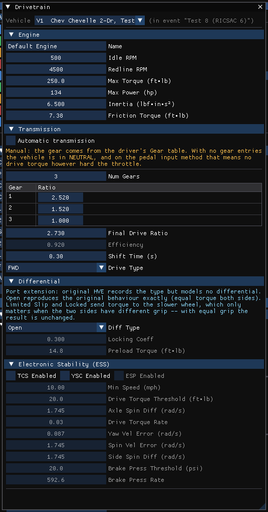
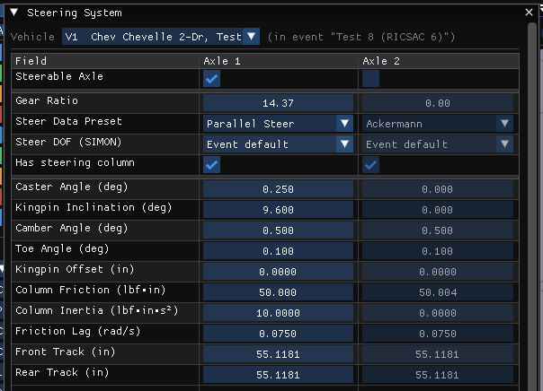
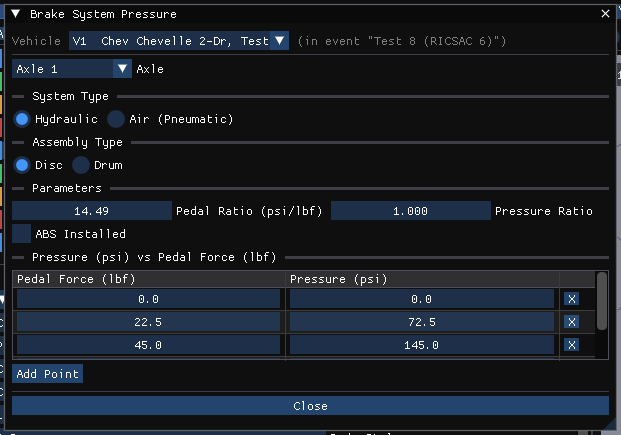

# Chapter 11 — Vehicle Model Definition (Part E: Drivetrain, Steering and Brake System)

*Adapted for HVE 2027 from the HVE User's Manual (Version 5, Seventh
Edition, Jan 2006), Chapter 11.*

This part covers the vehicle-level systems HVE edits by clicking on the
Engine icon (Drivetrain), the Steering Wheel icon (Steering System) and the
Brake Pedal/Master Cylinder icon (Brake System) in the Vehicle Viewer. In
HVE 2027 they are **Vehicle › Drivetrain**, **Vehicle › Steering System**,
**Vehicle › Brakes › Brake System Pressure** and **Vehicle › Brakes › ABS /
Brake Design** (each also a button in the Vehicles panel's Components
section).
Values are shown in the units set in Preferences, and changes apply as they
are made.

## Drivetrain

The Drivetrain parameters for the current vehicle are displayed and edited
using the Drivetrain dialog (**Vehicle › Drivetrain**). The drivetrain is
composed of three components, each a section of the dialog (HVE 2027 adds a
fourth, Electronic Stability (ESS)):

- Engine
- Transmission
- Differential

Each of these components is described below. See also the
reference page,
[Drivetrain dialog](../../04-brakes-powertrain/DriveTraDlg.md).

*Figure 11-50: The Drivetrain dialog (HVE 2027), with its Engine, Transmission, Differential and Electronic Stability (ESS) sections.*

### Engine

The HVE Vehicle engine is modeled by power vs engine speed table data for
both a wide-open-throttle (WOT) condition and a closed-throttle (CT)
condition.

In HVE 2027 the Engine section contains **Name**, **Idle RPM**, **Redline
RPM**, **Max Torque**, **Max Power**, **Inertia** and **Friction Torque**,
then **Engine Tables**: a **Throttle Position** selection (Wide Open /
Closed) and a grid of **Speed (RPM)**, **Torque** and **Power** for the
selected table. Speed and torque are edited; Power is shown greyed and
follows torque × speed, because no engine reads the power column (SIMON,
EDVSM and EDVDS read speed and torque).

!!! warning "Not in HVE 2027"
    The power graph, Apply and Print.

The Engine parameters are described below.

- **Engine Name** — User-editable description of drivetrain components.
- **Throttle Position** — Switch between WOT and Closed Throttle positions.
- **Engine Speed** — Rotational velocity of the crankshaft.
- **Engine Power** — Rate of work performed by the engine at the current
  engine speed.
- **Engine Torque** — Rotational torque produced at the current engine
  speed (calculated; not editable).
- **Drivetrain Inertia** — Rotational inertia of drivetrain components.
- **Engine Idle Speed (RPM)** — Idle speed of the engine.
- **TCS/YSC...** — Displays the Electronic Stability System dialog, used to
  indicate whether Traction Control (TCS) and/or Yaw Stability Control
  (YSC) are installed, and to edit their activation thresholds (velocity,
  yaw velocity error, wheel spin velocity error, wheel side-to-side
  difference, axle-to-axle difference, drive torque and brake pressure) and
  activation rates (drive torque change and brake pressure change). In
  HVE 2027 this is the **Electronic Stability (ESS)** section of the
  Drivetrain dialog: TCS Enabled, YSC Enabled, Min Speed, Drive
  Torque Threshold, Axle Spin Diff, Drive Torque Rate, Yaw Vel Error, Spin
  Vel Error, Side Spin Diff, Brake Press Threshold and Brake Press Rate. SIMON's TCS runs only when the event's Driver Controls
  use the Pedal input method. HVE's ESP switch is not offered: HVE 2027
  models TCS and YSC only.

**Table 11-26: Engine Parameters**

| Parameter | Unit Name | Description |
| --- | --- | --- |
| Engine Name | UtNone | Description of drivetrain components |
| Throttle Position | UtNone | Switch for Wide-Open-Throttle (WOT) and Closed Throttle engine tables |
| Engine Speed | UtEngVelAngular | Engine rotational velocity |
| Engine Power | UtEngPower | Engine power |
| Engine Torque | UtEngTorque | Engine torque (calculated; not editable) |
| Drivetrain Inertia | UtVehInertia | Rotational inertia of drivetrain components |

### Transmission

The HVE Vehicle transmission is modeled by a reverse gear, neutral and up
to 12 forward gears. The transmission is edited using the Transmission
dialog. See also the reference page,
[Transmission Data dialog](../../04-brakes-powertrain/TransDataDlg.md).

In HVE 2027 the transmission is the **Transmission** section of the
Drivetrain dialog: **Automatic transmission** (with Shift RPM min and max,
and the Upshift and Downshift throttle thresholds lo/hi, when checked),
**Num Gears** (1 to 12, as in HVE) and a table of the **Ratio** of reverse (**Rev**, negative
as HVE stores it) and of each forward gear,
**Final Drive Ratio**, **Efficiency** (disabled: no simulation reads it),
**Shift Time (s)** and **Drive Type** (FWD, RWD, AWD).

!!! note "HVE 2027"
    With a manual transmission the gear comes from the event's Driver
    Controls Gear table; with no gear entries the vehicle is in neutral. A
    reverse of 0 means *unstated*: the engines are then given minus first
    gear. HVE's shift-schedule graph has no control.

The Transmission parameters are described below.

- **Forward Speeds** — Number of forward speeds in the current transmission
  (up to 12).
- **Gear Ratios** — Ratio for each gear.
- **Transmission Type** — Radio buttons selecting *Standard* (manual) or
  *Automatic*. Selecting Automatic enables the Shift Points group, which
  defines the automatic transmission shift schedule (throttle position vs
  engine speed, with upshift and downshift lines between the low- and
  high-speed shift points; the shift schedule graph is redrawn after
  pressing Apply).

**Table 11-27: Transmission Parameters**

| Parameter | Unit Name | Description |
| --- | --- | --- |
| Forward Speeds | UtNone | Number of forward speeds in the current transmission |
| Transmission Gear | UtNone | Ratio for each gear |

### Differential

The HVE Vehicle differential is modeled by up to 3 ratios. The differential
is edited using the Differential dialog. See also the
reference page,
[Differential Data dialog](../../04-brakes-powertrain/DiffDataDlg.md).

In HVE 2027 the differential is the **Differential** section of the
Drivetrain dialog: **Diff Type** (Open, Limited Slip, Locked), **Locking
Coeff**, **Preload Torque**, and **Gears** (1-Speed, 2-Speed, 3-Speed) with
the **High** ratio (the Final Drive Ratio of the Transmission section, shown
greyed) and the **Medium**/**Low** ratios. The other ratios are selected
only by the event's Differential schedule in Driver Controls Gear; without
one the engines use High throughout, and EDVSM refuses a multi-speed
differential.

The Differential parameters are described below.

- **Forward Speeds** — Number of speeds in the current differential (up to
  3). *(The legacy manual said "transmission" here — a typo.)*
- **Gear Ratios** — Ratio for each gear.
- **Differential Type** — HVE's dialog shows Standard/Limited Slip/Locked
  radio buttons disabled: the HVE drivetrain model assumes an open
  (standard) differential.

  !!! tip "New in HVE 2027"
      HVE 2027 implements a torque-biasing differential as a disclosed port
      extension, so Diff Type is enabled. **Open** reproduces HVE's
      behavior exactly (equal torque to both sides). **Limited Slip** and
      **Locked** send torque toward the slower wheel — a difference of
      Preload Torque plus Locking Coeff × the axle torque — which matters
      only when the two sides have different grip.

**Table 11-28: Differential Parameters**

| Parameter | Unit Name | Description |
| --- | --- | --- |
| Forward Speeds | UtNone | Number of forward speeds in the current differential |
| Differential Gear | UtNone | Ratio for each gear |

## Steering System Parameters

The Steering System parameters for the current vehicle are displayed and
edited using the Steering System dialog. See also the
reference page,
[Steering System dialog](../../03-suspension-steering/SteerSysDlg.md).

*Figure 11-53: The Steering System dialog (HVE 2027), one column per axle. The per-wheel Steer-Axis Mechanics table is further down the dialog.*

To display or edit the current vehicle's steerable axles and associated
parameters, choose **Vehicle › Steering System** (or Vehicles panel ›
Components › Steering…). The dialog is a table with a column per
axle, so there is no Current Axle selector:

- **Steerable Axle** — HVE's Is Steerable check box; the other cells of an
  axle are enabled only when it is checked.
- **Gear Ratio** — Positive steers with the steering wheel; a negative
  ratio counter-steers (a steerable tag axle).
- **Steer Data Preset** — Ackermann, Parallel Steer or Custom.
- **Steer DOF (SIMON)** — Event default, Normal (free), Append (free after
  table) or Auto start (free at contact), per axle: a self-steering tag
  axle can be free while the front axle follows the steer table.
- **Has steering column** — Off for a castoring axle with no steering
  linkage.
- Alignment: **Caster Angle**, **Kingpin Inclination**, **Camber Angle**,
  **Kingpin Offset** (see [Spindle
  Axis](11c-suspension.md#spindle-axis)). There is no toe row: HVE's
  per-wheel toe-in, a length, is kept with the vehicle but no engine reads
  it.
- **Column Friction**, **Column Inertia**, **Friction Lag (rad/s)**.

Below the table, **Steer-Axis Mechanics (per wheel)** has a column per wheel
of a steerable axle: Stub Axle Length, Kingpin Friction, Stop Angle Right and
Left, Stop Stiffness, and Stop Damping (disabled; no simulation reads it).

!!! note "HVE 2027"
    - Column Friction, Column Inertia and Friction Lag, and the steer-axis
      friction and stops, are read only when an axle's Steer DOF is not Off:
      a prescribed steer angle cannot be resisted. The dialog says so.
    - HVE's Column Stiffness, Linkage Mass, Linkage Stiffness and Steering
      Linkage Damping have no control in this dialog.
    - In HVE, "Use Ackermann Steering" is chosen per event vehicle in the
      Driver Controls; HVE 2027 takes it from the vehicle (Steer Data
      Preset).

The Steering System parameters are described below.

- **Axle Selector** — Axle number (1, 2 or 3, limited by the number of
  axles defined in the Vehicle Information dialog; in HVE 2027, Number of
  Axles in the Vehicles panel's Configuration section).
- **Is Steerable Check Box** — Switch to allow or disallow steering at the
  selected axle.
- **Gear Ratio** — Ratio of the steering wheel angle to the wheel angle.
- **Steering Column Friction** — Friction torque measured at the steering
  wheel.
- **Steering Column Inertia** — Rotational inertia of steering wheel and
  column.
- **Column Stiffness** — Torsional stiffness of the steering system between
  the steering wheel and the wheel on the driver's side.

  > **NOTE:** The driver's side is defined by Driver Location (in HVE 2027,
  > in the Vehicles panel's Configuration section).

- **Linkage Mass** — Mass (weight/g) of all translating linkage components.
- **Linkage Stiffness** — Torsional stiffness of the steering system
  between the driver's side wheel and the opposite-side wheel.
- **Steering Linkage Damping** — Linear damping of the linkage system.
- **Steering Friction Lag** — Rotational velocity required to develop
  steering friction torque.

**Table 11-29: Steering System Parameters**

| Parameter | Unit Name | Description |
| --- | --- | --- |
| Axle Selector | n/a | Current axle number |
| Is Steerable | boolean (TRUE or FALSE) | Check box; if TRUE, the current axle is steerable |
| Gear Ratio | UtVehSteeringRatio | Ratio of the steering wheel angle to the wheel angle |
| Steering Column Friction | UtSteTorque | Frictional torque in steering column |
| Steering Column Inertia | UtVehInertia | Rotational inertia of steering wheel and column |
| Column Stiffness | UtVehSteeringStiffness | Torsional stiffness of the steering system between the steering wheel and the wheel on the driver's side |
| Linkage Mass | UtVehMass | Total mass of all translating linkage components |
| Linkage Stiffness | UtVehSteeringStiffness | Torsional stiffness of the steering system between the driver's side wheel and the opposite-side wheel |
| Steering Linkage Damping | UtVehDamp | Linear damping of linkage |
| Steering Friction Lag | UtVehVelAngular | Friction null band for full column friction |

## Brake System Parameters

The Brake System parameters for the current vehicle are displayed and
edited using the Brake System dialog (Brake System Pressure vs Pedal
Force). See also the reference page,
[Brake System Pressure vs Pedal Force dialog](../../04-brakes-powertrain/BrkSysVsPedFrcDlg.md).

*Figure 11-54: The Brake System Pressure dialog (HVE 2027).*

To display or edit the current vehicle's brake master cylinder pressure
ratio, choose **Vehicle › Brakes › Brake System Pressure**. The dialog contains an
**Axle** selector, **System Type** (Hydraulic, Air (Pneumatic)), **Pedal
Ratio** (per vehicle; 0 derives the slope from the curve below), **Pressure
Ratio**, and a table of pedal force against pressure with **Add Point**.

!!! note "HVE 2027"
    The Brake System Pressure dialog has **System Type**, which reaches
    SIMON's input report only, and no Assembly Type or ABS Installed. The
    disc/drum choice is the per-wheel Brake Type in the Brake Assembly
    dialog. **ABS Installed** is in **Vehicle › Brakes › ABS / Brake Design ›
    ABS System**, with the ABS System data; the ABS Designer is reached from the
    same menu item. SIMON regulates every wheel when ABS Installed, or any
    wheel's Antilock box in Brake Assembly, is ticked. EDSVS and EDVTS use the
    per-wheel boxes, and EDVDS has no ABS model.

The Brake System parameters are described below.

- **Pedal Ratio** — Ratio of master cylinder pressure per unit of brake
  pedal force.

  > **NOTE:** While using the Event Editor, Driver Controls, the user may
  > assign a table of pedal force vs time. The entered pedal force is
  > multiplied by the master cylinder pedal ratio to determine the current
  > brake system pressure.

  > **NOTE:** For airbrake systems, the Pedal Ratio is normally set equal
  > to 1.0; thus, for an airbrake system, the pedal force is also equal to
  > the treadle valve outlet pressure.

- **Brake System Type** — Radio buttons selecting the type of brake system
  installed on the vehicle: *Hydraulic* or *Air*.
- **Brake Type on Each Axle** — Displays and edits the brake assembly type (*Disc* or
  *Drum*) installed on each axle. This setting is also updated
  automatically when a specific brake design is chosen in the Brake
  Assembly dialog (Disc and Air Disc designs set it to Disc; drum-based
  designs set it to Drum). A warning message is issued when the dialog
  opens if the right and left brake types on an axle are different, as this
  is probably a mistake.
- **ABS Installed Checkbox** — Assigns ABS System parameters. Also enables
  the *Edit* pushbutton that displays the ABS System Data dialog and allows
  editing of the ABS System variables: control source, ABS algorithm,
  control method, cycle rate, ABS pressure threshold, ABS velocity
  threshold, low friction threshold, and delay parameters (delay method,
  apply delay and release delay).

  !!! note "HVE 2027"
      **Vehicle › Brakes › ABS / Brake Design** opens a window with **ABS System…**
      and **ABS Designer…**. The ABS System dialog has **ABS Installed**,
      the Algorithm, Control Method, the thresholds (Min Pressure, Min
      Velocity), the
      cycle rate, and the Delay Method with Apply and Release Delay. Of
      HVE's six algorithms, the engine implements Tire Slip, Bosch Version
      1 and Algorithm 4; Algorithms 3, 5 and 6 are offered, marked "not
      implemented", and stop the run with an error when ABS first acts.
      HVE's Low Friction Threshold and Control Source have no control. The
      ABS Designer is a table per wheel: Min Velocity, Slip Min and Max,
      Spin Accel Min and Max, Cycle Rate, Apply Rate, Apply Rate,
      Secondary (Algorithm 4) and Release Rate.

  > **NOTE:** Clicking this checkbox also enables the ABS Designer option
  > and the antilock options in the Wheel Brake Assembly dialog (see
  > [Part D](11d-brakes-tires-wheels.md), Figure 11-36).

**Table 11-30: Brake System Parameters**

| Parameter | Unit Name | Description |
| --- | --- | --- |
| Pedal Ratio | UtBraPedalRatio | Brake system pressure per unit of pedal force |
| ABS Installed | UtNone | Flag indicating an ABS system is installed on the vehicle |

## HVE Brake Designer

The HVE Brake Designer provides a detailed brake design capability
integrated directly within the HVE simulation environment. This feature
allows vehicle designers and safety researchers to develop a specific brake
design for each wheel and evaluate the resulting vehicle performance using
a predefined suite of maneuvers or compliance test simulations. The HVE
Brake Designer also includes a detailed tool for simulating ABS.

In HVE the Brake Designer is accessed from the Brake Assembly dialog (via
the Brake Type option list and Edit Brake pushbutton — see
[Part D](11d-brakes-tires-wheels.md)), from the ABS Designer pushbutton
(per-wheel ABS data) and from the Brake System dialog's ABS Edit pushbutton
(system-level ABS data). In HVE 2027 it is **Vehicle › Brakes › Brake
Designer** (see [Part D](11d-brakes-tires-wheels.md#hve-brake-designer)), with
the ABS data under **Vehicle › Brakes › ABS / Brake Design**. HVE's Brake
Material Properties library, which no engine reads, is not in HVE 2027. The individual Brake Designer dialogs
are documented in the HVE reference pages in
[Brakes and Powertrain](../../04-brakes-powertrain/README.md):
[Disc Brake](../../04-brakes-powertrain/DiskBreakDlg.md),
[Duo-Servo](../../04-brakes-powertrain/DueServoBrkDlg.md),
[Duplex](../../04-brakes-powertrain/DuplexBrkDlg.md),
[Single Piston](../../04-brakes-powertrain/BrkSingPistDlg.md),
[Dual Piston](../../04-brakes-powertrain/DualPistBrkDlg.md),
[Dual Wedge](../../04-brakes-powertrain/DualWedgeBrkDlg.md) (and HVE's
[Brake Material Properties](../../04-brakes-powertrain/BrkMatPropDlg.md),
which HVE 2027 does not have).

<!-- NAV -->

---

← Previous: [Chapter 11 — Vehicle Model Definition (Part D: Brakes, Tires and Wheels)](11d-brakes-tires-wheels.md)  |  [Index](README.md)

<!-- /NAV -->
