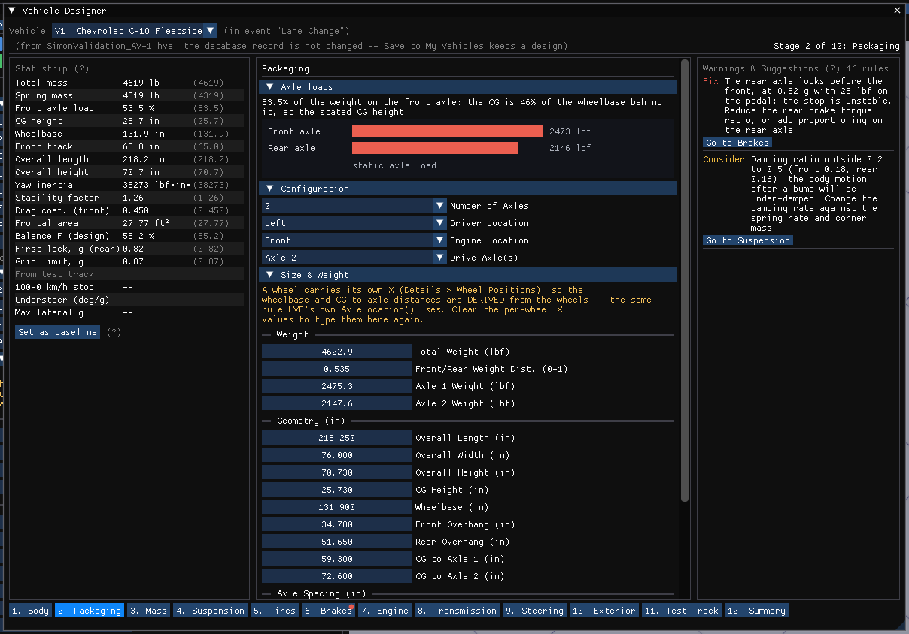
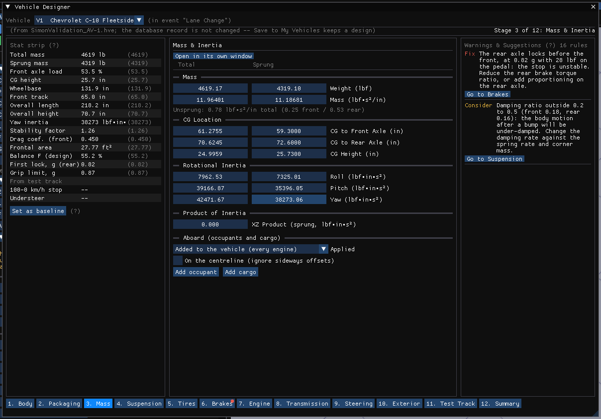
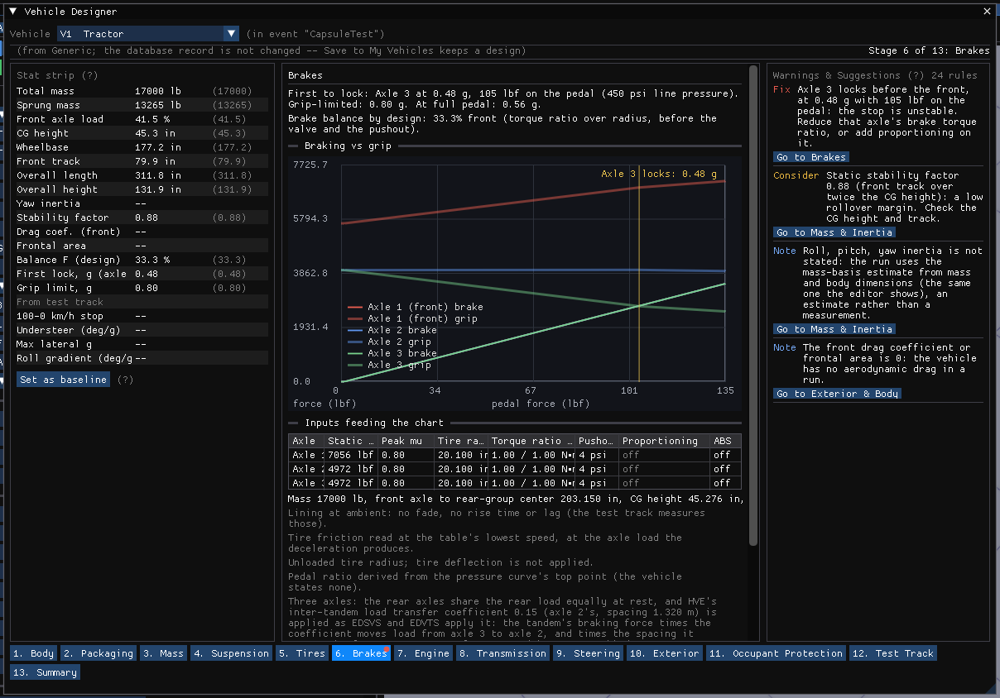
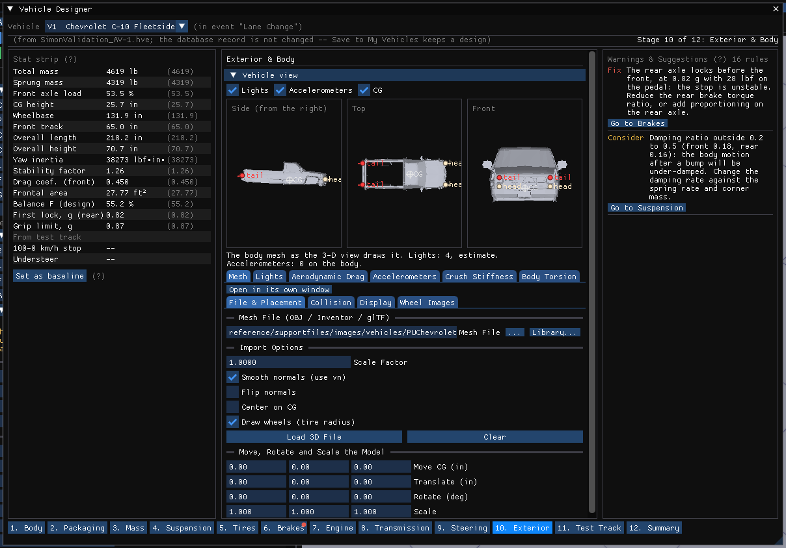
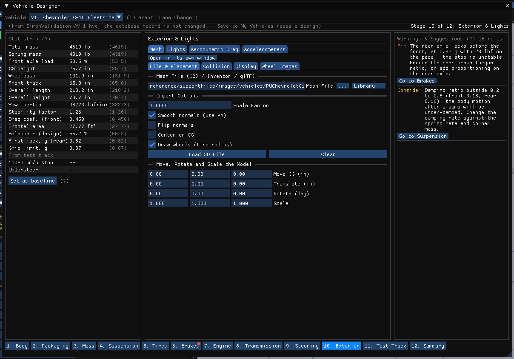
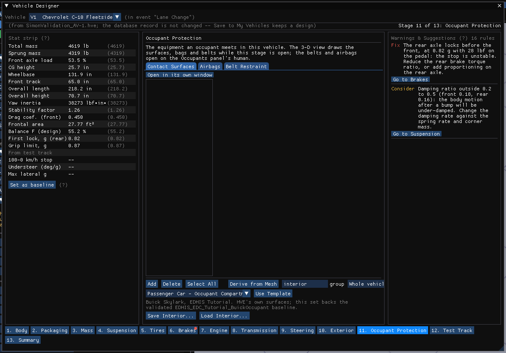
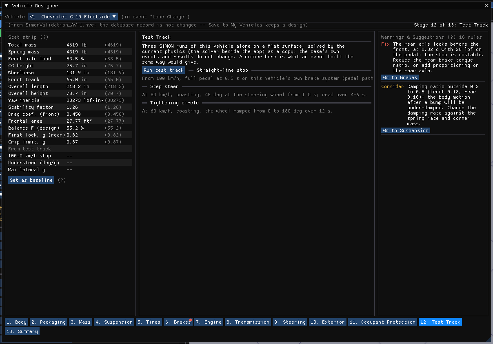
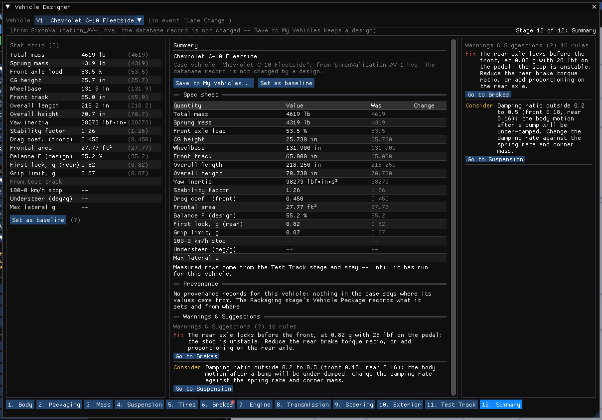
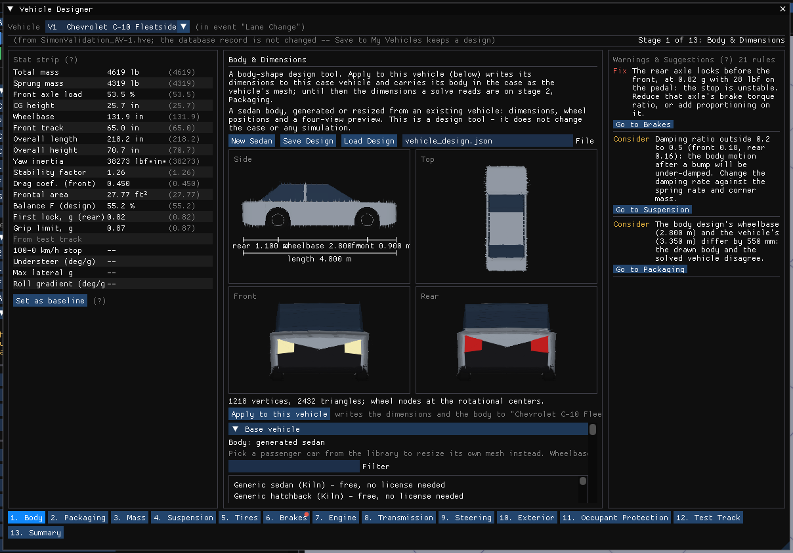

# Chapter 12 — Vehicle Designer

!!! note "HVE 2027"
    The Vehicle Designer is new in HVE 2027; HVE has no counterpart. It is a
    **staged design tool** that walks a vehicle from its body to a test track,
    stage by stage, over the same dialogs the Vehicle menu opens. It edits the
    **case's vehicle**: the database record the vehicle came from is never
    changed, and keeping a design means **Save to My Vehicles** (Chapter 10).

**The Vehicle Designer is the Vehicle editor's panel.** Switching to the Vehicle
editor (the **Vehicle (F3)** button or F3) opens it where the Vehicles panel used to
open, docked on the left with the 3-D view beside it; **Vehicle › Vehicle
Designer...** opens it too. It is an ordinary docked window: drag its tab to move it,
float it, or dock it anywhere, as you would the 3-D view, and the arrangement is
kept. Docked narrow, the **Key figures** and **Warnings & Suggestions** fold into
the top of the stage so the stage keeps its width; wider than about 1000 pixels
they are columns on either side. The Vehicles panel is one item away, **Vehicle ›
Editors › Vehicles Panel**. (Key Results and the Output Graph are in the Event and
Playback editors.) A session that starts in the
Vehicle editor opens it the first time you switch back to it. It has one
frame and thirteen stages. The frame is the same on every stage: the **Key figures**
column on the left, the stage's own controls and views in the center, a **Warnings &
Suggestions** panel on the right, and a stage bar along the bottom with every
stage reachable. The first line names the case vehicle and where it came from,
and which stage is open.

!!! warning "A shape is not a vehicle model"
    A body shape cannot determine a vehicle's mass, center of gravity, inertia,
    tire forces, braking, powertrain or crush stiffness. The Designer never
    infers them as measurements: each one is *not set*, *entered by you*, or an
    **estimate** that says so. See **Engineering data** below.

## The stages

The stage bar lists the thirteen stages in the order a design is usually worked,
numbered so the order is visible. The designer opens on the first, **Vehicle**;
every other stage edits a vehicle, so it opens once the case has one (until then
its button is unavailable and says so):

1. **Vehicle** — which vehicle the designer works on: the case's vehicles, and the Add Vehicle list to add or replace one from (Stage 1 below).
2. **Packaging** — axle layout, center of gravity and the weight split.
3. **Mass** — total and sprung mass, roll, pitch and yaw inertia.
4. **Suspension** — spring and damping rates, anti-roll, roll center and roll couple.
5. **Tires** — size, friction, cornering and camber stiffness and their tables.
6. **Brakes** — the assemblies, the Brake Designer, system pressure and ABS.
7. **Engine** — idle and redline, the torque and power curves, engine braking.
8. **Transmission** — gear ratios, final drive, shift logic, drive type, differential.
9. **Steering** — steer ratio, column and geometry per axle.
10. **Exterior** — the mesh, the lamps, aerodynamic drag, accelerometers, crush stiffness and body torsion.
11. **Occupant Protection** — the contact surfaces, airbags and belts an occupant meets, per seat.
12. **Test Track** — three canned runs on the current physics, each on SIMON and on EDSMAC4, read back as numbers (stage 12 below).
13. **Summary** (stage 13 below) — the spec sheet, the whole warnings list and the provenance tally.

In this release stages 1, 4, 5, 6 and 9 are built. Each other stage names the dialogs that hold
its inputs and opens them with a button (**Suspension Data...**, **Tires...**,
**Brake Assembly...**, **Drivetrain...** and so on, the same windows the Vehicle
menu opens), so nothing an analyst could set before is out of reach. The Test
Track and Summary stages say what they will do and do nothing yet.

### Stage 1: Vehicle

The Vehicle stage is where a vehicle comes into the case and where the designer
is pointed at one.

**Vehicles in this case** lists the case's vehicles, one row each with its
**Type**, where it came **From** (its database, or *(entered)*) and how many
**Events** use it. Click a row to work on that vehicle: the designer, the
Vehicle editor and the 3-D view all follow it. **Duplicate** copies the selected
vehicle with every setting, as a new vehicle after it in no event (the Vehicles
panel's **Dup**); it is unavailable while results are on screen, because the copy
renumbers the vehicles after it.

**Add or replace from a database** is the **Add Vehicle** window's own list (see
Vehicle › Add...): **Built in (no database needed)**, HVE's generic vehicles by
type and class, for a vehicle that is in no database, then the search
(**Filter**, **Clear**, **Generics**, **Database**) and the sortable table of
every vehicle in the loaded databases. Clicking a vehicle — in the table or in
the built-in list — **picks** it, and the four views below draw the picked vehicle
before anything is added: its body from its own mesh file (or its extents box,
with the reason, when it has no mesh or the mesh cannot be opened), its tires,
lights and CG. With nothing picked they draw the case vehicle selected above.

The stage fits the window without scrolling: the vehicles, the list and the
buttons on the left, and on the right the four views, sized to the height
there is. The views are **Side (from the right)**, **Top**, **Front** and **3-D**, two by
two. The 3-D view turns with a left-button drag and returns to its starting
angle on a double-click; the angle is kept as you change vehicles.

- **Add to case** adds the picked vehicle to the case and selects it, so the
  other twelve stages open on it with its data. It joins no event until an
  event's vehicle slot names it. Unavailable while the active event's results
  are on screen.
- **Replace V*n* with it...** replaces all of the selected vehicle's data with the
  picked vehicle's, after a confirmation. The vehicle keeps its place in the
  case and in every event that uses it. Unavailable while the results on screen
  were solved with that vehicle.

Figure 12-1 shows the stage with a vehicle picked in the database list.

### Stage 2: Packaging

The Packaging stage holds the dimensions a solve reads. It opens with **Axle
loads**, the static load on each axle from the mass and the weight split, and
where the CG sits along the wheelbase. On a vehicle with more than two axles
the rear axles share the rear load equally (a tandem's equalizer at rest), one
bar each, and the headline says so. Under it are the two sections the
Vehicles panel has: **Configuration** (number of axles, driver
location, engine location and drive axles, with HVE's rules applied as you
change one) and **Size & Weight** (HVE's Vehicle Wizard form, applied as you
type: wheelbase, tracks, lengths, weights and CG, with the wheelbase check and
the **Details** tables underneath). They are the panel's own sections, not
copies: a field has one editor. Under them, folded, are **Connections** (the
Vehicle Connections editor: how this unit couples to another by hitch, fifth
wheel or pintle, with its **Properties...** window) and the **Vehicle Package**
wizard that **Tools › Vehicle Package...** opens, pinned to the designer's
vehicle: **1. Identify** (the VIN
and what decoding it says, or the year, make, model and trim), **2.
Specifications** (weight, front axle share, wheelbase, front and rear track,
length, width, height and CG height, each marked Stated or Looked up with its
source) and **3. Save with the case**, with **Scale the vehicle to these specs**
for a generic vehicle. The window's vehicle picker and its path for building a
new vehicle are not drawn here: the frame's vehicle line is the picker, and a new
vehicle is the window's job, reached by **Open in its own window**.

### Stage 3: Mass

The Mass stage opens with **Stated against estimated inertia**: the roll, pitch
and yaw inertias the vehicle states against EDC's estimate from mass alone (its
power-law fits), the estimate drawn hatched because it is a regression, not
this vehicle; a stated value far from the fit is worth a look. Under it the
stage hosts the **Inertia / Mass** editor that the Vehicles panel's
Inertia **Edit...** opens: total and sprung mass, the CG location, the roll,
pitch and yaw inertias and the product of inertia, each in the stored basis and
the other basis side by side, and what is aboard (occupants and cargo). One
editor serves the window and the stage; **Open in its own window** opens the
window.

### Stage 4: Suspension

The Suspension stage opens with **Ride and roll**: each axle's ride frequency
and damping ratio, with the body's response to a unit bump drawn for each
axle's corner (half the axle's static load, less the unsprung share, on its
spring and damper), and the roll gradient in degrees per g with the roll
stiffness split front against the rear group (every axle behind the front one,
as HVE's roll couple counts them).
The roll axis is at the stated roll centers, or at the ground when none is
stated, and the headline says which. These are the numbers the damping and
roll-split rules judge.

The Suspension stage hosts the suspension editor itself: the same **Springs &
Dampers** table and the four advanced tabs that **Vehicle › Editors › Suspension Data...**
opens, drawn in the stage's center under the frame's vehicle line, so an edit
here is the edit, with Key figures and the warnings panel updating beside it.
The window and the stage draw one editor, so they can never disagree.
**Open in its own window** opens the same editor as a separate window, to work
it beside another stage. A solved run's inputs are read-only here as everywhere, until
the run is reset.

### Stage 5: Tires

The Tires stage opens with **Peak friction against load**: each axle's peak
longitudinal friction from zero to twice its static tire load, read from the
tire's load table where it has one (a constant otherwise), with the static load
marked; one curve per axle, however many the vehicle has. This is the capacity
the Brakes chart divides the brake force by.

The Tires stage hosts the tire editor: the same **Tire Properties** table, the
tire-size and database tools and the **Load & Speed Tables** panel that
**Vehicle › Editors › Tires...** opens, drawn in the stage's center under the frame's
vehicle line. One editor serves the window and the stage.

### Stage 6: Brakes

The Brakes stage answers one question from the vehicle's own inputs: at what
pedal force does each axle lock, and which locks first. Nothing is solved; the
chart is computed from the same chain SIMON uses in a run. Line pressure is the
pedal force times the pedal ratio; above a proportioning knee the wheel sees
the reduced pressure; brake torque is the torque ratio times the pressure
above the pushout; brake force is that torque over the tire radius; and the
tire's capacity is its peak friction times the axle load, with the load
transferred forward by the deceleration the brakes themselves produce.

The headline names the first axle to lock, the deceleration and pedal force at
which it locks, the grip-limited deceleration (every tire at its peak) and the
deceleration at full pedal, then the brake balance by design (the front share
of torque ratio over radius, before any valve or pushout).

**Braking vs grip** plots two curves per axle against pedal force: the brake
force the brakes can deliver (solid) and the force the tires can transmit at
that moment's load (translucent, in the axle's color). Where a brake curve
crosses above its grip curve that axle locks; a vertical marker names the
first. On a two-axle vehicle the axles are Front and Rear; on a tractor or a
straight truck they are numbered, and the rear axles share the rear load
equally at rest (a tandem's equalizer) with the transfer's arm running from the
front axle to the rear group's center. On three axles HVE's **Inter-tandem Load
Transfer** coefficient (the Suspension editor's row on axle 2) is applied as
EDSVS and EDVTS apply it: the tandem's braking force times the coefficient
moves load from the trailing axle to the leading one, and the same force times
the tandem spacing enters the front-to-rear transfer, so with equal brakes the
trailing axle is the one that locks early. The stage's note names the
coefficient and the spacing it used. SIMON, which the Test Track runs, does not
read the coefficient, and EDVDS applies its own four-spring form; a coefficient
of 0 (HVE's none) or more than three axles keeps the equal sharing, and the
note says so.

**Inputs feeding the chart** lists, per axle, the static load, the peak
friction (from the friction table where the tire has one), the tire radius,
the right and left torque ratios, the pushout, the proportioning knee and
ratio, and ABS. Under it is what the chart leaves out: the lining is at
ambient (no fade; the Test Track stage will measure that), tire friction is
read at the table's lowest speed, the unloaded tire radius is used, and a
pedal ratio derived from the pressure curve says so. A vehicle the chart cannot
describe (a towed unit, which has no front axle and states no front/rear
split; a single axle; no mass; no wheelbase or CG height; no brake torque ratio
on any wheel) is told why instead of being drawn.

The stage adds three rows to Key figures: **Brake balance F (design)**,
**First lock** with the axle named and the deceleration in g, and the
**Grip-limited decel**. Where the axle that reaches its grip first has ABS, the
chart, the headline and that row say **ABS engages** instead of locks: the sweep
is the brakes against the grip and ignores ABS, so that point is where ABS
starts cycling the pressure in a run, and the wheel keeps rolling. Its warnings
are the first rules in the panel: a rear axle locking before the front is a
**Fix** naming the axle, and a **Consider** when ABS on that axle keeps it from
locking (the stop is stable only while ABS works); brakes that reach less than
85% of the grip limit at full pedal without locking are a **Consider**; a
proportioning ratio of 0 (HVE reads it as a pressure limiter), ABS on a wheel
(the curves past the point where it engages are the brakes as if it were off)
and a wheel with no torque ratio are **Notes**.

**Edit the brakes** sits under the chart: the brake editors themselves, one tab
each, so a change to a torque ratio or a proportioning knee redraws the chart
above it at once. The **Assembly** tab is the Brake Assembly editor (per-wheel
type, torque ratio, pushout, proportioning and antilock, with its per-wheel
**Design...** buttons), the **Designer** tab the Brake Designer, **System
Pressure** the Brake System Pressure editor with its pedal-force curve, and
**ABS System** and **ABS Designer** the two ABS editors that the ABS / Brake
Design window otherwise opens. They are the same editors as the windows, not
copies: a field has one editor, drawn here or in the window. Under the designer,
a **Design...** click in the Assembly tab selects the Designer tab on that wheel
instead of opening a second window. Each tab's **Open in its own window** button
opens that editor as its separate window, to work it beside another stage; the
two ABS tabs open the ABS / Brake Design window.

### Key figures

The **Key figures (was)** column shows the case vehicle's key numbers in the current display units:
total and sprung mass, front axle load, CG height, wheelbase, front track,
overall length and height, yaw inertia (the sprung value, as HVE stores it),
the static stability factor (track over twice the CG height), the front drag
coefficient and frontal area. Beside each value, in parentheses, is the value it
had **when the stage was opened**; a value that has moved since is shown in
amber. A row marked `--` is one the vehicle does not state; the strip never
substitutes a number. The rows under **From test track** are measured by a run
rather than entered, and read `--` until the Test Track stage fills them.

**Set as baseline** takes the current values as the ones shown in parentheses.
The snapshot is otherwise taken each time a different stage is opened, and kept
when the same stage is re-opened.

### Warnings & Suggestions

Each entry is one sentence naming the symptom, the stat it costs and the fix,
graded **Fix**, **Consider** or **Note**, with a **Go to** button for the stage
that owns the input. A stage with an open Fix carries a red marker on the stage
bar. The count beside the panel's title says how many rules are checked; hover
it for the list. A rule that lacks one of its inputs stays silent rather than
firing on a default, and a vehicle that trips no rule is told so.

The rules, by stage:

| Grade | Stage | Rule |
|---|---|---|
| Fix | Brakes | A rear axle reaches its grip before the front in the braking-against-grip sweep (named on a vehicle with more than two axles). |
| Consider | Brakes | At full pedal no axle locks and the deceleration is under 85% of the grip limit. |
| Note | Brakes | A wheel's proportioning is on with a ratio of 0, which HVE reads as a pressure limiter. |
| Note | Brakes | ABS is on at a wheel; the chart shows lockup as if it were off. |
| Note | Brakes | A wheel's brake torque ratio is 0. |
| Note | Brakes | The brake chart cannot be drawn (a towed unit or a single axle, no mass, no wheelbase or CG height, no brake anywhere). |
| Consider | Suspension | The front share of roll stiffness (spring rate times track squared over two, plus the auxiliary roll stiffness; the rear axles counted together) differs from the front weight share by more than 20 points. |
| Consider | Suspension | An axle's damping ratio (damping rate over twice the root of spring rate times corner sprung mass) is under 0.2 or over 0.5, on any axle. |
| Consider | Mass | The static stability factor, front track over twice the CG height, is under 1.1. |
| Note | Mass | Roll, pitch or yaw inertia is 0 in both its fields, so the run uses the mass-basis estimate the editor shows. |
| Note | Steering | A steerable axle's steer ratio is 0, which HVE reads as no steering gear. |
| Consider | Packaging | The body design's wheelbase and the vehicle's differ by more than 5 mm. |
| Note | Transmission | Top speed is set by the redline in top gear, below the drag limit from engine power, drag coefficient, frontal area and rolling resistance. |
| Consider | Transmission | An upshift at the redline lands under the automatic shift window's minimum rpm. |
| Note | Engine | The full-throttle torque curve ends below the redline; the engine holds the last row's torque beyond it. |
| Note | Exterior | The front drag coefficient or frontal area is 0, so the vehicle has no aerodynamic drag. |
| Fix | Suspension | Test Track (SIMON or EDSMAC4): the measured understeer gradient is negative, so the rear tires reach their limit before the front (oversteer). |
| Consider | Tires | Test Track (SIMON or EDSMAC4): the measured understeer gradient is over 5 deg/g (passenger cars run 1 to 4). |
| Consider | Brakes | Test Track (SIMON): the mean deceleration of the stop from 100 km/h is under 70% of the Brakes chart's grip limit, so the brakes and not the tires limit the stop. |
| Fix | Mass | Test Track (SIMON or EDSMAC4): the most lateral acceleration the tires reach is over 85% of the static stability factor (front track over twice the CG height). |
| Consider | Suspension | Test Track (SIMON): the measured roll gradient is over 7 deg/g (passenger cars run 3 to 7). |
| Fix | Occupant Protection | An occupant seated in this vehicle is belted in an event (Lap, 3-Point or Airbag + Belt) and no belt restraint system is in use for them on this vehicle. |
| Fix | Occupant Protection | An occupant has an Airbag + Belt restraint in an event and no airbag is installed at their seat, which EDHIS refuses. |
| Consider | Occupant Protection | An installed airbag names a primary reaction panel the vehicle has no contact surface for. |

The understeer gradient and brake fade need a run and arrive with the Test
Track stage; a rule on a value's provenance (an inertia that is an estimate
rather than a measurement) arrives with the Mass stage.

### Stage 7: Engine

The Engine stage opens with **Torque and power**: the wide-open torque curve
and the power it implies against engine speed, from idle to the redline, with
the closed-throttle curve (engine braking) when one is stated. Without a
wide-open table the flat maximum torque is drawn, which is what the engines
receive.

The Engine stage hosts the **Engine** section of the Drivetrain editor that
**Vehicle › Editors › Drivetrain...** opens: the engine's name, idle and redline rpm,
maximum torque and power, rotational inertia, friction torque, and the **Engine
Tables** (the wide-open
and closed-throttle torque curves, with the power each row implies). Nothing is copied: the stage
and the window draw the same editor, and the Transmission stage holds the rest
of that window. The **Open in its own window** button opens the whole
Drivetrain window.

### Stage 8: Transmission

The Transmission stage opens with **Tractive effort**: the force at the tires
in each gear against road speed (the wide-open torque through the gear and the
final drive, times the efficiency, over the tire radius), with the road load of
drag and rolling resistance across it. The markers show the rev limit in top
gear and where the road load meets the power; the headline says which of the
two sets the top speed, as the rev-limit rule does.

The Transmission stage hosts the other three sections of the Drivetrain editor:
**Transmission** (automatic or manual with the shift rpm window, the number of
gears and their ratios with reverse, the final drive ratio, efficiency, shift
time and drive type), **Differential** (the differential type, locking
coefficient, preload torque and its speeds) and **Electronic Stability (ESS)**
(traction and yaw stability control with their rates). The **Open in its own window** button
opens the whole Drivetrain window.

### Stage 9: Steering

The Steering stage opens with **Yaw-rate gain**: the yaw rate per degree at
the steering wheel against speed, from the steering ratio and the wheelbase.
Until the Test Track has measured the understeer gradient the curve assumes
neutral steer and says so; with the measurement it falls off above the
characteristic speed, which is marked.

The Steering stage hosts the steering editor: the per-axle table that
**Vehicle › Editors › Steering System...** opens (steerable axle, steer ratio, the steering
degree of freedom, column and linkage, geometry and stops), drawn in the stage's
center under the frame's vehicle line. One editor serves the window and the
stage.

### Stage 10: Exterior

The Exterior stage opens with the **Vehicle view**: four drawings of the
vehicle's body, from the right side, from above, from the front and in 3-D (drag to
turn it, double-click to reset), with its
**Tires** drawn at the wheel positions the solver uses (a circle from the side,
the tread from above and from the front, each at its own radius and width,
duals as two) and its **Lights**, **Accelerometers** and **CG** marked and named
(each a checkbox to show or hide). The body is the mesh the 3-D view draws; where none is loaded the
vehicle's extents box is drawn instead and the line under the views says so.
Forward is to the right in the side and top views, and the front view is as a
person standing ahead of the vehicle sees it, so the vehicle's right side is
on the viewer's left. A light is drawn in its own color with a short stroke
along its aim, gray when it is off; the lights are the case's own list, or the
lamps the body file places, or the estimate, and the line under the views names
which. An accelerometer stated in the inertial frame is not on the body and is
not drawn. Hover a marker for its position (SAE about the CG); click a light to
select it in the Lights editor below and in the 3-D view, or an accelerometer to
select it in the Accelerometers editor.

Under the view are the four editors of what the vehicle looks like and
carries, one tab each: **Mesh** (the Vehicle Mesh editor with its File &
Placement, Collision, Display and Wheel Images tabs), **Lights** (the Vehicle Lights
editor with its Lamp parts and Light sources tabs), **Aerodynamic Drag** (the
drag coefficients of the four surfaces) and **Accelerometers** (the vehicle's
accelerometer list), then the body's structure: **Crush Stiffness** (A, B and Kv
per side, and DyMESH's node stiffness), **Crush from Crash Tests** (the
Automatic Tools' Crush Stiffness from Crash Tests: CRASH3 A, B and G from staged
barrier tests, shown beside the stiffness now before you apply it; not offered on
a sealed case) and **Body Torsion** (the frame's torsional stiffness and axis).
Each editor tab's **Open in its own window** opens that editor's window. The mesh is the one of the four an engine reads, in DyMESH contact; the
other three are display and instrumentation.

### Stage 11: Occupant Protection

The Occupant Protection stage hosts the three editors of what an occupant
meets in this vehicle, one tab each: **Contact Surfaces** (the panels an
occupant can strike, with their materials), **Airbags** and **Belt Restraint**.
They are the same editors as the windows under **Vehicle**, not copies: a field
has one editor. The belts and airbags are per seat, so these two open on the
human the Occupants panel has selected, with the editors' own occupant picker
to change seat. While the stage is open the 3-D view draws the surfaces, bags
and belts, as it does when their windows are open. Each tab's **Open in its own
window** opens that editor's window.

### Stage 12: Test Track

The Test Track runs the vehicle, alone, on a flat surface, in three canned
events, and reads the numbers back. Each event is solved twice, on **SIMON**
(3-D) and on **EDSMAC4** (planar), the two most used calculation methods: the
same vehicle answers differently on them, because the two engines model it
differently, and a number from one read as the other's would mislead. Each
test shows the two engines' results side by side, and one plot carries both
traces (SIMON blue, EDSMAC4 orange). **Run test track** solves the six runs one
after another on the current physics, as a copy: the case's own events and
results do not change, nothing in the 3-D view moves, and the run is the
solver beside the app, so a number here is what an event built the same way
on that calculation method would give. **Cancel** stops the runs.

What each engine does not model is said beside its number:

- EDSMAC4 has no pedal path and no brake system. Its stop applies all the tire
  friction available at every wheel at the same instant, so it measures the
  tires, not the brakes.
- EDSMAC4 is planar: it has no roll and no pitch, so it gives no brake dive and
  no roll gradient.

- **Straight-line stop**: from 100 km/h, brakes full on at 0.5 s; on SIMON
  through the vehicle's own brake system (the pedal path). The stopping
  distance, the time and the mean deceleration, with the speed trace, and on
  SIMON the brake dive (the mean pitch while braking, less the attitude at
  rest). A vehicle that has not stopped by 15 s is reported as such.
- **Step steer**: at 80 km/h, coasting, 45° at the steering wheel from 1 s. The
  steady yaw rate over 4 to 6 s, the yaw-rate gain, the lateral acceleration and
  the understeer gradient (the road-wheel angle over the Ackermann angle, per g
  of lateral acceleration), with the yaw-rate trace; and the steady roll angle
  with the roll gradient in degrees per g, saying whether the body leans out of
  the turn (as it should) or into it. The pose comes from the solver's probe;
  an older solver that answers without one gives no roll gradient rather than
  0. A vehicle whose steering ratio is 0 (no steering gear) is refused with
  that reason rather than read as 16:1.
- **Tightening circle**: at 60 km/h, coasting, the wheel ramped from 0 to 180°
  over 12 s. The most lateral acceleration the tires reach and the wheel angle
  where they reach it, with lateral acceleration against steering angle.

Key figures' **100-0 km/h stop**, **Understeer (deg/g)** and **Max lateral
g** rows come once per engine (**…, SIMON** and **…, EDSMAC4**), and **Roll
gradient (deg/g), SIMON** once. They are filled from these runs and stay "--"
until the track has been run for the vehicle; they clear when a different
vehicle is picked. A run the solver refuses shows the solver's own reason.

The measurements also feed five rules in **Warnings & Suggestions** (the
`Test Track` rows of the table below): oversteer measured, heavy understeer, a
stop well under the Brakes chart's grip limit, lateral grip within 15% of the
static stability factor, and a soft roll gradient. The first two and the
lateral-grip rule read both engines and name each one whose number trips them;
the stop and the roll gradient read SIMON alone, since EDSMAC4 has no brake
system and no roll. They are silent until the track has run for the vehicle: an
unrun track is not a finding.

### Stage 13: Summary

The Summary is the design on one page. It opens with the vehicle's identity (the
Vehicle Package's year, make, model and trim, and its VIN when kept; otherwise
the case vehicle's name) and the one action a finished design has: **Save to My
Vehicles...**, which keeps the vehicle as designed in a database of your own
for future cases, since a design otherwise lives in the case and never changes
the database record. **Set as baseline** makes the current values the "was"
column and keeps them for this vehicle of this case across stage changes and
sessions (in your user settings, not in the case); **Forget baseline** drops the
kept baseline and the "was" column goes back to the values when a stage was
opened. **Copy spec sheet** puts the spec sheet on the clipboard as
tab-separated text in the display units, for a report or a spreadsheet.

The **Spec sheet** is Key figures in full: every quantity with its value,
its baseline and the change, in the current display units, the measured rows
from the Test Track stage among them. **Provenance** counts the case's records
for this vehicle by kind, Stated, Looked up, Estimated or Generic default, so a
reader sees how much of the vehicle is documented; a vehicle with no records is
told so. **Warnings & Suggestions** is the whole list from the right-hand panel,
each with its stage to go to.

## Frame and units

Lengths, masses and inertias are shown in the display units chosen in
Preferences; the design file stores meters and degrees. The design frame is the SAE convention
the rest of HVE 2027 uses: x forward, y to the right, z down. Its origin is on
the ground, on the center line, at the rear of the body. A wheel node sits at
the wheel's rotational center: its height above the ground is the tire radius.
Wheel names are **wheel_FL**, **wheel_FR**, **wheel_RL** and **wheel_RR**.

## The body designer

**Body designer (generate or resize a sedan body)**, at the foot of the Exterior
stage (closed until opened), is a body-shape design tool. Until 2026-10-19 it was
stage 1. It it edits its own design, saved to
its own design file, and changes nothing a solve reads until you write it to
the case vehicle with **Apply to this vehicle** (under the design). That writes
the design's dimensions into the vehicle's Packaging fields (wheelbase,
overhangs, overall length, width and height, the tracks and the tire radii;
the CG's front/rear split and its height stay the vehicle's own, since a body
shape determines neither) and carries the generated body in the case as the
vehicle's mesh, so it is drawn and collided like a mesh file. The vehicle's
database record is not changed. Each applied dimension becomes a Stated record
in the Summary's provenance tally, naming the design. The button is disabled
while a run holds the vehicle, and a design that does not validate is refused
with the reason. Until applied, the case vehicle's dimensions are on stage 2,
Packaging; the stage says so above its controls.

The body designer builds a recognizable sedan body from a short list of
dimensions, with the wheels at their axle positions, and shows it in four views
(**Side**, **Top**, **Front** and **Rear**). Use it to settle a vehicle's overall
proportions, then save the design as a file or apply it to the case vehicle.
Saving the design changes nothing in the case; applying it does, as described
above.

At the top, **New Sedan** restores the default sedan. **Save Design** writes the
design to the file named in **File**, and **Load Design** reads it back. A line
under them reports what happened. The four views follow; the **Side** view
carries the dimension overlay: rear overhang, wheelbase, front overhang and the
overall length, all taken from the numbers you entered.

### Base vehicle

**Base vehicle** chooses what the body is. By default it is the generated sedan.
The first entries of the list are Kiln's generic sedan, hatchback and SUV
(**free, no license needed**): openly licensed (CC0) vehicles built into HVE 2027,
which work on every computer. Below them are the passenger cars of your vehicle
library. Pick one
(narrow the list with **Filter**) and the designer
instead takes that vehicle's own mesh and resizes it: the design starts at the
vehicle's real dimensions, and **Dimensions** then change its wheelbase, length,
width and height.

The mesh is not scaled as a whole. The two wheel openings travel with their
axles and keep their shape, the overhangs take a change in length, and the zone
between the axles takes a change in wheelbase. Each part may stretch only so far
(about 70% to 135% of its original length for the overhangs, 80% to 135% for the
wheelbase zone, 88% to 115% for width and height). A change beyond a limit is
refused and the line under the buttons says which limit; nothing is built from
it. **Use Generated Sedan** returns to the generated body.

A vehicle can be a base only if it is a two-axle passenger car with a mesh of its
own, and its mesh and record agree on its length. A vehicle with no mesh of its
own, with a mesh offset from its center of gravity, or with a scaled mesh is
refused with the reason.

!!! warning "A derivative of licensed data keeps its license"
    A design resized from an EDC vehicle is a derivative of EDC data. It names
    its base and carries the base's data tag in the design file (the file holds
    no geometry), and it does not open on a computer without the EDC data
    license. The generated sedan and the built-in Kiln vehicles carry no tag and open
    everywhere. The tag is
    a gate and a record of where the design came from, not secrecy: a printed
    vehicle report still shows the vehicle's values.

The mass of a base vehicle is filled in as a catalog value that says it is the
unmodified vehicle's; the center of gravity and inertia stay not set, because a
resized body has no recorded ones.

### Dimensions

**Dimensions** holds the sliders for the overall size and the wheels:

- **Length**, **Wheelbase**, **Front overhang** and **Rear overhang**. These are
  not independent: front overhang + wheelbase + rear overhang always equals the
  length. Changing the length, the wheelbase or the front overhang moves the
  rear overhang; changing the rear overhang moves the front. The length of the
  car stays where you set it unless you set the length itself.
- **Width** and **Height** — the overall extremes. The body's bounds match them
  to within 0.01 m, and the axle spacing and track to within 0.002 m.
- **Front track** and **Rear track** — wheel center to wheel center.
- **Front tire radius**, **Rear tire radius**, **Tire width** and **Ride height**
  (the underbody's height above the ground).

### Body shape

**Body shape** shapes the generated sedan's side elevation and cross-section.
A body resized from a base vehicle keeps its own shape, and these controls are
grayed out:

- **Hood length** — front bumper to the base of the windshield.
- **Roof length** — the flat of the roof. The windshield and rear window slope
  away from its ends at the **Windshield rake** and **Rear window rake**, measured
  from the horizontal; the rear window ends on the rear deck.
- **Beltline height** — the window sill; the hood and the deck follow it.
- **Roof crown** and **Body side curvature** — camber of the roof and the
  roundness of the shoulder, 0 to 1.
- **Wheel arch flare** — how far the body swells outward over a wheel.

Changing the wheelbase moves the arches with the axles. It does not stretch the
hood or the cabin, which keep their own lengths.

Every slider is held to the range the generator can build. An edit that would
break a relationship — a tire standing outside the body, a wheel opening reaching
a bumper, a rear window running into the bumper, a fender lower than its tire —
is refused, the design is left unchanged, and the line under the buttons says
why.

### Appearance

**Appearance** sets the **Body color** and whether glass and the lights and grille
are drawn (**Show glass**, **Show lights and grille**). These change how the body
looks and nothing else: they move no dimension and no engineering value.

### Constraints

**Constraints** lists every dimensional rule the design breaks, as an error
(the body cannot be built) or a warning (legal but unusual). A design you
build with the sliders always satisfies them; a file you load may not, and its
errors are listed here instead of a preview.

### Engineering data

**Engineering data** lists the physical quantities a simulation needs, each with
where its value came from. A new design has none: every row reads *not set*.

**Fill With Estimates** fills the rows that are still not set with a class
estimate for a mid-size sedan — mass, center of gravity and inertia — and marks
them **ESTIMATE (assumed, not a measurement)**. **Refresh Estimates** recomputes
those estimates after a change in dimensions; a value you entered yourself is
never overwritten. The tire, suspension, powertrain and crush models stay *not
set*: a body shape gives nothing to estimate them from.

### Wheel nodes

**Wheel nodes** lists the four wheels' positions and radii.

## The design file

The design is saved as a JSON file (schema version 1), with numbers written in
full precision, so saving and loading never changes a dimension. A key the
Designer does not know, or a field missing from the file, is reported when the
file is loaded rather than ignored. A design with a base vehicle is checked
against the license on load, and its base is found again in the vehicle library
by name; if it is not there, the design opens without a preview and says so.

## What it does not do yet

A generated body is a sedan only; the hatchback and SUV come from a base vehicle,
and only a passenger car or one of the built-in Kiln vehicles can be a base. The body
is not yet offered to a case as a vehicle's generic body: DyMESH contact uses the vehicle's mesh, and the drawn
body and the solved body must always be the same one, so that step needs its own
change. The designer is also not a source of validated vehicle data.
