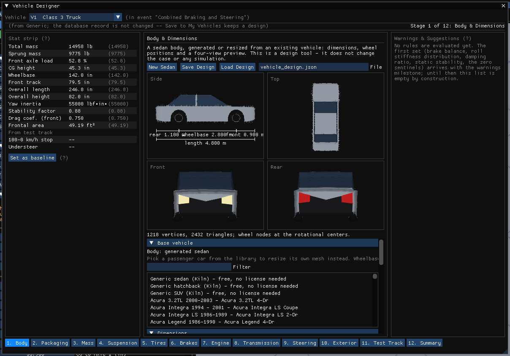
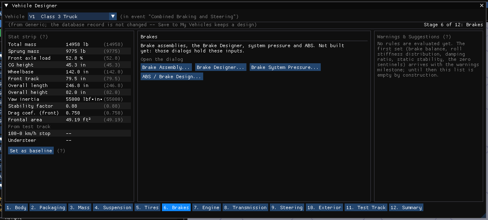
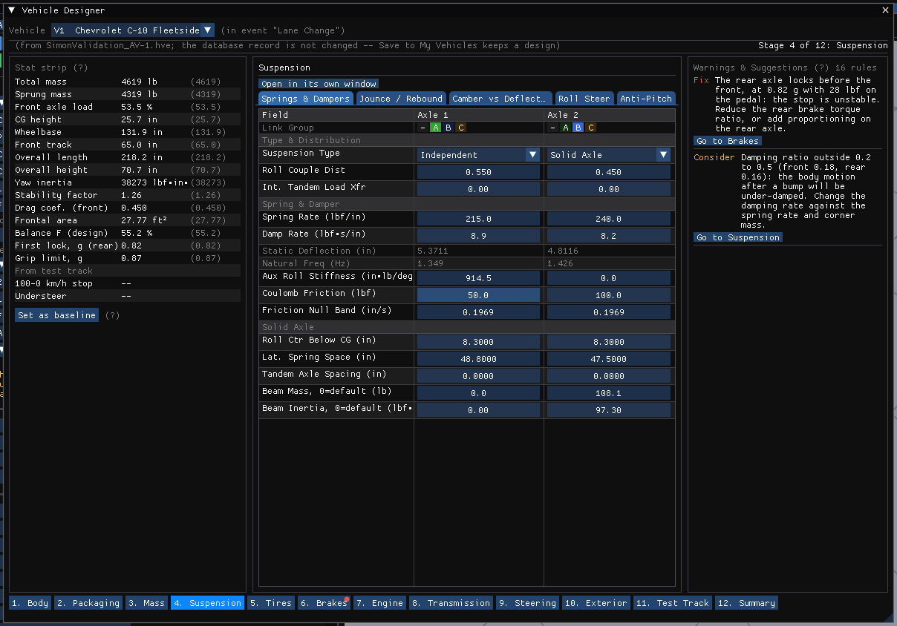
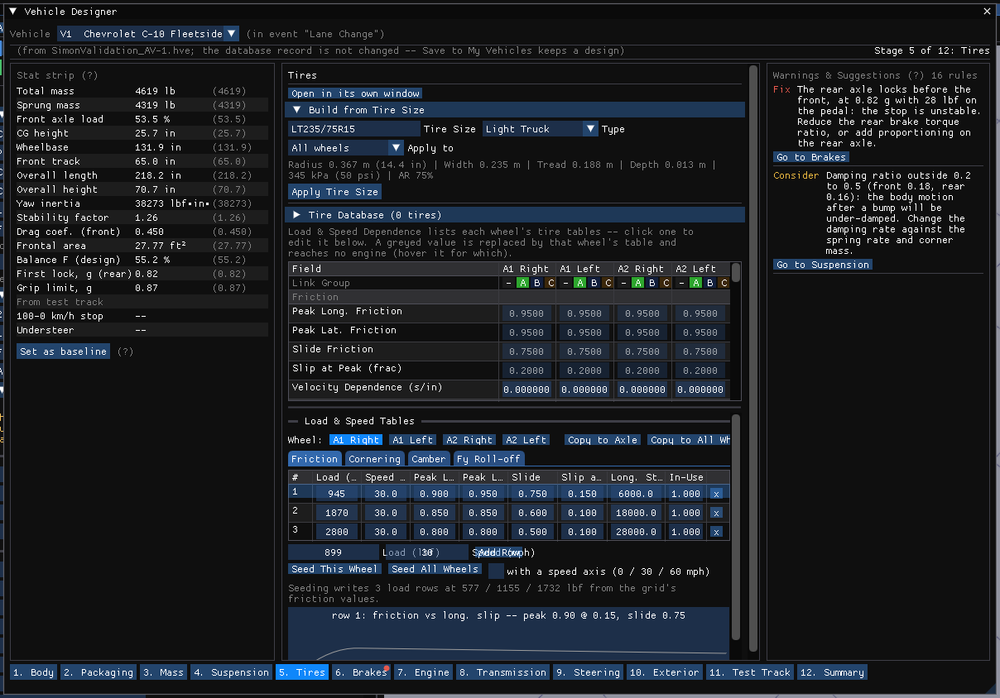
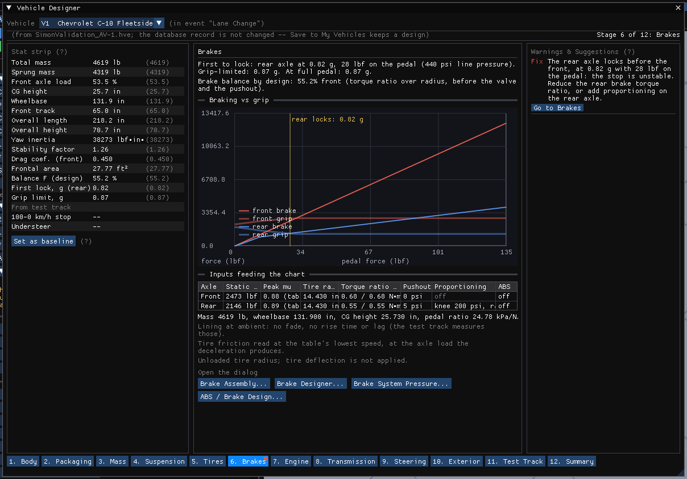
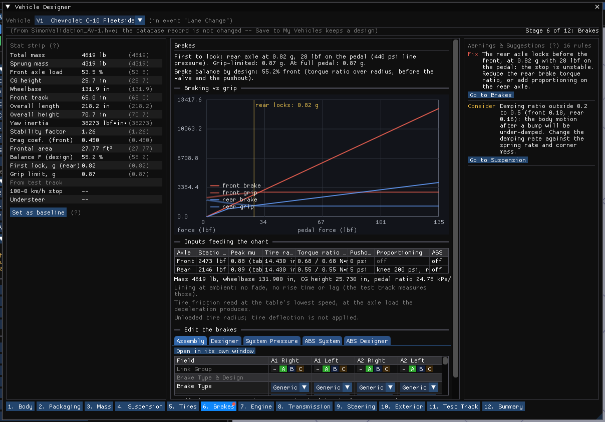
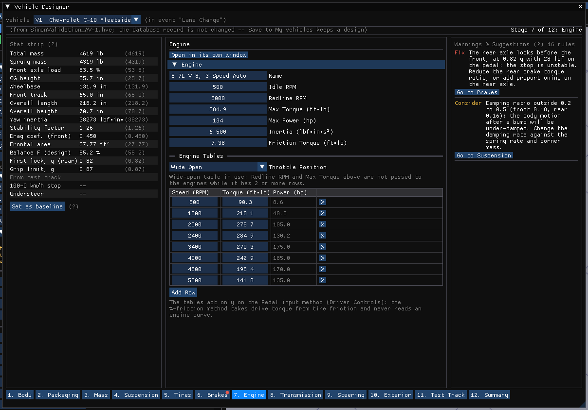
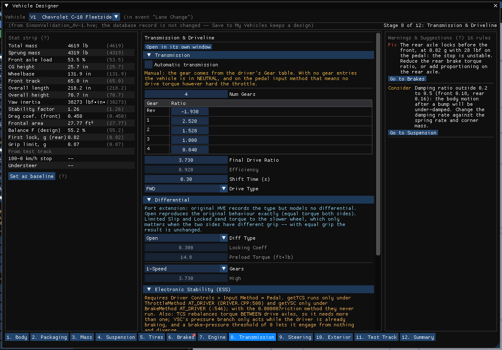
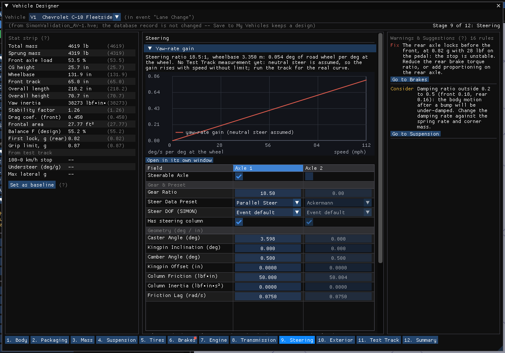

# Chapter 12 — Vehicle Designer

!!! note "HVE 2027"
    The Vehicle Designer is new in HVE 2027; HVE has no counterpart. It is a
    **staged design tool** that walks a vehicle from its body to a test track,
    stage by stage, over the same dialogs the Vehicle menu opens. It edits the
    **case's vehicle**: the database record the vehicle came from is never
    changed, and keeping a design means **Save to My Vehicles** (Chapter 10).

**Vehicle › Vehicle Designer...** opens the **Vehicle Designer** window. It has one
frame and twelve stages. The frame is the same on every stage: a **stat strip**
on the left, the stage's own controls and views in the center, a **Warnings &
Suggestions** panel on the right, and a stage bar along the bottom with every
stage reachable. The first line names the case vehicle and where it came from,
and which stage is open.

!!! warning "A shape is not a vehicle model"
    A body shape cannot determine a vehicle's mass, center of gravity, inertia,
    tire forces, braking, powertrain or crush stiffness. The Designer never
    infers them as measurements: each one is *not set*, *entered by you*, or an
    **estimate** that says so. See **Engineering data** below.

## The stages

The stage bar lists the twelve stages in the order a design is usually worked,
numbered so the order is visible; any stage can be clicked at any time:

1. **Body** — the parametric body and its dimensions (the rest of this chapter).
2. **Packaging** — axle layout, center of gravity and the weight split.
3. **Mass** — total and sprung mass, roll, pitch and yaw inertia.
4. **Suspension** — spring and damping rates, anti-roll, roll center and roll couple.
5. **Tires** — size, friction, cornering and camber stiffness and their tables.
6. **Brakes** — the assemblies, the Brake Designer, system pressure and ABS.
7. **Engine** — idle and redline, the torque and power curves, engine braking.
8. **Transmission** — gear ratios, final drive, shift logic, drive type, differential.
9. **Steering** — steer ratio, column and geometry per axle.
10. **Exterior** — the mesh, the lamps, aerodynamic drag and accelerometers.
11. **Test Track** — three canned SIMON runs on the current physics, read back as numbers.
12. **Summary** — the spec sheet, the whole warnings list and the provenance tally.

In this release stages 1, 4, 5, 6 and 9 are built. Each other stage names the dialogs that hold
its inputs and opens them with a button (**Suspension Data...**, **Tires...**,
**Brake Assembly...**, **Drivetrain...** and so on, the same windows the Vehicle
menu opens), so nothing an analyst could set before is out of reach. The Test
Track and Summary stages say what they will do and do nothing yet.

### Stage 4: Suspension

The Suspension stage hosts the suspension editor itself: the same **Springs &
Dampers** table and the four advanced tabs that **Vehicle › Suspension Data...**
opens, drawn in the stage's center under the frame's vehicle line, so an edit
here is the edit, with the stat strip and the warnings panel updating beside it.
The window and the stage draw one editor, so they can never disagree.
**Open in its own window** opens the same editor as a separate window, to work
it beside another stage. A solved run's inputs are read-only here as everywhere, until
the run is reset.

### Stage 5: Tires

The Tires stage hosts the tire editor: the same **Tire Properties** table, the
tire-size and database tools and the **Load & Speed Tables** panel that
**Vehicle › Tires...** opens, drawn in the stage's center under the frame's
vehicle line. One editor serves the window and the stage.

### Stage 6: Brakes

The Brakes stage answers one question from the vehicle's own inputs: at what
pedal force does each axle lock, and which locks first. Nothing is solved; the
chart is computed from the same chain SIMON uses in a run. Line pressure is the
pedal force times the pedal ratio; above a proportioning knee the wheel sees
the reduced pressure; brake torque is the torque ratio times the pressure
above the pushout; brake force is that torque over the tire radius; and the
tire's capacity is its peak friction times the axle load, with the load
transferred forward by the deceleration the brakes themselves produce.

The headline names the first axle to lock, the deceleration and pedal force at
which it locks, the grip-limited deceleration (every tire at its peak) and the
deceleration at full pedal, then the brake balance by design (the front share
of torque ratio over radius, before any valve or pushout).

**Braking vs grip** plots four curves against pedal force: the front and rear
brake force the brakes can deliver (solid) and the force the front and rear
tires can transmit at that moment's load (translucent). Where a brake curve
crosses above its grip curve that axle locks; a vertical marker names the
first. **Inputs feeding the chart** lists, per axle, the static load, the peak
friction (from the friction table where the tire has one), the tire radius,
the right and left torque ratios, the pushout, the proportioning knee and
ratio, and ABS. Under it is what the chart leaves out: the lining is at
ambient (no fade; the Test Track stage will measure that), tire friction is
read at the table's lowest speed, the unloaded tire radius is used, and a
pedal ratio derived from the pressure curve says so. A vehicle the chart cannot
describe (more than two axles, no mass, no wheelbase or CG height, no brake
torque ratio on any wheel) is told why instead of being drawn.

The stage adds three rows to the stat strip: **Brake balance F (design)**,
**First lock** with the axle named and the deceleration in g, and the
**Grip-limited decel**. Its warnings are the first rules in the panel: the rear
axle locking before the front is a **Fix**; brakes that reach less than 85% of
the grip limit at full pedal without locking are a **Consider**; a
proportioning ratio of 0 (HVE reads it as a pressure limiter), ABS on a wheel
(the chart shows lockup as if it were off) and a wheel with no torque ratio are
**Notes**.

**Edit the brakes** sits under the chart: the brake editors themselves, one tab
each, so a change to a torque ratio or a proportioning knee redraws the chart
above it at once. The **Assembly** tab is the Brake Assembly editor (per-wheel
type, torque ratio, pushout, proportioning and antilock, with its per-wheel
**Design...** buttons), the **Designer** tab the Brake Designer, **System
Pressure** the Brake System Pressure editor with its pedal-force curve, and
**ABS System** and **ABS Designer** the two ABS editors that the ABS / Brake
Design window otherwise opens. They are the same editors as the windows, not
copies: a field has one editor, drawn here or in the window. Under the designer,
a **Design...** click in the Assembly tab selects the Designer tab on that wheel
instead of opening a second window. Each tab's **Open in its own window** button
opens that editor as its separate window, to work it beside another stage; the
two ABS tabs open the ABS / Brake Design window.

### The stat strip

The strip shows the case vehicle's key numbers in the current display units:
total and sprung mass, front axle load, CG height, wheelbase, front track,
overall length and height, yaw inertia (the sprung value, as HVE stores it),
the static stability factor (track over twice the CG height), the front drag
coefficient and frontal area. Beside each value, in parentheses, is the value it
had **when the stage was opened**; a value that has moved since is shown in
amber. A row marked `--` is one the vehicle does not state; the strip never
substitutes a number. The rows under **From test track** are measured by a run
rather than entered, and read `--` until the Test Track stage fills them.

**Set as baseline** takes the current values as the ones shown in parentheses.
The snapshot is otherwise taken each time a different stage is opened, and kept
when the same stage is re-opened.

### Warnings & Suggestions

Each entry is one sentence naming the symptom, the stat it costs and the fix,
graded **Fix**, **Consider** or **Note**, with a **Go to** button for the stage
that owns the input. A stage with an open Fix carries a red marker on the stage
bar. The count beside the panel's title says how many rules are checked; hover
it for the list. A rule that lacks one of its inputs stays silent rather than
firing on a default, and a vehicle that trips no rule is told so.

The rules, by stage:

| Grade | Stage | Rule |
|---|---|---|
| Fix | Brakes | The rear axle reaches its grip before the front in the braking-against-grip sweep. |
| Consider | Brakes | At full pedal no axle locks and the deceleration is under 85% of the grip limit. |
| Note | Brakes | A wheel's proportioning is on with a ratio of 0, which HVE reads as a pressure limiter. |
| Note | Brakes | ABS is on at a wheel; the chart shows lockup as if it were off. |
| Note | Brakes | A wheel's brake torque ratio is 0. |
| Note | Brakes | The brake chart cannot be drawn (not two axles, no mass, no wheelbase or CG height, no brake anywhere). |
| Consider | Suspension | The front share of roll stiffness (spring rate times track squared over two, plus the auxiliary roll stiffness) differs from the front weight share by more than 20 points. |
| Consider | Suspension | An axle's damping ratio (damping rate over twice the root of spring rate times corner sprung mass) is under 0.2 or over 0.5. |
| Consider | Mass | The static stability factor, front track over twice the CG height, is under 1.1. |
| Note | Mass | Roll, pitch or yaw inertia is 0 in both its fields, so the run uses the mass-basis estimate the editor shows. |
| Note | Steering | A steerable axle's steer ratio is 0, which HVE reads as no steering gear. |
| Consider | Packaging | The body design's wheelbase and the vehicle's differ by more than 5 mm. |
| Note | Transmission | Top speed is set by the redline in top gear, below the drag limit from engine power, drag coefficient, frontal area and rolling resistance. |
| Consider | Transmission | An upshift at the redline lands under the automatic shift window's minimum rpm. |
| Note | Engine | The full-throttle torque curve ends below the redline; the engine holds the last row's torque beyond it. |
| Note | Exterior | The front drag coefficient or frontal area is 0, so the vehicle has no aerodynamic drag. |

The understeer gradient and brake fade need a run and arrive with the Test
Track stage; a rule on a value's provenance (an inertia that is an estimate
rather than a measurement) arrives with the Mass stage.

### Stage 7: Engine

The Engine stage hosts the **Engine** section of the Drivetrain editor that
**Vehicle › Drivetrain...** opens: the engine's name, idle and redline rpm,
maximum torque and power, rotational inertia, friction torque, and the **Engine
Tables** (the wide-open
and closed-throttle torque curves, with the power each row implies). Nothing is copied: the stage
and the window draw the same editor, and the Transmission stage holds the rest
of that window. The **Open in its own window** button opens the whole
Drivetrain window.

### Stage 8: Transmission

The Transmission stage hosts the other three sections of the Drivetrain editor:
**Transmission** (automatic or manual with the shift rpm window, the number of
gears and their ratios with reverse, the final drive ratio, efficiency, shift
time and drive type), **Differential** (the differential type, locking
coefficient, preload torque and its speeds) and **Electronic Stability (ESS)**
(traction and yaw stability control with their rates). The **Open in its own window** button
opens the whole Drivetrain window.

### Stage 9: Steering

The Steering stage hosts the steering editor: the per-axle table that
**Vehicle › Steering System...** opens (steerable axle, steer ratio, the steering
degree of freedom, column and linkage, geometry and stops), drawn in the stage's
center under the frame's vehicle line. One editor serves the window and the
stage.

## Frame and units

All values are in meters and degrees. The design frame is the SAE convention
the rest of HVE 2027 uses: x forward, y to the right, z down. Its origin is on
the ground, on the center line, at the rear of the body. A wheel node sits at
the wheel's rotational center: its height above the ground is the tire radius.
Wheel names are **wheel_FL**, **wheel_FR**, **wheel_RL** and **wheel_RR**.

## Stage 1: Body

The body stage builds a recognizable sedan body from a short list of
dimensions, with the wheels at their axle positions, and shows it in four views
(**Side**, **Top**, **Front** and **Rear**). Use it to settle a vehicle's overall
proportions, then save the design as a file. It is a design and preview tool: it
does not change the case or any simulation result.

At the top, **New Sedan** restores the default sedan. **Save Design** writes the
design to the file named in **File**, and **Load Design** reads it back. A line
under them reports what happened. The four views follow; the **Side** view
carries the dimension overlay: rear overhang, wheelbase, front overhang and the
overall length, all taken from the numbers you entered.

### Base vehicle

**Base vehicle** chooses what the body is. By default it is the generated sedan.
The first entries of the list are Kiln's generic sedan, hatchback and SUV
(**free, no license needed**): openly licensed (CC0) vehicles built into HVE 2027,
which work on every computer. Below them are the passenger cars of your vehicle
library. Pick one
(narrow the list with **Filter**) and the designer
instead takes that vehicle's own mesh and resizes it: the design starts at the
vehicle's real dimensions, and **Dimensions** then change its wheelbase, length,
width and height.

The mesh is not scaled as a whole. The two wheel openings travel with their
axles and keep their shape, the overhangs take a change in length, and the zone
between the axles takes a change in wheelbase. Each part may stretch only so far
(about 70% to 135% of its original length for the overhangs, 80% to 135% for the
wheelbase zone, 88% to 115% for width and height). A change beyond a limit is
refused and the line under the buttons says which limit; nothing is built from
it. **Use Generated Sedan** returns to the generated body.

A vehicle can be a base only if it is a two-axle passenger car with a mesh of its
own, and its mesh and record agree on its length. A vehicle with no mesh of its
own, with a mesh offset from its center of gravity, or with a scaled mesh is
refused with the reason.

!!! warning "A derivative of licensed data keeps its license"
    A design resized from an EDC vehicle is a derivative of EDC data. It names
    its base and carries the base's data tag in the design file (the file holds
    no geometry), and it does not open on a computer without the EDC data
    license. The generated sedan and the built-in Kiln vehicles carry no tag and open
    everywhere. The tag is
    a gate and a record of where the design came from, not secrecy: a printed
    vehicle report still shows the vehicle's values.

The mass of a base vehicle is filled in as a catalog value that says it is the
unmodified vehicle's; the center of gravity and inertia stay not set, because a
resized body has no recorded ones.

### Dimensions

**Dimensions** holds the sliders for the overall size and the wheels:

- **Length**, **Wheelbase**, **Front overhang** and **Rear overhang**. These are
  not independent: front overhang + wheelbase + rear overhang always equals the
  length. Changing the length, the wheelbase or the front overhang moves the
  rear overhang; changing the rear overhang moves the front. The length of the
  car stays where you set it unless you set the length itself.
- **Width** and **Height** — the overall extremes. The body's bounds match them
  to within 0.01 m, and the axle spacing and track to within 0.002 m.
- **Front track** and **Rear track** — wheel center to wheel center.
- **Front tire radius**, **Rear tire radius**, **Tire width** and **Ride height**
  (the underbody's height above the ground).

### Body shape

**Body shape** shapes the generated sedan's side elevation and cross-section.
A body resized from a base vehicle keeps its own shape, and these controls are
grayed out:

- **Hood length** — front bumper to the base of the windshield.
- **Roof length** — the flat of the roof. The windshield and rear window slope
  away from its ends at the **Windshield rake** and **Rear window rake**, measured
  from the horizontal; the rear window ends on the rear deck.
- **Beltline height** — the window sill; the hood and the deck follow it.
- **Roof crown** and **Body side curvature** — camber of the roof and the
  roundness of the shoulder, 0 to 1.
- **Wheel arch flare** — how far the body swells outward over a wheel.

Changing the wheelbase moves the arches with the axles. It does not stretch the
hood or the cabin, which keep their own lengths.

Every slider is held to the range the generator can build. An edit that would
break a relationship — a tire standing outside the body, a wheel opening reaching
a bumper, a rear window running into the bumper, a fender lower than its tire —
is refused, the design is left unchanged, and the line under the buttons says
why.

### Appearance

**Appearance** sets the **Body color** and whether glass and the lights and grille
are drawn (**Show glass**, **Show lights and grille**). These change how the body
looks and nothing else: they move no dimension and no engineering value.

### Constraints

**Constraints** lists every dimensional rule the design breaks, as an error
(the body cannot be built) or a warning (legal but unusual). A design you
build with the sliders always satisfies them; a file you load may not, and its
errors are listed here instead of a preview.

### Engineering data

**Engineering data** lists the physical quantities a simulation needs, each with
where its value came from. A new design has none: every row reads *not set*.

**Fill With Estimates** fills the rows that are still not set with a class
estimate for a mid-size sedan — mass, center of gravity and inertia — and marks
them **ESTIMATE (assumed, not a measurement)**. **Refresh Estimates** recomputes
those estimates after a change in dimensions; a value you entered yourself is
never overwritten. The tire, suspension, powertrain and crush models stay *not
set*: a body shape gives nothing to estimate them from.

### Wheel nodes

**Wheel nodes** lists the four wheels' positions and radii.

## The design file

The design is saved as a JSON file (schema version 1), with numbers written in
full precision, so saving and loading never changes a dimension. A key the
Designer does not know, or a field missing from the file, is reported when the
file is loaded rather than ignored. A design with a base vehicle is checked
against the license on load, and its base is found again in the vehicle library
by name; if it is not there, the design opens without a preview and says so.

## What it does not do yet

A generated body is a sedan only; the hatchback and SUV come from a base vehicle,
and only a passenger car or one of the built-in Kiln vehicles can be a base. The body
is not yet offered to a case as a vehicle's generic body: DyMESH contact uses the vehicle's mesh, and the drawn
body and the solved body must always be the same one, so that step needs its own
change. The designer is also not a source of validated vehicle data.
