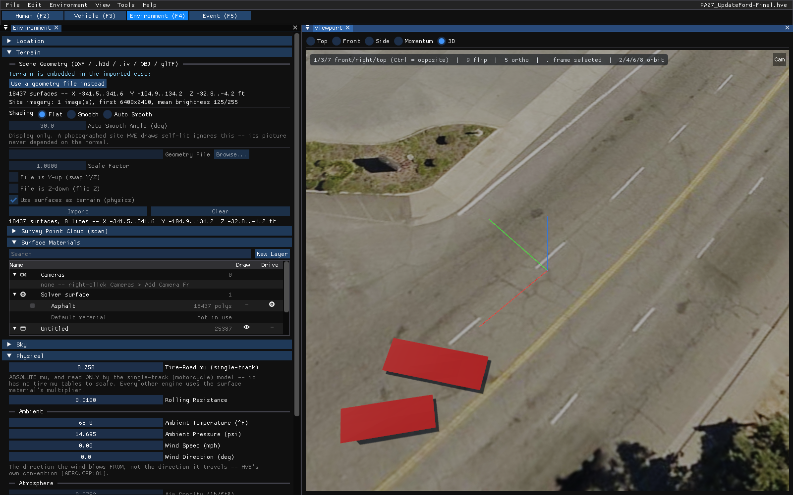
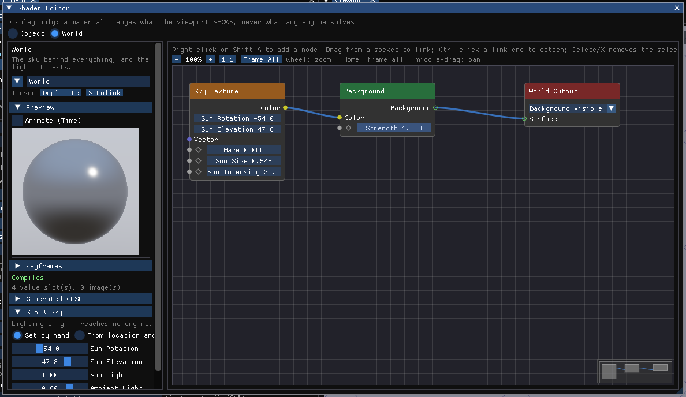
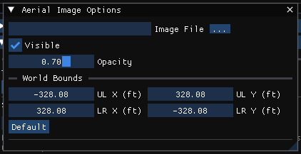
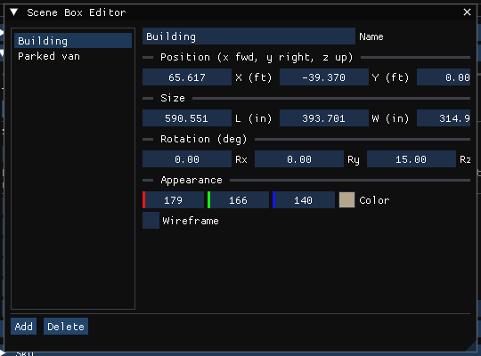
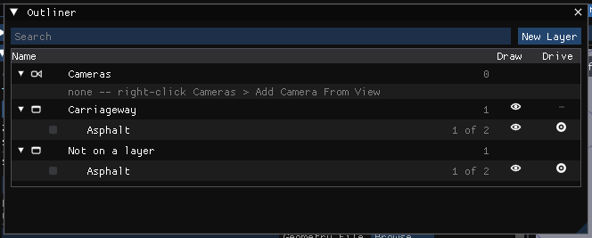

# Chapter 12 — Creating & Editing Environments

The Environment Editor is used for creating and editing the environment of
the current case: the site the humans and vehicles move on, the atmosphere,
the sun and the site's appearance. This chapter describes how to do that in
HVE 2027, beginning with the Environment Editor's components.

> **NOTE:** The environment is optional. If no site geometry is imported,
> the engines run on flat, level ground, using the friction of each
> vehicle's own tires (see the Vehicle Editor for the tires' frictional
> properties).

> **NOTE:** Refer to the next chapter, [Environment Model Definition](13-environment-model-definition.md),
> for a detailed description of each Environment Model parameter.

!!! note "HVE 2027"
    In HVE an environment is added to a case (New or Previous) and then
    edited. In HVE 2027 every case always has exactly one environment, so
    there is nothing to add: you edit the one the case already has. A new
    case (File › New Case) starts with a default environment — no site
    geometry, standard atmosphere and gravity.

## Environment Editor Components

To use the Environment Editor, click the **Environment (F4)** tab under the
menu bar, or press F4. This puts HVE 2027 in Environment mode and shows the
Environment Editor's components:

- **Environment panel** — a docked panel (normally on the left) holding all
  the environment's parameters in collapsing sections: **Location**,
  **Terrain**, **Sky**, **Physical** and **Signals**. It replaces HVE's
  Environment Information property sheet. Terrain and Physical — the
  sections the engines read — are open by default.
- **Viewport** — the 3-D view of the current environment, with the Top,
  Front, Side, Momentum and 3D views selectable above it.
- **Environment menu** — **Environment...** (shows the Environment panel),
  **Aerial Image...** and **Scene Box Editor...**, described later in this
  chapter.

*Figure 12-1: The Environment Editor — the Environment panel and the Viewport, showing the site embedded in HVE's PA27_UpdateFord-Final case.*

### Selecting surfaces in the Viewport

Unlike HVE's Environment Viewer, which had no pickable objects, the
HVE 2027 Viewport lets you click a surface of the site in Environment mode.
The clicked surface is selected in the panel's **Surface Materials** list
(see Road Surfaces and Their Materials, below), where its contact material
can be edited.

> **NOTE:** If a site stores the road twice — once as the surface the
> engines drive on and once as the surface that is drawn, as a native HVE
> case does — clicking the road names both halves together, each with its
> own Drive and Draw switch.

## Editing the Environment

!!! note "HVE 2027"
    Every field of HVE's Environment Information dialog that HVE 2027 has is
    on the Environment panel, in the section named below. There is no OK
    button: an edit takes effect when you leave the field, and Edit › Undo
    (Ctrl+Z) steps it back. While the results of a run are on screen,
    the fields the engines read (Terrain, Physical) are locked; press
    **Reset** on the playback bar or in the Simulation panel to edit them.

### Location

The **Location** section records where and when the accident happened:

- **Name** — a name for the environment (the site).
- **Date** and **Time** — the date and the local time of the crash or test.
- **Latitude** and **Longitude** — the site's coordinates in decimal
  degrees. North latitude and east longitude are positive; a west
  longitude is negative.
- **Elevation** — the site's elevation, in the length units set in
  Tools › Preferences.

Two helpers fill in the coordinates:

- **Set from a pasted coordinate** — paste a coordinate in decimal degrees,
  in degrees/minutes/seconds (for example `40°26'45"N 79°58'56"W`) or a map
  link, check how it reads, and click **Apply**.
- **Search an address** — type an address or place name and click
  **Search**, then pick the match.

!!! warning "Online service"
    The address search sends what you type to OpenStreetMap
    (nominatim.openstreetmap.org), and the chosen coordinate to timeapi.io
    to look up its time zone. The panel says so beside the button. The
    pasted-coordinate box needs no network.

!!! note "HVE 2027"
    HVE's user-extendible Location Database (City/State/Country with stored
    latitude, longitude and GMT) is not in HVE 2027; the address search and
    the coordinate paste replace it. The location places the sun and is
    printed in reports. The engines do not drive on it: a coordinate here
    does not position or scale the site.

The time-zone offset (HVE's *GMT*) and HVE's *Angle of X-Axis* are set with
the sun, in the Shader Editor's **Sun & Sky** panel (see Sun and Sky, below).

### Physical

The **Physical** section holds the environment's physical properties:

- **Tire-Road mu (single-track)** — an absolute tire-road friction
  coefficient read only by the single-track (motorcycle) model, which has no
  tire friction tables of its own. Every other engine uses the surface
  material's friction multiplier instead.
- **Rolling Resistance** — used only for tires that state no rolling
  resistance of their own; a tire's own value always wins.
- **Ambient Temperature** and **Ambient Pressure** — the air temperature
  and barometric pressure (defaults 68 °F and 14.695 psi, HVE's own).
- **Wind Speed** and **Wind Direction** — the ambient wind. The direction
  is the direction the wind blows *from*, HVE's convention.
- **Air Density** — shown, not entered: it is computed from the ambient
  temperature and pressure exactly as the engines compute it.
- **Gravity** — the local acceleration of gravity, in in/s² or m/s²
  depending on the units preference.
- **Standing Water** — no longer here: **Water Depth**, **Wet Friction**
  and **Texture Depth** are each surface's own, on its **HVE Surface** node
  in the Shader Editor, and the **Default surface material**'s for ground
  with no surface of its own (including the flat ground of a case with no
  site). They are read only by SIMON's hydroplaning models; a depth of 0
  means no water on that surface.

> **NOTE:** If you're simulating a lunar excursion module, you had better
> change the gravity!

!!! note "HVE 2027"
    The Road Surface preset (Dry / Wet / Snow / Ice) that sets a friction
    multiplier is not on the Physical section: it is a **Condition preset**
    on the selected surface material (see Road Surfaces and Their
    Materials, below).

### Sky

The **Sky** section summarizes how the scene is lit — the sun's direction
and elevation, whether they come from the location and time or were set by
hand, and the sun and ambient light levels — and has an **Edit the sun and
sky...** button that opens the Shader Editor on the world's **Sun & Sky**
panel.

## Sun and Sky

The sun and sky are part of the world's appearance and are edited in the
Shader Editor (View › Shader Editor, or **Edit the sun and sky...** in the
Environment panel's Sky section or the Event panel's Lighting section). The
**Sun & Sky** panel offers:

- **Set by hand** — **Sun Rotation** (the direction the sun lies in,
  measured like every heading in the case: 0 toward +X, 90 toward +Y) and
  **Sun Elevation** (degrees above the horizon).
- **From location and time** — the sun is placed from the case's location,
  date and time, as HVE placed it:
  - **Method** — *NOAA* (the solar position calculator Blender's Sun
    Position add-on uses) or *HVE's own* (the table method HVE drew its sun
    with). An imported HVE case uses HVE's own, so it is lit as it was in
    HVE.
  - the address search, **Latitude**, **Longitude**, **Date** (mm/dd/yyyy
    or yyyy-mm-dd) and **Time** — the same values as the Location section.
  - **UTC offset** — local clock time = UTC + this (HVE's *Hours from GMT*;
    for example −5 for the US Eastern time zone).
  - **Daylight saving** — HVE's time is always local standard time, so an
    imported case leaves this off.
  - **North** — the compass bearing the case's +X axis points along
    (0 = north, 90 = east). This is HVE's *Angle of X-Axis*.
  - **Refraction** — NOAA only: the apparent sun, raised by atmospheric
    refraction near the horizon.
- **Sun Light** — a multiplier on the sunlight that casts the shadows.
- **Ambient Light** — how much light fills the shadows (HVE's *Ambient
  Intensity*; default 0.80).
- **Reset sun to default**.

*Figure 12-4: The Shader Editor's Sun & Sky panel, which replaces HVE's Sky attributes.*

> **NOTE:** The sun and sky are display only. They light the picture and
> reach no engine.

!!! warning "Not in HVE 2027"
    HVE's **Fog Type** (None, Fog, Haze, Smoke) and **Maximum Visibility**
    are not available. A value imported from an HVE case is kept with the
    case, but there is no control for it and the viewport does not fade
    objects with distance, so HVE 2027 cannot be used for HVE's visibility
    studies. (The Shader Editor's Sky Texture node has a *Haze* setting, but
    it only veils the sky itself.) HVE's **Sky Color** dialog is replaced by the world material in
    the Shader Editor; see
    [Materials and the Shader Editor](../../new-features/01-materials-and-shader-editor.md).

## Traffic Signals

The Environment panel's **Signals** section stores one traffic signal's
timing: **Traffic Signal Active**, **Phase at Impact** (Green, Yellow or
Red), **Cycle Time**, **Green Time** and **Yellow Time**. The same three
times are on the Event menu's **Signals** dialog (EDGEN events).

!!! warning "Not in HVE 2027"
    HVE's Traffic Signals tab edits signals placed in the site with the 3-D
    Editor's Signal Tool, each with its own type, layout and cycle. HVE 2027
    has no signal objects: the Signals section holds a single timing record,
    which is saved with the case but is not drawn and reaches no engine.

## Site Geometry

The site geometry is the 3-D surface used for visualizing the environment
and — when *Use surfaces as terrain* is checked — the surface the engines
drive on: they ask it for the elevation, slope and friction beneath each
tire.

> **NOTE:** If no site geometry is supplied, the engines assume flat,
> level ground with uniform friction.

Site geometry is set in the **Scene Geometry** part of the Environment
panel's **Terrain** section:

- **Geometry File** and **Browse...** — the geometry file to import.
- **Scale Factor** — multiplies the file's coordinates to convert its units
  to metres (for example 0.3048 for a drawing in feet, 0.0254 for one in
  inches). For an `.h3d` file this is **Extra Scale**, applied on top of
  the file's own units.
- **File is Y-up (swap Y/Z)** and **File is Z-down (flip Z)** — corrections
  for a file whose vertical axis is not what the importer assumes (for an
  `.h3d` file the second reads **Invert Z**).
- **Use surfaces as terrain (physics)** — send the imported surfaces to the
  engines as the road. Unchecked, the geometry is drawn only.
- **Import** and **Clear** — read the file, or remove the geometry.

After an import, a summary line gives the number of surfaces and lines and
the site's X, Y and Z extents.

**Table 12-1: Site geometry formats**

| Format | Extension | Notes |
|---|---|---|
| HVE Geometry | `.h3d` | HVE's own frame (inches, Z-down) is applied automatically |
| Inventor | `.iv` | |
| VRML | `.wrl` | |
| OBJ | `.obj` | |
| glTF | `.gltf`, `.glb` | New in HVE 2027 |
| DXF | `.dxf` | |

!!! note "HVE 2027"
    HVE 2027 imports DXF directly; it does not read DWG. HVE's Geometry File
    Options dialog (flip, scale, "use as default environment") is replaced by
    the Scale Factor and the two axis check boxes, which stay on the panel.
    Any folder may hold the file — there is no `images\environments`
    directory to copy it into. The geometry is re-read from the file each
    time the case is opened, so keep the file where the case can find it,
    or embed the environment (see below).

!!! warning "Not in HVE 2027"
    HVE's **Save / Save-As** of the environment to an `.h3d` file is not
    available: HVE 2027 does not write geometry files.

To import site geometry:

1. Click the **Environment (F4)** tab.
2. In the Environment panel's **Terrain** section, click **Browse...** next
   to *Geometry File* and choose the file.
3. Set the **Scale Factor** and the axis check boxes for the file's units
   and orientation.
4. Leave **Use surfaces as terrain (physics)** checked if the vehicles are
   to drive on the site.
5. Click **Import**.
6. Check the summary line: the extents should be the size of the site, and
   the Z range should be right side up. Nothing in a DXF, OBJ or glTF file
   says which way is up, so a valley and a hill look the same to the
   importer.

### Sites imported with an HVE case

An HVE case (`.hve`) stores its site inside the case. When you open one,
the Terrain section says *Terrain is embedded in the imported case* and
names the file; there is no path to browse to and no scale to apply. Click
**Use a geometry file instead** to discard it and import a geometry file.

### Embedding the environment

A geometry file or a source `.hve` is a reference: on another computer, the
case opens with no ground under the vehicles. **File › Embed the
environment in the case** saves the site's geometry and its photograph
inside the case file on every save, so the case opens with its site
anywhere. The menu tooltip gives the size of the current site; the
photograph is the bulk of the cost.

!!! tip "New in HVE 2027"
    Embedding is a setting of the application, not of the case. While it is
    checked, every case you save carries its site; unchecking it removes the
    embedded site at the next save.

### Shading

**Shading** sets how the site's surfaces are shaded in the Viewport, as
Blender's Shade Flat / Shade Smooth does:

- **Flat** — one normal per face, as the file gives it.
- **Smooth** — the normals of all faces meeting at a point are averaged, so
  a graded road stops showing its triangles.
- **Auto Smooth** — averaged only between faces within the **Auto Smooth
  Angle** of each other, so kerbs and building edges stay sharp.

> **NOTE:** Shading is display only; no engine reads it. A photographed site
> drawn self-lit is not affected.

### Survey point clouds

!!! tip "New in HVE 2027"
    The **Survey Point Cloud (scan)** part of the Terrain section shows a
    laser scan or photogrammetry point cloud (LAS, PLY, XYZ/PTS/TXT/CSV)
    behind the simulation, with its own scale, axis options, colour mode,
    point size and placement (offset, yaw, pitch, roll). A point cloud is a
    picture, not a surface: vehicles cannot drive on it, settle onto it or
    collide with it. Import a site surface for what the vehicle drove on.

## Road Surfaces and Their Materials

When a site has been imported, the Terrain section lists its surfaces under
**Surface Materials**, in a tree of the site's layers with their surfaces
under them (the same tree as **View › Outliner**). Each row has two
switches:

- **Draw** (the eye) — draw the surface in the Viewport.
- **Drive** (the road) — send the surface to the engines as road.

Clearing both removes a surface from the picture and from the solver. This
is reversible: the geometry is rebuilt from its source each time the case is
opened, and the switches are re-applied.

The **Default material** row under *Solver surface* is the material used by
any drivable polygon that has no material of its own; the row says whether
any polygon uses it.

To edit a surface's contact material:

1. Click the surface in the Viewport, or select its row in the list.
2. Click **Edit in Shader Editor**. The surface's material opens in the
   Shader Editor with its **HVE Surface** node, which holds the surface
   type and every physical property the engines read (see
   [Chapter 13](13-environment-model-definition.md)).
3. Optionally pick an HVE material file from the material list and click
   **Apply material**, or choose a **Condition preset** (Dry 1.00,
   Wet 0.70, Snow 0.30, Ice 0.15), to fill in the fields as a starting
   point. They stay editable.

   > **NOTE:** The material list is read from HVE's own environment
   > material files (`.matl`, shipped in HVE's
   > `supportfiles/materials/EnvMaterials` folder). If none are found, the
   > node says where it looked; the `HVE_MATERIAL_PATH` environment
   > variable points HVE 2027 at that folder.
4. Edit the fields. **Reset to File Value** returns the surface to what its
   source file stated.

A surface's edits are saved with the case and re-applied each time the
geometry is re-imported. Selecting the Default material row edits the
fallback material in the panel itself.

!!! note "HVE 2027"
    HVE edits surface type and friction with the 3-D Editor's Object
    Attributes tool. HVE 2027 has no 3-D Editor; the surface type and
    contact material are edited as above.

## Aerial Images

An aerial photograph (or any scaled site image) can be laid on the ground
under the site. Choose **Environment › Aerial Image...** to display the
**Aerial Image Options** dialog:

- **Image File** — the image (SGI `.rgb`, TIFF, JPEG, BMP or PNG).
- **Visible** and **Opacity**.
- **World Bounds** — the X and Y coordinates of the image's upper-left
  (**UL X**, **UL Y**) and lower-right (**LR X**, **LR Y**) corners, which
  fix its position and scale. **Default** restores ±100 m.

*Figure 12-6: Aerial Image Options dialog.*

> **NOTE:** An aerial image is a picture. It provides no elevation, slope or
> friction to the engines.

> **NOTE:** Confirm the image's scale against two landmarks a known
> distance apart before relying on it.

!!! warning "Not in HVE 2027"
    HVE's **Sky Image** — a scanned photograph fixed behind the scene as a
    backdrop, used with the Set Camera dialog to match the view of a site
    photograph — is not available.

## Scene Boxes

**Environment › Scene Box Editor...** adds simple boxes to the scene — for
example to stand in for a building or a parked vehicle in a sight-line
study. Click **Add** to create a box and give it a **Name**, a **Position**
(X forward, Y right, Z up above the ground), a **Size** (L, W, H), a
**Rotation** and a **Color**, drawn solid or as a **Wireframe**. **Delete**
removes the selected box. Every box is drawn in the Viewport.

*Figure 12-7: Scene Box Editor.*

> **NOTE:** Scene boxes are display only. The engines do not drive on them
> or collide with them.

## Layers (HVE's Overlays)

Each part of an imported site belongs to a layer (HVE calls these
overlays). **View › Outliner** lists the site's layers with their surfaces
under them; clear a layer's eye to stop drawing everything on it, or its
road switch to take it out of the solver. **New Layer** creates a layer,
and surfaces can be moved between layers. The Outliner also lists the
case's cameras.

*Figure 12-9: The Outliner, which replaces HVE's Display Overlays dialog.*

> **NOTE:** In HVE, hiding an overlay still left its surfaces in the
> calculation. In HVE 2027 the two are separate switches: hiding a layer
> (Draw) leaves it in the solver unless its Drive switch is also cleared.

---

*See also (dialog references):*
[Environment Information Dialog](../../08-environment/EnvtInfoDlg.md) ·
[Environment Material Properties](../../08-environment/EnvrMatPropDlg.md) ·
[Surface Editor](../../08-environment/SurfEdDlg.md)

<!-- NAV -->

---

← Previous: [Section Five — Environment Editor](README.md)  |  [Index](README.md)  |  Next: [Chapter 13 — Environment Model Definition](13-environment-model-definition.md) →

<!-- /NAV -->
