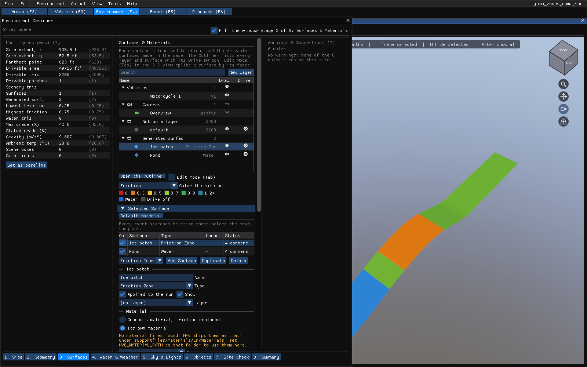
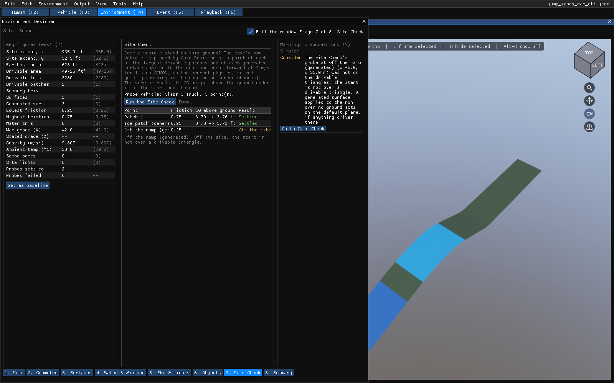

# Chapter 14 — Environment Designer

The Environment Designer is the Vehicle Designer's frame turned on the site:
a stage bar along the bottom, a **Key figures** strip on the left that
remembers what each number was, the site's panels hosted on the stage that
asks their question, and a **Warnings & Suggestions** panel on the right whose
rows name the fix and the stage that owns it. Open it with **Environment ›
Environment Designer...** in the Environment editor (F4), where it is the
first item.

One thing differs from the vehicle's frame: terrain needs the real renderer,
so with **Fill the window** on the designer takes the left of the editor's
work area and the 3-D view stays on the right. Off, it is a window of its own
size. Every panel it hosts is the same panel the **Environment** window draws,
so a field has one editor and nothing is reachable in one and not the other.

*Figure 14-1: The Environment Designer on its Geometry stage, filling the left of the work area with the 3-D view beside it.*

## The stages

1. **Site**: Location (placement, address, coordinates) and **Aerial Image...**
   (the backdrop, in its own window). Scene description; nothing here reaches
   a solve.
2. **Geometry**: the scene geometry file, its import frame and the survey point
   cloud — the Terrain section. The drivable triangles here are what every
   vehicle runs on.
3. **Surfaces**: the Outliner's tree hosted on the stage (layers, surfaces and
   objects with their eye and Drive switches; **Open the Outliner** puts the
   same tree in its own window), the **Selected Surface** section for the
   surface picked in the tree or the 3-D view, **Edit Mode (Tab)** to pick
   faces in the viewport and give them a material or split a surface by them,
   and the Surface Generator. The Key figures strip's **Drivable patches** row
   counts the drivable surface's connected pieces: more than one means a wheel
   can run off an edge onto the default plane. **Color the site by** recolors
   the 3-D view while this stage is open: **Friction** runs from red at 0
   through orange, yellow and green to teal above 1.2, so a seam between two
   surfaces shows; **Drive and water** shows drivable ground green, a drivable
   surface at friction 0 red, water blue and surfaces with Drive off gray in
   both. **Picture** is the site as drawn. The colors are display only, and
   leaving the stage or closing the designer gives the picture back.

   

   *Figure 14-3: Color the site by Friction: the road at 0.75, an ice patch
   at 0.25 and a pond, with the Key figures' friction range reading both.*

   

   *Figure 14-2: The Surfaces stage: the Outliner tree, Edit Mode, the
   Selected Surface section and the Surface Generator on one page.*

4. **Water & Weather**: gravity, rolling resistance, the ambient air and wind,
   and standing water — the Physical section.
5. **Sky & Lights**: the sun, the sky and the site's lights. Display only, and
   the stage says so.
6. **Objects**: **Scene Box Editor...** for the drawn boxes.
7. **Site Check**: does a vehicle stand on this ground? **Run the Site Check**
   places the case's own vehicle (the first one SIMON drives on its wheels: not a
   motorcycle, trailer, dolly or barrier) by Auto Position at a point of each of
   the six largest drivable patches and of each generated surface applied to the
   run, and creeps it forward at 2 m/s for 1 s on SIMON, on the current physics.
   The runs are solved quietly: nothing in the case or on screen changes. The
   table gives each point's friction, its CG height above the ground under it at
   the start and the end, and a result (the reason is under the table and on
   hover): **Settled**, **Fell through** (the CG
   ended at or below the ground, or sank more than 0.3 m), **Moved** (its height
   above the ground changed by more than 0.1 m), **Off the site** (it left the
   drivable triangles), or **No answer** (the solver refused the run, with its
   reason). The Key figures show **Probes settled** and **Probes failed** once a
   check has run on this ground; a check made before the site changed is not
   read.

   

   *Figure 14-4: The Site Check with a truck: the ramp and an ice patch
   settle; a friction zone drawn beside the ramp has no ground under it.*
8. **Summary**: the site's name and file, **Set as baseline** (kept for this case
   across sessions), **Copy spec sheet** (tab-separated text on the clipboard),
   the spec sheet with its baseline and change, and every warning.

## Key figures

Site extent in x and y and the farthest point from the origin; the drivable
area, the drivable and scenery triangle counts, the surfaces and generated
surfaces; the drivable patches; the lowest and highest friction multiplier
among the drivable materials and the generated surfaces applied to the run;
the water triangles; the maximum grade read from the drivable
triangles and the stated grade of a graded terrain; gravity, ambient
temperature, scene boxes and site lights. **Set as baseline** under the strip
keeps the current values as the "was" column for this case.

## Warnings & Suggestions

| Grade | Stage | Rule |
|---|---|---|
| Fix | Surfaces | A drivable surface, or a generated surface applied to the run, has a friction multiplier of 0, which every tire reads as no friction. |
| Fix | Geometry | The site names a geometry file but no triangle is drivable, so vehicles run on the default plane. |
| Note | Site | The site reaches more than 2 km from the origin, where single precision coarsens. |
| Note | Water & Weather | The stated gravity differs from 9.80665 m/s² by more than 1%. |
| Consider | Surfaces | The drivable surface is more than one patch and the smallest is under 2% of the area, so its edge drops a wheel onto the default plane. |
| Note | Surfaces | A palette entry owns no drawn or drivable triangle, so editing its friction changes nothing. |
| Fix | Site Check | The probe vehicle's CG ended at or below the ground, or sank more than 0.3 m: a hole or a seam there. |
| Consider | Site Check | The probe vehicle's CG height above the ground changed by more than 0.1 m in 1 s: a step, a ramp edge or a bump. |
| Consider | Site Check | The probe vehicle started off the drivable triangles or left them within its 2 m: a generated surface over no ground, or a patch too small to hold it. |

A rule that lacks its input stays silent, and the count beside the panel's
title lists what is checked on hover.
