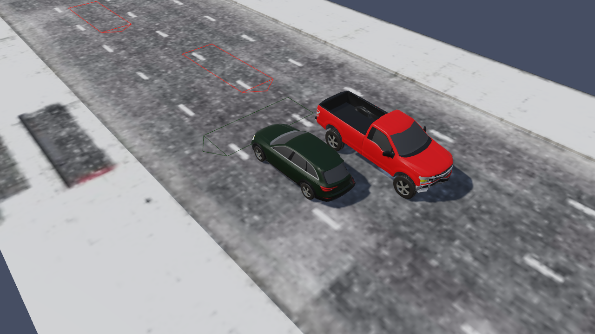
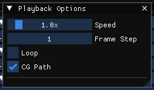

# Chapter 17 — Creating Report and Playback Windows

The purpose of HVE's Playback Editor is to allow the user to view and manage all program outputs by performing the following operations:

- View all program outputs (numeric, graphic and simulation).
- Print all program outputs.
- Edit the accident sequence.
- Combine multiple simulation events into a single Playback Window.
- Record the Playback Window to a movie file.

This chapter describes how each of these is done in HVE 2027, beginning with the components that replace the Playback Editor.

!!! note "HVE 2027"
    HVE 2027 has no Playback Editor dialog and no Report or Playback windows
    to add. The outputs of the **current event** are shown in panels opened
    from the **Output** menu in Event mode, and the solved event plays back in
    the **Viewport**. Several events are combined in **Playback** mode (the
    **Playback (F6)** tab; see [Chapter 18](18-editing-event-sequence.md)).

## Playback Editor Components

In Event mode (the **Event (F5)** tab), the following components take the place of HVE's Playback Editor:

- **Viewport** — displays the current event's motion, from any of its Top, Front, Side or 3D views, or as a **Momentum** diagram. It replaces HVE's Trajectory Simulation report windows.
- **Playback bar** — along the bottom of the Viewport: it plays the results forward, steps through them and jumps to any time. It replaces the Playback Controller.
- **Output panels** — the Key Results, Output Graph and Timestep Data panels, which dock beside the Viewport like any other panel; they replace HVE's Report Windows.
- **Output menu** — opens the output panels and reports and the Playback Options. (The Playback Sequence is on the **Playback** menu, in Playback mode.)

*Figure 17-1: A solved event played back in the HVE 2027 Viewport, 1.2 s into the run (CityBlockAccident-tbone, SIMON).*

### Playback Editor Dialog

!!! warning "Not in HVE 2027"
    There is no Playback Editor dialog, and no list of Report and Playback
    windows to add, select or delete. Each output panel always shows the
    current event (chosen in the Event Information panel's **Active Event**
    list); open it from the Output menu or the View menu, and close it with
    its tab's close button.

### Report Windows

HVE displays the results of each event in Report Windows of several kinds. In HVE 2027 they are:

- **Numeric output** — the program's own report pages:
    - **Output › HVE Reports...** shows the report pages the program built for the last run (HVE's Messages, Program Data, Event Data, Vehicle Data, Environment Data and the other pages the program produces). Each page is its own window, docked as a tab in HVE Reports; drag a tab beside another page to read the two side by side, above or below it to stack them, or out of the window to float it, and **Reset Layout** puts them back. **Save This Page** and **Save All Pages** write them to text files, **Save Page as HTML** and **Save All Pages as HTML** to an HTML file a browser can print, in the order and with the pages set in **Print Order...**; **Export Run Report (HTML)** writes HVE 2027's own printable summary of the run (inputs, key results, plan view of the trajectories). If the event has not been run, or the program refused it, the window says so. See [Common Reports](../../11-reports-output/CommRepDlg.md).
    - The **ACCIDENT HISTORY** page of HVE Reports is the engine's own table of important positions and velocities during the event (see [Accident History](../../11-reports-output/AcciHistDlg.md)).
    - **Output › Key Results...** shows the important results for each vehicle — for example impact and separation speeds, delta-V, PDOF, energy, and the final position, heading change and peak accelerations.
    - **View › Results HUD** draws chosen numbers — time, and each vehicle's speed, heading, Delta-V or any output channel — in boxes over the Viewport itself as the event plays, and into recorded videos (see [Results HUD](../../new-features/11-results-hud.md)).
- **Graphic output**:
    - **Damage** — the crushed vehicles are shown in the Viewport. **Output › Damage Studio Report...** gives a table, per vehicle, of the key results chosen in **Output › Damage Studio Options...** (by default impact velocity, delta-V, PDOF, separation velocity and damage energy) and the **Max Crush** the program recorded on the vehicle's mesh (see the note below).
    - **Momentum Diagram** — the Viewport's **Momentum** view.
    - **Site Drawing** — the Viewport's **Top** view shows the vehicles at their positions; for EDCRASH, the surveyed scene positions are drawn as ghosts.
- **Variable output** — the output tracks (see [Chapter 16](../06-event-editor/16-event-model-definition.md)):
    - **Output › Variable Selection...** chooses the channels to show.
    - **Output › Output Graph...** plots the selected channels against time (**Select Variables...**, **Format...**).
    - **Output › Timestep Data Table...** lists them at each output step (**Export CSV...**, **Copy**).
    - **Output › Export Variables...** writes the selected channels of the event on screen to a file (CSV, tab-separated text or MATLAB), at a chosen interval and in SAE or Traditional signs.
- **Trajectory simulation** — the Viewport itself.

> **NOTE:** The Damage Studio Report's *Max Crush* column is the largest
> vertex displacement the program recorded on the vehicle's mesh; it shows
> -- where the program recorded none.

!!! warning "Not in HVE 2027"
    **Output › Damage Studio Options...** chooses only the key results
    listed in the Damage Studio Report. HVE's PDOF and crush vector display
    settings are not available: Damage Studio does not draw a PDOF arrow or
    crush vectors.

!!! note "HVE 2027"
    HVE's Driver Data and Injury Data reports are not separate items: the
    driver inputs are output channels (graph or table them), and the
    program's own report pages are under HVE Reports.

### Playback Window

HVE's Playback Window shows several events in one viewer. In HVE 2027 the Viewport shows the active **Playback Sequence** in Playback mode (the **Playback (F6)** tab), with a header naming the events playing at the current time; in Event mode it always shows the active event alone. See [Chapter 18](18-editing-event-sequence.md).

#### Audit Trail

!!! warning "Not in HVE 2027"
    There is no printable Audit Trail. The Playback Sequence dialog lists
    each event in the sequence with its start, end and offset times and
    draws them as bars on a timeline, and which event drives a vehicle at
    each moment follows the rules in [Chapter 18](18-editing-event-sequence.md).

### Playback Controller

The playback bar along the bottom of the Viewport, in Event mode, replaces HVE's Playback Controller. The same controls are in the **Simulation** panel (View › Simulation):

- **Run** / **Reset** — execute the current event, or discard its results (see [Chapter 15](../06-event-editor/15-creating-editing-events.md)).
- **Jump to start** — return to the start of the simulation.
- **Step back** / **Step forward** — move one output step.
- **Play** / **Pause** — run the playback forward, or pause it.
- **Jump to end** — advance to the end of the simulation.
- **Camera** — the active camera (C and Shift+C cycle through the cameras).
- **Time slider** — drag to any time; the current time is shown, and a time can be typed into the box beside it to jump there.

!!! warning "Not in HVE 2027"
    There is no Reverse (play backwards) and no frame counter; the step
    buttons and the time slider take their place.

**Output › Playback Options...** sets how the playback runs:

- **Speed** — the playback rate (0.1× to 10× real time).
- **Frame Step** — how many output steps the step buttons move.
- **Loop** — restart from the beginning at the end.
- **CG Path** — draw each vehicle's CG path up to the current time (also in View › Scene Display).

*Figure 17-7: Playback Options.*

## Adding Report Windows

To view an output of the current event in HVE 2027, perform the following steps:

1. In the Event Information panel, choose the event in the **Active Event** list.

   > **NOTE:** If the event has not been run, the output panels and reports
   > are empty and say so. Click **Run** on the playback bar first.

2. Choose the output from the **Output** menu (or, for the Key Results, Output Graph and Timestep Table panels, from the View menu).
3. Drag the panel's tab to dock it where you want it, or out of the main window if View › Panels Outside the Main Window is on.

## Adding Playback Windows

To show several events together, create a Playback Sequence: see [Chapter 18](18-editing-event-sequence.md).

## Displaying Simulations

To play back the current event, perform the following steps:

1. Run the event (**Run** on the playback bar). The current time is 0 at the start.
2. Click **Play**. The vehicles and humans move in the Viewport and the time slider advances.
3. Click **Pause**. The playback stops.
4. Click **Jump to start**. The playback returns to the start.
5. Click **Jump to end**. The playback advances to the end of the event (or of the sequence, if one is active).
6. Drag the time slider to the middle of its range. The Viewport shows the selected time.

## Creating A Video

!!! note "HVE 2027"
    **File › Record Animation...** records the playback in the Viewport to
    a Motion-JPEG AVI file — set the output file, size, frame rate and
    quality, the camera, the start and end times, slow motion if wanted, and
    whether the [Results HUD](../../new-features/11-results-hud.md) is burned
    in, and press **Record** — and **File › Play Video...** plays it (see
    [Recording a video](../../new-features/07-video-and-playback-sequences.md#recording-a-video)).
    For a rendered movie, take the scene to Blender:

    - **File › Export Scene for Blender › glTF Binary (.glb)** (or glTF
      Text) writes the site, the vehicles and their motion from the last
      run, for rendering in Blender or another glTF tool. It is available
      once a simulation has been run.
    - **File › Blender Live Link...** connects to a running Blender session.

## Printing

!!! warning "Not in HVE 2027"
    HVE 2027 does not print. Save the output to a file and print that
    instead: **Save This Page** / **Save All Pages** (or **Save Page as
    HTML** / **Save All Pages as HTML**) in HVE Reports, which holds the
    Accident History, **Export CSV...** in Key Results and the Timestep
    Data table, and **Output › Export Variables...**.

For more information about combining events, refer to the next chapter, [Editing the Event Sequence](18-editing-event-sequence.md).

---

<!-- NAV -->

---

← Previous: [Section Seven: Playback Editor](README.md)  |  [Index](README.md)  |  Next: [Chapter 18 — Editing the Event Sequence](18-editing-event-sequence.md) →

<!-- /NAV -->
