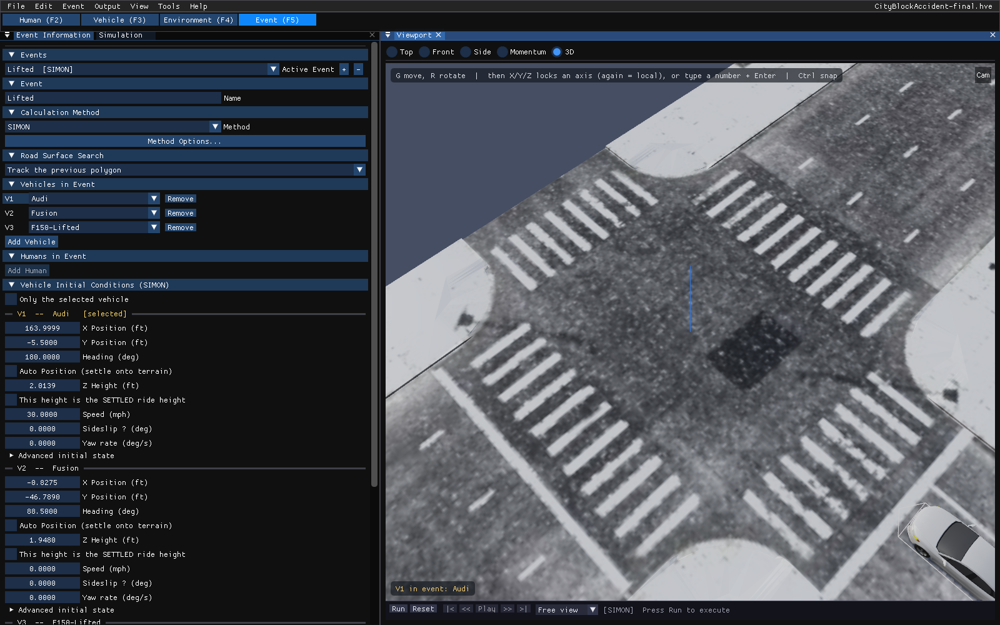

# Chapter 19 — Using the 3-D Viewport

In HVE, the 3-D Editor is the tool for creating and editing the 3-D objects used to visualize humans, vehicles and environments, and for giving environment surfaces their physical properties (surface type and friction factor). This chapter describes where each of those jobs is done in HVE 2027.

!!! note "HVE 2027"
    HVE 2027 has no separate 3-D Editor. Its **Viewport** panel (**View › Viewport**) is the one 3-D view for all five editor modes (Human F2, Vehicle F3, Environment F4, Event F5, Playback F6). Environment geometry is imported rather than modelled; surface properties, layers and materials are edited on the imported surfaces. The sections below follow the order of HVE's chapter.

## Description

The HVE 2027 equivalents of the 3-D Editor's components are:

- **Viewport** — the 3-D view, with Top, Front, Side, Momentum and 3D view buttons (see [Viewers](#viewers)).
- **Surface Materials** and the **Shader Editor's Surface node** — the per-surface attributes HVE edits in the Object Attributes tool (see [Object Attributes Tool](#object-attributes-tool)).
- **Outliner** — the scene's layers (HVE's overlays) with their surfaces (see [Overlay Name](#overlay-name)).
- **Shader Editor** — materials and textures (see [Materials Editor](#materials-editor)).

*Figure 19-1 — HVE 2027 in the Event editor: the Event Information panel (left) and the Viewport (right), with the playback bar beneath the view. The line across the top of the view lists the G/R keyboard operators.*

## Viewers

HVE's 3-D Editor shows four viewers (Perspective, X-Y, Y-Z and X-Z). The HVE 2027 Viewport shows one view at a time, selected by the buttons along its top edge:

- **Top**, **Front**, **Side** — schematic 2-D views: the event's vehicles drawn as outlines at their start positions (or along the solved trajectory), and in the Environment editor's Top view the scene boxes. The site geometry is not drawn in these views. The 2-D views read the same way as the 3-D view's own Top (**7**), Front (**1**) and Right (**3**) views. **Top**: +X to the right and +Y down the screen, so a vehicle with a positive heading (a right turn) is turned clockwise. **Front** looks back from ahead of the scene: +Y runs to the LEFT, as it does when you face a car, and height is up. **Side** looks from the right: +X to the right, as in the Top view, and height is up. In Front and Side each vehicle stands on the ground height the 3-D view gives it, its outline is as wide as the vehicle looks from that side at its heading, and white lamps (front) or red lamps (rear) mark the end that faces you; seen broadside, a windscreen marks the nose. The top-right corner of the view names its axes. After a run, the Top view marks each vehicle's position at the moment of impact with a red **PDOF** arrow pointing into it from the direction the collision force came from, as the 3-D view's Collision Force arrow does.
- **Momentum** — the momentum diagram of the active event (Event editor): for each vehicle, its velocity just before the collision (**V**, solid), just after it (**V'**, dashed) and the change between them (**dV**, yellow, drawn from the tip of V to the tip of V'), all from one origin and to one scale. These are the run's own velocities either side of the collision, so the length of dV is the Delta-V the results report. For an EDCRASH reconstruction the diagram is EDCRASH's own model -- V along the impact course and dV along its impulse -- and says so.
- **3D** — the rendered 3-D view (the default). Everything else in this chapter refers to this view.

In the 3-D view the camera can also be set to a top, front, rear, left, right or bottom view with the number keys, and switched to orthographic projection with **5** (below) — the rendered equivalent of HVE's plan, front and side orthographic viewers.

!!! note "HVE 2027"
    The 2-D Top, Front and Side views pan with a left or middle-button drag, zoom with the mouse wheel or Ctrl + middle-button drag, and return to their default scale with a right-button double-click.

### Navigating the 3-D view

The mouse controls follow Blender's conventions:

| Action | Result |
|---|---|
| Left-button drag on empty space | Orbit the camera about its target |
| Right-button drag | Pan |
| Mouse wheel | Zoom in and out |
| Middle-button drag | Orbit |
| Shift + middle-button drag | Pan |
| Ctrl + middle-button drag | Zoom |
| Left double-click | Reset the camera to the default perspective view |
| Right click (without dragging) | Menu: **Camera Properties…** and **Reset Camera** |
| **Cam** button (top-right corner of the view) | Opens the **Cameras** dialog |

With the mouse pointer over the view, the number keys (top row or numeric keypad) move the camera:

| Key | View |
|---|---|
| 1 / Ctrl+1 | Front / Rear |
| 3 / Ctrl+3 | Right / Left |
| 7 / Ctrl+7 | Top / Bottom |
| 9 | The opposite side of the current view |
| 5 | Toggle perspective and orthographic projection |
| 4 / 6 | Orbit left / right in 15° steps |
| 8 / 2 | Orbit up / down in 15° steps |
| . (period) | Frame the selected vehicle |
| C / Shift+C | Look through the next / previous saved camera (the list includes the free view) |
| I | Insert a camera key on the camera being looked through (see [Chapter 21](21-manipulators.md#cameras)) |
| Esc | Clear the environment surface selection |
| Tab | Vehicle editor only: toggle **Edit Mode** (pick parts of the vehicle mesh to give them materials) |

!!! note "HVE 2027"
    The numeric keys are not read while a G or R operation is in progress (they enter a typed distance or angle instead), nor while a text field has the keyboard.

The camera itself — orbit or free (Euler) control, presets, target point, projection, focal length or field of view — is set on the **Viewport View** tab of **Tools › Cameras…**. Saved, named and keyframed cameras are on the **Saved Cameras** tab (see [Chapter 21](21-manipulators.md#cameras)).

## 3-D Editor Dialog

HVE's 3-D Editor dialog combines the Current Object tool, the Object Attributes tool and the Group tool.

!!! warning "Not in HVE 2027"
    There is no 3-D Editor dialog. Object creation is replaced by geometry import and the Scene Box Editor ([Chapter 20](20-object-tools.md)); object attributes by **Surface Materials** and the Shader Editor (below); the Group tool has no equivalent (see [Group Tool](#group-tool)).

## Current Object Tool

HVE creates surfaces, cones, boxes, spheres, cylinders, text, lights and signals with its object tools.

!!! warning "Not in HVE 2027"
    HVE 2027 does not create or edit environment geometry. A site is imported from a DXF, `.h3d`, `.iv`, OBJ or glTF file (**Environment › Environment… › Terrain › Scene Geometry**), or comes with an HVE `.hve` case. The only objects created in HVE 2027 are display boxes (**Environment › Scene Box Editor**). See [Chapter 20](20-object-tools.md).

## Object Dialog

In HVE, each object tool has an Object Dialog with the object's size and position.

!!! warning "Not in HVE 2027"
    Imported surfaces have no size or position editor. The **Scene Box Editor** has position, size, rotation and colour fields for its boxes ([Chapter 20](20-object-tools.md#box-tool)).

## Object Attributes Tool

Every HVE environment object has an Object Type, an Overlay Name and a Friction Factor. In HVE 2027 these belong to each **surface** of the imported site — each named surface (material) of the geometry file, or each object of a site read from an HVE case.

To select a surface, perform one of the following:

- In the **Environment** editor, click the surface in the 3-D view. (Selection happens when the button is released without the mouse having moved, so an orbit drag does not select anything.) Clicking empty sky clears the selection, as does Esc.
- Pick its row under **Environment › Environment… › Terrain › Surface Materials**.
- Pick its row in the **Outliner** (**View › Outliner**).

The selected surface is highlighted in the view. **Surface Materials** shows *Selected: name — type, friction* with an **Edit in Shader Editor** button and a **Deselect** button.

The physical attributes are edited in the Shader Editor's **Surface** node, headed *PHYSICS — these change the result*:

- **Surface Type** — Road, Friction Zone, Curb, Water or Other. The type reaches the solver: the road search stops early on a curb or friction-zone hit, where a road hit keeps searching.
- **Condition preset** — Dry (1.00), Wet (0.70), Snow (0.30) or Ice (0.15); sets the Friction Multiplier.
- **Friction Multiplier** — HVE's Friction Factor: a multiplier on each tire's own friction.
- The surface's force-deflection properties (Force Constant, Linear, Quadratic and Cubic Stiffness, Damping Rate, Unloading Stiffness), its soil properties (Bekker Constant, Kphi, Kc, Moisture %, Clay %), and a material-library picker that fills them in.

Below them, *Object Color (display only)* — roughness, metallic and an optional base colour — reaches no engine.

### Object Name

HVE names an object after the tool that made it. In HVE 2027 a surface's name is the one in the geometry file (or HVE's object name in a `.hve` case); a surface with no name is listed as *(unnamed)*.

### Object Type

The available types are **Road**, **Friction Zone**, **Curb**, **Water** and **Other**, as in HVE. HVE's Human and Vehicle object types do not apply to environment surfaces in HVE 2027.

> **NOTE:** An object type of Road or Friction Zone must be selected if the surface is part of the physical environment with which a human or vehicle may interact.

Whether a surface takes part in the physics at all is also controlled by its **Drive** switch in the Outliner (below), and, for an imported geometry file, by **Use surfaces as terrain (physics)** under Scene Geometry.

### Overlay Name

HVE assigns each object to a named overlay and turns overlays on and off in the Overlays dialog. In HVE 2027 an overlay is a **layer** in the **Outliner** (**View › Outliner**), which lists the site's layers with their surfaces under them, as Blender's Outliner lists collections:

- **Draw** column (the eye) — draw or hide the layer or surface. Ctrl-click an eye shows only that one among its siblings (again to show all); Shift-click a layer's eye switches the layer and every surface in it. Click-dragging down the column sets every switch the pointer passes.
- **Drive** column (surfaces only) — whether the solver drives on the surface. Clearing both Draw and Drive removes a surface from the scene.
- Click, Ctrl-click and Shift-click rows to select, add to and extend the selection; the active row is the one the 3-D view highlights.
- Drag surfaces onto a layer to move them to it. **New Layer** creates a layer; a layer you created can be renamed or deleted from its right-click menu.
- Right-click a layer for **Show Only This Layer**, **Show All Layers**, **Select Surfaces**, **Make All Drivable** and **Make None Drivable**.
- With the pointer over the tree, **H** hides the selection and **Alt+H** shows everything.
- A **Search** field filters the tree, and a **Cameras** group lists the case's saved cameras.

*Figure 19-2 — The Outliner: layers (HVE's overlays) with their surfaces, Draw (eye) and Drive switches.*

!!! note "HVE 2027"
    A layer has no Drive switch, because an HVE overlay is a visibility switch only: the drivable polygons of a `.hve` site belong to its physics element, which is on no overlay. Groups in the Outliner may include *Solver surface* (drivable polygons on no layer), *Not on a layer* (drawn triangles the site puts on no layer) and *Unused*.

### Friction Factor

HVE's Friction Factor is the **Friction Multiplier** of the selected surface (see [Object Attributes Tool](#object-attributes-tool)). Use it, as in HVE, for regions with frictional properties different from the base surface — gravel shoulders, oil, and so on. A drivable polygon with no surface material of its own uses the site's *default surface material*, which is edited from the same Surface Materials section.

> **NOTE:** For more information about how the friction attribute is used, see Environment Model Definition.

## Materials Editor

HVE's Material Color editor sets ambient, diffuse, specular, emissive, shininess and transparency for the selected object.

!!! note "HVE 2027"
    Appearance is edited in the **Shader Editor** (**View › Shader Editor**), a node material editor modelled on Blender's. A material is a graph of nodes ending in a Material Output; a new surface material is *Object Color → Principled BSDF → Material Output*, which draws the object exactly as it looked without one. Materials apply to vehicles (whole vehicle or each named part of its mesh), to road surfaces and to the world (sky). **Materials are display only — nothing in the Shader Editor reaches an engine**; the *HVE Simulation* node can read friction, speed and time so that a material can visualize them.

### Texture Editor

HVE's Texture Editor maps an image onto an object's faces.

!!! note "HVE 2027"
    Use an **Image Texture** node in the Shader Editor. A vehicle body or road surface whose geometry file carries texture coordinates keeps them; an image material is carried into the glTF export and the Blender live link ([Chapter 27](../09-video-output/27-video-interface.md)). There is no texture list or Accept button; there is no `EnvTextures` folder to copy images into.

## Group Tool

HVE's Group tool combines objects into a group, splits groups, and saves and loads groups in the Highway Furnishings Library.

!!! warning "Not in HVE 2027"
    HVE 2027 has no grouping of scene objects and no Highway Furnishings Library. Model furnishings in a geometry editor and import the site, or use display boxes from the Scene Box Editor.

## Viewing Options

!!! tip "New in HVE 2027"
    The **View** menu controls what the 3-D view draws. All are view preferences, not case data:

    - **Rendering** — **Phong** (smooth), **Flat** (one normal per face) or **Wireframe** shading, and **Light Sources On** (off, the sun stops contributing and the ambient light is raised so shape stays readable).
    - **Shadow Coverage** — fit the shadow to the **Vehicles (sharp)** or the **Whole scene**.
    - **Vectors** — **Velocity Vectors**, **Collision Force (PDOF)** (drawn only while the vehicles are in contact, pointing into the CG from the direction the force came from), **Tire Force Vectors** (red Fx', green Fy', with **…include vertical Fz'** in blue) and **Draw Vectors Through Bodywork**. Each arrow is scaled against its run's own peak, so lengths compare within a run, not between runs.
    - **Scene Ghosts** — how a vehicle is marked at each measured scene position (Initial, Begin Perception, Begin Braking, Impact, Separation, Point On Curve, End of Rotation, Rest): **None**, **Outline**, **Translucent vehicle** or **Both** (HVE's targets).
    - Paths and markers — **CG Path**, **Accelerometer Path**, **Tire Contact Patch Paths**, **Skidmarks**, **Axes** (the origin's and each vehicle's own, at its CG), **North Arrow**, **Vehicle Extents**, **Occupant Equipment**, **Humans Through Bodywork** and **DyMESH Wheel Mesh**.

*Figure 19-3 — The 3-D view of a site read from an HVE case, with scene ghosts in outline style marking measured scene positions.*

Lighting comes from the sun and sky set in **Environment › Environment… › Sky**. **Vehicle › Vehicle Lights…** keeps a list of lights with each vehicle (type, intensity, direction, position, colour); the viewport does not draw them.

---
*Converted and updated from the legacy HVE User's Manual (Seventh Edition, Jan 2006), Chapter 19; adapted for HVE 2027.*

<!-- NAV -->

---

← Previous: [Section Eight: 3-D Editor](README.md)  |  [Index](README.md)  |  Next: [Chapter 20 — 3-D Editor Object Tools](20-object-tools.md) →

<!-- /NAV -->
