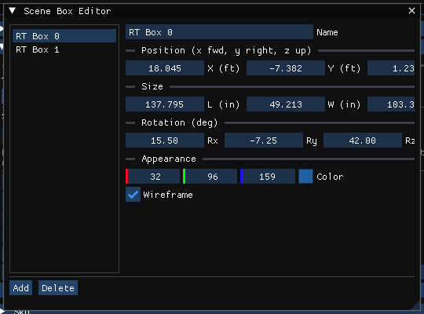

# Chapter 20 — 3-D Editor Object Tools

## Overview

HVE's 3-D Editor creates environment objects with nine Object Tools — Surface, Cone, Box, Cylinder, Sphere, Text, Light, Signal and Edit — each with its own Object Editor dialog for size, position and orientation.

!!! warning "Not in HVE 2027"
    HVE 2027 does not build environment geometry. There are no Surface, Cone, Cylinder, Sphere or Text tools, no object editor dialogs, and no vertex editing. A site is **imported**:

    - from a geometry file — DXF, `.h3d`, `.iv`, OBJ or glTF — under **Environment › Environment… › Terrain › Scene Geometry** (enter or browse for the file, set the scale and axis options, tick **Use surfaces as terrain (physics)** if vehicles are to drive on it, and press **Import**); or
    - with an HVE case: **File › Open Case...** reads a `.hve` case, including the site built for it in HVE's 3-D Editor, with its object types, overlays and friction factors.

    Build or edit the site in HVE or in a modelling program and import the result. The tools that remain are described below.

The table maps each HVE tool to what HVE 2027 offers:

| HVE tool | HVE 2027 |
|---|---|
| Surface | Imported geometry; surface type and friction set per surface ([Chapter 19](19-using-3d-editor.md#object-attributes-tool)) |
| Cone, Cylinder, Sphere, Text | Not available |
| Box | **Environment › Scene Box Editor** — display boxes only (below) |
| Light | The Environment panel's **Lights** section — point and spot site lights (below) |
| Signal | Not available; see [Signal Tool](#signal-tool) |
| Edit | Click to select in the Viewport ([Chapter 19](19-using-3d-editor.md#object-attributes-tool)); vehicles are moved with the gizmo ([Chapter 21](21-manipulators.md)) |

## Surface Tool

HVE's Surface tool creates drivable polygons (roads, medians, adjacent surfaces) vertex by vertex.

!!! warning "Not in HVE 2027"
    Surfaces come only from imported geometry. What HVE 2027 does edit on an imported surface is its **Surface Type**, **Friction Multiplier** and other physical properties, its **layer**, whether it is **drawn** and whether it is **driven on**, and its display **material** — see [Chapter 19](19-using-3d-editor.md#object-attributes-tool). Reversing a surface's normals, moving vertices and changing object hierarchy are not available.

## Cone Tool

!!! warning "Not in HVE 2027"
    There is no Cone tool. Include delineators in the imported geometry.

## Box Tool

HVE's Box tool creates box-shaped objects such as buildings and curbs.

!!! note "HVE 2027"
    **Environment › Scene Box Editor…** keeps a list of boxes with the case. **They are display objects only**: no engine reads them, so a box is not a curb, a barrier or a drivable surface. Use them to mark a location, a building footprint or a reference volume in the 3-D view.

*Figure 20-5 — The Scene Box Editor, with two boxes from a test case.*

### Box Editor Dialog

The Scene Box Editor shows the list of boxes on the left and the selected box's fields on the right:

- **Name** — the box's name, shown in the list.
- **Position (x fwd, y right, z up)** — X, Y and Z of the box's center. **Z is the height above the ground (positive up)**, not the SAE z-down coordinate.
- **Size** — **L** (along x), **W** (along y) and **H** (vertical).

Positions and sizes are shown in the units set in Preferences (in the US system, positions in feet and sizes in inches).
- **Rotation (deg)** — **Rx** (roll), **Ry** (pitch) and **Rz** (yaw), applied as for a vehicle.
- **Appearance** — **Color** and **Wireframe**.

### Creating a New Box

1. Choose **Environment › Scene Box Editor…**.
2. Press **Add**. A box named *Box n* is added and selected.
3. Enter its name, position, size, rotation and colour.

The box appears in the 3-D view.

### Editing an Existing Box

1. Choose **Environment › Scene Box Editor…**.
2. Click the box in the list and change its fields.
3. To remove it, press **Delete**.

> **NOTE:** Boxes cannot be selected or moved in the 3-D view; use the dialog's fields.

## Cylinder Tool

!!! warning "Not in HVE 2027"
    There is no Cylinder tool.

## Sphere Tool

!!! warning "Not in HVE 2027"
    There is no Sphere tool.

## Text Tool

!!! warning "Not in HVE 2027"
    There is no Text tool. Street names and other labels cannot be placed in the scene.

## Light Tool

HVE's Light tool adds point, directional and spot light sources (such as street lights) to the environment.

!!! note "HVE 2027"
    Site lights are made in the Environment Editor (F4), in the Environment panel's **Lights** section, not with a tool in the viewport. **Add Light** puts a light 8 m above the ground at the middle of the view; for each light you set its name, on/off, **On in daylight too**, type (**Point** or **Spot** — the sun is the only directional light), position (**X**, **Y**, **Height above the ground**), a spot's aim, tilt, cone and edge softness, and its colour and intensity. They come on as the sky darkens, as vehicle lamps do, and light the 3-D view, the ray-traced render and the glTF export. While the Environment is selected, each is marked by a yellow star (grey when off) with a dotted line to the ground. No engine reads them. See [Environment Information › Lights](../../08-environment/EnvtInfoDlg.md#lights).

    **Vehicle › Vehicle Lights…** keeps each vehicle's own lamps, which move with it. Lamps modelled in a vehicle's mesh can be given an emissive material in the Shader Editor.

## Signal Tool

HVE's Signal tool creates traffic signal lights in the environment.

!!! warning "Not in HVE 2027"
    There is no Signal tool, and no traffic signal is drawn or recorded with the case. No engine models a traffic light.

## Edit Tool

HVE's Edit tool selects an object so that its attributes can be edited and a manipulator attached.

!!! note "HVE 2027"
    There is no separate Edit tool; clicking selects. In the Environment editor a click on a surface selects it for the Environment panel's Selected Surface section and the Shader Editor. In the Event editor a click on a vehicle selects it and shows its gizmo ([Chapter 21](21-manipulators.md)). In the Vehicle editor, **Tab** enters Edit Mode, in which a click picks a named part of the vehicle mesh. In the Environment editor, **Tab** enters Edit Mode, in which a click picks one face of the site ([Chapter 12](../05-environment-editor/12-creating-editing-environments.md#edit-mode-faces-of-the-site)).

---
*Converted and updated from the legacy HVE User's Manual (Seventh Edition, Jan 2006), Chapter 20; adapted for HVE 2027.*

<!-- NAV -->

---

← Previous: [Chapter 19 — Using the 3-D Viewport](19-using-3d-editor.md)  |  [Index](README.md)  |  Next: [Chapter 21 — Manipulators](21-manipulators.md) →

<!-- /NAV -->
