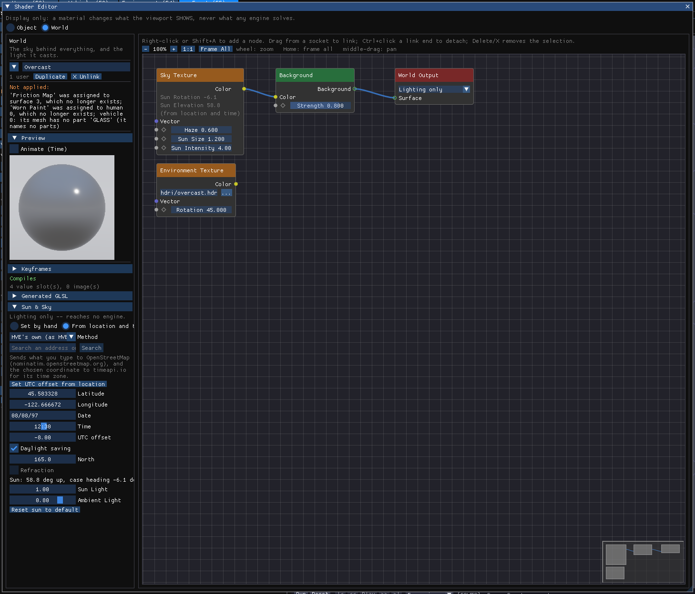

# Sun, Sky and World

!!! tip "New in HVE 2027"
    HVE places the sun, and the shadows it casts, from the scene's location,
    date and time, and HVE 2027 does too, with HVE's own method. New in
    HVE 2027: NOAA's solar position method as an alternative, finding the
    location from an address, and a world material — a sky with haze — whose
    sun is the light that casts the shadows.

!!! warning "Display only"
    The sun and sky light the picture. No engine reads them. Changing them never
    invalidates a solved run, and they are not locked while results are on
    screen.

## Where the sun and sky are edited

The sun and sky are part of the case's **world**, and are edited in the Shader
Editor:

- **View › Shader Editor**, then **World** in the header; or
- **Edit the sun and sky...** in **Environment › Environment...**, *Sky*
  section, or in the Event editor's **Lighting** section.

Both of those places show a one-line summary — the sun's heading and elevation,
whether it is set by hand or from the location and time, the sun strength and
the ambient light — and the button. The button opens the Shader Editor on the
case's world. If the case has no world material yet, it makes the default one
(*Sky Texture → Background → World Output*), which lights the scene exactly as
no world does.

The **Sun & Sky** panel is in the Shader Editor's left column, below the World
material's preview. It folds like the Preview section.

## Sun & Sky

The first choice is where the sun comes from.

### Set by hand

| Field | Meaning |
| --- | --- |
| **Sun Rotation** | The direction the sun lies in, −180° to 180°, measured as every heading in HVE 2027 is: 0 toward +X, 90 toward +Y |
| **Sun Elevation** | Degrees above the horizon, −90° to 90°. Below 0 is night (below) |

### From location and time

This places the sun the way Blender's *Sun Position* add-on does.

| Field | Meaning |
| --- | --- |
| **Method** | **NOAA (Blender's Sun Position)** — NOAA's solar position calculator, the accurate one — or **HVE's own (as HVE drew it)**, the table method HVE used for its sun. The two agree within about 0.7°. |
| Address search | See [Finding the place by address](#finding-the-place-by-address) |
| **Latitude** | Degrees, positive north |
| **Longitude** | Degrees, positive east (west is negative) |
| **Date** | `mm/dd/yyyy` (HVE's form) or `yyyy-mm-dd`. A two-digit year below 50 is read as 20yy. An unreadable date is reported in orange beneath the field. |
| **Time** | Drag it to scrub the sun through the day, one minute per pixel from where it is, or click it without dragging to type a time: `14:30`, `1430` or `7:05:30`. Enter keeps what you typed; Escape keeps the old time. It writes the case's own time of day. |
| **UTC offset** | Local clock time = UTC + this offset, in hours, for **standard** time (Akron, Ohio is −5) |
| **Daylight saving** | Tick when the case's date and place were on daylight saving time |
| **North** | The compass bearing the case's +X axis points along: 0 = north, 90 = east. This is HVE's *angle of X axis* and Blender's *North Offset* |
| **Refraction** | Include atmospheric refraction near the horizon (NOAA method only; HVE's method has no refraction term, so the box is disabled) |

Below the fields the panel prints where the sun ended up: *Sun: N deg up, case
heading N deg.* A problem with an input — a date or time that cannot be read —
is reported in orange, and the sun falls back to the manual setting rather than
being guessed.

Latitude, longitude, date, time, UTC offset, daylight saving and north are the
**same fields** as **Environment › Environment...**, *Location*. Editing them in
either place edits the case's one value.

Every change here is a step in **Edit › Undo History**, and it undoes with
**Ctrl+Z** even while results are on screen: no program reads the sun, the sky
or the location, so stepping back over them cannot change the run being shown.

!!! note "An imported HVE case is lit by HVE's own sun"
    When an HVE `.hve` case is opened, HVE 2027 reads HVE's location, date,
    time, GMT offset and north direction from the case, sets **From location
    and time**, and chooses **HVE's own** method, so the scene is lit as HVE
    lit it. A case whose location HVE left empty keeps the manual sun, since
    HVE could place none either.

### Finding the place by address

In **From location and time** (and in Environment › Location, *Search an
address*):

1. Type an address or place name in **Search an address or place** and press
   **Search** (or Enter).
2. Pick the right result from the list. Hovering a result shows its latitude
   and longitude. Picking it sets **Latitude** and **Longitude**.
3. HVE 2027 then looks up the time zone at that point and sets the **UTC
   offset** (standard time) and **Daylight saving** for the case's date. The
   status line names the zone and what it decided, for example *UTC−5.00
   standard; daylight saving ON for the case's date*.

**Set UTC offset from location** does the second half alone, for a latitude and
longitude you typed or pasted.

!!! warning "This sends data off the machine"
    The address search is the one control in HVE 2027 that goes online. What
    you type is sent to OpenStreetMap (`nominatim.openstreetmap.org`), and the
    chosen coordinate to `timeapi.io` for its time zone. The panel says so
    beside the button, every time. Do not use it if the case's location must
    not leave the workstation; type the coordinates and UTC offset by hand
    instead.

Daylight saving is decided from the current year's switch dates, and the status
line says so; check it by hand for a date within a few days of a switch. If the
time-zone lookup fails, the status line says so — set the UTC offset by hand.

### Light

| Field | Meaning |
| --- | --- |
| **Sun Light** | A multiplier on the key light that casts the shadows; 1.00 is the viewport's own. It has no upper limit (Ctrl+click to type a value). |
| **Ambient Light** | How much light fills the shadows, 0–1; 0.80 is the viewport's own |
| **Reset sun to default** | Back to the manual sun at its default position, Sun Light 1.00, Ambient 0.80 |

HVE's sky *condition* and *visibility* are not offered: nothing in HVE's
renderer or engines reads them. A value an HVE file states is kept in the case,
untouched.

## Night and twilight

Below the horizon — set by hand, or because the location and time put it there
— the sun's direct light fades out between +1° and −1° of elevation and no
shadow falls. The sky darkens with it: unchanged at and above the horizon, then
dimmer by a factor of ten for every 6° below it (civil twilight ends at −6°,
nautical at −12°, astronomical at −18°), down to a floor. The material preview
stays lit as in a studio, on purpose.

## Vehicle lamps

At night each vehicle lights the road with its own lamps. Which lamps, and
where, comes from the first of these that applies:

1. **The vehicle's own list** (Vehicle › Vehicle Lights…), when it has any
   entry. A switched-off entry is dark; the vehicle does not fall back to
   anything else.
2. **Its body file's lamps.** An HVE vehicle file marks each lamp lens
   (`HVE_LIGHT_` tags), and the lamp sits on that lens. A file that marks none
   but names its lenses by material — HVE's `LIGHT_WHITE_*` and `LIGHT_RED_*`,
   or a modeller's `Headlight`/`Taillight` names — gets a headlamp on each white
   lens at the front and a tail lamp on each red lens at the back. Amber lenses,
   a white lens at the back (reversing) and a red one at the front are not
   lit at night.
3. **An estimate** at the corners of the vehicle's extents: two headlamps and
   two tail lamps. A trailer or dolly gets tail lamps only.

**Lamp gizmos.** Scene Display › Paths & Overlays › **Lamp Gizmos** draws every
lamp as Blender draws a light: a ring where it is, a line along its aim and,
for a spot, its cone. A switched-off lamp is grey and the selected one orange.
**Click** a lamp to select it; **drag** it to move it. It moves in the plane
facing you through where you grabbed it, as Blender's G does, and holding
**Ctrl** snaps it to 5 cm. The position is stored in the vehicle's own frame, so
the lamp rides with the vehicle.

**Light settings in the Shader Editor.** Picking a lamp switches the Shader
Editor to **Light** (beside Object and World). There you can set its type
(spot or point), colour, strength, cone and softness, aim, position, and
switch it on or off. The same fields are in Vehicle Lights. You can also choose
any vehicle's lamp from the list at the top, and the **Lamp gizmos in the
viewport** box turns the gizmos on or off from there.

**The first change copies.** A vehicle drawn with its file's lamps or the
estimate has no list yet. The first move or change of one of its lamps copies
all of them into its list, unchanged, and then applies the change to that
entry. From then on the list is what lights the vehicle. To go back, use
**Remove all** in Vehicle Lights. To turn off the tail lamps of the front unit
of an articulated bus, for example, pick each one and untick **Enabled**.

Lamps are display only: no engine reads them, so they stay editable with
results on screen.

## Site lights

The site can have lights of its own — street lights, work lights, a floodlight
— made in the Environment Editor (F4), in the Environment panel's **Lights**
section. Each is a **Point** light (every way) or a **Spot** (a cone with an
aim, a downward tilt and a soft edge), with a colour, an intensity (1 is about
a headlamp) and a height above the ground. Like vehicle lamps they come on as
the sky darkens; tick **On in daylight too** for one that should also light
the scene by day.

The 3-D view lights the scene with up to **32 lamps at once**, site lights and
vehicle lamps together. Site lights take at most 16 of them — the ones nearest
the middle of the view — so the vehicles' lamps always have the rest. A
ray-traced render and the glTF export carry every light. While the Environment
is selected, each light is marked by a yellow star (grey when off) with a
dotted line to the ground. Site lights are display only: no engine reads them.
See [Environment Information › Lights](../08-environment/EnvtInfoDlg.md#lights).

## The Sky Texture node

The default world's **Sky Texture** node is HVE 2027's own analytic sky: a
three-colour gradient, the sun's disc, and haze. It has these inputs:

| Input | Default | Effect |
| --- | --- | --- |
| **Haze** | 0 | A milky veil over the whole sky, thickest at the horizon, plus a glow around the sun. 0 leaves the sky clear; 1 is a clear haze; 3 nearly white. There is no upper limit. With **View › Scene Display › Effects › Distance Haze** on (the default), the same amount also fades far geometry toward the horizon colour; at 0 nothing is faded. Display only. |
| **Sun Size** | 0.545 | The angular size of the sun's disc, in degrees |
| **Sun Intensity** | 20 | The sun's brightness |

The node also shows **Sun Rotation** and **Sun Elevation**, which are the
case's sun: on a manual sun you can drag them on the node; with **From location
and time** they are shown read-only, marked *(from location and time)*.

The sun's disc is drawn only in the **background**. Glossy surfaces reflect the
sky without it, so a rough paint finish does not show a hard white spot.

### The sun is the key light

The light that casts shadows is the world's sun. HVE 2027 evaluates the world
toward the sun, so **Sun Intensity** and every node after it in the world graph
— the Background node's **Strength** included — scale the key light. The
default world gives exactly 1.

- **Sun Intensity** 40 doubles the key light; 10 halves it.
- A Sun Intensity or Strength of **0** puts the sun out; a negative value counts
  as 0.
- **Sun Light** in the panel multiplies the result.

Haze adds sky light (a glossy road reflects the glow and the ambient light it
adds is real) but does not change the key light, which is measured from the
sun's disc alone.

### Other worlds

A world can be any graph ending in a *World Output*: a **Background** with a
plain colour, an **Environment Texture** with an equirectangular image (a
`.hdr` photograph of the sky, for example), or a mix. World Output's option
chooses whether the world is drawn behind the scene or used for **lighting
only**.

## Shadows

The viewport draws shadows from the key light (the sun).

- **Low sun.** A low sun throws long shadows; HVE 2027 extends the shadow
  calculation down the light to the ground, so a long shadow is not cut off
  short of where it lands.
- **View › Scene Display › Shadow Coverage** chooses what the shadow calculation covers:
  - **Vehicles (sharp)** — fitted to the vehicles, so their shadows are as sharp
    as possible, but site geometry outside that region casts nothing.
  - **Whole scene** — fitted to the site too, so everything that can cast a
    shadow does, with softer edges because the same detail covers more ground.

  The panel shows the current resolution as *Now: N cm per shadow texel*.
- **At night** no shadow falls (above).

## In Blender and glTF

The **Blender Live Link** sends the case's sun with the materials, and rebuilds
the Sky Texture in Blender term for term, haze and twilight included. It does
not create a Sun lamp object. A **glTF** export carries no world or sun at all;
its status says the world material was not exported. See
[Exporting to Blender and glTF](06-exporting-to-blender-and-gltf.md).
