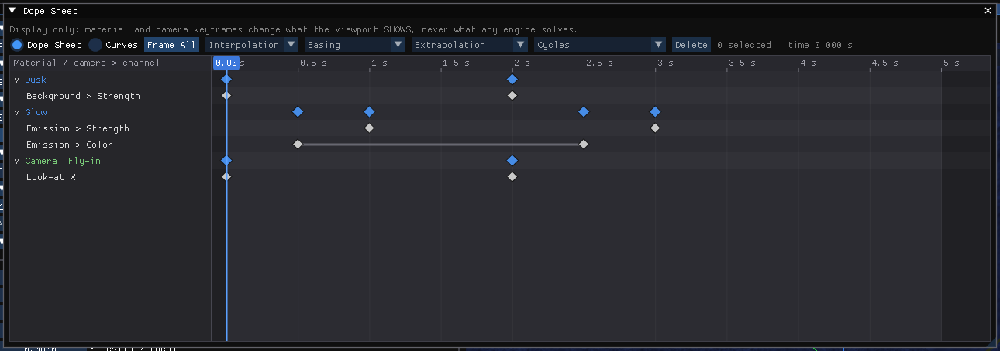

# Keyframes and the Dope Sheet

!!! tip "New in HVE 2027"
    Any value on a material node, and any saved camera, can be animated against
    **playback time** — a lamp that flashes, a paint that changes colour at the
    moment of impact, a camera that flies in. The **Dope Sheet** shows every
    animated value in the case on one time axis and lets you edit the keys.

!!! warning "Display only"
    Keyframes change what the viewport shows. No engine reads them, and keying
    a value never invalidates a solved run.

## The clock

Keys are placed in **playback time**, in seconds: the time the playback bar
under the viewport shows, the time the viewport draws, and the time the HVE
Simulation node's **Time** output reads. Before a run nothing limits the time,
so keys can be laid out on an unsolved case; after a run the time is the
playback scrubber's.

## Keying a material value

In the [Shader Editor](01-materials-and-shader-editor.md), every value on a
node that is **not linked** — a number, a colour, a vector — has a small
diamond in front of it.

| Diamond | Means |
| --- | --- |
| Filled | There is a key at the current playback time |
| Yellow outline | The value is animated, but has no key at this time |
| Grey | Not animated |

To animate a value:

1. Set the playback time — with the playback bar, or with the **Time** field in
   the Shader Editor's **Keyframes** section.
2. Set the value, then click its diamond. The value is keyed at that time.
3. Move to another time, change the value, click the diamond again.

Once a value is animated, its field shows the value **at the playback time**,
and editing it sets (or moves) the key at that time — Blender's auto-key on an
animated channel. Click a filled diamond to remove that key.

### The Keyframes section

In the Shader Editor's left column, **Keyframes** lists the playback time —
drag or type it, or jump with **◀ ▶** to the previous or next key of this
material — and then every animated input of the material, with its keys:

- click a key's time to go to it;
- choose how the value travels from that key to the next (interpolation, and
  easing where it applies);
- **x** deletes the key;
- the two lists beside each input's name set its **extrapolation** and
  **cycles** (below);
- **Clear all keys** removes every key of the material.

## Interpolation and easing — per key

Each key's interpolation governs the stretch from that key to the next, as in
Blender. A new key takes the interpolation and easing of the key before it.

| Interpolation | The value... |
| --- | --- |
| **Constant** | holds until the next key, then jumps |
| **Linear** | moves at a steady rate |
| **Ease** | starts and ends gently (an S-curve; Blender's Bezier with flat handles) |
| **Sine**, **Quadratic**, **Cubic**, **Quartic**, **Quintic**, **Exponential**, **Circular** | follows that easing curve, increasingly sharp down the list |
| **Back** | overshoots slightly, then settles |
| **Bounce** | bounces into place |

The easing curves (Sine to Bounce) also take an **Easing**: **Ease In** (the
effect at the start), **Ease Out** (at the end), **Ease In and Out** (both), or
**Automatic** — Ease In, except Back and Bounce, which are Ease Out. This is
Blender's rule. Blender's *Elastic* is not offered.

Colours are interpolated in linear light, as Blender interpolates them.

## Extrapolation and cycles — per channel

What an animated value does **outside** its first and last keys:

| Extrapolation | Effect |
| --- | --- |
| **Constant** (default) | Holds the first value before the first key and the last value after the last key |
| **Linear** | Carries on along the end segment's slope — when that end key is itself Linear. Any other end holds, as in Blender |

| Cycles | Effect |
| --- | --- |
| **Off** (default) | No repetition |
| **Repeat** | Repeats the span from the first key to the last, before it and after it, for ever |
| **Repeat with Offset** | Each repeat adds the span's change, so a ramp keeps climbing |
| **Repeat Mirrored** | Every other repeat runs backwards |

Cycling replaces the extrapolation. A channel with only one key has nothing to
repeat and holds.

### Example: a flashing lamp

1. Select the vehicle and the lamp's slot (for example `LIGHT_AMBER_HI`), and
   give it a material with an **Emission** node (or use the Principled BSDF's
   Emission Strength).
2. At **0 s**, set Strength to **0** and key it. At **0.25 s**, set **5** and
   key it. At **0.5 s**, set **0** and key it.
3. Set all three keys to **Constant**.
4. Set the channel's Cycles to **Repeat**.

The lamp now flashes twice a second for the whole run.

## The Dope Sheet

**View › Dope Sheet** shows every keyframed material **and every keyframed
camera** in the case on one time axis — including a material that nothing
currently wears, which the Shader Editor cannot reach.

**Rows.** A header per material (or *Camera: name*), its summary diamonds (one
per key time), then one row per animated channel. A grey bar between two keys
is a Constant hold. The span of the run is shaded. A channel that cycles or
extrapolates linearly says so after its name, and a cycled channel's repeats
are drawn as faint diamonds (they cannot be picked).

- Hover a material header to see what wears it. Click it to fold or unfold.
  Double-click it to open the material in the Shader Editor, with the object
  that wears it selected.
- Double-click a camera header to look through that camera.
- Click a channel's label to select all of its keys (Shift adds).

**Time.**

| To | Do |
| --- | --- |
| Scrub the playback time | Click or drag in the ruler (the viewport follows) |
| Go to a time | Click empty space |
| Zoom time | Mouse wheel, about the mouse |
| Scroll the rows | Shift + mouse wheel |
| Pan | Middle-drag |
| Fit every key | **Frame All**, or **Home** |

**Keys.**

| To | Do |
| --- | --- |
| Select | Click; Shift+click adds or removes; drag on empty space to box-select |
| Select every key of a material at one time | Click its summary diamond |
| Move | Drag (Ctrl snaps to the ruler) |
| Delete | **Delete** or **X**, or the **Delete** button |
| Change interpolation, easing, extrapolation, cycles | Right-click a key; or use the toolbar |
| Type a key's time, value, interpolation and easing | Double-click it |
| Move the playback time to a key | Right-click it and choose **Go to key**, or press **Go to key** in its double-click editor |

Right-click a key for a menu that offers **Interpolation** and **Easing** (for
the selected keys), **Extrapolation** and **Cycles** (for their channels),
**Go to key** (the playback time jumps to the first selected key) and
**Delete**.

A dragged key that lands on another key replaces it when you let go, as in
Blender. Every edit marks the case modified.

**Toolbar.** **Interpolation** and **Easing** set the selected **keys**.
**Extrapolation** and **Cycles** set every **channel** that holds a selected key.
Each list shows the selection's own setting, or *mixed*. The toolbar also shows
how many keys are selected and the current time.

### The Curves view

**Curves** (beside **Dope Sheet** at the top) shows each channel's value over
time — the Graph Editor of Blender. A colour or a vector draws three curves,
red, green and blue. The curves are drawn as evaluated, so repeats and
extrapolated ends show as the curve itself.

- Click a channel's label to show or hide its curve (the eye).
- Drag a key point to move it in **time and value**.
- Ctrl + mouse wheel zooms the value axis; middle-drag pans both axes.

## Camera keys

Saved cameras are keyed with **I** in the viewport, or **Insert Key** in the
Cameras dialog, and their keys appear in the Dope Sheet beside the materials'.
See [Cameras](05-cameras.md).

## Saving and exporting

Keys are saved with the case in both formats. The **Blender Live Link** sends
them as real Blender keyframes on the same timeline as the motion — Ease as a
flat-handled Bezier, the easing curves under Blender's own names, the
extrapolation on the F-Curve and cycles as a Cycles modifier. A **glTF** export
carries a material's values at **t = 0** only, and its status says which
materials were keyframed.
