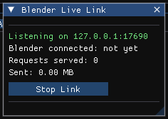

# Exporting to Blender and glTF

!!! tip "New in HVE 2027"
    A solved case can leave HVE 2027 with its motion: as a **glTF 2.0** file
    that Blender (and most 3-D tools) import with the animation, or over a
    **live link** that Blender's add-on reads straight from a running HVE 2027.

| | glTF export | Blender Live Link |
| --- | --- | --- |
| How | A file, written once | A connection to a running HVE 2027 |
| Needs a run | Yes (the menu is disabled before one) | No — geometry can be fetched before solving |
| Re-running the case | Re-export and re-import: **new** objects, so materials, cameras and modifiers you set up in Blender on the old import are orphaned | Fetch again: the **same** objects are updated, so your Blender work survives |
| Node materials | Baked to glTF's fixed material model | Sent as real node graphs |
| Keyframes on materials | Values at t = 0 only | Real Blender keyframes |
| Cameras | Yes; no lens shift, lens at t = 0 | Yes; lens, shift and motion keyed |
| Sky and sun | No | Yes (the World and its Sky Texture) |
| Readers | Any glTF reader | Blender only |

For a one-off render either will do. If you will re-run the case and re-render,
use the live link.

## Exporting glTF

1. Solve the event (**Output › Run Simulation**, or **Run** on the playback
   bar).
2. Choose **File › Export Scene for Blender** and then
   - **glTF Binary (.glb) -- recommended** — one binary file, about a quarter
     smaller and quicker for Blender to read; or
   - **glTF Text (.gltf)** — one self-contained text file.
3. Pick the file name and folder.
4. In Blender: **File › Import › glTF 2.0**, pick the file, and press play.

The menu is greyed until there is a run to export ("Run a simulation first --
the export carries the motion"). A summary of what was written — and every
item glTF could not carry — is added to **Tools › Audit Log**.

### What the file contains

| Item | In the file |
| --- | --- |
| Vehicle bodies | One object per vehicle: its real mesh (`.h3d`/`.iv`/`.wrl`) when it has one, otherwise the same generated body the physics uses |
| Motion | Position and rotation keys on each body, sampled at 30 frames per second |
| Wheels | One child object per wheel at its axle position, animated with steer, spin and camber; a motorcycle gets one wheel per axle, on the centreline |
| The site | The imported terrain, as a static mesh |
| Humans | The solved event's occupants and pedestrians, one ellipsoid per body segment, animated in position, rotation and size, each wearing its segment's material or colour |
| Materials | Each vehicle's paint, its tires, one material per road surface, and node materials **baked** (below) — one material per vehicle part |
| Texture coordinates | On a body or a surface whose source has them, so an image material travels |
| Cameras | Every saved camera, keyed per frame when it rides a vehicle or is keyframed |

In Playback mode (F6), with a [playback sequence](07-video-and-playback-sequences.md)
active, the export carries the whole sequence: each vehicle the sequence places moves, and
its occupants ride, as the sequence plays them, whichever event happens to be
live; a camera riding a vehicle follows it as drawn.

**Baked materials.** glTF has one fixed material model (base colour, metallic,
roughness, emission, alpha, a normal map, one image per slot, and a clear coat
through `KHR_materials_clearcoat`) and no node graphs. The Principled BSDF's
Coat Weight and Coat Roughness go into the clear coat; a Coat IOR other than
1.5 or a Coat Tint is named in the export status, not sent. Each Shader Editor material is followed back from its output and
reduced to that model. What reduces — constants, Object Color, simple Mix and
Math of those, an image texture on the mesh's own texture coordinates, a normal
map, emission, the Alpha Blend and Alpha Clip modes, Mix and Add Shader — goes
into the file, with images embedded. **Everything else is named in the export
status, one sentence each**: a procedural texture (Noise, Voronoi, Checker, ...)
is exported as the object's own colour and said; so is a Bump, an image on a
mesh without texture coordinates, an image that could not be read, a world
material, the ground plane's material, and a keyframed material (exported at
t = 0).

### What glTF does not carry

- **No crush.** The deformed body is not written; the exported vehicle is
  undamaged.
- **No sky, sun or world**, and no ground plane.
- **Lens shift** on a camera (exported unshifted, and said), and a keyed lens
  after t = 0.
- **Vehicle shading** (Auto Smooth etc.) — use Blender's Shade Auto Smooth.
- **Wheels** are plain cylinders, not real wheel geometry, and their suspension
  travel and any displacement of a damaged wheel are not animated. A mesh that
  models its own wheels exports them welded to the body (they do not turn), and
  no cylinder is added for them.
- A vehicle whose mesh is OBJ or glTF exports as the generated body.
- The viewport's *Center on CG* display option is not applied; the export shows
  the mesh where the physics placed it.

## The Blender Live Link

### Setting it up (once)

1.  **Install the add-on in Blender.** The add-on is the file
    `tools/blender/hve_live_link.py` in the HVE 2027 distribution. In Blender:
    **Edit › Preferences › Add-ons › Install...**, pick that file, and tick
    **HVE Live Link** to enable it. It needs nothing else installed. It is
    written for Blender 3.0 or later; *HVE 2027's look* (below) needs Blender 4.2.

2.  **Start the link in HVE 2027.** Choose **File › Blender Live Link...**, leave
    the **Port** at 17690 unless something else uses it, and press **Start
    Link**. The window shows *Listening on ...*. HVE 2027 can also be started
    with the link already on, with the command-line option `--serve` (or
    `--serve=PORT`).

    

    The window counts the requests served and the data sent, and shows the last
    request and any error. **Stop Link** closes it. With **View › Show Guidance
    Text** on, the window also explains the link and repeats the Blender steps.

3.  **Connect from Blender.** In Blender's 3-D viewport press **N** to open the
    sidebar, open the **HVE** tab, check Host (127.0.0.1) and Port, and press
    **Connect**. The panel shows the case name, the number of vehicles and
    whether it is solved; HVE 2027's window shows *Blender connected: yes*.

!!! note "Local only, read-only"
    The link listens on this computer only (127.0.0.1); nothing on the network
    can reach it, and that cannot be changed. Blender can read the case but
    cannot change it. The link is not available in the web build of HVE 2027.

### Fetching

The **HVE** tab's buttons, once connected:

| Button | Brings across |
| --- | --- |
| **Fetch Everything** | All of the below |
| **Geometry** | Vehicle bodies (with one material slot per mesh part), wheels and the terrain (one material slot per road surface). **Wheels** and **Terrain** toggles above choose whether to include them |
| **Motion** | The solved motion as keyframes, frame 1 = t 0, at **Sample FPS** (default 30) |
| **Damage** | The crushed shape of each body, at the end of the run |
| **Humans** | Occupants and pedestrians, one object per body-segment ellipsoid, animated |
| **Materials** | Every node material as a Blender node tree, assigned to bodies, parts, surfaces, humans and the World |
| **Cameras** | Every saved camera, as Blender cameras in an *HVE Cameras* collection |

After you re-run the case in HVE 2027, press the same buttons again. The add-on
updates the objects it made before — their mesh data and keyframes — instead of
creating new ones, so the materials, lights, modifiers and constraints you added
in Blender stay. Objects are recognised by a tag, not by name, so renaming one
in Blender does not create a duplicate. A vehicle HVE 2027 no longer has, or a
wheel it no longer publishes, is removed.

**Your work in Blender is never overwritten.** The add-on replaces only what it
made itself. A material you assigned to a body or a terrain slot stays, and so
does a World you made or edited; the fetch's warning names every slot it left
alone. A named mesh HVE 2027 could not find is reported as a warning, because
the generic body standing in for it looks entirely plausible.

### Live Preview

**Live Preview** shows the pose in Blender **while HVE 2027 solves**, and the
damage as it forms. The motion fetched after the run is the authoritative one;
the preview is for watching. Press it again (it reads *Live Preview (running)*)
to stop.

### HVE 2027's look

**HVE 2027's look** shows the Blender scene through HVE 2027's own display
curve and bloom, so a Blender render looks like the HVE 2027 viewport. **Scene's
own view** puts Blender's colour management back exactly as it was. It works
through the compositor (your own compositor nodes are kept) and needs Blender
4.2's GPU compositor.

### What crosses, and how exactly

- **Vehicles** — the real mesh, prepared as the solver prepares it, or the
  generic body; one material slot per named part.
- **Motion** — body position and rotation, and each wheel's rotation and
  suspension travel, per frame.
- **Damage** — the deformed vertices of each crushed body. In Playback mode, each
  vehicle's damage from the event that holds it at that moment.
- **Humans** — every segment ellipsoid, wearing its segment's material, else the
  figure's, else the segment's colour. In Playback mode, the sequence's bodies,
  each from its own event.

In Playback mode the link sends the vehicles the sequence places; in Event mode,
the solved event's. **Fetch Geometry again after switching mode**, so the bodies
in Blender are the ones the motion and damage that follow are for.
- **Materials** — node graphs. Nearly every HVE 2027 node *is* a Blender node.
  The ones that are not are rebuilt: **Object Color** reads per-vertex
  attributes the geometry fetch writes; **HVE Simulation**'s Time is driven by
  the frame number and Speed by a property the Motion fetch keys per frame,
  while **Crush** reads 0 in Blender; the **Sky Texture** is rebuilt term for
  term so Blender's sky is HVE 2027's sky, haze and the case's sun included.
  Material keyframes arrive as Blender keyframes.
- **Sun** — as the World's Sky Texture sun. No Sun lamp object is created.
- **Cameras** — real camera objects with Blender's lens settings and keyed
  motion; the camera HVE 2027 looks through becomes the scene camera.

Small differences the add-on reports rather than hides: Blender has no *Alpha
Clip* mode (it uses dithered), *Lighting only* on the World becomes the World's
camera visibility (honoured by Cycles), and Blender's Math *Modulo* differs from
HVE 2027's for negative inputs.

### Limits

- Wheels are cylinders built from each wheel's position, radius and width. A
  mesh that models its own wheels arrives with them welded to the body.
- Wheel **position** (a wheel driven out of its arch by wheel damage) is not
  animated; rotation and suspension travel are.
- Live Preview resends damage only when new vertices enter the crush; fetch
  **Damage** after the run for the settled shape.
- Vehicle shading (Auto Smooth) is not carried.
- The *Center on CG* display option is not applied.

## Without a window

For a render machine with no display, HVE 2027 can solve a case and serve it to
Blender with no window at all:

```
hve-next --serve-headless <case> [port]
```

It prints `SERVING <address>` once ready. To export glTF from the command line
(it solves the case's active event first, then writes the file):

```
hve-next --export-gltf <case.json> <out.glb|out.gltf> [fps]
```
