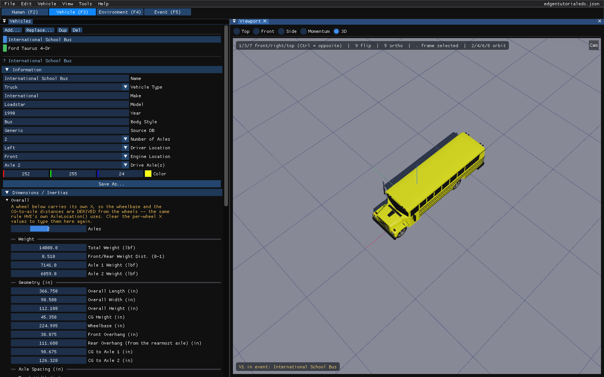
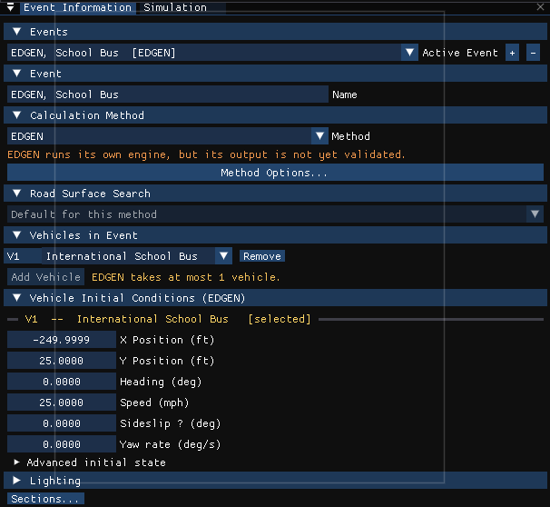
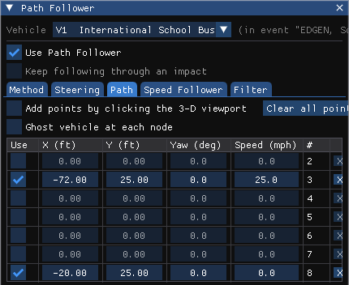
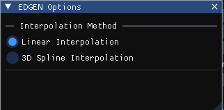

# Chapter 2 — Program Input Parameters

This chapter defines the objects (humans, vehicles and environment) and the event set-up parameters (positions and velocities) used by the EDGEN analysis. In general, the chapter is divided into the following sections:

- **Objects** — The number of humans and vehicles, and the specific human and vehicle parameters actually used by EDGEN.
- **Events** — The various options available for setting up and executing an EDGEN event.

## Objects Overview

The objects used by the EDGEN model are:

- **Humans** — One human, either an occupant or a pedestrian, may be studied by EDGEN.
- **Vehicles** — One vehicle may be studied by EDGEN.

  > **NOTE:** Either a human *or* a vehicle, but not both, may be studied in an EDGEN event.

- **Environment** — Like the *real* world, EDGEN has exactly one environment.

  > **NOTE:** The environment is optional.

The following sections describe how these objects provide the required inputs to the EDGEN calculation model.

## Humans

EDGEN may use one human created using the HVE Human Editor. Humans are selected from the Human Database by choosing the following attributes:

- **Location** — Choose from any available occupant position (i.e., *R/F, L/F*) or, alternatively, choose *Pedestrian*.

  > **NOTE:** If an occupant position is selected, HVE initially displays the human in a seated position; if a pedestrian is selected, it is displayed in a standing position.

  > **NOTE:** The initial orientation of the human may be edited during Event mode.

- **Sex** — Choose *Male* or *Female*.
- **Age** — Choose *Adult* or from a list of child ages.
- **Weight Percentile** — Choose from a list of available percentiles.
- **Height Percentile** — Choose from a list of available percentiles.

To add a human to the current case in HVE 2027:

1. Choose the **Human** editor tab (F2). The **Occupants** panel is displayed.
2. Click **Add Occupant**.
3. Under **Identity**, enter a **Name** and choose the **Location** (an occupant position or *Pedestrian*).
4. Under **Anthropometry**, choose the **Subject Type**, **Age Group**, **Weight Percentile** and **Height Percentile**.

The name does not affect calculations.

The following Human Parameter groups are editable in the Human editor:

- Inertias
- Color
- Ellipsoids
- Joints
- Injury Tolerance

EDGEN is a kinematics program. Thus, it does not require or use any human parameters in its calculations.

## Vehicles

EDGEN may use one vehicle created using the Vehicle Editor. Vehicles are selected from the Vehicle Database by choosing the following attributes:

- **Type** — EDGEN supports all HVE/HVE-2D vehicle types: *Passenger Car, Pickup, Van, Sport-Utility, Truck, Trailer, Dolly, Fixed Barrier* and *Movable Barrier*.
- **Make** — EDGEN supports all available vehicle makes.
- **Model** — EDGEN supports all available vehicle models.
- **Year** — EDGEN supports all available vehicle years.
- **Body Style** — EDGEN supports all available vehicle body styles.

Each vehicle also has the following additional user-editable parameters:

- **Driver Location** — The driver location is not used by EDGEN.
- **Engine Location** — The engine location is not used by EDGEN.
- **Number of Axles** — The number of axles is not used by EDGEN.
- **Drive Axle(s)** — The drive axle attribute is not used by EDGEN.

To add a vehicle to the current case in HVE 2027:

1. Choose the **Vehicle** editor tab (F3).
2. In the **Vehicles** panel, click **Add...** and choose a vehicle from the loaded databases, or one of HVE's generic vehicles by type and class.
3. If desired, edit its name and attributes in the **Information** section of the Vehicles panel. The name does not affect calculations.

*Figure 2-2: The Vehicle editor in HVE 2027, showing the school bus of the EDGEN tutorial case.*

The following Vehicle Parameter groups are created by the Vehicle editor:

- Sprung Mass
- Unsprung Mass (Wheels)
- Exterior
- Drivetrain
- Steering System
- Brake System

EDGEN is a kinematics program. Thus, it does not require or use any vehicle parameters in its calculations.

## Environment

The environment is defined by the following groups of attributes:

- Visual Data
- Physical Data

### Creating an Environment

In HVE 2027 every case has exactly one environment, so there is nothing to add. To edit it:

1. Choose the **Environment** editor tab (F4).
2. Choose **Environment › Environment...**. The Environment dialog is displayed.
3. Enter the name, date, time, latitude and longitude of the site.
4. Under **Scene Geometry**, choose a site file with **Browse...** and **Import** it.
5. The angle of the earth-fixed X axis from true north is the **North** setting of the sun and sky (**Edit the sun and sky...**).

See [Environment Information](../../08-environment/EnvtInfoDlg.md) for the dialog. The Visual and Physical attribute groups are defined below.

### Visual Data

The following visual parameters may be edited:

- **Environment Location** — A database containing the name (City/State/Country), Latitude and Longitude and GMT for the selected location.
- **Time and Date** — The local standard time and date for the event.

The visual data are not used by the event; they are provided for studies related to visibility at the time of an event (e.g., avoidability of an accident).

> **NOTE:** The visual data (Location, Time, Date and Angle of earth-fixed X axis) affect the lighting of the event! Depending on your view the scene may be shaded and difficult to see. If the time is after sundown, the view will be dark.

### Physical Data

The Physical Data groups are:

- Angle of X Axis
- Wind Speed and Direction
- Atmospheric Temperature and Pressure
- Gravity Constant
- Surface Geometry

EDGEN does not use any physical environment parameters. However, an environment may be supplied to provide visual context, as well as to control the lighting of the event. These parameters are described below:

#### Angle of X Axis

The angle of the X axis is used to position the earth-fixed coordinate system on the surface of the earth.

> **NOTE:** The angle is specified relative to true north. If you are using a compass to determine direction at the scene of an accident, you should provide a correction factor before entering this angle.

> **NOTE:** The angle of the X axis affects how you visualize an EDGEN event because it affects the location of the sun.

#### Wind Speed and Direction

Wind Speed and Direction are not used by EDGEN.

#### Atmospheric Temperature and Pressure

Atmospheric Temperature and Pressure are not used by EDGEN.

#### Gravity Constant

Gravity Constant is not used by EDGEN.

#### 3-D Surface Geometry

3-D Surface Geometry is not used by EDGEN.

## Event

EDGEN events are created, set up and executed in the **Event** editor (F5). Each of these topics is described below.

### Creating an EDGEN Event

An EDGEN event is created in the **Event Information** panel.

To create an EDGEN event:

1. Choose the **Event** editor tab (F5).
2. Under **Events**, click **+** to add an event.
3. Under **Calculation Method**, choose **EDGEN** in the **Method** list.
4. Under **Vehicles in Event**, click **Add Vehicle** and add one vehicle.
5. Under **Event**, enter a name. The name does not affect calculations.

!!! note "HVE 2027: a human subject"
    In HVE an EDGEN event may select one human instead of a vehicle, as the
    *EDGEN, Child* event of HVE's tutorial case does. HVE 2027 runs such an
    event: it moves the human's pelvis along the human's path (the eight
    positions stored with the human in that event), and the run status reads
    *EDGEN complete*, with a note that only the main segment is driven. A
    human event that states no path is reported rather than run.

    To build one: add a human whose **Location** is *Pedestrian* (**Add
    Occupant** in the Occupants panel generates its body), add an EDGEN event,
    leave **Vehicles in Event** empty, and under **Humans in Event** click
    **Add Human**. The human's path is entered below it, in the Event
    Information panel (see *Entering a human's path* below). A human event
    has no vehicle, and needs none.

*Figure 2-4: The Event Information panel for the EDGEN tutorial's school bus event in HVE 2027.*

### Setting Up an EDGEN Event

EDGEN uses only the *Position/Velocity* event set-up options.

#### Position/Velocity

EDGEN is similar to a simulation model. Like all simulations, EDGEN requires initial positions and velocities to be supplied by the user.

The human or vehicle is positioned relative to the earth-fixed coordinate system by supplying the X, Y, Z coordinates of its CG, and roll ($\phi$), pitch ($\theta$) and yaw ($\psi$) angles about the vehicle x, y and z axes, respectively.

The velocities are supplied in the form of a total velocity, sideslip angle and vertical velocity.

> **NOTE:** The forward and lateral velocity components are calculated according to the user-entered total velocity and sideslip angle.

The position of a human is defined by the center of gravity of its pelvis segment (this is called the *main segment*). Thus, the positions and velocities are actually those assigned for the pelvis. However, human positions may be further defined for each additional segment (i.e., *Head, Left Upper Leg*, and so forth) by $\psi, \theta, \phi$ articulations (supplied in that order) at the joints.

> **NOTE:** The positions of other segments remain fixed, that is, no articulation occurs between those segments and the pelvis.

HVE provides eight path positions: *Initial, Begin Perception, Begin Braking, Impact, Separation, Point on Curve, End of Rotation* and *Final/Rest*. All of these positions may be used by EDGEN. However, the specified names are not relevant. Only the order of the specified positions is important (i.e., the position for *Separation* follows *Impact*, the position for *End of Rotation* follows *Separation*, and so forth).

Position/Velocity data used by EDGEN are shown in Table 2-1.

!!! note "HVE 2027: entering a vehicle's path"
    HVE 2027 does not use HVE's eight named positions to enter an EDGEN
    vehicle path. Instead:

    - **Position 1** is the vehicle's initial position, heading and speed:
      the **Vehicle Initial Conditions (EDGEN)** section of the Event
      Information panel, or **Event › Position / Velocity...**. The
      vehicle can also be dragged in the viewport.
    - **Positions 2 to 8** are the waypoints in **Event › Path Follower**,
      on the **Path** tab: one row per position with **X**, **Y**, **Z**,
      **Yaw**, **Roll**, **Pitch**, **Speed** and **Slip**, in order (the
      **#** column numbers them 2 to 8). Tick
      **Use** on each row you need; unticked rows are skipped. Waypoints
      can also be placed by clicking the ground in the viewport (**Add points
      by clicking the 3-D viewport**). The table is editable when **Use Path
      Follower** is ticked; EDGEN uses the waypoints either way and does not
      run the path-follower driver model, so the other tabs of that dialog
      do not apply.
    - Each waypoint has its own elevation (**Z**), **Roll** and **Pitch**; a
      row that states none takes the initial position's, and with Auto
      Position on they are the vehicle settled on the ground at that point.
      **Slip** is the sideslip at the waypoint, which EDGEN adds to the yaw
      under *3-D Spline Interpolation* only (the column is greyed otherwise).
      The speed is a forward speed: a waypoint has no vertical velocity or
      angular velocity of its own.
    - Every position needs a speed. A speed of zero at the last position
      (coming to rest) is allowed.

    A case opened from HVE is converted to this form: its first position
    becomes the initial conditions and each of the others becomes the
    waypoint row of the same slot (HVE's Begin Braking is row 3, its
    Final/Rest row 8, and so on).

!!! note "HVE 2027: entering a human's path"
    A human's path is entered in the **Event Information** panel, under
    **Humans in Event**, below the human's row. It is shown on EDGEN events
    only, because EDGEN is the only program that reads it. Each of HVE's
    eight positions (*Initial* to *Final/Rest*) has a checkbox; a ticked
    position is a path node, and the ticked positions are used in order.
    Ticking an empty position copies the one before it, so move it before
    running: EDGEN stops on two consecutive nodes at the same place, and the
    panel says so.

    For each ticked position:

    - **X**, **Y** and **Z, + down**: the earth-fixed position of the pelvis
      CG, in the site length unit set in Preferences. The frame is HVE's:
      x forward, y to the right and z **down**, so a pelvis above the ground
      has a negative Z.
    - **Yaw**, **Pitch** and **Roll** in degrees.
    - **Sideslip** in degrees. EDGEN adds it to the yaw under the *3-D
      Spline Interpolation* path model only, so it is greyed under *Linear
      Interpolation*.
    - **Speed stated** and **Speed**: the total velocity at the position, in
      the speed unit set in Preferences. EDGEN stops on a position with no
      speed stated, and on a segment whose two ends both have zero speed.

    EDGEN uses only the size of a position's velocity: it lays the velocity
    along the path. A case opened from HVE keeps the direction of each
    velocity it stored, and the panel shows it when it is not straight
    ahead, but there is no field for it. There are no fields for angular
    velocities either: EDGEN works them out from the orientations.

    Moving the *Initial* position also moves the human's **Scene X/Y/Z**
    above it, so the human is drawn where EDGEN will start it. Both are in
    the site length unit (ft, or m in metric), so the two show the same
    number for the same point.

*The Path tab of Event › Path Follower for the school bus of the EDGEN tutorial case: after its initial position the bus passes through two waypoints, imported into rows 3 and 8; the second is at rest.*

**Table 2-1: Event Position/Velocity Parameters used by EDGEN**

| Parameter | Description |
|---|---|
| Vehicle Positions (up to 8 positions may be entered) | The earth-fixed X, Y, Z coordinates and the roll, pitch and yaw orientations of the vehicle CG at the specified position |
| Vehicle Velocity | The forward, lateral and vertical linear velocities, and the roll, pitch and yaw angular velocities of the vehicle at the specified position |
| Human Position (up to 8 positions may be entered) | The earth-fixed X, Y, Z coordinates and roll, pitch, yaw orientations of the human pelvis CG at the specified position |
| Human Initial Velocity | The forward, lateral and vertical linear velocities, and the roll, pitch and yaw angular velocities of the human pelvis at the specified position |

### Simulation Controls

EDGEN uses the current simulation control parameters in the Simulation Controls dialog. *(In HVE 2027 these are in the **Simulation** panel, docked beside Event Information, and belong to the event: **Duration (s)** is the maximum simulation time, **Trajectory Timestep (s)** the vehicle integration timestep and **Output Timestep (s)** the output interval.)*

The Simulation parameters used by EDGEN are shown in Table 2-2.

**Table 2-2: Simulation Control Parameters used by EDGEN**

| Parameter | Description |
|---|---|
| Human Integration Timestep | The calculation timestep used for events involving a human. *(HVE 2027: **Human Collision Timestep (s)** in the Simulation panel, shown for EDGEN and EDHIS events; 0 uses the Output Timestep.)* |
| Vehicle Integration Timestep | The calculation timestep used for events involving a vehicle |
| Output Interval | The timestep used to send output results back to HVE |
| Maximum Simulation Time | Maximum length of the run |

### Calculation Options

EDGEN has one calculation option, Path Model. The options are:

- **Linear Interpolation** — EDGEN uses linear interpolation between user-entered path nodes to define the path position and orientation. This can result in discontinuities at the nodes; however, the result is somewhat more predictable. This is the default.
- **3-D Spline Interpolation** — EDGEN uses spline interpolation between the path nodes to define the path position and orientation. The result is a smooth, continuous path that is guaranteed to be tangent at each node.

*(Updated: the choices are Linear Interpolation (the default) and 3-D Spline Interpolation; see [Chapter 4 — Path Interpolation Options](04-calculation-method.md#path-interpolation-options) for what each model does.)*

For dialog details, see [Calculation Options for EDGEN](../../10-calculation-options/CalcOptEDGENDlg.md).

!!! note "HVE 2027"
    The Path Model is chosen in the **EDGEN Options** window, opened with
    **Method Options...** in the Event Information panel, under
    **Interpolation Method**: **Linear Interpolation** or **3D Spline
    Interpolation**. The choice is passed to the engine and is read from a
    case opened from HVE. It changes the path of a vehicle and of a human
    alike, and under 3D Spline Interpolation each position's sideslip is
    also added to its yaw (Chapter 4).

*Figure 2-5: The EDGEN Options window in HVE 2027.*

### Executing an Event

In HVE 2027 an event is executed from the **playback bar** under the viewport, or with **Output › Run Simulation...**:

- **Run** — Execute the active event
- **Reset** — Discard the results so the event can be edited and run again
- **|<**, **<<**, **Play**, **>>**, **>|** — Rewind to start, step back, play, step forward and advance to end of the playback

*Figure 2-6: The playback bar.*

> **NOTE:** While an event's results are on screen its inputs are locked. Press **Reset** before changing any event set-up option, then **Run** again.

> **NOTE:** Remember to use the View menu to choose useful options, such as Key Results.

<!-- NAV -->

---

← Previous: [Chapter 1 — Program Description](01-program-description.md)  |  [Index](README.md)  |  Next: [Chapter 3 — Program Output Results](03-program-output.md) →

<!-- /NAV -->
