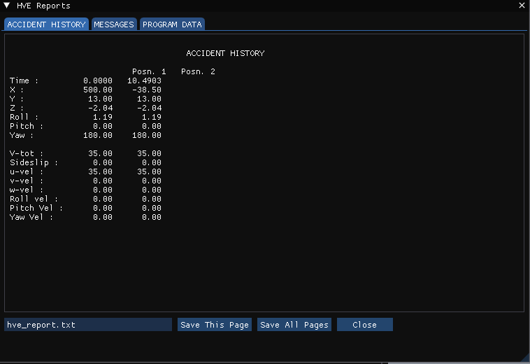
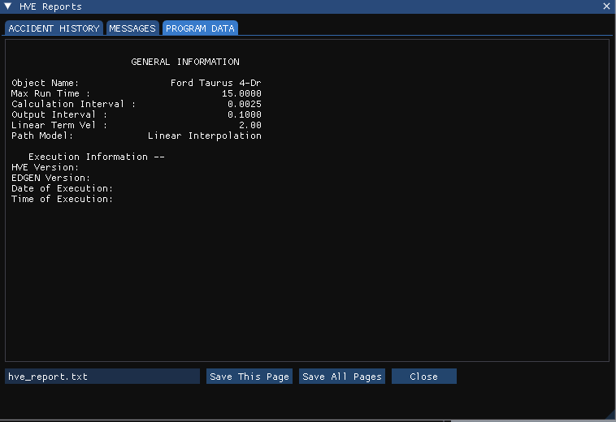
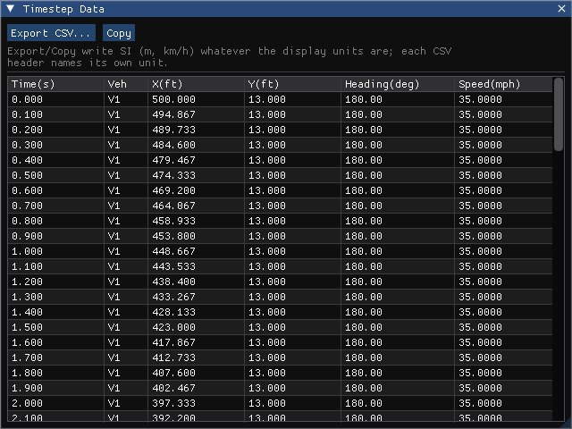

# Chapter 5 — EDGEN Tutorial

This tutorial illustrates a typical use of EDGEN: a time-distance study involving the visibility between several objects. The specific example involves a child exiting a school bus, walking around to the rear of the bus, then crossing the road in front of an oncoming vehicle. We'll view the sequence from several vantage points to address the issue of avoidability.

We will create three EDGEN events in this tutorial. The first event simply places the school bus. The second event moves the child out of and around the back of the bus. The third event moves the approaching vehicle.

Like all EDGEN events, the procedure involves the following basic steps:

- Create the human(s)
- Create the vehicle(s)
- Create the environment
- Execute the EDGEN event
- Review the EDGEN output reports

This basic procedure is described in detail in this tutorial.

> **NOTE:** It is assumed that HVE 2027 is up and running, and that the user is familiar with its basic features. The purpose of this tutorial is to illustrate those features while setting up and executing an EDGEN event.

This study involves both a human and vehicles, and it involves 3-dimensional motion.

!!! note "HVE 2027"
    This tutorial uses the case HVE's own EDGEN tutorial produces,
    **EdgenTutorialEDC.hve**, installed with HVE in its `supportFiles\case`
    folder. The vehicles in it come from HVE's tutorial vehicle database,
    which is not part of HVE 2027, so instead of building the case from an
    empty one you **open that case** and follow its inputs: each section
    says where the input is in HVE 2027 and what value the tutorial uses.
    All three events can be re-created in a new event to practise.

## Getting Started

As in other tutorials, before we get started, let's set the user options so we're all starting on the same page.

1. Choose **File › Open Case...** and open **EdgenTutorialEDC.hve**.
2. Choose **Tools › Preferences...** and set **Units** to **Imperial (ft/in, mph, lb, lbf)**, the units this tutorial uses.
3. On the **View** menu, make sure **Key Results** is shown.

EDGEN takes each vehicle's elevation, roll and pitch from its initial position (see the First Event); HVE's AutoPosition option is not used. We're now ready to proceed with the tutorial.

## Creating the Humans

The case contains the male child pedestrian. Choose the **Human** editor tab (F2): the **Occupants** panel lists *Male Child Pedestrian*, with **Location** *Pedestrian*, **Subject Type** male, a 12-year-old **Age Group** and the 50th **Weight Percentile** and **Height Percentile**.

> **NOTE:** To add such a human yourself, click **Add Occupant** in the Occupants panel and choose those values under **Identity** and **Anthropometry**.

## Creating the Vehicles

The case contains two vehicles: a yellow 1990 International Loadstar school bus (*International School Bus*) and a blue 1996–1999 Ford Taurus 4-Door (*Ford Taurus 4-Dr*). Choose the **Vehicle** editor tab (F3) to see them; click one in the **Vehicles** panel to make it current.

> **NOTE:** To build such a case yourself, click **Add...** in the Vehicles panel and choose vehicles from the loaded databases. HVE's *Tutorial.db* is not part of HVE 2027.

*Figure 5-1: The school bus in HVE 2027's Vehicle editor.*

### Editing the Vehicles

HVE's tutorial changes the vehicles' colours. In HVE 2027 a vehicle's colour is the **Color** field (red, green and blue values and a swatch) in the **Information** section of the Vehicles panel; in the opened case the bus is already yellow and the Taurus blue.

> **NOTE:** Color is the only vehicle attribute used by EDGEN.

## Creating the Environment

The case carries its environment, HVE's *4T2_Intersection.h3d* site. Choose the **Environment** editor tab (F4) to see it, and **Environment › Environment...** for its settings: the site *School Bus Stop* in Chicago, Illinois (latitude 41°53′ N, longitude 87°40′ W), on 5/15/97 at 1430, with the earth-fixed X axis at −80 degrees from true north (the **North** setting of the sun and sky, **Edit the sun and sky...**).

> **NOTE:** The latitude, longitude, date, time and angle from true north are used to position the sun in the scene. This is, of course, important because the sun is the primary light source for the scene.

## Saving the Case

Let's save the opened case as an HVE 2027 case file:

1. Choose **File › Save Case As...**.
2. Enter the file name *EdgenTutorial* and save. HVE 2027 saves `.hvc` files, or `.json` with **File › Save Case As JSON...**; it does not write `.hve`.

> **NOTE:** Saving the file occasionally is a highly recommended practice.

## Creating the Events

This EDGEN tutorial includes multiple events. The first event uses EDGEN to drive the school bus to the curb. The second event uses EDGEN to move the child out of the school bus, around the back of the bus, and into the oncoming traffic, a Ford Taurus. The third event uses EDGEN to move the oncoming Ford Taurus.

Choose the **Event** editor tab (F5). The three events are in the **Events** list of the Event Information panel: *EDGEN, School Bus*, *EDGEN, Child* and *EDGEN, Taurus*. The one shown in the list is the **active event**; the panel, the Event menu and **Run** all apply to it. Choose an event in the list to make it active.

### First Event: School Bus

Make *EDGEN, School Bus* the active event. To create such an event yourself: click **+** under **Events**, choose **EDGEN** as the **Method**, click **Add Vehicle** and add *International School Bus*, and name the event *School Bus*.

*Figure 5-2: The School Bus event in the Event Information panel.*

The bus's path has three positions. The first is its initial position and speed, in the panel's **Vehicle Initial Conditions (EDGEN)** section (or **Event › Position / Velocity...**):

1. X = −250 ft, Y = 25 ft, heading 0 degrees.
2. Speed 25 mph.

   > **NOTE:** EDGEN carries the elevation, roll and pitch of this first position along the whole path. In the opened case the bus's CG height comes from the HVE case.

The other two positions are waypoints, in **Event › Path Follower**, **Path** tab, with *V1 International School Bus* chosen in the **Vehicle** list:

1. Make sure **Use Path Follower** is ticked; the waypoint table can be edited only then. (EDGEN uses the waypoints either way; it does not use the rest of this dialog.)
2. The *Begin Braking* position of HVE's tutorial: X = −72 ft, Y = 25 ft, Yaw 0, Speed 25 mph.
3. The *Final/Rest* position: X = −20 ft, Y = 25 ft, Yaw 0, Speed 0 mph.

   > **NOTE:** The position names in HVE's Position/Velocity dialog are not relevant to EDGEN; only the order of the positions matters. The **#** column numbers the rows 2 to 8 (position 1 being the initial position). In the opened case the two waypoints sit in rows 3 and 8, the rows of HVE's Begin Braking and Final/Rest slots; rows whose **Use** is not ticked are skipped. When entering a path yourself, simply use the rows in order.

*Figure 5-3: The school bus's waypoints on the Path tab of Event › Path Follower, as imported (rows 3 and 8).*

The required positions and velocities have now been entered; however, this event lasts more than 5 seconds. In the **Simulation** panel (beside Event Information), **Duration (s)** is 15 in the opened case. For an event of your own, raise it from its default in the same place.

> **NOTE:** EDGEN is not a simulation program in that it does not use tire forces or other forces to calculate the object's motion. Therefore, Driver Controls, Damage Profiles and other event-related inputs are not used.

To execute the event:

1. Press **Run** on the playback bar under the viewport. The run status reads *EDGEN complete*.
2. Press **Play** to watch the bus come to rest at the curb.

> **NOTE:** While the event plays, you can watch the current position, velocity and acceleration in **Key Results**.

We have now completed the first event.

### Second Event: Child Pedestrian

Make *EDGEN, Child* the active event. In HVE this event selects the *Male Child Pedestrian* and no vehicle, and its eight positions are the child's path from the aisle of the bus, out onto the sidewalk, around the back of the bus and across the street.

!!! note "HVE 2027"
    The child is listed under *Humans in Event* in the Event Information
    panel, and his path is below him: one checkbox per position, and for each
    ticked one its X, Y, Z (+ down), yaw, pitch, roll, sideslip and speed.
    To re-create the event: add an EDGEN event with no vehicle, click
    **Add Human** and choose the child, tick the eight positions and enter
    Table 5-1. The path below is what the opened case contains.

The following explains how the path was worked out in HVE's tutorial.

Our goal is to have the child walk up the center aisle of the bus, step out onto the sidewalk, turn to his right, walk along the side of the bus, turn right again and run behind the bus out into the oncoming traffic lane. The first important observation of this sequence is that the human is at first moving relative to the vehicle, but at the end of the event the child is moving relative to the earth. It is important to know that EDGEN moves all objects relative to the earth. So, we need to think about how the vehicle moves in order to assign the human's position.

First, consider the vehicle's dimensions and its motion relative to the earth. By visual inspection, we can observe the exit door is about 1.5 feet ahead of the bus's CG. The rear of the bus is 262.5 inches (21.875 ft) behind the CG, and the bus is 96 inches wide.

According to our first EDGEN event, the bus started at X=-250 ft, Y=25 ft with a velocity of 25 mph. It continued at this pace until X=-72 ft. It then began braking until it reached its rest position (zero velocity) at X=-20 ft.

Let's assume the child begins the event 10 feet behind the exit door (remember, the door is 1.5 feet ahead of the CG). Therefore, the human's earth-fixed initial position is

$$X_{Human} = X_{Bus} + \Delta X_{Human\text{-}to\text{-}CG_{Bus}} = -250 + (-10 + 1.5) = -258.5 \text{ ft}$$

Since the child is walking down the center aisle of the bus, his earth-fixed Y coordinate is the same as the bus's, so

$$Y_{Human} = Y_{Bus} = 25 \text{ ft}$$

The child's CG is about 5 feet above the street, so Z = -5 ft, and his heading angle is the same as the bus's, 0 degrees.

Now, let's determine the human's next position, standing in front of the exit door. His earth-fixed X position when the bus began braking is 1.5 ft ahead of the bus's CG at this point, so

$$X_{Human} = X_{Bus} + \Delta X_{Human\text{-}to\text{-}CG_{Bus}} = -72 + 1.5 = -70.5 \text{ ft}$$

Since the child is walking down the center aisle of the bus, his earth-fixed Y position is still the same as that of the bus, 25 ft, and his elevation, Z, is still -5 ft.

When the bus has stopped, the human is still standing in front of the door, 1.5 ft ahead of the bus's CG at this point, so

$$X_{Human} = X_{Bus} + \Delta X_{Human\text{-}to\text{-}CG_{Bus}} = -20 + 1.5 = -18.5 \text{ ft}$$

and his Y and Z positions are also unchanged, 25 ft and -5 ft, respectively. However, let's have the child turning 90 degrees to his right during the time the bus is braking, so his heading angle is now

$$\Psi_{Human} = \Psi_{Bus} + \Delta\Psi_{Human} = 0 + 90 = 90 \text{ deg}$$

Next, the child exits the bus. His X coordinate does not change, so X=-18.5 ft. However, his Y coordinate and elevation change as he walks out the door and onto the sidewalk:

$$Y_{Human} = Y_{Bus} + \Delta Y_{Human\text{-}to\text{-}CG_{Bus}} = 25 + 6 = 31 \text{ ft}$$

After exiting, his elevation (by repeated adjustment until his feet sink into the sidewalk) is -3 ft.

His heading angle remains fixed at 90 degrees as he exits the bus.

Now that our child is outside the bus, we no longer need to consider relative motion between him and the bus, so our job is pretty simple.

Next, let's turn the child 90 degrees to walk on the sidewalk alongside the bus:

$$X_{Human} = X_{Human,\,Previous} + \Delta X_{Human} = -18.5 + (-3.5) = -22 \text{ ft}$$

$$Y_{Human} = Y_{Human,\,Previous} + \Delta Y_{Human} = 31 + 2 = 33 \text{ ft}$$

$$\Psi_{Human} = \Psi_{Human,\,Previous} + \Delta\Psi_{Human} = 90 + 90 = 180 \text{ deg}$$

The sidewalk is level, so Z remains fixed at -3 ft.

Now, the child simply walks alongside the bus, so Y, Z and heading angle do not change. Based on the bus's dimensions, the child walks back about 19 feet before he begins to turn to his right, so

$$X_{Human} = X_{Human,\,Previous} + \Delta X_{Human} = -22 + (-19) = -41 \text{ ft}$$

After reaching the rear of the bus, the child turns right and begins running behind the bus. After completing his turn, the child has also stepped off the curb onto the street, so

$$X_{Human} = X_{Human,\,Previous} + \Delta X_{Human} = -41 + (-3) = -44 \text{ ft}$$

$$Y_{Human} = Y_{Human,\,Previous} + \Delta Y_{Human} = 33 + (-4) = 29 \text{ ft}$$

$$Z_{Human} = Z_{Human,\,Previous} + \Delta Z_{Human} = -3 + 0.5 = -2.5 \text{ ft}$$

$$\Psi_{Human} = \Psi_{Human,\,Previous} + \Delta\Psi_{Human} = 180 + 90 = 270 \text{ deg}$$

Now the kid takes off across the street behind the bus. X and heading angle remain constant, but Y and Z change as he reaches the point of impact (Z changes slightly due to the road crown), so

$$Y_{Human} = Y_{Human,\,Previous} + \Delta Y_{Human} = 29 + (-15) = 14 \text{ ft}$$

$$Z_{Human} = Z_{Human,\,Previous} + \Delta Z_{Human} = -2.5 + (-0.5) = -3 \text{ ft}$$

The entire path is now defined. However, we have said nothing about velocities. Let's assume the child walks up the aisle of the bus while the bus is approaching the stop, before it begins to brake. The child moves from X=-258.5 ft to X=-70.5 ft during this phase. From our first event, this phase took 4.8545 seconds, so

$$V = \frac{\Delta S}{\Delta t} = \frac{\left|{-258.5 - (-70.5)}\right|}{4.8545} = 38.73 \text{ ft/sec} = 26.40 \text{ mph}$$

Next, as our child exits and walks alongside the bus, we'll assume a normal walking rate, say 4 mph. Then, we'll assume the child runs out from behind the bus at a speed of 10 mph.

The sequence described above requires eight positions, summarized in Table 5-1. These are the eight positions stored for the child in the opened case.

> **NOTE:** The positions and velocities used in this event were selected as reasonable values to illustrate the desired sequence. Thus, the positions and velocities described above are not intended to be precise.

**Table 5-1: Position and velocity entries for EDGEN Child Pedestrian event**

| Position | X (ft) | Y (ft) | Z (ft) | Yaw (deg) | Vtotal (mph) |
|---|---|---|---|---|---|
| Initial | -258.5 | 25.0 | -5.0 | 0.0 | 26.4 |
| Begin Perception | -70.5 | 25.0 | -5.0 | 0.0 | 26.4 |
| Begin Braking | -18.5 | 25.0 | -5.0 | 90.0 | 4.0 |
| Impact | -18.5 | 31.0 | -3.0 | 90.0 | 4.0 |
| Separation | -22.0 | 33.0 | -3.0 | 180.0 | 4.0 |
| Point-on-curve | -41.0 | 33.0 | -3.0 | 180.0 | 4.0 |
| End-of-rot'n | -44.0 | 29.0 | -2.5 | 270.0 | 10.0 |
| Final/Rest | -44.0 | 14.0 | -3.0 | 270.0 | 10.0 |

In the opened case the event's **Duration (s)** is 15 and its **Output Timestep (s)** 0.10 (Simulation panel).

We're now ready to execute our next event:

1. With *EDGEN, Child* active, press **Run**. The run status reads *EDGEN complete*, with a note that EDGEN drives only the main (pelvis) segment and the other segments ride along at their entered joint angles.

The child reaches his position at impact at t=13.7048 seconds; HVE 2027 reproduces the pelvis track HVE saved for this event.

*Figure 5-4: The child pedestrian (right edge) stepping out behind the school bus, with the Ford Taurus approaching.*

We have now completed the second event.

### Third Event: Ford Taurus

Make *EDGEN, Taurus* the active event. To create such an event yourself: click **+**, choose **EDGEN**, add *Ford Taurus 4-Dr* and name the event *Taurus*. Its two positions are in Table 5-2:

1. The **Initial** position and speed in **Vehicle Initial Conditions (EDGEN)**: X = 500 ft, Y = 13 ft, heading 180 degrees, speed 35 mph.
2. The **Final/Rest** position as a waypoint in **Event › Path Follower**, **Path** tab: X = −38.5 ft, Y = 13 ft, Yaw 180, Speed 35 mph.

**Table 5-2: Position and velocity entries for EDGEN Taurus event**

| Position | X (ft) | Y (ft) | Yaw (deg) | Vtotal (mph) |
|---|---|---|---|---|
| Initial | 500.0 | 13.0 | 180.0 | 35.0 |
| Final/Rest | -38.5 | 13.0 | 180.0 | 35.0 |

**Duration (s)** is 15 in the opened case.

We're now ready to execute our final event:

1. Press **Run**. The Taurus reaches its position at impact at t=10.4903 seconds (the Accident History's Posn. 2; HVE's printed tutorial gives 10.4922 seconds).

We have now completed all three events for our EDGEN Tutorial.

## Viewing Results

Now that we have produced our individual EDGEN events, let's take a detailed look at the results. In HVE 2027 there is no separate Playback Editor: each event's reports are on the **Output** menu while it is the active event, and its motion plays in the viewport.

EDGEN produces the following reports:

- **Messages** — A list of messages produced by the current run
- **Accident History** — A table of initial and final positions and velocities
- **Program Data** — A table containing program control information
- **Variable Output** — A table containing time-dependent simulation results
- **Trajectory Simulation** — A 3-D visualization of the event

We're also going to illustrate how several events are combined into a single, coherent sequence including multiple humans and vehicles. We'll create a playback sequence illustrating the entire sequence of events:

- First, the school bus will approach the intersection and come to a stop.
- As the bus slows, the child will walk up the center aisle of the bus. When the bus is stopped, the child will exit and walk around the back of the bus, out into oncoming traffic.
- Finally, the approaching Ford Taurus will move into the position where the child was struck. At the completion of these events, the cause of the accident will be obvious.

### Report Windows

The alpha-numeric reports of the active event are in one window: choose **Output › HVE Reports...**. It has a tab for each page EDGEN built — Accident History, Messages and Program Data — and shows the pages for the most recent run of the active event.

The pages are in HVE's units (feet, mph and so on) whatever the Preferences are set to.

#### Messages Report

EDGEN produces several messages, depending on the outcome of the run. For a complete list and explanation of these messages, refer to [Chapter 6](06-messages.md).

To view the Messages report produced by the *EDGEN, Taurus* event: make *EDGEN, Taurus* the active event, run it, choose **Output › HVE Reports...** and click the **MESSAGES** tab.

*Figure 5-5: Messages Report for EDGEN, Taurus.*

#### Accident History Report

The Accident History report displays the positions and velocities for the human or vehicle at each entered position (e.g., *Initial, Begin Perception*).

To view the Accident History report for an event: make it the active event, run it, choose **Output › HVE Reports...** and click the **ACCIDENT HISTORY** tab.

*Figure 5-6: Accident History Report for EDGEN, Taurus.*

> **NOTE:** The Accident History report is wider than the default size of the window. Resize the window or use the scroll bar to view the remainder of the report.

#### Program Data Report

The Program Data report displays the simulation controls (calculation time steps and termination conditions), including Program Name, Version, Object Name, Max Run Time, Calculation Interval, Output Interval, Linear Term Vel and Path Model.

To view it, click the **PROGRAM DATA** tab of the HVE Reports window.

*Figure 5-7: Program Data Report for EDGEN, Taurus.*

#### Variable Output Report

The Variable Output table displays the time-dependent results computed by EDGEN. In HVE 2027 the table of chosen channels is the **Key Results** panel, and **Output › Timestep Data Table...** lists every output step of each vehicle's position, heading and speed.

##### Variable Selection

The purpose of our EDGEN study is to evaluate the avoidability of the accident based on speeds and visibility. To document the path positions of the Taurus as a function of time, let's select only the position, velocity and acceleration:

1. With *EDGEN, Taurus* the active event and run, click **Select Variables...** in the Key Results panel. The **Select Output Variables** window is displayed.
2. Choose the Ford Taurus and its kinematics channels — X, Y, Z, roll, pitch, yaw, total velocity, sideslip, total, forward and lateral acceleration — and clear the others.

Key Results now shows those channels for the Ford Taurus; with **Follow playback time** ticked they follow the playback. **Export CSV...** writes them to a file, and **Output › Output Graph...** graphs them against time.

For the whole time history of the Taurus's position, heading and speed, choose **Output › Timestep Data Table...**.

*Figure 5-8: The Timestep Data window for EDGEN, Taurus.*

#### Trajectory Simulation Report

In HVE 2027 the trajectory simulation is the viewport itself: after an event has run, the playback bar under the viewport plays its motion.

> **NOTE:** As in HVE's Playback Editor, no calculations take place during playback.

1. Make *EDGEN, School Bus* the active event and run it.
2. Click **Play**. The simulation begins.
3. Click **Pause**. The simulation stops.
4. Click **<<** or **>>** to step back or forward one output step, or drag the time slider.
5. Click **|<**. The simulation returns to the start.

Repeat for the *EDGEN, Child* and *EDGEN, Taurus* events.

### Playback Window

Finally, let's combine the three events into one playback. In HVE 2027 this is a **playback sequence**: a list of solved events, each placed on one timeline with its own offset. To create it:

1. Click the **Playback (F6)** tab. The Playback Sequence panel is displayed.
2. Click **New** and enter the **Name** *Visibility Study*.
3. Click **Add All Events**. The three events are listed, each with **On**, **Start (s)**, **End (s)** and **Offset (s)** columns and its **Result**. An event that has not been run is marked *not solved*; **Run All Events** runs every event in the sequence.

#### Editing the Event Sequence

The *EDGEN, Child* event lasted 13.7048 seconds. However, the *EDGEN, Taurus* event lasts only 10.4903 seconds. As a result, if we combine these two events together, the Taurus will arrive too early.

To synchronize the events, edit the **Offset (s)** of the Taurus event. The adjustment is as follows:

$$T_{Delay} = T_{Event1} - T_{Event2} = 13.7048 - 10.4903 = 3.2145 \text{ seconds}$$

Enter `3.2145` in the Offset of *EDGEN, Taurus* (HVE's printed tutorial, with its 10.4922 s, uses 3.2126). Before its offset, the Taurus waits at its initial position; each event's objects hold their first position before the event starts and their last after it ends.

> **NOTE:** The child appears from behind the bus at about t=13.1 seconds (about 0.6 seconds before impact). It is clear the Taurus could not stop from a speed of 35 mph in time to avoid the child.

#### Setting the View

HVE's tutorial attaches the camera to the Ford Taurus so we can assess the driver's opportunity to observe and react to the child crossing the street. In HVE 2027:

1. Choose **Tools › Cameras...** and add a camera.
2. Under **Attachment**, set **View From** to the Ford Taurus (and **Look At** to the Ford Taurus, or leave it, to aim along the car).
3. Adjust the camera's mount position on the car — for example just outside the driver's door glass — in the same window.

Now, play the sequence and watch as the Taurus approaches the school bus. View › Scene Display › Scene Ghosts set to **None** shows the sequence as the Taurus driver would have seen it, without the outlines of other positions.

### Video

Our playback sequence shows us the sequence, but to share it a movie file is needed.

With the sequence active, choose **File › Record Animation...**, name the
output file, and press **Record**. The whole sequence is recorded through the
camera on the playback bar — here the driver's-eye camera — to an AVI video,
which **File › Play Video...** (or any media player) plays back.

!!! note "HVE 2027"
    Record Animation writes a Motion-JPEG AVI of the 3-D scene, with the
    [Results HUD](../../new-features/11-results-hud.md) boxes drawn in when
    **Burn in key results (Results HUD)** is ticked; panels and dialogs are
    not recorded. For a
    rendered movie, export the animated scene with **File › Export Scene for
    Blender › glTF Binary (.glb)** and render it in Blender, which imports the
    animation directly.

### Printing

HVE 2027 does not print. To keep a report page, click its tab in the HVE Reports window and click **Save This Page** (or **Save All Pages**), which writes plain text to the file named beside the buttons.

<!-- NAV -->

---

← Previous: [Chapter 4 — Calculation Method](04-calculation-method.md)  |  [Index](README.md)  |  Next: [Chapter 6 — Messages](06-messages.md) →

<!-- /NAV -->
