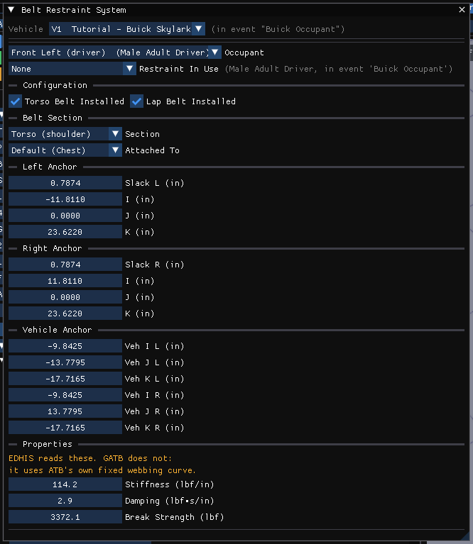
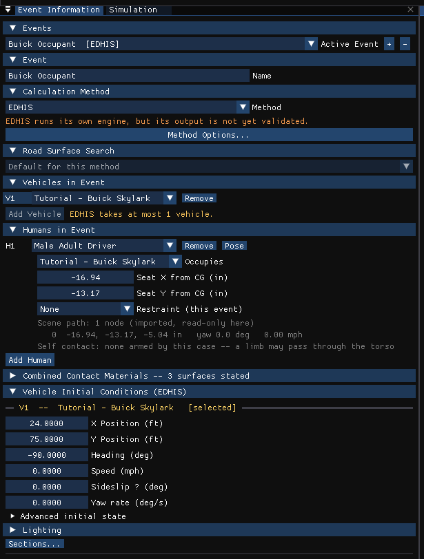

# Chapter 2 — EDHIS Program Input

This chapter defines the objects (humans, vehicles and environment) and the event set-up parameters (positions, damage profiles, driver controls, and so forth) used by the EDHIS analysis. The chapter is divided into the following sections:

- **Objects** — The number of humans and vehicles, and the specific human and vehicle parameters actually used by EDHIS.
- **Events** — The various options available for setting up and executing an EDHIS event.

!!! note "HVE 2027"
    Where the inputs live in HVE 2027, in one place:

    | Input | HVE 2027 |
    |---|---|
    | Human body (segments, joints, ellipsoids, injury tolerances) | **Human (F2)** editor › **Occupant › Human Information** (*Occupants* panel) and its *Body Segments…*, *Joint Properties…*, *Injury Tolerances…* buttons |
    | Contact surfaces | **Vehicle (F3)** › **Vehicle › Editors › Contact Surfaces** |
    | Belt installed, anchors, attachment segment, slack, webbing | **Vehicle › Editors › Belt Restraint** |
    | Airbag, per seat (installed, position, timing, reaction panel, bag geometry, gas, vent, column, membrane) | **Vehicle › Editors › Airbags** |
    | Which human, which vehicle, seat, restraint worn, pose, pedestrian velocity | **Event (F5)** › Event Information › *Humans in Event* (and its **Pose** button) |
    | Vehicle initial position and velocity | Event Information › *Vehicle Initial Conditions*, or **Event › Position / Velocity** |
    | Collision pulse | **Event › Collision Pulse** |
    | Combined contact materials | Event Information › *Combined Contact Materials* |
    | Calculation options | Event Information › *Calculation Method* › **Method Options…** |
    | Simulation controls | the **Simulation** panel |

## Objects Overview

The objects used by the EDHIS model are:

- **Humans** — One human, either an occupant or a pedestrian, may be studied by EDHIS.
- **Vehicles** — One vehicle may be studied by EDHIS.
- **Environment** — Like the *real* world, EDHIS has exactly one environment.

> **NOTE:** The environment is used in any HVE-compatible reconstruction or simulation model.

The following sections describe how these humans, vehicles and environment provide the required inputs to the EDHIS calculation model.

## Humans

EDHIS uses one human created using the Human Editor (see the [Human Editor pages](../../07-humans/Human.md)). In HVE, humans are selected from the Human Database by choosing the following attributes:

- **Location** — The user may choose from any available occupant position (i.e., *R/F*, *L/F*) or, alternatively, choose *Pedestrian*.

  > **NOTE:** If an occupant position is selected, HVE displays the human's motion relative to the vehicle; if Pedestrian is selected, its motion is relative to the earth.

- **Sex** — The user may choose *Male* or *Female*.
- **Age** — The user may choose *Adult* or from a list of child ages.
- **Weight Percentile** — The user may choose from a list of available percentiles.
- **Height Percentile** — The user may choose from a list of available percentiles.

!!! note "HVE 2027"
    HVE 2027 does not pick a human from a database: it **generates** the body with GEBOD, as HVE's own GEBOD Human Information dialog does. The *Occupants* panel offers **Subject Type** (Male, Female), **Age Group** (Child, Teen, Adult, Senior) and **Weight Percentile** and **Height Percentile** (5th, 25th, 50th, 75th, 95th). An adult or senior is generated from the two percentiles together; a child or teen is generated by age (a 6-year-old and a 12-year-old respectively). Changing any of the four regenerates the body, except for a human whose pose an event has imported; **Regenerate GEBOD Body** rebuilds it on demand. The GEBOD tables are built into HVE 2027, so no data file has to be found.

To add a human to the current case, perform the following steps:

1. Choose the **Human (F2)** editor and open **Occupant › Human Information**. The *Occupants* panel is displayed.
2. Click **Add Occupant**. A new human is added and its body generated with GEBOD.
3. Choose its **Location**: the seat it nominally occupies, or *Pedestrian*.

   > **NOTE:** In HVE 2027 the vehicle a human rides in, and where it sits, belong to the **event**: they are set in Event Information › *Humans in Event* (see [Event](#event) below).

4. Choose the **Subject Type**, **Age Group**, **Weight Percentile** and **Height Percentile**.
5. Edit the **Name**. The name does not affect calculations.

*Figure 2-1: The Occupants panel (Human editor, Occupant › Human Information).*

The following Human Parameter groups are used by EDHIS:

- Inertias
- Ellipsoids
- Joints
- Injury Tolerance

The EDHIS human is modeled by 3 mass segments (Head, Torso and Legs) connected by 2 ball-type joints (Neck and Hip). Refer to Chapter 4, Calculation Method, for important details describing how the EDHIS human model is derived.

The specific data in each of the above parameter groups that are actually used by EDHIS are defined in Tables 2-1 and 2-2.

> **NOTE:** For information about using the Human Editor to create and edit humans, refer to the HVE User's Manual, Human Editor section (see the [Humans](../../07-humans/README.md) section of the Dialog Reference). In HVE 2027 the segment data are edited in the *Occupants* panel's **Body Segments…** dialog — choose the segment from its *Segment* list (or click the body part in the 3-D view) and use the *Inertia*, *Ellipsoids* and *Joints* (joint locations) tabs — the joint properties in **Joint Properties…**, and the tolerances in **Injury Tolerances…**.

### Inertias

The Human Inertial Data used by EDHIS are shown in Table 2-1. EDHIS combines the pelvis, abdomen and chest masses into a single mass, named the Torso. The neck and head are combined into a single mass, named the Head, and the upper left and right legs are combined into a single mass, named the Legs. The parallel axis theorem is used to compute moments of inertia for the combined masses about the total resultant center of gravity for the combined segments.

### Ellipsoids

Ellipsoids are used for predicting contact forces between the human and vehicle. Penetration of an ellipsoid into a vehicle contact surface results in the calculation of force on the human.

The Human Ellipsoid Data used by EDHIS are shown in Table 2-1. HVE allows up to 3 ellipsoids per HVE segment; EDHIS allows up to 25 total ellipsoids. The user should consider the following issues related to differences between the HVE Human Model and the EDHIS human model:

- Because the HVE Upper and Lower Arm segments are ignored, any ellipsoids attached to these segments are also ignored.
- Because the lower legs and feet are ignored, any lower extremity ellipsoids (e.g., Knee, Shin or Foot) should be attached to the upper leg segments.
- HVE allows the ellipsoids' principal axes to be rotated relative to the segment axis system; EDHIS does not consider such rotations.

  > **NOTE:** If principal axes are rotated and you choose to show contact surfaces, you will not be looking at a true picture of the human-vehicle interaction. However, the forces will be correctly calculated according to the inputs being considered.

### Joints

Joints are used to connect together each of the 15 segments. Although the HVE Human has 14 joints, EDHIS defines only 2: the *Neck* and *Hip*. The Neck joint is C7-T1, located between the Chest and Neck segments. The Hip joint is the average of the Right Hip and Left Hip. These joints are located between the Pelvis and Upper Leg (Right and Left) segments.

The Human Joint Data used by EDHIS are shown in Table 2-1. Both joints are considered to be *ball-and-socket* joints having 3 degrees of freedom (roll, pitch and yaw).

**Table 2-1 — Human Inertial, Ellipsoid and Joint Parameters Used by EDHIS.** The following parameters are supplied to each of the 15 human segments and 14 joints.

| Parameter | Description |
|---|---|
| Weight | Weight of each segment |
| Roll, Pitch and Yaw Moments of Inertia | Rotational inertia of each segment about the segment-fixed i, j, k axes, respectively |
| Ellipsoid Name | Up to 30 characters, used to identify the ellipsoid |
| Ellipsoid Center i,j,k Coords | Coordinates of the center of the ellipsoid, defined relative to the segment principal axis system |
| Ellipsoid Semi-axis i,j,k Length | Half the ellipsoid length, defined in the ellipsoid principal axis system |
| Joint k Location | Distance from segment CG to joint along the segment-fixed k axis |
| Joint roll, pitch and yaw stop angles | Articulation roll, pitch and yaw angles at which joint stop properties are applied |
| Stop Elasticity, i, j, k axes | Elasticity of the joint stops for roll, pitch and yaw rotations. Applies to both (+) and (−) directions |
| Linear Elastic Coefficient | Elastic properties for the joint in the normal range of motion (i.e., between the joint stops) |
| Damping Constant | Damping properties for the joint |
| Maximum Joint Angles | Injury tolerance for joint rotations beyond the joint stops |

The Joints are assumed to be located at $i = j = 0.0$ ($k$, the vertical distance from the segment origin to the joint, is used to locate the joint). If $i$ or $j$ is non-zero, the human will not be visualized as it is used in the EDHIS model.

> **NOTE:** You can ensure that the joints are correctly located for EDHIS by selecting the Hip, Abdomen, Chest, Neck and Head segments (in HVE 2027, in the **Body Segments…** dialog's *Joints* tab) and setting i equal to zero for each joint. Although j is left with its original values, calculations are not affected as long as matching ellipsoids are placed on right and left legs.

### Injury Tolerance

Injury tolerances may help estimate the propensity for an injury during a crash. EDHIS compares the current levels of force and acceleration to these injury tolerances to produce the Injury Data Report (see Output).

The Human Injury Tolerance Data used by EDHIS are shown in Table 2-2. These values are based on reported tolerances [2, 4] for healthy humans. Although age and other factors can affect human injury tolerance, these values should be modified only with the greatest of care.

**Table 2-2 — Injury Tolerance Values for current human (see References 2 and 4).**

| Parameter | Description |
|---|---|
| HIC | Head Injury Criterion |
| Head Pitch Concussion | Injury tolerance for head angular acceleration about the pitch axis |
| Head Side Acceleration | Injury tolerance for head side acceleration |
| Chest Severity Index | Injury tolerance for chest |
| Chest Force | Injury tolerance for chest force |
| Chest Forward Acceleration | Injury tolerance for chest forward acceleration |
| Maximum Femur Load | Injury tolerance for femur load |
| Maximum Torso Belt Force (Left, Right) | Injury tolerance for torso belt force, entered separately for the left and right torso belt sections |
| Maximum Lap Belt Force (Left, Right) | Injury tolerance for lap belt force, entered separately for the left and right lap belt sections |

*(updated: in the current HVE human model the belt injury tolerances are entered as four separate values — left lap, left torso, right lap and right torso — rather than the single combined torso and lap values described in the original manual.)*

!!! note "HVE 2027"
    The tolerances are in the *Occupants* panel › **Injury Tolerances…**, labelled by the quantity each is compared against rather than by its traditional name: *HIC*, *Head Pitch Accel*, *Head Side Accel*, *Chest Vertical Accel* (the "Chest Severity Index"), *Chest Forward Accel*, *Chest Contact Force*, *Knee Contact Force* (the "Femur Load") and the four belt maxima. [Chapter 4](04-calculation-method.md#injury-measures) explains each.

## Vehicles

EDHIS uses one vehicle created using the Vehicle Editor. Vehicles are selected from the Vehicle Database by choosing the following attributes:

- **Type** — EDHIS supports the following vehicle types: *Passenger Car, Pickup, Van, Sport-Utility, Truck* and *Movable Barrier*.
- **Make** — EDHIS supports all available vehicle makes.
- **Model** — EDHIS supports all available vehicle models, within the limits defined by number of axles and drive axles; see below.
- **Year** — EDHIS supports all available vehicle years.
- **Body Style** — EDHIS supports all available vehicle body styles.

Each vehicle also has the following additional user-editable parameters:

- **Driver Location** — The driver location is used by EDHIS to determine if the airbag is a driver-type or a passenger-type airbag (a passenger-type airbag is modeled as a cylinder, whereas a driver-type airbag is modeled as a sphere).
- **Engine Location** — The engine location is not used by EDHIS.
- **Number of Axles** — EDHIS supports 2- and 3-axled vehicles.
- **Drive Axle(s)** — The drive axle attribute is not used by EDHIS.

To add a vehicle to the current case in HVE 2027:

1. Choose the **Vehicle (F3)** editor.
2. In the *Vehicles* panel, click **Add…**. The *Add Vehicle* dialog is displayed: search the loaded vehicle databases, or pick one of HVE's generic vehicles by type and class.
3. Add the vehicle. Its attributes, including *Driver Location*, are edited in the Vehicles panel's *Identity* and *Configuration* sections.

The following Vehicle Parameter groups are used by EDHIS:

- Move CG
- Contact Surfaces
- Belt Restraints
- Airbag Restraints

The specific data used in each of the above parameter groups are defined in Tables 2-3 through 2-5.

### Sprung Mass

Remember, EDHIS is not a *vehicle* simulator! The motion of the vehicle is determined by a user-supplied collision (acceleration) pulse, along with initial vehicle position and velocity. Therefore, the vehicle data required by EDHIS is limited to that which is required to establish interaction forces between the human and vehicle.

#### Inertias

Inertial parameters are not used by EDHIS. The vehicle's motion is supplied by assigning an initial velocity and a collision pulse (see Event Editor).

**Table 2-3 — Vehicle Parameters Used by EDHIS.**

| Parameter | Description |
|---|---|
| Move CG x,y,z | Relocates the CG in the vehicle-fixed x, y and z directions. This entry causes an automatic adjustment of all vehicle coordinate-related parameters (e.g., contact surface, belt anchor points) |
| Contact Surface Name | Up to 30 characters, used to identify the contact surface |
| Contact Surface Location | Interior or Exterior; provides the default status that determines whether a contact surface is allowed or ignored during force calculations (see also Event Set-up Parameters, Contacts) |
| Contact Surface x,y,z corner coordinates | Vehicle-fixed x,y,z coordinates for three consecutive corners of the current contact surface, supplied in a counter-clockwise order. The positive side of the surface is specified by the right-hand rule |
| Contact Surface Linear Stiffness | Linear stiffness of the ellipsoid vs contact surface pair |
| Contact Surface Quadratic Stiffness | Second-order stiffness of the ellipsoid vs contact surface pair |
| Contact Surface Cubic Stiffness | Third-order stiffness of the ellipsoid vs contact surface pair |
| Contact Surface Damping Constant | Velocity-dependent damping properties between the ellipsoid and contact surface |
| Contact Surface Maximum Penetration | Determines if the ellipsoid is approaching the surface from the back side (see Corner Coordinates, above). If the ellipsoid surface is initially behind the contact surface and the distance is greater than this value, it is assumed the ellipsoid is not contacting the surface and no force calculations are performed |
| Contact Surface Maximum Force | The force is not allowed to exceed this value. Once it is reached the surface is saturated, and when the penetration begins to reverse the force falls along the unloading slope rather than back down the loading curve, leaving a permanent deformation. Leave this and the unloading slope unentered for a fully elastic surface |
| Contact Surface Edge Constant | Determines the fraction of contact force if a portion of the ellipsoid lies outside the boundary of the contact plane |
| Contact Surface Unloading Slope | The linear elastic property during unloading |

#### Move CG

Move CG is not directly used by EDHIS. Its current value does not show up in the results. However, the Move CG fields may be used to quickly move the vehicle's center of gravity; the x,y,z coordinates for the contact surfaces, belt anchor points and airbag location are updated to reflect the new location.

!!! note "HVE 2027"
    **Event › Move CG** is offered only for EDSMAC and EDSMAC4 events in HVE 2027.

#### Geometry File

The geometry file plays no role in the EDHIS calculations. However, there are some smart things that may be done for occupant simulation. Remembering that an occupant is inside the vehicle, and may be difficult to see, the following two suggestions will help greatly:

- Choose NoBody.h3d as the geometry file. As its name implies, NoBody.h3d is a null geometry file (it has all the required data structures, but no surface polygons), or
- Edit the vehicle's geometry file and remove the roof and roof supports.

  > **NOTE:** Remember to save the file with a new name, such as PCFordTaurus4DrSNoRoof.xxx, to avoid losing the original geometry file!

!!! tip "New in HVE 2027"
    **View › Scene Display › Humans Through Bodywork** draws the occupant through the vehicle body, so a cut-down geometry file is not needed just to see inside. The geometry file is chosen in **Vehicle › Editors › Vehicle Mesh**.

#### Contact Surfaces

Vehicle contact surfaces are the surfaces that interact with human ellipsoids to produce forces on the human. Up to 25 contact surfaces are allowed by EDHIS, the properties for which are shown in Table 2-3.

!!! note "HVE 2027"
    Contact surfaces are edited in **Vehicle › Editors › Contact Surfaces**. A surface is entered either by centre, size and yaw/pitch/roll angles or, with *Edit corner points instead*, by its three corner points; the dialog shows the surface normal and has a **Flip** button to reverse it. The panels are drawn in the 3-D view, with an arrow on each normal, while the dialog is open. Its *Material Properties* section holds the surface's own force-deflection data, and *Side* (Interior/Exterior) is stored with the surface.

    The dialog also offers **Derive from Mesh**, **Seed Standard Interior**, a **Pedestrian preset**, interior templates and **Save/Load Interior…** for building a set of panels quickly.

*Figure 2-2: Contact Surfaces dialog in HVE 2027, with the Buick Skylark's Seat Bottom, Seat Back and Head Rest panels from the EDHIS tutorial case.*

#### Belt Restraints

Belt restraints are an extremely important aspect of EDHIS's functionality. The ability to study the effect of restraint system usage (or non-usage) is an important one.

A belt restraint system may be supplied for up to nine seat positions. Although HVE assigns default positions for each belt system, these locations are arbitrary and may be replaced by user-entered information. Belt Parameters used by EDHIS are shown in Table 2-4.

> **NOTE:** At this point, you are saying the vehicle has a belt installed at a specific location. Whether or not the belt is used is event-dependent! See Event Set-up, Restraints, for more information.

!!! note "HVE 2027"
    Belts are edited in **Vehicle › Editors › Belt Restraint** (the *Belt Restraint System* dialog). Its **Occupant** list names the human each entry belongs to; for that human the dialog has *Torso Belt Installed* and *Lap Belt Installed*, a **Section** selector (Torso or Lap — each section has its own anchors, slack and webbing), the **Left Anchor** and **Right Anchor** (slack and the attachment point on the body, i/j/k), the **Vehicle Anchor** (the other end of the webbing, about the vehicle CG), and the webbing **Properties**: *Stiffness*, *Damping* and *Break Strength*. Each section's **Attached To** chooses the body segment it is fastened to; *Default* is the chest for the torso section and the pelvis for the lap section. EDHIS accepts the pelvis, abdomen or chest for a torso belt and the pelvis or abdomen for a lap belt, and refuses the run otherwise.

    The dialog also carries **Restraint In Use** for the active event (see [Restraints](#restraints)).

    The webbing is sent to EDHIS with *Stiffness* as its linear stretch rate; the quadratic and cubic rates are sent as zero and have no control. The unloading slope has no control either: a case imported from HVE keeps its stored value, otherwise the webbing unloads elastically.

!!! note "HVE 2027"
    **The webbing force law reaches EDHIS and not GATB.** GATB writes ATB its own fixed webbing stress/strain curve, as HVE's GATB does, so *Stiffness*, *Damping* and *Break Strength* change an EDHIS run and leave a GATB run unchanged. The dialog says so.

*Figure 2-2a: Belt Restraint System dialog in HVE 2027 (EDHIS tutorial case, Buick Skylark driver).*

**Table 2-4 — Vehicle Belt Restraint System Parameters used by EDHIS.**

| Parameter | Description |
|---|---|
| Seat Position | Seat position within vehicle (R/F, L/F, etc.) |
| Belt Section | Torso or Lap |
| Belt Anchor Point x,y,z Coords | Vehicle-fixed attachment point for the one end of the belt (the other end is attached to a human segment) |
| Belt Linear Stretch Rate | Linear stretch rate of the belt material |
| Belt Quadratic Stretch Rate | Second-order stretch rate of the belt material |
| Belt Cubic Stretch Rate | Third-order stretch rate of the belt material |
| Belt Damping Constant | Velocity-dependent contribution |
| Belt Breaking Strength | Maximum strength of the belt material, acting as a limit on the tension. Once reached, the tension is held at this value; when the belt then begins to shorten it unloads along the entered unloading slope, leaving it permanently stretched. *(updated: belt rupture is not modelled — compare the belt tension in the Variable Output against this value to judge whether a belt would have failed)* |
| Belt Unloading Slope | Linear elastic property during unloading (should be greater than the loading rate) |

#### Airbag Restraints

Like belt restraints, airbag restraints are also an extremely important aspect of EDHIS's functionality.

An airbag restraint system may be supplied for up to nine seat positions. Like belt restraints, default positions for each airbag may be replaced by user-entered information. Airbag Parameters used by EDHIS are shown in Table 2-5.

> **NOTE:** At this point, you are saying the vehicle has an airbag installed at a specific location. Whether or not the airbag deploys is event-dependent! See Event Set-up, Restraints, for more information.

!!! note "HVE 2027"
    The whole bag is edited in one dialog, **Vehicle › Editors › Airbags** (also **Event › Restraints › Airbags**), one bag per **Seat**, as HVE stores it: **Device Installed**; the **Position** (X, Y, Z from the vehicle CG — the bag position EDHIS uses); **Begin Fill Time** (default **0.001 s**) and **Fill Duration** (default **0.05 s**, limited to HVE's own range of 0.0001–0.20 s); the head/chest/arm **Contact Segments**; the **Reaction Panel** (the contact surface the bag deploys from — HVE's *Backside Contact Surface*) and up to three confining panels; the bag geometry (*Full Inflated Volume*, *Initial Radius*, *Passenger Bag Length*), gas (*Initial Pressure*, *Gas Density*, *Mass Flow Rate*, *Specific Heat Ratio*), vent (*Discharge Coef*, *Vent Area*, *Pressure Open Vent*), steering column (*Column Angle*, *Col. Load*, *Max Col. Disp*), *Max Penetration*, *Force Conv. Criterion* and the membrane's force-deflection law. The dialog says which of the seat's fields reach which engine; Position and Fill Duration are read by EDHIS.

    The bag deploys only in an event where the occupant at that seat has the restraint **Airbag + Belt** (see [Restraints](#restraints)); the dialog says so when it does not, and a run with such an occupant at a seat with no bag installed is refused.

**Table 2-5 — Vehicle Airbag Restraint System Parameters used by EDHIS.**

| Parameter | Description |
|---|---|
| Seat Position for current airbag | Seat position within vehicle (R/F, L/F, etc.) |
| Airbag Center x,y,z Coords | Vehicle-fixed x,y,z coordinates of the airbag |
| Initial Bag Radius | Initial radius of the airbag |
| Passenger Bag Length | If a passenger seat position (i.e., no steering column), the airbag length |
| Initial Bag Pressure | Initial pressure inside the airbag |
| Bag Membrane Thickness | Thickness of the airbag material |
| Bag Full Inflation Volume | Volume of the airbag at full inflation |
| Bag Vent Discharge Coef | Thermodynamic discharge coefficient of vent |
| Bag Discharge Vent Area | Area of the vent |
| Bag Vent Opening Pressure | Pressure required to open the vent |
| Bag Penetration For Force | Depth of penetration into the airbag over which the bag force is faded in. At shallower depths the force is reduced in proportion to the depth, reaching its full value at this penetration |
| Force Convergence Criterion | Allowable difference between force on airbag and force on human |
| Bag Elastic Modulus | Elastic modulus of the airbag membrane during force application |
| Bag Elastic Modulus on Rebound | Elastic modulus of the airbag during unloading |
| Bag Elastic Modulus When Bottomed Out | Elastic modulus of airbag at maximum penetration |
| Gas Density | Density of the fluid filling the airbag |
| Max Column Collapse Dist | Maximum column stroke before it bottoms out |
| Column Collapse Load | Force required to initiate column collapse |
| Column Angle | Pitch angle of the steering column |
| Backside Contact Surface | The name of the contact surface supporting the airbag (no force can exist between the human and airbag unless the airbag is supported on a contact surface that provides a reaction force) |

### Unsprung Mass

Unsprung Mass parameters (Wheel Location, Tire, Suspension and Brake) are not used by EDHIS.

> **NOTE:** Wheel location and tire size are used to visualize the vehicle, but play no role in the simulation's calculations.

### Exterior

The Vehicle Exterior Data (Exterior Dimensions, Stiffness) are not used by EDHIS.

### Steering System Data

Steering System Data are not used by EDHIS.

### Brake System Data

Brake System Data are not used by EDHIS.

### Drivetrain Data

Drivetrain Data are not used by EDHIS.

## Environment

EDHIS uses the environment created by the Environment Editor. The environment is created by defining the following groups of attributes:

- Visual Data
- Physical Data

### Visual Data

The following visual parameters may be edited:

- **Environment Location** — A database containing the name (City/State/Country), Latitude and Longitude and GMT for the selected location.
- **Time and Date** — The local standard time and date for the event.
- **Angle of X Axis** — The angle of the earth-fixed X axis relative to true north.

The visual data are not used by the event; they are provided for studies related to visibility at the time of an event (e.g., avoidability of an accident).

> **NOTE:** The visual data (Location, Time, Date and Angle of earth-fixed X axis) affect the lighting of the event! Depending on your view (Camera Position) the scene may be shaded and difficult to see. If the time is after sundown, the view will be dark.

In HVE 2027 the environment is edited in the **Environment (F4)** editor with **Environment › Environment…**. A case always has exactly one environment, so there is nothing to add:

1. Choose the **Environment (F4)** editor and open **Environment › Environment…**.
2. In the *Location* section, enter the site name, *Date*, *Time*, *Latitude* and *Longitude* (or paste a coordinate or map link, or search an address).
3. In the *Terrain* section, load the scene geometry (DXF, `.h3d`, `.iv`, OBJ or glTF).
4. In the *Physical* section, edit the gravity constant and atmosphere.

> **NOTE:** The bearing of the earth-fixed X axis from true north (HVE's *Angle of X Axis*) is the *North* setting of the sky in **View › Shader Editor**.

*Figure 2-3: The Environment dialog in HVE 2027.*

### Physical Data

The Physical Data groups are:

- Wind Speed and Direction
- Atmospheric Temperature and Pressure
- Gravity Constant
- 3-D Surface Geometry

The specific physical environment data used by EDHIS are described below.

#### Angle Of X Axis

The angle of the X axis is used to position the earth-fixed coordinate system on the surface of the earth.

> **NOTE:** The angle is specified relative to true north. If you are using a compass to determine direction at the scene of an accident, you should provide a correction factor before entering this angle.

> **NOTE:** The angle of the X axis affects how you visualize an EDHIS event, but does not affect any calculations.

#### Wind Speed and Direction

Wind Speed and Direction are not used by EDHIS.

#### Atmospheric Temperature and Pressure

Atmospheric Temperature and Pressure are not used by EDHIS.

#### Gravity Constant

The gravity constant converts mass to force. An object's mass and rotational inertias are properties that are the same throughout the universe; however the weight of an object is dependent on the local gravitational constant.

#### 3-D Surface Geometry

The 3-D Surface Geometry is not used by EDHIS.

> **NOTE:** This means that a pedestrian will fall through the surface of the earth if you try to leave him/her standing for more than an instant! To avoid this problem, start your pedestrian simulation just before initial impact. Again, because EDHIS simulates only forces between the human and a vehicle, you'll have to end your pedestrian simulation when the human begins to interact with the ground surface.

## Event

EDHIS uses the Event Editor to create, set up and execute an event. Each of these topics is described below.

### Creating An EDHIS Event

An EDHIS event is created in the Event Information panel of the **Event (F5)** editor.

To create an EDHIS event in HVE 2027:

1. Choose the **Event (F5)** editor. The Event Information panel is displayed (**Event › Event Information** opens it if it is closed).
2. Click **+** beside *Active Event* to add an event.
3. Under *Event*, enter a **Name**. The name does not affect calculations.
4. Under *Calculation Method*, choose **EDHIS** from the *Method* list. **Method Options…** opens the EDHIS calculation options (see [EDHIS Calculation Options](#edhis-calculation-options)).
5. Under *Vehicles in Event*, choose one vehicle. EDHIS takes at most one, and the panel says so.
6. Under *Humans in Event*, click **Add Human** and choose one human.

   > **NOTE:** If a method cannot run with the objects chosen, the panel says why beside the list (for example, a vehicle count the method does not accept).

### Setting Up an EDHIS Event

EDHIS uses the following *event set-up* options:

- Position/Velocity
- Collision Pulse
- Contacts
- Restraints

The specific Event Set-up data used by EDHIS are defined in Table 2-6.

!!! note "HVE 2027"
    In HVE 2027 these are set as follows:

    - **Vehicle position and velocity** — Event Information › *Vehicle Initial Conditions (EDHIS)* (X, Y, heading, speed, sideslip and yaw rate, with the rest under *Advanced initial state*), or **Event › Position / Velocity**.
    - **Human position** — Event Information › *Humans in Event*: **Occupies** (the vehicle, or *Pedestrian (no vehicle)*) and the seat X and Y. For an occupant they are measured from the vehicle CG; for an EDHIS pedestrian they are scene X and Y.
    - **Human orientation and pedestrian velocity** — the **Pose** button beside the human (the *Body Pose* dialog).
    - **Restraint worn** — **Restraint (this event)** beside the human.
    - **Collision pulse** — **Event › Collision Pulse**.
    - **Contacts** — **Event › Contacts...**; see [Contacts](#contacts).

    **Driver Controls**, **Damage Profiles**, **Payload**, **Wheels** and **Accelerometers** on the Event menu are greyed for an EDHIS event. **Contacts** and **Restraints** are available; Restraints opens the vehicle's belt and airbag restraints.

*Figure 2-4: Event Information panel set up for an EDHIS occupant event (EDHIS tutorial, "Buick Occupant").*

#### Position/Velocity

Like all simulations, EDHIS requires initial positions and velocities to be supplied by the user.

The vehicle is positioned relative to the earth-fixed coordinate system by supplying the X,Y,Z coordinates of its CG, and roll ($\Phi$), pitch ($\Theta$) and yaw ($\Psi$) angles about vehicle x, y and z axes, respectively. The vehicle velocities are supplied in the form of a total velocity, sideslip angle and vertical velocity.

> **NOTE:** The vehicle-fixed u (forward) and v (side) velocity components are calculated using the total velocity and sideslip angle.

Human positions and velocities are assigned differently, depending on whether the human is an occupant or a pedestrian: Occupant positions and velocities are assigned relative to the vehicle-fixed coordinate system, while pedestrian positions and velocities are assigned relative to the earth-fixed coordinate system.

> **NOTE:** The same is true for output reports: All the kinematic data displayed in Variable Output is reported relative to the vehicle for occupants and the earth for pedestrians.

**Table 2-6 — Event Set-up Parameters used by EDHIS.**

| Parameter | Description |
|---|---|
| Vehicle Initial Position | The earth-fixed X,Y,Z coordinates and the roll, pitch and yaw orientations of the vehicle at the start of the run |
| Vehicle Initial Velocity | The forward, lateral and vertical linear velocities, and the roll, pitch and yaw angular velocities of the vehicle at the start of the run |
| Human Initial Position | The x,y,z coordinates and roll, pitch, yaw angles of the human at the start of the simulation |
| Human Initial Velocity | The forward, lateral and vertical linear velocities, and the roll, pitch and yaw angular velocities of the human at the start of the run |
| Vehicle Collision Pulse | Time-dependent table of the vehicle forward, lateral and vertical components of linear acceleration, and the roll, pitch and yaw angular accelerations |
| Contacts | A table of allowable interactions between human ellipsoids and vehicle contact surfaces |
| Belt Restraints In-Use Switch | Determines whether the selected belt restraint system (Torso or Lap) is in use |
| Segment Attachment | The name of the segment to which the belt ends are attached |
| Attachment Coordinates | The segment-fixed i,j,k coordinates for the belt attachment point |
| Belt Slack | Initial slack in the belt |
| Airbag Restraint In-Use Switch | Determines whether the airbag restraint system is in use |
| Airbag Begin Fill | Simulation time at which the airbag begins to fill |
| Fill Duration | Duration of filling before the gas shuts off |

The position of a human is defined by the center of gravity of its pelvis segment (this is called the *main segment*). Thus, the positions and velocities are actually those assigned for the pelvis. However, human positions may be further defined for each additional segment (i.e., *Head, Left Upper Leg*, and so forth) by $\Psi$, $\Theta$, $\Phi$ articulations (supplied in that order) at the joints. Angular velocities may be supplied as well.

EDHIS is a 3-mass, 2-joint model. Articulation angular positions and velocities may be entered by clicking on the neck segment (to set the initial conditions for the C7-T1, or Neck, joint), and by clicking on the Right and Left Upper Leg segments (to set the initial conditions for the Hip joint). These joints are modeled by EDHIS and their motion will be affected by subsequent human-vehicle interaction. Any of the other segment positions may be supplied as well (for example, the upper arms may be articulated so the human appears to be grasping the steering wheel). However, these joints will remain rigid during the simulation.

!!! note "HVE 2027"
    **Human position.** The pelvis X, Y and Z (SAE: + is down) are entered in Event Information › *Humans in Event*; a human can also be dragged across the ground in the 3-D view. HVE 2027 has no control for the vehicle's initial elevation (Z) for an EDHIS event: a case opened from HVE keeps the value it stores. The vehicle's roll, pitch, vertical velocity and angular rates are under *Advanced initial state*.

    **Human orientation (pose).** Click **Pose** beside the human. The *Body Pose* dialog edits **this event's** pose: tick *Pose this body*, then enter roll, pitch and yaw for each of the 15 segments, each relative to its parent segment. *Reset to default posture* returns to the posture an un-posed body is drawn and solved in (a seated occupant's upper legs pitched 90° forward; a pedestrian standing). With *Pose this body* off, the angles reach neither the 3-D view nor the engine.

!!! note "HVE 2027"
    **Restraint type and pose are per event (since v3.0.132).** HVE stores them on the event, and so does HVE 2027: the same occupant can be belted in one event and unbelted in the next, and posed differently in each. A case saved by an earlier HVE 2027, which kept one restraint and one pose per human, is given that value in every event that holds the human.

!!! note "HVE 2027"
    **A pedestrian's initial velocity reaches EDHIS.** The *Body Pose* dialog's *Initial velocity (segment frame, u/v/w)* is the human's own velocity: for an occupant it is relative to the vehicle and normally zero; for a pedestrian it is the walking speed, in the body's own frame (EDHIS rotates it by the segment orientation). The EDHIS tutorial's pedestrian, for example, is stored at 4.0 mph along her body x with a 90° yaw — crossing the road. EDHIS and GATB read the main segment's (pelvis's) velocity only; a non-zero velocity imported on any other segment is kept and reported as unused.

#### Driver Controls

The Driver Controls Data are not used by EDHIS. (In HVE 2027, **Event › Driver Controls** is greyed for an EDHIS event.)

#### Damage Profile

The Damage Profile Data are not used by EDHIS.

#### Payload

The Payload Data are not used by EDHIS.

#### Collision Pulse

The collision pulse provides the vehicle acceleration vs time history for the event. The data are provided in the form of a table. The current value of forward, side and vertical linear accelerations, and roll, pitch and yaw angular accelerations is obtained from this table using linear interpolation. Once obtained, the accelerations are integrated during each time step to determine vehicle velocity and position.

> **NOTE:** This approach, used in some form by all occupant and pedestrian impact simulation models, removes the need to provide a robust vehicle dynamics model.

> **NOTE:** HVE allows you to supply a collision pulse directly from a previously run EDSMAC4 event (or any event producing a collision pulse), as well as from a directory of user-saved collision pulses. See References 5 and 6 for additional information.

!!! note "HVE 2027"
    **Event › Collision Pulse** edits the pulse of one vehicle in the active event (choose it in the *Vehicle* list at the top). It offers:

    - **Source** — pick another event of the case that runs the same vehicle and click **Take pulse from this event**. The forward and lateral acceleration come from that event's stored run and the yaw acceleration from differentiating its yaw rate; vertical, roll and pitch are left at zero, because the stored run holds none of them. The source event has to have been run.
    - **Pulse type** — EDHIS reads an **Acceleration** table only and refuses any other type by name; the dialog warns if another type is chosen. (*Position* and *Velocity* are for GATB; *Impulse* for SIMON.)
    - **Start time** and **Threshold (g)**, and **Scale factors** for each of the six columns (HVE's in-use factors). The threshold reaches no engine, in HVE or in HVE 2027.
    - **The table** — linear acceleration in g and angular acceleration in deg/s², with **Add row**, **Import file…** (seven numbers a line: time, x, y, z, roll, pitch, yaw) and **Export file…**, and a plot of the total acceleration.
    - **Clear pulse.**

    With no pulse stated the run still completes; the occupant then responds to the vehicle's own prescribed motion only, nothing is substituted, and the run status says so.

*Figure 2-4a: Collision Pulse dialog for the Buick in the EDHIS tutorial, taken from the EDSMAC4 event "Buick vs Ford".*

> **NOTE:** Because of the significant difference in the mass of a human compared to a vehicle, a collision pulse is not normally required for a pedestrian impact simulation. (Unfortunately, the vehicle does not slow down very much during impact.)

#### Contacts

The contacts dialog allows the user to selectively remove specific human ellipsoid vs vehicle contact surface interactions from consideration by the event. This practice is useful because every interaction requires computational overhead. Removing unnecessary calculations reduces calculation time.

By default, the Contacts dialog assumes interaction between every human ellipsoid and vehicle contact surface. When an ellipsoid name is selected from the ellipsoids listbox, all the vehicle contact surface names will be highlighted in the Contacts listbox. Click on any highlighted contact surface to remove it from consideration.

> **NOTE:** Actually, EDHIS does some pre-screening: If the current human is an occupant, only interior contact surfaces will be highlighted; if the current human is a pedestrian, only exterior surfaces will be highlighted.

!!! note "HVE 2027"
    **Event › Contacts...** (Ctrl+T) opens the **Occupant Contacts** dialog for an EDHIS event. It names the occupant and the vehicle, and shows a grid with one row per human segment (one per ellipsoid where a segment has more than one) and one column per vehicle contact surface. A ticked box is an armed pair; un-tick it to remove that pair from the analysis. Segments EDHIS does not test against the vehicle (it uses the pelvis, abdomen, chest, neck, head and upper legs) are dimmed: a pair on them is stored and has no effect.

    - A case opened from an HVE `.hve` file carries **HVE's own list** of armed pairs for the event, and the grid shows it. A list that states the same pair twice (the EDHIS tutorial states each of its pairs twice) is kept as stated; un-ticking removes every entry for the pair.
    - A case built in HVE 2027 has **no stored list**. The dialog then says so, and the grid shows the default the run generates: every ellipsoid of the pelvis, abdomen, chest, neck, head and upper legs against every contact surface, with no interior/exterior pre-screening (so give a pedestrian's vehicle only the exterior surfaces you want struck, and an occupant's vehicle only interior ones). The first click stores that default with the click applied.
    - **Arm All** stores every ellipsoid of every segment against every surface (HVE's starting selection); **Pelvis Only** stores just the pelvis against each surface; **Use Run-Time Default** forgets the stored list.
    - The last armed pair cannot be removed: an empty list means "use the default", which would arm everything again, and with nothing armed EDHIS stops.
    - EDHIS takes each surface's contact material from the **pelvis** pair against that surface, and stops (error -5436) when one is not armed. The dialog warns, naming the first such surface.
    - An un-ticked box is handed to EDHIS as an explicitly un-armed pair, which is how EDHIS removes one from the analysis (a pair simply left off its list would still be tested).
    - If more than 250 pairs are armed, only the first 250 reach the engine; the dialog and the run status say so.
    - Contact blocks an imported case states against a vehicle the event does not select are listed read-only.

    An ellipsoid index other than the segment's first is accepted on a vehicle-contact pair. Within the segment's range it does not change the EDHIS solution (only which output channel the contact is reported under); beyond the segment's own ellipsoid count the pair's contact channel is lost, and the run status reports it.

#### Combined Contact Materials

!!! note "HVE 2027"
    The per-surface combined material — the stiffness, damping, friction, maximum force and deflection, unloading slope, maximum penetration and edge constant that EDHIS actually uses for the occupant against each surface — is edited in Event Information › **Combined Contact Materials** (it appears for EDHIS and GATB events). A case imported from HVE states these per surface. A surface with no combined material stated uses the surface's **own** material from the Contact Surfaces dialog with an edge constant of 0.5, which can be far stiffer than the combined value (on the EDHIS tutorial's seat, about 19 times). A *Max Penetration* of 0 is replaced by 0.1016 m (4 in), since 0 would allow no penetration at all; the *Edge Constant* is limited to HVE's 0–1 range.

#### Restraints

The Restraints dialog determines if a belt or airbag restraint system is in use for the current event.

!!! note "HVE 2027"
    **Event › Restraints** opens the vehicle's Airbags and Belt Restraint dialogs (the same as **Vehicle › Editors › Airbags** and **Vehicle › Editors › Belt Restraint**). What the occupant wears in the event is one choice, **Restraint (this event)**, beside the human in Event Information › *Humans in Event* — the same value appears as *Restraint In Use* in **Vehicle › Editors › Belt Restraint** for the active event:

    | Restraint | Torso belt | Lap belt | Airbag |
    |---|---|---|---|
    | None | — | — | — |
    | Lap Belt | — | if installed | — |
    | 3-Point Belt | if installed | if installed | — |
    | Airbag + Belt | if installed | if installed | deploys |

    A pedestrian wears nothing and is not offered the choice. The attachment segment, attachment coordinates and slack are part of the belt in **Vehicle › Editors › Belt Restraint**; Begin Fill Time and Fill Duration are part of the airbag in **Vehicle › Editors › Airbags** (defaults 0.001 s and 0.05 s, HVE's own).

> **NOTE:** If the current vehicle does not have a restraint system installed at the position specified for the current human, no restraints will be available for selection. If necessary, use the Vehicle Editor to install a restraint system at the desired seat position.

For belt restraint systems, Torso and Lap belt sections may be supplied individually. The following in-use parameters are required for each belt section:

- **Attached To** — The name of the human segment (Pelvis, Abdomen, Chest...) to which the belt is attached.
- **Attachment Coordinates** — The segment-fixed coordinates of the anchor point for the left and right belt sections.

  > **NOTE:** EDHIS combines the Pelvis, Abdomen and Chest into a single mass, called the Torso. EDHIS computes the torso attachment point using the segment and joint geometry.

- **Belt Slack** — The initial slack in the belt for the left and right belt sections.

  > **NOTE:** Negative slack may be supplied to model belt pre-loading.

For airbag restraint systems, the following in-use parameters may be supplied:

- **Deployment Time** — The simulation time at which the bag begins to inflate.
- **Fill Duration** — The time interval during which airbag filling occurs.

### Simulation Controls

EDHIS uses the current simulation control parameters in the Simulation Controls dialog (in HVE, Options Menu › Simulation Controls; in HVE 2027, the **Simulation** panel). The Simulation parameters used by EDHIS are shown in Table 2-7.

!!! note "HVE 2027"
    In HVE 2027 these are in the **Simulation** panel (**View › Simulation**): *Duration*, *Human Collision Timestep*, *Output Timestep*, *Maximum Bisections*, *Velocity Convergence*, *Velocity Change Limit* and *Acceleration Change Limit*. The panel shows the two change limits only for EDHIS, the only engine that reads them.

    The **Human Collision Integration Timestep** is **Human Collision Timestep (s)**, shown for EDHIS and EDGEN events. A case opened from HVE carries the step it stores; 0 uses the output timestep.

**Table 2-7 — Simulation Control Parameters used by EDHIS.**

| Parameter | Description |
|---|---|
| Human Collision Integration Timestep | The integration timestep used by the numerical integration routine |
| Output Interval | The timestep used to send output results back to HVE |
| Maximum Simulation Time | The length of the run |
| Maximum Bisections | The number of times the normal integration timestep may be halved in order to achieve velocity convergence, typically between 8 and 12 |
| Velocity Convergence | The maximum error allowed between the predicted and actual velocity values |
| Velocity Change Limit | An additional stability test on the integration; if it is exceeded, the timestep is halved and the step retried rather than the run being stopped (if set to zero, this test is ignored). See the note below |
| Acceleration Change Limit | A second stability test of the same kind, also acting by halving the timestep (if set to zero, this test is ignored). See the note below |

> **NOTE:** Both are stability tolerances rather than physical limits, and the quantity each is compared against is not the one its name would suggest — [Chapter 4](04-calculation-method.md#the-two-change-limits) gives both. Choose values from those relationships rather than from the parameter names, by trial on the case at hand. Entering zero for either turns that test off.

#### EDHIS Calculation Options

EDHIS has the following user-selectable simulation model options (see [Calculation Options for EDHIS](../../10-calculation-options/CalcOptionsEDHIS.md) for full details, defaults and allowed ranges):

- **Integration Method (Start)** — A radio button providing three types of numerical integration methods used to start the solution: *Euler*, *Modified Runge-Kutta* (default) and *Runge-Kutta*.
- **Predictor-Corrector Method** — A radio button providing two types of predictor-corrector methods: *Adams-Moulton* and *Milne-Hamming* (default).

  > **NOTE:** For details about the various integration options, see Calculation Method (Chapter 4) as well as references 1 and 2.

- **Minimum Acceleration** — Setting a non-zero value acts like a filter to remove tiny, non-zero values resulting from roundoff or loss of numerical precision. Default: 0.0000001 (1.0e-7).
- **Minimum Time Criterion (sec)** — The minimum time precision (time epsilon) used by the integration and output control logic. If entered as 0.0 (the default), EDHIS computes the value automatically.

*(updated: the original manual listed an "Integration Weights" option; the current dialog instead provides the Minimum Time Criterion entry described above. Note also that the two numeric entries are read in swapped order, and the minimum time criterion actually used is then fixed internally at 1×10⁻⁷ sec regardless of the value entered — see the discrepancy note in [Calculation Options for EDHIS](../../10-calculation-options/CalcOptionsEDHIS.md).)*

!!! note "HVE 2027"
    In HVE 2027 these options are in the *EDHIS Options* dialog: Event Information › *Calculation Method* › **Method Options…**. It has:

    - **Min Acceleration (g)** — the deadband. HVE 2027's default is **0 (off)**, which is what HVE's own saved tutorial run used; the engine takes in/s² and HVE 2027 converts from g.
    - HVE's **Minimum Time Criterion** has no control: EDHIS replaces whatever is entered with 1×10⁻⁷ s, in HVE as well, so no value can take effect.
    - **Start Method** — *Euler*, *Runge-Kutta (Ralston)* or *Runge-Kutta*. HVE 2027's default is **Euler**, the setting stored in HVE's own saved tutorial run.
    - **Predictor-Corrector** — *Adams* or *Milne*. Default **Adams** (HVE's stored value 0). Below four starting points the engine uses Adams whatever this says.

### Executing An Event

To execute an EDHIS event in HVE 2027, use the playback bar under the viewport (or **Output › Run Simulation**, Ctrl+R):

- **Run** — Execute the active event. Greyed once the event is solved; press Reset to run it again.
- **Reset** — Clear the results so the event can be edited and run again.
- **|<** — Jump to the start
- **<<** — Step back one output step
- **Play / Pause** — Play the results forwards, or pause
- **>>** — Step forward one output step
- **>|** — Jump to the end

While a run is in progress the bar offers **Pause**/**Resume** and **Cancel**.

> **NOTE:** A solved event's inputs are read-only until you press **Reset**, so the results on screen always describe the inputs shown.

> **NOTE:** Use the **View** menu for display options such as Key Results, Vectors and Humans Through Bodywork.

---
*Previous: [Chapter 1 — Program Description](01-program-description.md) | Next: [Chapter 3 — EDHIS Program Output](03-program-output.md)*

<!-- NAV -->

---

← Previous: [Chapter 1 — EDHIS Program Description](01-program-description.md)  |  [Index](README.md)  |  Next: [Chapter 3 — EDHIS Program Output](03-program-output.md) →

<!-- /NAV -->
