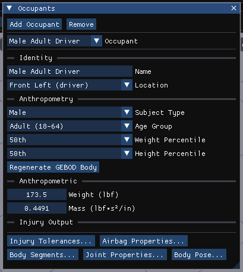
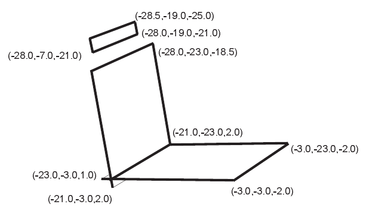
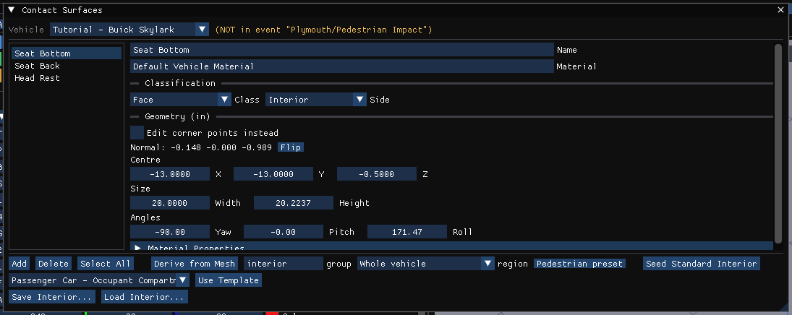
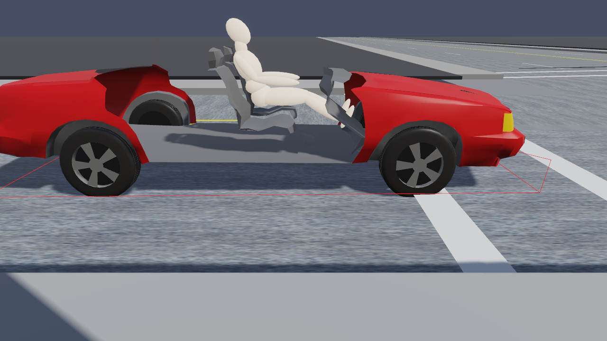
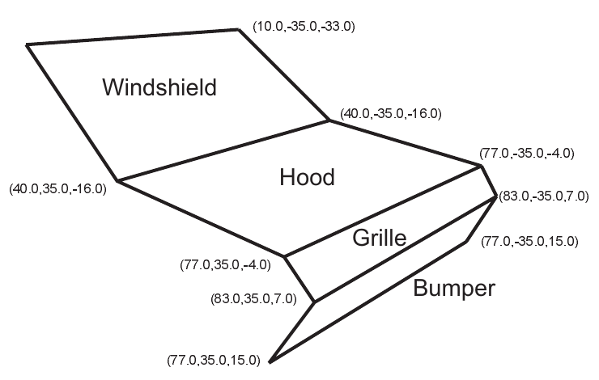
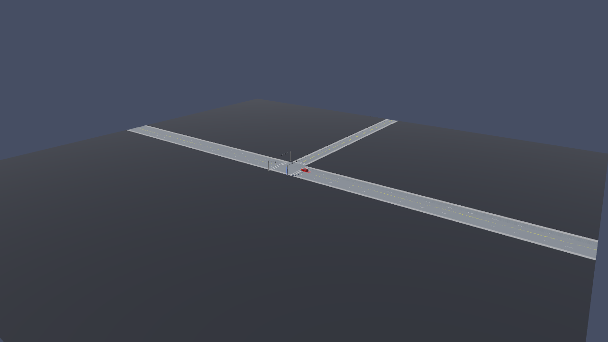
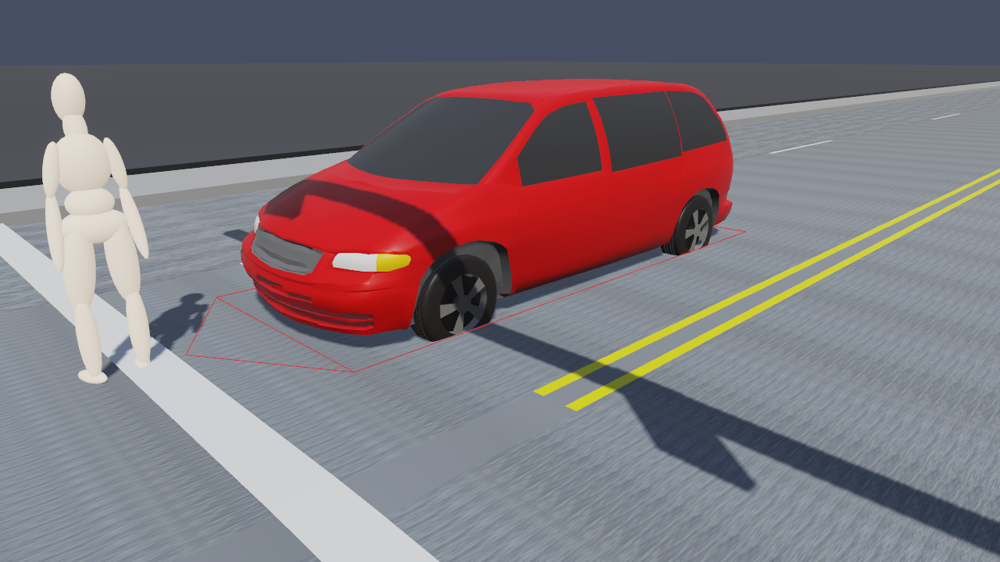
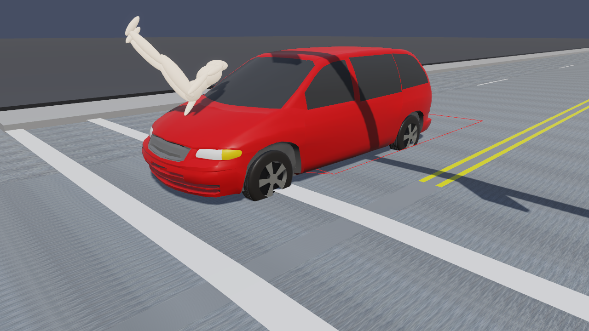

# Chapter 5 — EDHIS Tutorial

This tutorial provides complete examples for two uses of EDHIS. The first example is a low-speed collision, where the occupant motion is simulated in an effort to determine the potential for injury. The second example is a pedestrian impact, where the issue is the speed of the striking vehicle. These examples illustrate common applications of EDHIS.

Like all EDHIS events, the procedure involves the following basic steps:

- Create the humans
- Create the vehicles
- Create the environment
- Execute the EDHIS events
- Review the EDHIS output reports

This basic procedure is described in detail in this tutorial.

!!! note "HVE 2027"
    This chapter follows HVE's EDHIS tutorial in HVE 2027. The finished tutorial case, **`EdhisTutorialEDC.hve`**, is part of HVE's support files (`supportfiles/case`), and HVE 2027 opens it directly with **File › Open Case**. Its three vehicles come from HVE's tutorial vehicle database, and its humans, contact surfaces, combined contact materials and armed contact pairs are HVE's own. The easiest way to work through the tutorial is therefore to **open the finished case and inspect each step in it**, re-running the events as you go; each section below says how the step is done in HVE 2027 and what the case already contains. Where a step has no HVE 2027 equivalent, the section says so.

    All figures in this chapter are of that case in HVE 2027.

> **NOTE:** It is assumed that HVE 2027 is up and running, and that the user is familiar with its basic features: the editor tabs (Human F2, Vehicle F3, Environment F4, Event F5), the docked panels and the 3-D viewport. The purpose of this tutorial is to illustrate those features while setting up and executing an EDHIS event.

## Getting Started

As in other tutorials, before we get started, let's set the user options so we're all starting on the same page.

> **NOTE:** Most options simply affect the appearance in the viewport. Some options affect the data used in the analysis — for example, the vehicle's *Auto Position (settle onto terrain)* setting in its initial conditions — so check that they are set as intended.

In HVE 2027, set the following:

- **Tools › Preferences** — Units equals US
- **View › Key Results** — on
- **View › Scene Display › Skidmarks** — on
- **View › Scene Display › Vectors › Velocity** — off
- **View › Scene Display › Rendering** — *Phong*
- **View › Scene Display › Humans Through Bodywork** — on, to see the occupant inside the car

The remaining options will automatically initialize to their default conditions. We're now ready to proceed with the tutorial.

## Creating the Humans

To create the humans for both events (the occupant in the intersection collision and the pedestrian in the pedestrian impact), choose the **Human (F2)** editor and open **Occupant › Human Information**. The *Occupants* panel is displayed.

First, let's add the human occupant to the case.

- Click **Add Occupant**. A new human is added and its body generated with GEBOD. The panel offers a *Location* (a seat within the vehicle, or *Pedestrian*) and the human's *Subject Type*, *Age Group*, *Weight Percentile* and *Height Percentile*.
- Choose the following human attributes:
  - Location = *Front Left (driver)*

    > **NOTE:** By definition, we must choose sides here. We're going to assign the driver's position to the left side of the vehicle (sorry to our friends in Great Britain, Australia and other countries whose drivers are stuck on the wrong side of the vehicle!).

  - Subject Type = *Male*
  - Age Group = *Adult (18-64)*
  - Weight Percentile = *50th*
  - Height Percentile = *50th*
- Edit the **Name**: `Male Adult Driver`.

Now, let's add the female pedestrian.

- Click **Add Occupant** again and choose:
  - Location = *Pedestrian*
  - Subject Type = *Female*
  - Age Group = *Adult (18-64)*
  - Weight Percentile = *50th*
  - Height Percentile = *97.5* in HVE's tutorial
- Edit the name: `Female Adult Pedestrian`.

  > **NOTE:** By choosing Pedestrian, the human's motion is defined relative to the earth-fixed coordinate system (occupant motion is defined relative to the vehicle-fixed coordinate system).

!!! note "HVE 2027"
    HVE 2027's percentile lists are 5th, 25th, 50th, 75th and 95th, so HVE's 97.5th height percentile cannot be chosen; the nearest is the 95th. The tutorial case keeps the bodies HVE stored for both humans, so its results do not depend on this.

After the above steps are performed, both humans have been added to the case and are ready to be analyzed.

*Figure 5-1: The Occupants panel showing Male Adult Driver.*

## Creating the Vehicles

Now we have our humans, so let's add the vehicles. First, the two vehicles involved in a low-speed, rear-end collision: a dark red 1991 Buick Skylark and a forest green 1989 Ford F-150 Pickup. Then the aqua blue 1997 Plymouth Voyager van involved in the pedestrian impact. In HVE they are taken from the tutorial database:

| Vehicle | Type | Make | Model | Year | Body Style |
|---|---|---|---|---|---|
| Buick Skylark | Passenger Car | Buick | Skylark | 1985-1991 | 4-Door |
| Ford F-150 | Pickup | Ford | F-150 | 1988-1991 | Fleetside |
| Plymouth Voyager | Van | Plymouth | Voyager | 1996-1999 | Van |

!!! note "HVE 2027"
    In HVE 2027 a vehicle is added in the **Vehicle (F3)** editor with **Add…** in the *Vehicles* panel, which searches the loaded vehicle databases or offers HVE's generic vehicles by type and class. The tutorial case already contains all three vehicles, named *Tutorial - Buick Skylark*, *Tutorial - Ford F-150* and *Tutorial - Plymouth Voyager*.

### Editing the Vehicles

Next, we edit the vehicles: the Buick and the Plymouth van need contact surfaces for the human simulations. The contact surfaces are the *physical* surfaces that interact with the human ellipsoids to produce forces.

> **NOTE:** HVE's tutorial also changes each vehicle's colour. Colour is display only and is not needed for the simulation; it is not covered here.

Let's start with the Buick. This vehicle was struck from the rear, and we wish to simulate its occupant during the low-speed impact.

- Select the Buick (in the *Vehicles* panel, or with the *Vehicle* picker at the top of any vehicle dialog).

HVE's tutorial removes the passenger compartment so the occupant can be seen, using a modified geometry file, `PCBuickNoTop.h3d`. In HVE 2027 the geometry file is chosen in **Vehicle › Editors › Vehicle Mesh**; the tutorial case already uses `PCBuickNoTop.h3d`.

!!! tip "New in HVE 2027"
    **View › Scene Display › Humans Through Bodywork** draws the occupant through an intact body, so a cut-down geometry file is no longer needed just to see the occupant.

Next, let's add the contact surfaces for the Buick. We'll need a minimum of three surfaces for our simulation: a seat bottom, a seat back and a head rest.

*Figure 5-4: Seat Bottom, Seat Back and Head Rest contact surfaces.*

To add the contact surfaces in HVE 2027:

- Open **Vehicle › Editors › Contact Surfaces**. The Contact Surfaces dialog is displayed (see Figure 5-5).
- Click **Add** and enter the **Name** `Seat Bottom`.
- Set **Side** to *Interior*.
- Tick **Edit corner points instead** and enter the three corners from the table below: the *First Corner* as **P1**, the *Middle Corner* as **P2** and the *Third Corner* as **P3**.

**Table 5-1 — Seat Bottom Contact Surface Coordinates**

| | First Corner | Middle Corner | Third Corner |
|---|---|---|---|
| x | -23.0 | -3.0 | -3.0 |
| y | -3.0 | -3.0 | -23.0 |
| z | 1.0 | -2.0 | -2.0 |

*Figure 5-5: Contact Surfaces dialog in HVE 2027, with the tutorial case's Seat Bottom selected.*

> **NOTE:** Remember to enter three consecutive corners in counter-clockwise order to establish the positive side of the surface.

> **NOTE:** The order is important! If we enter the coordinates in the wrong order, no force will be produced between the human and vehicle. In HVE 2027 the dialog shows the resulting **Normal**, and **Flip** reverses it.

The *Seat Bottom* contact surface is complete. Next, let's create a contact surface for the seat back:

- Again, click **Add** and enter `Seat Back`. Set *Side* to *Interior*. Enter the coordinates for three corners of the seat back (Table 5-2):

**Table 5-2 — Seat Back Contact Surface Coordinates**

| | First Corner | Middle Corner | Third Corner |
|---|---|---|---|
| x | -21.0 | -21.0 | -28.0 |
| y | -3.0 | -23.0 | -23.0 |
| z | 2.0 | 2.0 | -18.5 |

Finally, let's create a contact surface for the head rest:

- Again, click **Add** and enter `Head Rest`. Set *Side* to *Interior*. Enter the coordinates for three corners of the head rest (Table 5-3):

**Table 5-3 — Head Rest Contact Surface Coordinates**

| | First Corner | Middle Corner | Third Corner |
|---|---|---|---|
| x | -28.0 | -28.0 | -28.5 |
| y | -7.0 | -19.0 | -19.0 |
| z | -21.0 | -21.0 | -25.0 |

While the Contact Surfaces dialog is open, the panels are drawn on the vehicle in the 3-D view, with an arrow along each normal (the contact side).

*Figure 5-6: The Buick Skylark with its driver seated against the seat and head rest panels (EDHIS event, t = 0).*

Now, let's add *Bumper, Grille, Hood* and *Windshield* contacts to the Plymouth van's exterior (see Figure 5-7). These contact surfaces will be used for the pedestrian impact simulation.

*Figure 5-7: Bumper, Grille, Hood and Windshield contact surfaces.*

To create the contact surfaces for the van:

- Select the Plymouth Voyager and open **Vehicle › Editors › Contact Surfaces**.
- Click **Add** and enter `Bumper`. Set *Side* to *Exterior* and enter the coordinates for 3 corners of the front end (Table 5-4).

**Table 5-4 — Plymouth Van Bumper Contact Surface Coordinates**

| | First Corner | Middle Corner | Third Corner |
|---|---|---|---|
| x | 83.0 | 77.0 | 77.0 |
| y | 35.0 | 35.0 | -35.0 |
| z | 7.0 | 15.0 | 15.0 |

Now, let's create the Grille contact surface:

- Again, click **Add** and enter `Grille`. Set *Side* to *Exterior* and enter the coordinates for three corners of the grille:

**Table 5-5 — Plymouth Van Grille Contact Surface Coordinates**

| | First Corner | Middle Corner | Third Corner |
|---|---|---|---|
| x | 83.0 | 83.0 | 77.0 |
| y | 35.0 | -35.0 | -35.0 |
| z | 7.0 | 7.0 | -4.0 |

Now, let's create the Hood contact surface:

- Again, click **Add** and enter `Hood`. Set *Side* to *Exterior* and enter the coordinates for three corners of the hood:

**Table 5-6 — Plymouth Van Hood Contact Surface Coordinates**

| | First Corner | Middle Corner | Third Corner |
|---|---|---|---|
| x | 40.0 | 77.0 | 77.0 |
| y | 35.0 | 35.0 | -35.0 |
| z | -16.0 | -4.0 | -4.0 |

The last contact surface for the *Plymouth Van* is the Windshield:

- Again, click **Add** and enter `Windshield`. Set *Side* to *Exterior* and enter the coordinates for three corners of the windshield:

**Table 5-7 — Plymouth Van Windshield Contact Surface Coordinates**

| | First Corner | Middle Corner | Third Corner |
|---|---|---|---|
| x | 40.0 | 40.0 | 10.0 |
| y | 35.0 | -35.0 | -35.0 |
| z | -16.0 | -16.0 | -33.0 |

> **NOTE:** In HVE 2027 the *Side* (Interior/Exterior) is stored with the surface but does not pre-screen which surfaces a human is tested against — see [Chapter 2, Contacts](02-program-input.md#contacts). Give each vehicle only the surfaces its human should strike.

We now have all three vehicles required for the two simulation studies in this case.

## Creating the Environment

Now, let's look at the environment. In HVE's tutorial it is the sample intersection `2T4_Intersection.h3d`, located in Beaverton, Oregon, USA, on 4/22/96 at 1630, with the earth-fixed X axis 56 degrees from true north.

> **NOTE:** The Latitude, Longitude, Date/Time and angle from true north are used to position the sun in the scene. This is, of course, important because the sun is the primary light source for the scene.

In HVE 2027, choose the **Environment (F4)** editor and open **Environment › Environment…**:

- In the *Location* section, enter the place, *Date* and *Time*, and the *Latitude* and *Longitude*.
- In the *Terrain* section, load the scene geometry with **Browse…** and **Import**. The tutorial case carries the intersection embedded in the case.
- The angle from true north to the X axis is the *North* setting of the sky in **View › Shader Editor**.

The environment is drawn in the viewport. Use the mouse to orbit and zoom the view.

*Figure 5-9: 3-D environment used for our tutorial, in HVE 2027.*

## Saving the Case

Now that we've created all the objects (*humans, vehicles* and *environment*) for our case, let's save the case file.

- Choose **File › Save Case As…**. HVE 2027 saves the case as an `.hvex` file; **File › Save Case As JSON…** saves the same case as JSON.

  > **NOTE:** HVE 2027 does not write HVE's `.hve` format. Saving the tutorial case leaves `EdhisTutorialEDC.hve` unchanged.

  > **NOTE:** Saving the file occasionally is a highly recommended practice.

## Creating the Events

We are going to perform two simulation studies: one study is an occupant simulation of a low-speed, rear-end collision and the other is a pedestrian impact.

### Collision Simulation

For the low-speed rear-end collision, we need a collision pulse. We can get the collision pulse directly using the EDSMAC4 collision simulator:

> **NOTE:** HVE ships this pulse as `EdhisTutorialCollisionPulse`. That file is in HVE's binary pulse format, which HVE 2027 cannot import (its *Import file…* reads a text table). Run the EDSMAC4 event instead, or use the pulse stored with the tutorial case's EDHIS event.

In the **Event (F5)** editor, in the Event Information panel:

- Click **+** beside *Active Event* to add an event and name it `Buick vs Ford`.
- Choose **EDSMAC4** as the *Method*.
- Under *Vehicles in Event*, choose the *Buick Skylark* as V1 and add the *Ford F-150* as V2.

Now, we're ready to set up the first event.

- Under *Vehicle Initial Conditions*, give the Buick its impact position: X Position = `24` ft, Y Position = `75` ft, Heading = `-90` degrees. Since it was stopped at impact, leave its Speed at `0` mph.

  > **NOTE:** A vehicle can also be moved in the viewport with the gizmo (G to move, R to rotate, X/Y/Z to lock an axis; or type a number and press Enter), but it is often easier to type the coordinates.

- Give the Ford: X Position = `24` ft, Y Position = `91` ft, Heading = `-90` degrees, Speed = `10` mph.
- In the **Simulation** panel, change the **Output Timestep** from `0.1` sec to `0.005` sec.

  > **NOTE:** We reduced the output interval because we're going to use the acceleration output from this simulation as the collision pulse for our occupant simulation, so we want more detail; selecting the smaller output interval provides the acceleration at 0.005 second increments, rather than the default value, 0.1 second. Note the entire duration of a collision is only about 0.1 second, so the default interval might actually skip the entire collision!

- Click **Run** on the playback bar to execute the event.

> **NOTE:** While the event is executing, watch the current results (especially acceleration) in the Key Results panel.

### Occupant Simulation

The EDSMAC4 event has provided us with the collision pulse; now let's use EDHIS to study the driver's behavior during impact.

- Add an event, name it `Buick Occupant` and choose **EDHIS** as the *Method*.
- Under *Vehicles in Event*, choose the *Buick Skylark*.
- Under *Humans in Event*, click **Add Human** and choose *Male Adult Driver*.

Now, let's set up the occupant simulation event:

- Under *Vehicle Initial Conditions*, assign the same initial position as the one used in the previous EDSMAC4 event, X = `24` ft, Y = `75` ft and Heading = `-90` deg, with a Speed of `0` mph.
- Open **Event › Collision Pulse**. In the *Source* list choose *Event 1 - Buick vs Ford* and click **Take pulse from this event**. The collision pulse (acceleration vs time history) for the Buick during the low-speed impact is displayed numerically, in an editable table, and graphically. Make sure the *Pulse type* is *Acceleration*.

  > **NOTE:** The pulse taken from an EDSMAC4 run carries forward and lateral acceleration and the yaw acceleration; vertical, roll and pitch are zero, since EDSMAC4 is a planar model.

*Figure 5-12: Collision Pulse dialog for the Buick Skylark.*

Before we position the human, it helps to attach a camera to the vehicle.

> **NOTE:** This tip really helps while positioning occupants because it allows you to move the camera relative to the vehicle, thus you can quickly focus on the interaction between the human and the seat cushion, an important part of placing the human in an equilibrium position.

In HVE 2027, open **Tools › Cameras**, add a camera, and under *Attachment* set *View From* and *Look At* to the Buick, so the camera rides with the vehicle. HVE's tutorial places it at vehicle-fixed x = `0`, y = `-20`, z = `0`, looking at 0, 0, 0.

Now we're ready to position the driver in the Buick.

HVE's tutorial positions the occupant with manipulators: the pelvis over the middle of the seat at x = `-17` in, y = `-13` in, raised to z = `-5` in, pitched back `30` degrees, with each lower leg pitched to `-30` degrees.

In HVE 2027:

- Under *Humans in Event*, set **Occupies** to the Buick and enter **Seat X from CG** = `-17` in and **Seat Y from CG** = `-13` in.
- Click **Pose** beside the human. In the *Body Pose* dialog, tick **Pose this body** and enter the pelvis pitch (`30` degrees) and the lower-leg pitches (`-30` degrees). Each angle in the dialog is relative to the segment's parent.
- The occupant's initial velocity is in the same dialog. Leave it at `0`.

  > **NOTE:** Because the human is defined as an occupant (as opposed to a pedestrian), the initial velocity is defined relative to the vehicle.

!!! note "HVE 2027"
    The tutorial case carries HVE's own seated position — **Seat X from CG** −16.94 in, **Seat Y from CG** −13.17 in, **Seat Z from CG** −5.04 in (SAE axes: + is down) — and pose. A human can be dragged across the ground in the 3-D view, but its height and pose are typed.

- Set **Restraint (this event)** to *None*: the tutorial's driver is unbelted.

The final step in HVE's event set-up is to set up contacts and assign combined material property data for the human ellipsoid to contact surface interactions, using HVE's *Contacts* dialog (Select All objects and targets, then the `TypicalSeat.matl` combined material).

!!! note "HVE 2027"
    **Event › Contacts...** opens the Occupant Contacts dialog, where the tutorial case shows HVE's own armed pairs (every segment against each of the three surfaces); **Arm All** is the equivalent of selecting all objects and targets. HVE 2027 does not read HVE's `.matl` combined-material files: the tutorial case carries HVE's own combined materials, in Event Information › **Combined Contact Materials** (three surfaces stated for this event), where each value can be edited. A case built in HVE 2027 has no stored pairs until you edit them, and for a surface with no combined material uses the surface's own material — see [Chapter 2, Contacts](02-program-input.md#contacts).

The contacts are now assigned and we are ready to proceed with executing the simulation.

- Click **Run** on the playback bar. The event runs to the end of the simulation (0.25 s in the tutorial case).

Since our goal for this event is to study how the impact severity affects force and head acceleration, let's look at the Key Results:

- If the Key Results panel is not displayed, choose **View › Key Results**.
- After the run, the panel lists the occupant's peak head and torso accelerations, the HIC exceedance and the number of injury tolerances exceeded, beside the vehicle's results. The run status reports the same peaks.

!!! note "HVE 2027"
    HVE's tutorial then adds *Head Fwd Accel*, *Head Pitch Accel* and the *Head vs Head Rest* contact force to the Key Results window through the Variable Selection dialog. In HVE 2027 tick them in the occupant's **H1** column of **Output › Variable Selection**: *Fwd Acc* and *Pitch Acc* in the **Occupant Head** group. Contact force is offered per interaction rather than per pair — **Occupant Contacts, Interaction 1** has the sum over all armed pairs and the largest single pair — so the head-vs-headrest force on its own is not available (see [Chapter 3](03-program-output.md#variable-output-table)).

We have finished our occupant simulation. You may wish to view it a few more times with the playback bar's **|<** and **Play** buttons.

*The driver at t = 0.20 s.*

### Pedestrian Simulation

Using EDHIS to simulate a pedestrian impact is very similar to the previous occupant simulation. Let's proceed:

- Add an event, name it `Plymouth/Pedestrian Impact` and choose **EDHIS** as the *Method*.
- Under *Vehicles in Event*, choose the *Plymouth Voyager*. Under *Humans in Event*, add *Female Adult Pedestrian*.

Now, let's set up the pedestrian simulation event, as shown in Figure 5-17.

- Under *Vehicle Initial Conditions*, give the van its impact position, X = `-20` ft, Y = `37` ft, Heading = `0` degrees, and its impact speed, `35` mph.

Next, position the pedestrian.

- Under *Humans in Event*, set **Occupies** to *Pedestrian (no vehicle)*. The position fields become **Scene X** and **Scene Y**: an EDHIS pedestrian is positioned relative to the earth-fixed coordinate system, so these fields are in feet, like the vehicle positions (a seated occupant's *Seat X/Y from CG* are in inches). Enter X = `-10` ft, Y = `37` ft.
- Click **Pose**, tick **Pose this body** and enter a pelvis yaw of `90` degrees.

!!! note "HVE 2027"
    HVE's tutorial also sets the pedestrian's elevation, Z = `-3.5` ft (there being no auto-positioning of humans). In HVE 2027 it is **Scene Z** in the human's row of the Event Information panel (SAE: + is down, so enter `-3.5` ft).

*Figure 5-17: The EDHIS pedestrian impact at t = 0 in HVE 2027.*

Now, let's enter the initial velocity of the pedestrian:

- In the *Body Pose* dialog, under *Initial velocity (segment frame, u/v/w)*, enter u = `4` mph.

!!! note "HVE 2027"
    **The pedestrian's walking speed reaches EDHIS.** It is entered in her own body frame (u forward), and with her 90° yaw it carries her across the road. The tutorial case stores exactly 4.0 mph.

The final step in HVE's event set-up is to set up contacts and assign combined material properties for the female against each surface — `TypicalRoofPillar.matl` for the bumper, `TypicalDoorUndamaged.matl` for the grille and hood, and `TypicalWindshield.matl` for the windshield. In HVE 2027 the tutorial case carries HVE's armed pairs, shown in **Event › Contacts...**, and these combined materials, which appear in Event Information › **Combined Contact Materials** (`.matl` files are not read).

The pedestrian impact is now set up and ready to execute.

- In the **Simulation** panel, set the **Duration**, then click **Run** on the playback bar.

  > **NOTE:** EDHIS is designed to simulate human occupant or pedestrian motion up to the point of first impact. We should therefore terminate the event no later than 0.15 seconds.

We have now completed the three events.

## Viewing Results

Now that we have produced our EDHIS simulations, let's take a detailed look at the results. In HVE 2027 the results of the active event are on the Event editor's **Output** menu and in the viewport. Make the event you want to review the *Active Event* in Event Information, and run it if it has not been run.

> **NOTE:** In this tutorial, we will only review the output reports produced by the EDHIS Buick Occupant event. Feel free to view the EDSMAC4 and EDHIS Pedestrian events as well.

EDHIS produces the following reports:

- **Messages** — A list of messages produced by the current run
- **Accident History** — A table of initial and final positions and velocities
- **Event Data** — A table containing the collision pulse used in the EDHIS event
- **Human Data** — A series of tables containing the human data used by EDHIS
- **Injury Data** — A table containing the injury tolerances, followed by a table containing values exceeding the allowable tolerances during the event
- **Vehicle Data** — A series of tables containing the vehicle data used by EDHIS
- **Program Data** — A table containing program control information
- **Variable Output** — A table containing time-dependent simulation results
- **Trajectory Simulation** — A 3-D visualization of the event, displayed at a user-selectable time interval

### Report Windows

The first seven reports are pages of the *HVE Reports* window:

- Choose **Output › HVE Reports**. The window shows one tab per report page that EDHIS built during the run.
- Click a tab to view that report.

The following sections describe the reports produced for the *Buick Occupant* event.

### Messages

EDHIS produces several messages, depending on the outcome of the event. For a complete listing and explanation of these messages, refer to [Chapter 6](06-messages.md). They are on the *Messages* tab.

### Accident History

The Accident History report displays the earth-fixed positions and velocities for the three human segments and the vehicle at the start of the run. It is on the *Accident History* tab.

> **NOTE:** This EDHIS page is the ACCIDENT HISTORY tab of **Output › HVE Reports**; there is no separate HVE 2027 accident history.

### Event Data

The Event Data report displays the acceleration pulse used in the EDHIS event. It is on the *Event Data* tab.

### Human Data

The Human Data report displays the human segment and joint properties, as well as the human contact ellipsoid information. It is on the *Human Data* tab.

### Injury Data

The Injury Data report displays the results of injury calculations that compare simulated tolerance levels with those specified for the human. It is on the *Injury Data* tab.

### Vehicle Data

The Vehicle Data report displays the contact properties (location and physical properties), collision pulse and restraint systems parameters. It is on the *Vehicle Data* tab.

### Program Data

The Program Data report displays the simulation controls and other program control information. It is on the *Program Data* tab.

### Variable Output

#### Variable Selection

HVE's tutorial selects the head's position, velocity and forward and pitch accelerations, and the head vs headrest contact force, in the Variable Output window.

!!! note "HVE 2027"
    The human output groups are offered as variables in **Output › Variable Selection** (the **Occupant** groups, **H1** column) and can be graphed in **Output › Output Graph** and written by **Output › Export Variables**. Contact force is per interaction (sum of pairs, largest pair), not per pair.

### Trajectory Simulation

The Trajectory Simulation provides a 3-dimensional visualization of the vehicle and occupant motion during the event. In HVE 2027 it plays in the viewport once the event has been run.

*Figure 5-28: Trajectory simulation for the Plymouth/Pedestrian Impact event at t = 0.12 s.*

To visualize the motion, use the playback bar under the viewport:

- Click **Play**. The simulation is played at the current playback rate (**Output › Playback Options**).
- Click **Pause**. The simulation stops.
- Click **<<** or **>>** to step back or forward one output step.
- Click **|<** to return to the start.
- Click **>|** to advance to the end of the run.

### Printing

HVE 2027 does not print. To keep a report:

- In the *HVE Reports* window, enter a file name and click **Save This Page**, or **Save All Pages** to write every page to one text file. Print that file, or attach it to your report.
- Use **File › Record Animation** to record the trajectory simulation as a movie.

---
*Previous: [Chapter 4 — Calculation Method](04-calculation-method.md) | Next: [Chapter 6 — Messages](06-messages.md)*

<!-- NAV -->

---

← Previous: [Chapter 4 — Calculation Method](04-calculation-method.md)  |  [Index](README.md)  |  Next: [Chapter 6 — Messages](06-messages.md) →

<!-- /NAV -->
