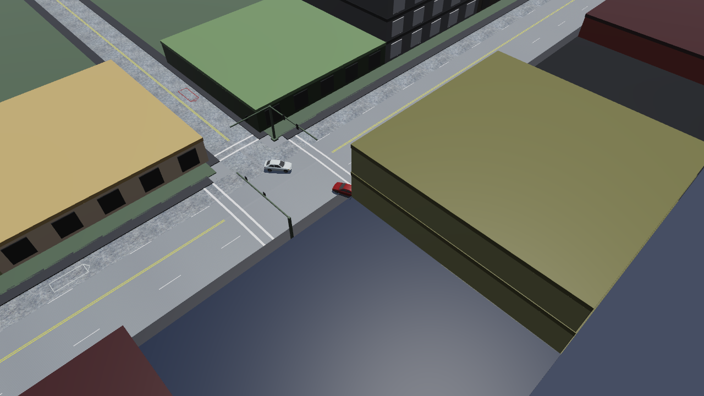

# Chapter 1 — EDSMAC Program Description

## Overview

**EDSMAC** (**E**ngineering **D**ynamics Corporation **S**imulation **M**odel of **A**utomobile **C**ollisions) is a simulation analysis of single- or two-vehicle crashes. It is based on the program called SMAC [1,2,3,4,5], developed at Calspan for NHTSA, and includes several major extensions and enhancements developed by Engineering Dynamics Corporation [6,7]. EDSMAC uses a set of assumed or estimated initial conditions, including positions, velocities and driver controls, provided by the user for each vehicle. EDSMAC then predicts the outcome of a crash by simulating the vehicle trajectories and damage profiles.

The output generated by EDSMAC is a time history of the vehicle kinematics (position, velocity, and acceleration), kinetics (summation of tire and collision forces and moments acting at the CG), and tire skidmarks for the duration of the crash sequence. The program also computes the resulting damage profiles, the Collision Deformation Classifications, or *CDC* (see reference 8; also refer to your EDCRASH Physics manual, Program Inputs, or HVE-2D User's Manual), Principal Direction of Force, or *PDOF* (again, see reference 8 or User's Manual), delta-V (a measure of crash severity) and peak acceleration for each damage range. EDSMAC also produces a collision pulse (acceleration vs time history).

Accident investigators can use EDSMAC to determine how the crash may have occurred. By repeated adjustments of the initial conditions and driver braking (or acceleration) and steering inputs, the user will converge on the data that best match the known accident site evidence (usually rest positions, skidmarks, and vehicle damage).

*Figure 1-1: An EDSMAC event in HVE 2027 — the intersection collision of the [Chapter 5](05-tutorial.md) tutorial at the end of the run.*

Users of EDCRASH will find it convenient to first analyze the accident using EDCRASH to estimate the impact speeds, then use these speeds as the initial conditions for the EDSMAC program. The resulting confirming analysis is both very complete and very powerful.

Accident researchers can use EDSMAC to simulate an actual staged collision test. This can be done *before* the test in order to predict or anticipate the results and help during test preparations. Test parameters may be adjusted based on EDSMAC results to help ensure the test is successful. After the test, the researcher can note the differences between the actual and simulated collision and modify the EDSMAC input in order to obtain a better match.

An extremely useful feature of EDSMAC is the ability to quickly and easily review the results associated with different input scenarios. Termed *what-if* analysis, changes can be made to an isolated variable or set of variables in order to identify their effect on the outcome. Only the inputs that change need to be modified; the program saves all the previously entered information. For example, the sensitivity of the results to initial velocity, or post-impact driver control, can be studied by merely changing those parameters.

Another useful feature of the program is the ability to display the results in viewers. These trajectory simulations display the vehicles at user-specified time intervals during the sequence. In HVE 2027 the solved event plays back in the 3-D viewport it was set up in, and **File › Record Animation** writes a video of it.

## Model Inputs

EDSMAC inputs include one or two vehicles, and an optional environment with terrain geometry. Event set-up parameters include vehicle initial positions and velocities and driver controls (steering, brakes and throttle).

## Model Outputs

EDSMAC output reports include Accident History, Damage Data, Messages, Program Data, Vehicle Data, Variable Output, Trajectory Simulations and Damage Profile Simulations.

!!! note "HVE 2027"
    The alpha-numeric reports are EDSMAC's own pages, shown in **Output › HVE Reports**. Variable output is in **Output › Key Results**, **Output › Output Graph** and **Output › Timestep Data Table**; the trajectory and damage profile simulations are the playback of the event in the 3-D viewport. See [Chapter 3](03-program-output.md).

## Validation

EDSMAC was validated first by direct comparison with earlier versions of EDSMAC to ensure the basic model was intact after porting the original codes to the C programming language and making the model HVE-2D-compatible. Additional validation was performed comparing EDSMAC results to other models as well as direct comparison with controlled collision experiments [1].

!!! note "HVE 2027"
    HVE 2027 compiles the same EDSMAC source as HVE; it makes no change to EDSMAC's calculations. One defect in HVE 2027's own input handling — the mass basis used for the unsprung yaw inertia of the 2-D programs — was found and corrected by comparison with HVE's saved results.

## Basic Procedure

The procedure for using EDSMAC in HVE 2027 is the same as for any simulator in HVE 2027:

1. In the **Vehicle (F3)** editor, add one or two vehicles to the case (**Add...** on the Vehicles panel).
2. Optionally, in the **Environment (F4)** editor, load a site (Terrain section) and set the physical environment.
3. In the **Event (F5)** editor:
    - Create an event (**+** beside **Active Event** in Event Information).
    - Choose **EDSMAC** in **Calculation Method › Method**.
    - Add the one or two vehicles under **Vehicles in Event**.
    - Position the vehicles and assign velocities (viewport gizmo, or **Event › Position / Velocity**).
    - Assign driver controls (**Event › Driver Controls**: Throttle, Brake and Steer tabs).
    - Press **Run** on the playback bar and compare the results with the evidence.
4. Modify the inputs as required to achieve the desired match between the simulation and the actual event. A solved event's inputs are locked until you press **Reset**.

Finally, review the reports in the **Output** menu. The **Playback (F6)** editor plays several events together, and **File › Record Animation** writes a video.

---

[Next: Chapter 2 — EDSMAC Program Input](02-program-input.md)

<!-- NAV -->

---

← Previous: [EDSMAC — Vehicle Collision Simulator](README.md)  |  [Index](README.md)  |  Next: [Chapter 2 — EDSMAC Program Input](02-program-input.md) →

<!-- /NAV -->
