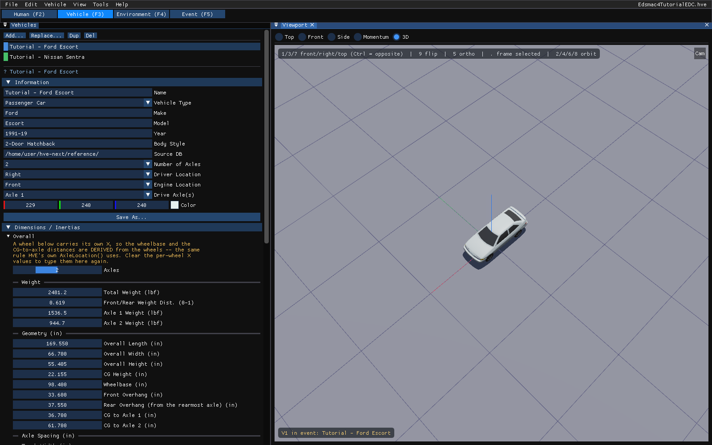
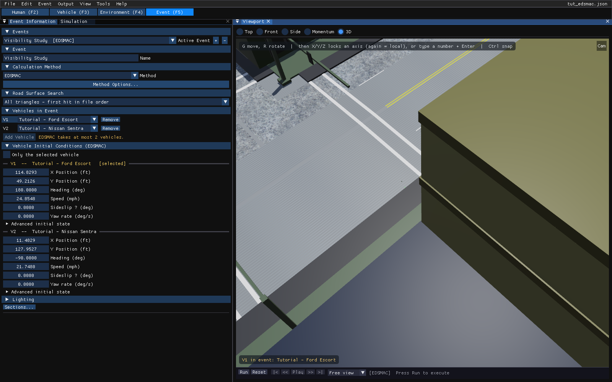

# Chapter 2 — EDSMAC Program Input

This chapter defines the objects (vehicles and environment) and the event set-up parameters (positions, driver controls, and so forth) used by the EDSMAC analysis. In general, the chapter is divided into the following sections:

- **Objects** — The number of vehicles, and the specific vehicle parameters actually used by EDSMAC.
- **Events** — The various options available for setting up and executing an EDSMAC event.

## Objects Overview

The objects used by the EDSMAC model are:

- **Vehicles** — One or two vehicles may be studied by EDSMAC.
- **Environment** — Like the *real* world, EDSMAC has exactly one environment.

> NOTE: The environment is used in any reconstruction or simulation model.

The following sections describe how the vehicle and environment provide the required inputs to the EDSMAC calculation model.

## Vehicles

EDSMAC uses one or two vehicles created in the **Vehicle (F3)** editor (see Figure 2-1). Vehicles are selected from a vehicle database by the following attributes, shown in the **Identity** and **Configuration** sections of the Vehicles panel:

- **Type** — EDSMAC supports the following vehicle types: *Passenger Car, Pickup, Sport-Utility* (HVE 2027: *Multi-Purpose*)*, Van,* and *Truck,* within the limits defined by number of axles and drive axles; see below.
- **Make** — EDSMAC supports all available vehicle makes.
- **Model** — EDSMAC supports all available vehicle models, within the limits defined by number of axles and drive axles; see below.
- **Year** — EDSMAC supports all available vehicle years.
- **Body Style** — EDSMAC supports all available vehicle body styles.

Each vehicle also has the following additional user-editable parameters:

- **Driver Location** — The *Driver Location* is not used by EDSMAC. However, if you would like the vehicle to have any steerable axles, *Driver Location* must not be *None*.
- **Engine Location** — The *Engine Location* is not used by EDSMAC. However, if you would like the Throttle Table to be available during Event mode, *Engine Location* must not be *None*.
- **Number of Axles** — EDSMAC supports only 2-axled vehicles.
- **Drive Axle(s)** — The *Drive Axle* is used by EDSMAC to determine which wheels to include in the Throttle Table during Event mode.

!!! note "HVE 2027"
    HVE 2027 checks EDSMAC's limits when you choose the method: one or two vehicles in the event, each with exactly two axles. Otherwise the **Method** list marks EDSMAC "N/A for these vehicles" with the reason in its tooltip, and pressing **Run** is refused with the reason in the run status.

To add a vehicle to the current case:

1. Choose the **Vehicle (F3)** editor tab (or press F3). The Vehicles panel and the viewport are displayed.
2. Click **Add...** at the top of the Vehicles panel. The **Add Vehicle** dialog is displayed.
3. Search the loaded databases (open **Database folders** to add a folder holding HVE `.db` files), or choose one of HVE's built-in generic vehicles under **Built in (no database needed)**, and click **Add**.
4. If desired, modify the *Driver Location, Engine Location, Number of Axles* and *Drive Axle(s)* in the **Configuration** section.
5. Edit the vehicle's **Name**. The name does not affect calculations.

*Figure 2-1: The Vehicle (F3) editor in HVE 2027.*

The following Vehicle Parameter groups are assigned in the Vehicle editor (the **Size & Weight**, **Inertia** and **Components** sections of the Vehicles panel, and the **Vehicle** menu):

- Sprung Mass (Inertias, Move CG, Inter-vehicle Connections)
- Unsprung Mass (Wheel Location, Tire Data, Suspension Data)
- Exterior (Overall Dimensions, Stiffness Coefficients)
- Steering System

The specific data used in each of the above parameter groups are defined in Tables 2-1 through 2-3.

### Sprung Mass

**Table 2-1. Vehicle Sprung Mass Parameters Used By EDSMAC.**

| Parameter | Description |
|---|---|
| Weight | Total vehicle weight |
| Total Yaw Inertia | Rotational inertia about the vehicle-fixed z axis |
| Move CG x | Relocates the CG in the vehicle-fixed x direction. This entry causes an automatic adjustment of all other vehicle dimensions to reflect the new CG location. |

#### Inertias

EDSMAC uses the total vehicle weight (converted to mass according to the current gravitational constant; see Environment), and the yaw rotational inertia.

> NOTE: The yaw inertia displayed in the Inertias dialog applies only to the sprung mass. EDSMAC does not include independent degrees of freedom for the unsprung masses. Therefore, the inertial contributions of the unsprung masses are added to the sprung mass yaw inertia to calculate the total yaw inertia used by EDSMAC.

!!! note "HVE 2027"
    The weight and yaw inertia are edited in the **Inertia / Mass** dialog (**Edit...** in the Vehicles panel's **Inertia** section), which shows each quantity both TOTAL and SPRUNG. **Move CG** is in the **Event** menu for an EDSMAC or EDSMAC4 event.

#### Move CG

Move CG is not used directly by EDSMAC. Its current value does not show up in the results. However, the Move CG fields may be used to quickly move the vehicle's center of gravity. The x coordinates for the wheels are updated to reflect the new CG location.

#### Geometry File

The Geometry File is not used by EDSMAC.

#### Inter-vehicle Connections

Inter-vehicle connections are not used by EDSMAC.

### Unsprung Mass

**Table 2-2. Vehicle Unsprung Mass Parameters Used By EDSMAC.**

| Parameter | Description |
|---|---|
| Wheel Location | The vehicle-fixed x,y wheel center coordinates |
| Dual Tire | Flag indicating position has dual tires. **Not supported by EDSMAC** — a vehicle with dual tires at any wheel position is rejected at event initialization with a fatal error. Use EDSMAC4 for such a vehicle. |
| Tire Slide Friction | The slide coefficient of friction for each tire |
| Tire Cornering Stiffness | Tire lateral force per unit of tire lateral slip for small amounts of lateral slip |

#### Wheel Location

Although HVE-2D provides values for the vehicle-fixed x,y coordinates of each wheel, EDSMAC uses the following three parameters: $a$, the distance from the CG to the front axle; $b$, the distance from the CG to the rear axle; $tw$, the average of the front and rear track widths.

> NOTE: EDSMAC uses the average $x_{wheel}$ for the front wheels to calculate $a$ and the average $x_{wheel}$ for the rear wheels to calculate $b$. Similarly, EDSMAC uses the total distance between right-side and left-side tires to calculate track width. Bilateral symmetry is assumed. Finally, EDSMAC does not use $z_{wheel}$ for calculations.

#### Tire

The HVE-2D tire parameters provide the following data groups:

- Friction Data
- Cornering Stiffness Data
- Slip-vs Rolloff Table

EDSMAC's use of these parameters is described below.

!!! note "HVE 2027"
    The tire friction and cornering stiffness tables are on the **Friction** and **Cornering** tabs of the **Load & Speed Tables** panel at the bottom of **Vehicle › Editors › Tires...** (the Tire Properties window).

##### Friction Data

EDSMAC uses the slide friction coefficient.

> NOTE: If there is any doubt about which value is actually used by EDSMAC, you can check the Vehicle Data output report.

> NOTE: During an event, the actual tire-terrain friction used during the current timestep is the product of the slide friction coefficient and the terrain friction multiplier for the polygon beneath the tire. Mathematically,
> $$\mu_{Tire\text{-}terrain} = \mu_{Slide} \times Mult_{Polygon}$$

##### Cornering Stiffness Data

EDSMAC uses the Cornering Stiffness value.

> NOTE: If there is any question about which value is actually used by EDSMAC, you can check the Vehicle Data output report.

##### Slip-vs Rolloff Table

EDSMAC does not use the Slip-Rolloff data.

#### Suspension

EDSMAC does not use the Suspension data.

#### Brake

EDSMAC does not use the Brake data.

### Exterior

EDSMAC uses the following Vehicle Exterior data:

- Exterior Dimensions
- Frontal $K_v$ Stiffness Coefficient

**Table 2-3. Vehicle Exterior and Steering System Parameters Used By EDSMAC.**

| Parameter | Description |
|---|---|
| CG to Front, Right, Back and Left | The vehicle's exterior dimensions |
| Frontal $K_v$ Stiffness Coefficient | The stiffness of the vehicle exterior (assumed to be uniform on all sides) |
| Steering Gear Ratio | Ratio of the angle at the steering wheel to the angle at the wheel |

> NOTE: EDSMAC assumes the exterior structure is homogeneous and does not use different stiffness values for the front, sides, and rear. The $K_v$ stiffness coefficient entered for the frontal surface is applied to all other surfaces of the vehicle!

!!! note "HVE 2027"
    The stiffness is edited from the **Event** menu of an EDSMAC or EDSMAC4 event: **Event › Crush Profile...** opens the **Crush & Geometry** window, and **CG to Front...** opens the **CG to Front Stiffness** window, whose **Kv Stiffness** is the value EDSMAC uses. (The A and B fields are EDSMAC4's; the Kv fields of the other three sides are not read by EDSMAC.) The values belong to the vehicle, not to the event.

!!! note "HVE 2027: the Kv field's unit"
    The Kv field is in **lbf/in²** in US units and **N/m²** in metric units, the unit EDSMAC reads. A frontal Kv of 104.1 lb/in² (71.8 N/cm²) reads 104.1 in US units and about 717 744 in metric units (1 N/cm² = 10 000 N/m²).

### Steering System Data

EDSMAC uses the Steering System to determine which axles are steerable. Only steerable wheels are displayed in the Driver Controls, Steer Table. In addition, if the Steer Table *At Driver* option is used, the steering gear ratio parameter is used to compute the steer angle at each steerable tire. In HVE 2027 these are in **Vehicle › Editors › Steering System...** (the **Gear Ratio** row).

### Brake System Data

EDSMAC does not use the Brake System data.

## Environment

EDSMAC uses the environment set up in the **Environment (F4)** editor (see Figure 2-2). The environment is defined by the following groups of attributes:

- Visual Data
- Physical Data

*Figure 2-2: The Environment (F4) editor in HVE 2027.*

### Creating an Environment

A case in HVE 2027 always has exactly one environment; there is nothing to add. To set it up:

1. Choose the **Environment (F4)** editor tab. The Environment panel is displayed.
2. In the **Location** section, enter the site **Name**, **Date**, **Time**, **Latitude** and **Longitude** (or search an address or paste a coordinate).
3. In the **Terrain** section, load the site geometry (**Geometry File** › **Browse...**, then **Import**). DXF, `.h3d`, `.iv`, OBJ and glTF files are read.
4. In the **Physical** section, edit the wind, atmosphere and **Gravity** for the event.

!!! note "HVE 2027"
    The angle of the earth-fixed X axis from north, the UTC offset and the sun itself are set in the world of the Shader Editor (**View › Shader Editor**), because in HVE 2027 they only light the scene. See [Sun, Sky and World](../../new-features/02-sun-sky-and-world.md).

### Visual Data

The following visual parameters may be edited:

- **Environment Location** — A database containing the name (City/State/Country), Latitude and Longitude and GMT for the selected location.
- **Time and Date** — The local standard time and date for the event.

The visual data are not used by the event; they are provided for studies related to visibility at the time of an event (e.g., avoidability of an accident).

> NOTE: The visual data (Location, Time, Date and Angle of earth-fixed X axis) affect the lighting of the event! Depending on your view (Camera Position) the scene may be shaded and difficult to see. If the time is after sundown, the view will be dark.

### Physical Data

The Physical Data groups are:

- Angle of X Axis
- Wind Speed and Direction
- Atmospheric Temperature and Pressure
- Gravity Constant
- Surface Geometry

The specific physical environment data used by EDSMAC are described below and in Table 2-4.

**Table 2-4. Environment Parameters used by EDSMAC.**

| Parameter | Description |
|---|---|
| Gravitational Constant | The local acceleration of gravity |
| Surface Geometry, Friction Factor | The polygon database used to create the environment |

#### Angle Of X Axis

The angle of the X axis is used to position the earth-fixed coordinate system on the surface of the earth.

> NOTE: The angle is specified relative to true north. If you are using a compass to determine direction at the scene of an accident, you should provide a local correction factor before entering this angle.

> NOTE: The angle of the X axis affects how you visualize an EDSMAC event because it affects the location of the sun.

#### Wind Speed and Direction

EDSMAC does not use the Wind Speed or Direction.

#### Atmospheric Temperature and Pressure

EDSMAC does not use the atmospheric temperature and pressure.

#### Gravitational Constant

The gravitational constant converts mass to force. An object's mass and rotational inertias are properties that are the same throughout the universe; however the weight of an object is dependent on the local gravitational constant.

> NOTE: All user-entered weights are divided by this gravitational constant and stored as mass.

#### Surface Geometry

The Surface Geometry is used by the tire model in EDSMAC to calculate the friction multiplier for the current X,Y position of each tire.

!!! note "HVE 2027"
    Surface friction is set per surface material on each surface selected in the Environment editor (the Environment panel's **Selected Surface** section, **Edit in Shader Editor**). HVE 2027's site is 3-D, but EDSMAC uses only the friction beneath each tire; the vehicles are drawn on the terrain.

## Event

EDSMAC uses the **Event (F5)** editor (see Figure 2-3) to create, set up and execute an event. Each of these topics is described below.

*Figure 2-3: The Event (F5) editor in HVE 2027: the Event Information panel (left) and the viewport with the playback bar (right).*

### Creating an Event

An EDSMAC event is created in the **Event Information** panel.

To create an EDSMAC event:

1. Choose the **Event (F5)** editor tab. The Event Information panel is displayed.
2. Click **+** beside **Active Event**. A new event is added and made active.
3. In **Calculation Method**, choose **EDSMAC** from the **Method** list.
4. Under **Vehicles in Event**, click **Add Vehicle** for each of the one or two vehicles and choose it in the slot's list.
5. Edit the event **Name**. The name does not affect calculations.

> NOTE: If you choose a vehicle that is not compatible with EDSMAC, the Method list marks EDSMAC "N/A for these vehicles", with the reason in its tooltip. The event can still be edited; it cannot be run until EDSMAC-compatible objects are selected.

### Setting Up an Event

EDSMAC uses the following *event set-up* options:

- Position/Velocity
- Driver Controls

The specific Event Set-up data used by EDSMAC are defined in Table 2-5.

**Table 2-5. Event Set-up Parameters used by EDSMAC.**

| Parameter | Description |
|---|---|
| Vehicle Initial Position | The earth-fixed X,Y coordinates and yaw angle of each vehicle at the start of the simulation |
| Vehicle Initial Velocity | The forward and lateral linear velocities, and the yaw angular velocity, at the start of the run |
| Driver Controls, Steer Table | Steer Table Option; Steering Wheel Angle vs Time or Tire Steer Angle vs Time |
| Driver Controls, Brake Table | Brake Table Option; Wheel Force vs Time or Percent Available Friction vs Time |
| Driver Controls, Throttle Table | Throttle Table Option; Wheel Force vs Time or Percent Available Friction vs Time |

#### Position/Velocity

Each vehicle is positioned relative to the earth-fixed coordinate system by supplying the X,Y,Z coordinates of its CG, and the roll ($\Phi$), pitch ($\Theta$) and yaw ($\Psi$) angles about the vehicle's x, y and z axes, respectively.

> NOTE: Z is equal to the CG height above ground, and roll and pitch are equal to 0.0.

!!! note "HVE 2027"
    Enter **X Position**, **Y Position**, **Heading**, **Speed**, **Sideslip** and **Yaw rate** for each vehicle in the **Vehicle Initial Conditions** section of Event Information, or in **Event › Position / Velocity** (Ctrl+P), or move the vehicle in the viewport with the gizmo (G to move, R to rotate). A solved event's initial conditions are locked until you press **Reset**.

The vehicle velocities are supplied in the form of a total velocity and sideslip angle.

> NOTE: The vehicle-fixed u (forward) and v (side) velocity components are calculated according to the user-entered total velocity and sideslip angle. Vertical velocity is set to zero.

EDSMAC uses the following positions and velocities:

- **Initial Position** — The X,Y coordinates and heading angle of the vehicle at the start of the simulation. Only the initial position is used by EDSMAC.

    > NOTE: Other positions may be supplied as target positions, used to assess how closely the simulated path matches the actual path during a run.

- **Initial Velocity** — The total velocity and sideslip angle of the vehicle(s) at the start of the simulation.

    > NOTE: Initial positions and velocities must be entered for each vehicle in an EDSMAC event.

#### Driver Controls

EDSMAC uses the following Driver Controls:

- **Steering** — A table of steering inputs as a function of time. The *At Driver* and *At Axle* options are supported.
- **Braking** — A table of braking inputs as a function of time. The *Wheel Force* and *Percent Available Friction* options are supported.
- **Throttle** — A table of throttle inputs as a function of time. The *Wheel Force* and *Percent Available Friction* options are supported.

!!! note "HVE 2027"
    The tables are in **Event › Driver Controls** (Ctrl+D), on the **Throttle**, **Brake** and **Steer** tabs, stored per event per vehicle; the vehicle being edited is chosen at the top of the window.

    - **Steer** edits the steering-wheel angle table (*At Driver*; +right). A steer table at the tires (*At Axle*) that came from an imported HVE case is shown above it and overrides it.
    - **Brake** offers **Pedal (AT_DRIVER)**, **Wheel Force** and **% of Friction** as its **Input Method**; **Throttle** offers **Pedal (AT_DRIVER)** and **% of Friction** (HVE 2027 has no Wheel Force throttle). A % of Friction table entered in HVE 2027 applies one value to every wheel; a per-wheel table imported from an HVE case is shown above it and is used instead.

!!! note "HVE 2027: the Pedal input method with EDSMAC"
    EDSMAC reads only Wheel Force and Percent Available Friction tables. A **Pedal (AT_DRIVER)** brake or throttle table is run as **% of Friction** (the same values), and the run status says "EDSMAC has no pedal (AT_DRIVER) path: driver input forced to %-friction". EDSMAC4, EDSVS and EDVTS do the same.

##### Brake

Typical values for non-braking rolling resistance for passenger car tires are provided for reference in Table 2-6 [11]. These values should be entered in the Driver Controls, Brake tab using the % of Friction input method.

Representative values for locked-wheel (slide) friction coefficients for passenger car tires on a variety of surfaces are also provided, in Table 2-7 [10]. While the table is very complete, EDC makes no claim as to the accuracy of the data. The user is urged to perform thorough research in order to supply EDSMAC with the best possible data.

**Table 2-6. Rolling Resistance Braking Inputs for Pavement [11].**

| Tire/Wheel Condition | % Available Friction |
|---|---|
| Normal Inflation | $0.010 / \mu$ |
| Partial Inflation | $0.013 / \mu$ |
| Damaged | 0.0 to 1.0 |
| Engine Braking — High Gear | $0.150/\mu$ to $0.200/\mu$ |
| Engine Braking — Low Gear | $0.200/\mu$ to $0.400/\mu$ |

**Table 2-7. Tire-Ground Friction Coefficients on Various Surfaces [10].**

| Surface | Dry <30 mph | Dry >30 mph | Wet <30 mph | Wet >30 mph |
|---|---|---|---|---|
| Portland Cement — New, Sharp | 0.80 - 1.20 | 0.70 - 1.00 | 0.50 - 0.80 | 0.40 - 0.75 |
| Portland Cement — Traveled | 0.60 - 0.80 | 0.60 - 0.75 | 0.45 - 0.70 | 0.45 - 0.65 |
| Portland Cement — Polished | 0.55 - 0.75 | 0.50 - 0.65 | 0.45 - 0.65 | 0.45 - 0.60 |
| Asphalt or Tar — New, Sharp | 0.80 - 1.20 | 0.65 - 1.00 | 0.50 - 0.80 | 0.45 - 0.75 |
| Asphalt or Tar — Traveled | 0.60 - 0.80 | 0.55 - 0.70 | 0.50 - 0.80 | 0.45 - 0.75 |
| Asphalt or Tar — Polished | 0.55 - 0.75 | 0.45 - 0.65 | 0.45 - 0.65 | 0.40 - 0.60 |
| Asphalt or Tar — Excess Tar | 0.50 - 0.60 | 0.35 - 0.60 | 0.30 - 0.60 | 0.25 - 0.55 |
| Gravel — Packed, Oiled | 0.55 - 0.85 | 0.50 - 0.80 | 0.40 - 0.80 | 0.40 - 0.60 |
| Gravel — Loose | 0.40 - 0.70 | 0.40 - 0.70 | 0.45 - 0.75 | 0.45 - 0.75 |
| Cinders — Packed | 0.50 - 0.70 | 0.50 - 0.70 | 0.65 - 0.75 | 0.65 - 0.75 |
| Rock — Crushed | 0.55 - 0.75 | 0.55 - 0.75 | 0.55 - 0.75 | 0.55 - 0.75 |
| Ice — Smooth | 0.10 - 0.25 | 0.07 - 0.20 | 0.05 - 0.10 | 0.05 - 0.10 |
| Snow — Packed | 0.30 - 0.55 | 0.35 - 0.55 | 0.30 - 0.60 | 0.30 - 0.60 |
| Snow — Loose | 0.10 - 0.25 | 0.10 - 0.20 | 0.30 - 0.60 | 0.30 - 0.60 |

#### Damage Profile

EDSMAC does not use the Damage Profile data.

> NOTE: EDSMAC produces a simulated damage profile.

#### Payload

The Payload Data are not used by EDSMAC. (In HVE 2027, **Event › Payload** is disabled for an EDSMAC event.) Payload inertias may be added to the vehicle inertias and the CG may be moved longitudinally and/or vertically using the Move CG dialog.

#### Wheels

Wheel Data is not used by EDSMAC. (In HVE 2027, values entered in **Event › Wheels** for an EDSMAC event are kept in the case and ignored by the run.)

#### Accelerometers

EDSMAC does not support accelerometers. (In HVE 2027, accelerometers are stored on the vehicle in the **Accelerometers** window; an EDSMAC run produces no accelerometer output.)

### Simulation Controls

EDSMAC uses the Vehicle Collision, Separation and Trajectory integration timesteps and the maximum simulation time parameters in the Simulation Controls. The Simulation parameters used by EDSMAC are shown in Table 2-8.

!!! note "HVE 2027"
    The simulation controls are in the **Simulation** panel (the tab beside Event Information, or **View › Simulation**), section **Simulation Controls**: **Duration** (maximum simulation time), **Trajectory Timestep**, **Collision Timestep**, **Separation Timestep** and **Output Timestep**, with the termination velocities under **Termination** (**Linear** and **Angular**, each with an **On** box). They are stored per event.

**Table 2-8. Simulation Control Parameters used by EDSMAC.**

| Parameter | Description |
|---|---|
| Vehicle Collision Integration Timestep | The integration timestep used during the collision phase |
| Vehicle Separation Integration Timestep | The integration timestep used for the first 100 time steps of the simulation (or until collision occurs); also used for the first 100 after the end of the collision phase |
| Vehicle Trajectory Integration Timestep | The integration timestep used before and after the collision phase (after 100 timesteps without collision, as described above) |
| Output Interval | The timestep at which output results are reported |
| Maximum Simulation Time | Maximum length of the run |
| Min Linear Velocity | The linear velocity used to terminate the run (if the linear and angular velocities for both vehicles are simultaneously less than these termination velocities, the run terminates) |
| Min Angular Velocity | The angular velocity used to terminate the run (if the linear and angular velocities for both vehicles are simultaneously less than these termination velocities, the run terminates) |

The output time interval is the interval at which output results (positions, velocities, accelerations, forces) are reported. This has a direct effect on the tabular results (see [Chapter 3 — Output, Variable Output](03-program-output.md#variable-output-table)).

> NOTE: For analyses of gross vehicle motion, damage, and rest position, an output interval of 0.10 is generally sufficiently small.

> NOTE: For analyses of vehicle accelerations or collision pulses, smaller output intervals are recommended.

> NOTE: The output time interval should be an even multiple of the vehicle trajectory integration timestep. For example, if the integration timestep is 0.02, the output interval might be 5 x 0.02, or 0.10.

### Calculation Options

EDSMAC has the following parameter options (see the reference page [EDSMAC Calculation Options](../../10-calculation-options/CalcOptEDSMAC.md) for defaults and allowed ranges):

- **Vector Spacing** — This angle, $\Delta\psi$, determines the angular interval between RHO vectors (see Calculation Method). The default value is 2 degrees (range 1 to 5 degrees). *(updated: the original manual recommended 1 degree; the current default in the dialog is 2.0 degrees.)*
- **Vector Adjustment Increment** — This increment, $\Delta\rho$, determines the incremental adjustment for each RHO vector as the collision routine seeks to establish force equilibrium between vehicles. Default 0.20 in (range 0.01 to 0.5 in).
- **Max Pressure Error** (Vector Force Tolerance) — This value, $\lambda$, is the allowable difference in the force per unit width exerted by RHO vectors for each vehicle. A small value is obviously preferable. In general, it should not exceed 50 lb/in (about 100 N/cm). Default 15 lb/in.
- **Inter-vehicle Friction** — This value, $\mu$, represents the coefficient of sliding friction between the vehicle exteriors. Default 0.55.
- **Minimum Velocity for Friction** — This value, $\zeta_v$, represents the minimum relative surface velocity at which the full inter-vehicle friction is achieved. Default 5 in/sec. *(updated: the original manual swapped the descriptions of these two options; Inter-vehicle Friction is the friction coefficient and Minimum Velocity for Friction is the minimum velocity.)*
- **Restitution Coefficients** — These three values, $C_0$, $C_1$, and $C_2$, are the constant, linear and quadratic terms used for the parametric restitution model used in EDSMAC ($e = C_0 - C_1\delta + C_2\delta^2$, with defaults 0.04606, 0.0017547 /in and 1.6711×10⁻⁵ /in²).

!!! note "HVE 2027"
    The calculation options are in the **EDSMAC Options** window, opened with **Method Options...** under the Method list in Event Information. Its fields, by the names HVE's Program Data report uses, are: **Angular Sweep Interval (deg)** (Vector Spacing), **Radial Depth Interval** (Vector Adjustment Increment), **Max Pressure Error**, **Min Friction Velocity** (Minimum Velocity for Friction), **Inter-Vehicle Friction**, and **Restitution Constant**, **Restitution Linear Coef** and **Restitution Quadratic Coef**. Values are stored in SI and shown in the units set in Preferences.

    EDSMAC has a single inter-vehicle friction for the event. If the **Per-pair override** grid below Inter-Vehicle Friction holds a value for the pair V1-V2, EDSMAC uses that value instead.

!!! warning "HVE 2027: settings in the shared window that EDSMAC does not read"
    The EDSMAC Options window is shared with EDSMAC4 and shows EDSMAC4's options too. EDSMAC reads none of the following, and changing them has no effect on an EDSMAC run: **Initialize from the vehicle mesh**, **Inter-Vehicle Connection**, **Hydroplane Model**, **Accident History** (basis and threshold), **Connection Model** and **Damage Data Format**. EDSMAC reads only the eight values listed above.

### Get Surface Information

Both HVE and HVE-2D use a terrain search, called Get Surface Information, to determine on which environment polygon the tire is riding. It searches below the X,Y coordinates of each tire contact patch, and uses a user-editable algorithm to determine the friction and other characteristics of the surface beneath.

The default method for Get Surface Information is *From Previous Polygon, Sorted*. This results in fast execution while enforcing friction-zone precedence. *(updated: these terrain search options are set separately from the EDSMAC Calculation Options; the "By Elevation" method is not supported.)*

!!! note "HVE 2027"
    The search method is the **Road Surface Search** section of Event Information: **Default for this method**, **All triangles - first hit in file order**, **Track the previous polygon**, or **Track the previous polygon, friction zones first**.

### Executing An Event

To execute an EDSMAC event, use the playback bar under the viewport (Figure 2-5). Its buttons have the following functions:

*Figure 2-5: The playback bar under the viewport: Run, Reset, the playback buttons and the camera list.*

- **Run** — Execute the event. Once the event is solved, Run is disabled until you press Reset.
- **Reset** — Discard the results so the inputs can be edited and the event run again
- **|<** — Jump to the start of the simulation
- **<<** — Step back one output step
- **Play / Pause** — Play the simulation forwards, or pause it
- **>>** — Step forward one output step
- **>|** — Jump to the end of the simulation

**Output › Run Simulation** (Ctrl+R) also runs the active event. The Simulation panel shows the run's progress and its status line.

> NOTE: A solved event's inputs are locked while its results are on screen. To change any vehicle, environment or event set-up input, press **Reset** first, then **Run** again.

> NOTE: Use the **View** menu to choose useful displays, such as **Key Results**, and **View › Scene Display** for **Skidmarks** and the **Velocity** vector.

### Barrier Collisions

The collision algorithm used by EDSMAC was not designed to accommodate barrier collisions (barrier being defined as an infinitely rigid object that absorbs no energy during impact). The reason is clear upon close inspection of the collision algorithm; it requires that both colliding objects be deformable (see Chapter 4 and references 3, 4, 6, and 7 for a detailed description of the collision algorithm).

That being said, EDSMAC may often be used successfully for barrier collisions and pole impacts by making certain adjustments. These adjustments are as follows:

- To create the barrier, start by choosing any supported vehicle type from the Vehicle Database.
- Increase the barrier's front stiffness to about 1000 lb/in².
- If the object being struck is an immovable barrier, such as a bridge abutment or large pole, increase the weight to 1,000,000 lb and the yaw inertia to 1,000,000 lb-sec²-in to help prevent its movement during impact.
- Change the object's dimensions as required.

    > NOTE: The EDSMAC collision algorithm views the object as a rectangle, regardless of the shape of the geometry file.

- From EDSMAC's Calculation Options (HVE 2027: the **EDSMAC Options** window), reduce the Vector Adjustment Increment to 0.02 in (from the default value, 0.2 in), and increase the Vector Force Tolerance (Max Pressure Error) to 25 lb/in (from its default value, 15 lb/in).
- For fixed barriers, select the Driver Controls, Brake tab and assign a large braking value (i.e., % of Friction = 1.0) to further help prevent movement.
- Finally, set up the simulation so the first timestep involving a collision force occurs with a small overlap between the vehicle and barrier. This may be accomplished by reducing the trajectory and separation integration timesteps or by adjusting the initial positions as required for a small overlap at the start of the collision phase.

    > NOTE: This is especially true for pole impacts! The pole may be completely engulfed by the vehicle before a collision is detected, resulting in a fatal error during the collision phase.

---

[Previous: Chapter 1 — Program Description](01-program-description.md) | [Next: Chapter 3 — EDSMAC Program Output](03-program-output.md)

<!-- NAV -->

---

← Previous: [Chapter 1 — EDSMAC Program Description](01-program-description.md)  |  [Index](README.md)  |  Next: [Chapter 3 — EDSMAC Program Output](03-program-output.md) →

<!-- /NAV -->
