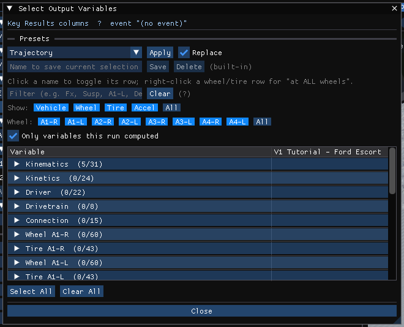
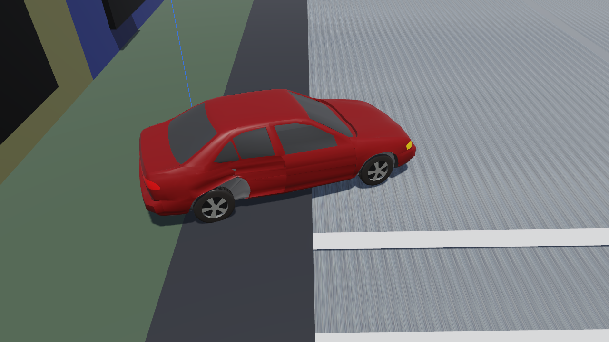

# Chapter 3 — EDSMAC Program Output

This chapter defines the outputs available from an EDSMAC event. In HVE 2027 the outputs of a solved event are in the **Output** menu of the Event (F5) editor, and the trajectory is played back in the viewport.

## Output Overview

EDSMAC produces three types of output reports:

- **Alpha-Numeric Reports** — Reports containing text and numeric information, such as vehicle dimensional parameters
- **Variable Output Tables** — Reports containing tabular simulation results as a function of time
- **Trajectory Simulations** — Dynamic, visual simulations

To view the alpha-numeric reports in HVE 2027:

1. Solve the event (**Run** on the playback bar).
2. Choose **Output › HVE Reports...**. The **HVE Reports** window is displayed, with one tab per report page that EDSMAC built during the run: **ACCIDENT HISTORY**, **DAMAGE DATA**, **MESSAGES**, **PROGRAM DATA**, **REFERENCES** and **VEHICLE DATA**.
3. Click a tab to display that page.

!!! note "HVE 2027"
    These pages are EDSMAC's own: the engine builds them from its own resource strings at the end of the run, as in HVE, and HVE 2027 displays them as tables built from the engine's own report records. **Save This Page** and **Save All Pages** at the bottom of the window write them to a text file, and **Save Page as HTML** / **Save All Pages as HTML** to an HTML file a browser can print; the window has no Print button. The figures of HVE-2D's report windows that this chapter used to carry are not reproduced. The Accident History is its ACCIDENT HISTORY tab. HVE 2027 also has views of its own built from its results — **Output › Key Results...** and **Output › Output Graph...**.

## Alpha-Numeric Reports

EDSMAC produces the following alpha-numeric reports:

- **Accident History** — A table of initial, impact, separation and final positions and velocities for each vehicle in the current event
- **Damage Data** — A table containing the vehicle collision ('RHO') vectors in both cylindrical and Cartesian coordinates, and a table containing the beginning and end of each damage range, its CDC, PDOF, total delta-V and peak acceleration
- **Messages** — A list of messages produced by the current event
- **Program Data** — A table containing program control information for the current event
- **References** — EDSMAC's technical references (a page the engine builds; it is listed in HVE 2027's HVE Reports window)
- **Vehicle Data** — A series of tables containing the vehicle data and driver controls data used by the current EDSMAC event

An example of each of these numeric output reports from EDSMAC is described below.

### Accident History

The Accident History Report displays a table of initial, impact, separation and final positions and velocities for each vehicle. For each of the phases SIM START, IMPACT, SEPARATION and FINAL/REST, the report lists the time, the position (X, Y in ft, and heading angle PSI in deg) and the velocity (forward u and lateral v in mph, and angular velocity in deg/sec) of each vehicle.

For how the impact and separation times are detected, see [Chapter 4 — Impact and Separation Times](04-calculation-method.md#impact-and-separation-times).

In HVE 2027 this is the **ACCIDENT HISTORY** tab of **Output › HVE Reports...**.

### Damage Data

The Damage Data Report includes the following information:

- **Vehicle Damage Summary** — A table containing the collision ('RHO') vector information in two forms: RHO vector length and angle, and RHO vector x,y endpoint coordinates.

    > NOTE: This table is used to define the damage profile.

- **Vehicle Damage Ranges** — A table containing the starting and ending points for each damage range, along with its CDC, PDOF, total delta-V and peak acceleration. For how these are determined, see [Chapter 4 — Collision Severity Results](04-calculation-method.md#collision-severity-results-pdof-delta-v-and-peak-acceleration).

> NOTE: A **J-point**, marked with a double asterisk in the damage summary, is a point on the damage profile that could not be established from the vehicle's own radial vector and was constructed from the other vehicle's CG instead. Restitution is not computed at these points.

### Messages

A typical Messages Report simply lists the messages (or "No Messages") produced during event execution. For a complete listing of messages issued by EDSMAC, see [Chapter 6 — Messages](06-messages.md).

### Program Data

The Program Data Report includes the following information:

- **Simulation Controls** — Integration parameters used for the current event (maximum simulation time; collision, separation and trajectory phase timesteps; output interval; linear and angular termination velocities).
- **Collision Parameters** — Parameters used within the collision model (Vector Spacing, the angular sweep interval; Vector Adjustment Increment, the radial depth interval; Max Pressure Error; Inter-vehicle Friction; Minimum Velocity for Friction; and the restitution coefficients $C_0$, $C_1$ and $C_2$).
- **Collision Criteria** — Parameters used to determine which side (front, back, right or left) a RHO vector intersects; used to determine the RHO vector's initial length (the eight clock-angle limits that bracket each side, together with the corresponding initial RHO vector length tests).

### Vehicle Data

The Vehicle Data Report includes the following information:

- **Vehicle Dimensional and Inertial Properties** — The dimensional and inertial parameters used by each vehicle in the current event (CG to front and rear axle, track width, yaw inertia, mass, weight, body length to front and rear, overall body width, and crush stiffness $K_v$).

    > NOTE: The yaw inertia displayed in the Vehicle Data report includes the inertial contributions of the unsprung masses. These masses are added to the sprung mass yaw inertia to calculate the total yaw inertia used by EDSMAC.

- **Tire Properties** — The tire parameters used by each vehicle in the current event (slide friction, velocity dependence, cornering stiffness, for each axle and side).
- **Driver Data** — Individual Driver Control tables for steering, braking and throttle used by each vehicle in the current event.

!!! note "HVE 2027"
    The **Crush Stiffness, Kv** row of this report is the Kv EDSMAC actually used for each vehicle — the frontal value — and is the quickest check that the value entered in **Kv Stiffness** reached the engine (see [Chapter 2 — Exterior](02-program-input.md#exterior)).

## Graphic Reports

EDSMAC produces no Graphic Output Reports.

> NOTE: Graphs of simulation results vs time may be produced using the Variable Output window (see next section); in HVE 2027, **Output › Output Graph...**.

## Variable Output Table

EDSMAC produces a Variable Output table containing the time-based simulation results.

!!! note "HVE 2027"
    In HVE 2027 the time-based results are shown in:

    - **Output › Key Results...** — the equivalent of the Variable Output table: one row per output step and one column per selected variable and vehicle, plus each vehicle's key results. **Select Variables...** at the top of the panel (or **Output › Variable Selection...**) opens the **Select Output Variables** window, which chooses the columns; **Export CSV...** writes the table to a file;
    - **Output › Output Graph...** — selected variables plotted against time;
    - **Output › Export Variables...** — the selected variables written to a file.

    Channels that EDSMAC never computes are marked "(not computed)" in their names, and **Only variables this run computed** in the Select Output Variables window hides them.

The Variable Output groups produced by EDSMAC are as follows:

### Vehicle Output Groups

- **Kinematics** — Position, velocity and acceleration for each vehicle
- **Kinetics** — Summation of collision forces and moments acting at the CG of each vehicle
- **Tire** — The tire output parameters existing at the tire contact patch (compare with Wheel Output, below)
- **Wheel** — The wheel output parameters existing at the wheel's hub. Information about the position of each wheel (compare with Tire output, above).
- **Driver** — Current levels of driver inputs (steering, braking and throttle)

A detailed listing of each Variable Output parameter produced by EDSMAC is found in Table 3-1.

**Table 3-1. Vehicle Variable Output Data**

| Parameter | Description |
|---|---|
| Vehicle Kinematic Data | X,Y,Z position of CG; $\Phi,\Theta,\Psi$ orientation; total linear velocity, u,v,w components; sideslip angle; r angular velocity; total linear acceleration, fwd and side components; u-dot, v-dot linear components; r-dot angular components |
| Vehicle Kinetic Data | $\Sigma F_x$, $\Sigma F_y$, $\Sigma M_z$ (collision); $\Sigma F_x$, $\Sigma F_y$, $\Sigma M_z$ (tires) |
| Tire Data | X,Y,Z position of tire contact patch; slip angle; $F'_x$, $F'_y$, $F'_z$; skid flag |
| Wheel Data | x,y,z location of each wheel; $F_x$, $F_y$, $F_z$; steer angle ($\delta$) at each steerable wheel |
| Driver Data (\*) | Steering wheel angle |

(\*) If Driver Control option was 'At Driver'

*Figure 3-6: The Select Output Variables window, which chooses the variables shown in Key Results. Before a run it has one vehicle column, after a run one per vehicle.*

## Trajectory Simulation

EDSMAC produces a trajectory simulation of the current event. The trajectory simulation is a visualization of the vehicle position data displayed in the Variable Output table (see previous section).

*Figure 3-7: An EDSMAC trajectory simulation in HVE 2027, at the end of the run.*

### Displaying a Trajectory Simulation

In HVE 2027 the trajectory simulation is the playback of the solved event in the 3-D viewport; nothing is calculated during playback. It is controlled with the playback bar under the viewport (see [Chapter 2 — Executing An Event](02-program-input.md#executing-an-event)):

- **|<** — Jump to the start of the simulation
- **<<** — Step back one output step
- **Play / Pause** — Play the simulation forwards, or pause it
- **>>** — Step forward one output step
- **>|** — Jump to the end of the simulation

!!! note "HVE 2027"
    HVE 2027 has no reverse play; step back with **<<**. The camera is chosen in the list on the playback bar (**Free view**, or a camera made in **Tools › Cameras...**). Paths, skidmarks and vectors are switched on in **View › Scene Display**, and **File › Record Animation...** writes a video.

### Displaying a Damage Profile Simulation

EDSMAC produces a dynamic simulation of the vehicle damage profile. The vehicle is initially displayed in its original shape without damage.

!!! note "HVE 2027"
    HVE 2027 has no separate Damage Profile viewer: the simulated crush is drawn on each vehicle's body in the viewport as the event plays back. **Output › Damage Studio Report...** analyzes the final crush.

*Figure 3-9: EDSMAC's simulated damage drawn on the struck vehicle of the tutorial event, after the run.*

---

[Previous: Chapter 2 — Program Input](02-program-input.md) | [Next: Chapter 4 — Calculation Method](04-calculation-method.md)

<!-- NAV -->

---

← Previous: [Chapter 2 — EDSMAC Program Input](02-program-input.md)  |  [Index](README.md)  |  Next: [Chapter 4 — Calculation Method](04-calculation-method.md) →

<!-- /NAV -->
