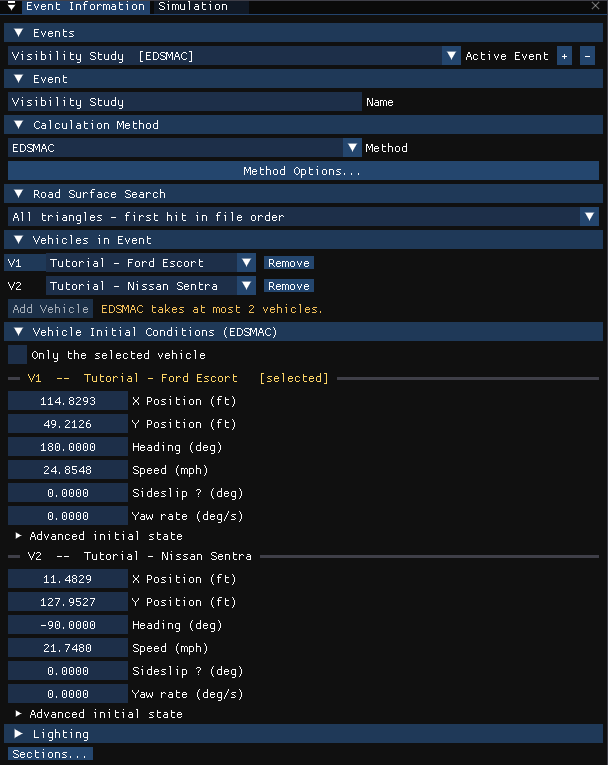
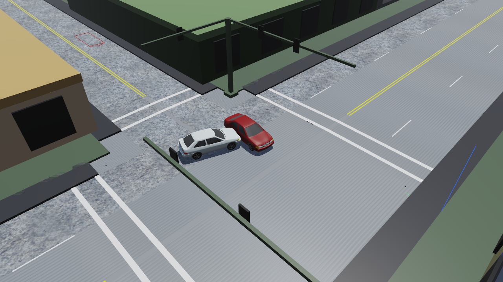

# Chapter 5 — EDSMAC Tutorial

## Description

This tutorial illustrates a very common use of EDSMAC, that is, to perform a time-distance study to evaluate accident avoidability. We'll be able to watch as the vehicles approach each other and determine the first point of visibility between vehicles.

This tutorial is a continuation of the EDCRASH Tutorial, wherein the initial vehicle velocities were estimated. You may wish to review that tutorial before continuing.

Like all EDSMAC events, the procedure involves the following basic steps:

- Create the vehicle(s)
- Create the environment
- Execute the EDSMAC event
- Review the EDSMAC output reports

This basic procedure is described in detail in this tutorial.

!!! note "HVE 2027"
    HVE-2D builds this tutorial from scratch out of its `Tutorial.db` vehicle database and the `EdcrashEdsmacTutorial_2D.h3d` site, neither of which HVE 2027 ships. The EDSMAC4 tutorial uses the same two vehicles, the same site and the same initial conditions and driver tables, and HVE's support files include it as a finished case, **`Edsmac4TutorialEDC.hve`**. In HVE 2027 we therefore open that case, switch its event to EDSMAC, and make the one EDSMAC-specific change: the Nissan's frontal Kv stiffness. Each step of the original tutorial is shown where its input lives in HVE 2027. If you have HVE's `Tutorial.db`, you can build the case from scratch with the same steps instead.

> NOTE: It is assumed that HVE 2027 is running and that you are familiar with its basic features: the editor tabs, the panels and the 3-D viewport. The purpose of this tutorial is to illustrate those features while setting up and executing an EDSMAC event.

## Getting Started

Before we start, let's set the display options so we're all starting on the same page.

1. Choose **Tools › Preferences...** and set **Units** to **Metric (m, km/h, kg, N)**.

    > NOTE: As we'll see when we look at the environment, our EDSMAC Tutorial takes place in Australia; thus, we use metric units. One field in this tutorial, the Kv stiffness, is checked in US units; see [Editing the Vehicles](#editing-the-vehicles).

2. In the **View** menu, make sure **Key Results** is checked, and in **View › Scene Display** turn on **Skidmarks**.

3. In **View › Scene Display › Rendering**, choose **Phong**.

The remaining options keep their defaults. We're now ready to proceed with the tutorial.

## Opening the Case

1. Choose **File › Open Case...** (Ctrl+O).
2. Browse to the `supportfiles\case` folder of your HVE installation and open **`Edsmac4TutorialEDC.hve`**.

The case opens with two vehicles, the *Blind Intersection* site, and one event, *Visibility Study*.

## Creating the Vehicles

The case contains the two vehicles of our study: a white 1996 Ford Escort 2-Door Hatchback and a dark red 1995 Nissan Sentra 4-Door Sedan.

1. Choose the **Vehicle (F3)** editor tab. The Vehicles panel lists **Tutorial - Ford Escort** and **Tutorial - Nissan Sentra**.
2. Click **Tutorial - Ford Escort**. In the **Information** section, note its attributes: Vehicle Type = Passenger Car, Make = Ford, Model = Escort, Year = 1991-1996, Body Style = 2-Door Hatchback, Driver Location = Right.

    > NOTE: The Information section (and **Vehicle › Vehicle Information**) also lets you edit the Driver Location, Engine Location, Number of Axles and Drive Axle(s). For our tutorial, only the driver location differs from its default.

3. Click **Tutorial - Nissan Sentra** and note its attributes: Passenger Car, Nissan, Sentra, 1995-1999, 4-Door, Driver Location Right.

*Figure 5-1: The Vehicle Information window for the Ford Escort.*

> NOTE: To build the case from scratch, click **Add...** at the top of the Vehicles panel. The **Add Vehicle** dialog searches the vehicle databases in the folders listed under **Database folders**; add the folder holding HVE's `Tutorial.db`, choose the vehicle, and click **Add Vehicle**. Then set **Driver Location** to **Right**.

### Editing the Vehicles

In the original tutorial we edit the vehicles to change their color and weight, and change the stiffness of the Nissan Sentra using values derived from our initial reconstruction analysis. The case already holds the edited colors and weights; here is where each one lives.

The Ford Escort:

1. Select **Tutorial - Ford Escort** in the Vehicles panel.
2. The **Color** row of the **Information** section holds the color as red, green and blue values; click the color chip at the end of the row for a color picker. The Escort is white.

    !!! note "HVE 2027"
        HVE 2027 has no separate Vehicle Color dialog.

3. In the **Vehicle Properties** section, click **Inertia / Mass...**. The total **Weight** is the measured value, 11037 N (2481.2 lbf), where the database value was 10283 N.

    > NOTE: The weight is entered as a force; the mass is calculated and displayed beside it. The value may show extra digits, because the weight is stored as mass and multiplied by the gravity constant for display.

    !!! note "HVE 2027"
        HVE 2027 has no *Auto Update Inertia When Weight Changes* checkbox. When you change a weight, check the **Yaw** row of **Rotational Inertia** in the same window and enter the yaw inertia you intend.

The Nissan Sentra:

1. Select **Tutorial - Nissan Sentra**. Its color is a dark red.
2. In **Vehicle Properties › Inertia / Mass...**, the total **Weight** is the measured value, 11282 N (2536.3 lbf), where the database value was 10858 N.

Finally, let's change the stiffness of the Nissan. From a previous reconstruction analysis, the A and B stiffnesses were re-calculated in order to balance the forces (the technique is described in references [20] and [21]). Based on this analysis, a new $K_v$ stiffness was calculated, 89.2 N/cm² (129.4 lb/in²). This is the one value we have to enter, because the case was saved for EDSMAC4, which does not use $K_v$.

1. Choose **Tools › Preferences...** and set **Units** to **Imperial (ft/in, mph, lb, lbf)** for this step.

    !!! note "HVE 2027"
        The Kv field is in lbf/in² in US units and N/m² in metric units (71.8 N/cm² is 718 000 N/m²). See [Chapter 2 — Exterior](02-program-input.md#exterior).

2. Choose the **Event (F5)** editor tab, then **Event › Crush Profile...**. The **Crush & Geometry** window is displayed. Choose **V2 Tutorial - Nissan Sentra** in its **Vehicle** list.

    > NOTE: Crush Profile is in the Event menu of an EDSMAC or EDSMAC4 event; the case's event is EDSMAC4 at this point, which is fine.

3. Click **CG to Front...**. The **CG to Front Stiffness** window is displayed.
4. In **Kv Stiffness**, replace the current value, 104.1 (HVE's 71.8 N/cm²), with the calculated value, `129.4`.
5. Close the two windows, and set **Units** back to **Metric** in Preferences.

*Figure 5-4: The Crush & Geometry window. **CG to Front...** opens the window holding the A, B and Kv stiffness of the front surface. EDSMAC uses the front Kv for the entire vehicle.*

> NOTE: It is obviously of great importance to recognize that EDSMAC assumes the stiffness is uniform about the exterior of the vehicle, and that EDSMAC uses the value assigned for the FRONT surface.

Now, we have both vehicles ready for our study.

## Saving the Case

HVE 2027 does not write `.hve` files, so save the case under a new name in HVE 2027's own format:

1. Choose **File › Save Case As...**.
2. Enter the file name `EDSMACTutorial` and save. The case is saved as an `.hvc` file (or use **File › Save Case As JSON...** for a `.json` file).

    > NOTE: Saving the file occasionally is a highly recommended practice.

## Creating the Environment

The case brings its site, the *Blind Intersection*, with it.

1. Choose the **Environment (F4)** editor tab. The **Terrain** section reports that the terrain is embedded in the imported case.
2. In the **Location** section, enter the site and time of our study: **Name** `Blind Intersection`, **Date** `07/23/1997`, **Time** `1330`, **Latitude** `-35.5` and **Longitude** `151.1667` (35°30'S, 151°10'E, as the original tutorial gives them).
3. Set the angle from true north to the earth-fixed X axis, −10 degrees, and the UTC offset, +10 hours, in the Shader Editor's world: choose **View › Shader Editor** and set **North** to `-10` and **UTC offset** to `+10`.

    > NOTE: The latitude, longitude, time zone, date, time and north angle are used to position the sun in the scene. This is, of course, important because the sun is the primary light source for the scene. They do not change the EDSMAC results.

*Figure 5-5: Environment used for our EDSMAC tutorial, in the Environment (F4) editor.*

!!! note "HVE 2027"
    HVE-2D used a flat 2-D version of this site; HVE 2027 uses the full 3-D site that the case carries. EDSMAC itself uses only the friction under each tire.

## Creating Events

As mentioned at the outset, this EDSMAC tutorial is an avoidability study in which visibility plays a key role. With this in mind, we will start simulating the event well before impact to illustrate the visibility between vehicles, as obstructed by the building on the southwest corner of the intersection.

The case's event, *Visibility Study*, is set up for EDSMAC4. Let's make it an EDSMAC event:

1. Choose the **Event (F5)** editor tab. The **Event Information** panel is displayed.
2. Under **Calculation Method**, choose **EDSMAC** in the **Method** list.
3. Under **Vehicles in Event**, V1 is the Ford Escort and V2 the Nissan Sentra.

> NOTE: To create such an event yourself, click **+** beside **Active Event**, choose **EDSMAC** in **Method**, click **Add Vehicle** twice and choose the two vehicles, and type `Visibility Study` in **Name**.

*Figure 5-6: Event Information for the Visibility Study event with EDSMAC as its method.*

Now let's look at how the vehicles are placed in the environment and what the drivers do.

### The Ford Escort

1. Choose **Event › Position / Velocity...** (Ctrl+P) and choose **V1 Tutorial - Ford Escort** in the window's **Vehicle** list. The initial position is **X** = 35 m, **Y** = 15 m and **Heading** = 180 degrees, and the initial **Speed** is 40 km/h.

    > NOTE: To place a vehicle with the mouse, click it in the viewport and press **G** to move it on the road surface or **R** to rotate it about its yaw axis. It is often easier to type the coordinates into the Position / Velocity window or into the Vehicle Initial Conditions section of Event Information.

2. Choose **Event › Driver Controls...** (Ctrl+D) and choose the Ford Escort. The **Steer** tab holds the steering-wheel angle table of Table 5-1 (HVE's default *At Steering Wheel* option).

**Table 5-1. Steer table entries for the Ford Escort.**

| Time (sec) | Steer Angle at Steering Wheel (degrees) |
|---|---|
| 1.50 | 0.0 |
| 2.00 | 90.0 |

3. The **Brake** tab's **Input Method** is **% of Friction**, and its per-wheel table holds the entries of Table 5-2. In HVE 2027's per-wheel table, A1-R is HVE's R/F, A1-L is L/F, A2-R is R/R and A2-L is L/R.

**Table 5-2. Brake table for Ford Escort.**

| Time (sec) | R/F | L/F | R/R | L/R |
|---|---|---|---|---|
| 2.25 | 0.00 | 0.00 | 0.00 | 0.00 |
| 2.35 | 1.00 | 1.00 | 1.00 | 1.00 |
| 2.70 | 1.00 | 1.00 | 1.00 | 1.00 |
| 2.80 | 1.00 | 1.00 | 0.01 | 0.01 |

*(Percent Available Friction, %/100)*

!!! note "HVE 2027"
    Leave **Input Method** on **% of Friction**. EDSMAC has no pedal input; a **Pedal (AT_DRIVER)** table is run as % of Friction, and the run status says so; see [Chapter 2 — Driver Controls](02-program-input.md#driver-controls).

### The Nissan Sentra

1. In **Event › Position / Velocity**, choose **V2 Tutorial - Nissan Sentra**. The initial position is **X** = 3.5 m, **Y** = 39 m, **Heading** = −90 degrees, and the initial **Speed** is 35 km/h.
2. The Nissan has no driver inputs, per se. However, after impact the vehicle coasts to rest, so its **Brake** tab in **Event › Driver Controls** holds the rolling resistances of Table 5-3 (% of Friction).

**Table 5-3. Post-impact rolling resistances for the Nissan Sentra.**

| Time (sec) | R/F | L/F | R/R | L/R |
|---|---|---|---|---|
| 2.70 | 0.00 | 0.00 | 0.00 | 0.00 |
| 2.80 | 0.20 | 0.20 | 0.01 | 0.01 |

*(Percent Available Friction, %/100)*

### Simulation Controls

This event lasts more than 5 seconds, so the maximum simulation time is increased from 5 to 10 seconds. In HVE 2027, click the **Simulation** tab beside Event Information (or choose **View › Simulation**): under **Simulation Controls**, **Duration** is 10 s, with a **Trajectory Timestep** of 0.02 s, **Collision Timestep** 0.001 s, **Separation Timestep** 0.01 s and **Output Timestep** 0.1 s.

### Running the Event

Now, we're ready to position the camera to view the event.

- In the viewport, orbit and zoom until both vehicles and the intersection are in view.

Next, the Key Results:

- If the **Key Results** panel is not displayed, choose **View › Key Results**, and dock it where it does not block the viewport.

Now, we're ready to execute the event.

- Press **Run** on the playback bar under the viewport.

Watch as the vehicles approach each other, collide, and roll to their rest positions.

> NOTE: You can change the view while the event is playing, or press **Pause**, set the view, and press **Play** to continue.

> NOTE: Remember to pay attention to the Key Results; in this case, you might be interested in the position and velocity of each vehicle at initial visibility.

The run status in the Simulation panel reads *EDSMAC complete*. The vehicles collide at t = 2.66 s, the Ford at about 30 km/h and the Nissan at about 35 km/h; they separate at t = 2.74 s, and the Ford comes to rest at t = 3.61 s and the Nissan at t = 6.04 s.

*Figure 5-8: The vehicles at separation, t = 2.74 s.*

!!! tip "New in HVE 2027"
    HVE-2D's view is limited to a straight-down view. In HVE 2027 you can ride along with either driver: **Tools › Cameras...** attaches a camera to a vehicle at the driver's head and aims it where the driver is looking. The EDSMAC4 tutorial's [Setting the View](../EDSMAC4/05-tutorial.md#setting-the-view) walks through it for this same case.

We have now completed the event.

## Viewing Results

Now that we have produced our EDSMAC simulation, let's take a detailed look at the results. In HVE 2027 the results of the solved event are in the **Output** menu, and the trajectory is played back in the viewport.

EDSMAC produces the following reports:

- **Accident History** — A table of initial, impact, separation and final positions and velocities for each vehicle
- **Damage Data** — A table of damage profile coordinates, CDC, PDOF, Delta-V and Peak Acceleration for each vehicle
- **Damage Profiles** — A visualization of the damage to each vehicle
- **Messages** — A list of messages produced by the current run
- **Program Data** — A table containing program control information
- **Trajectory Simulation** — A visualization of the event, displayed at the output interval
- **Variable Output** — A table containing user-selectable, time-dependent simulation results for each vehicle
- **Vehicle Data** — Tables containing all of the vehicle data and driver control data used by the simulation

### Report Windows

The alpha-numeric reports are EDSMAC's own report pages. To view them:

1. Choose **Output › HVE Reports...**. The **HVE Reports** window is displayed, headed *EDSMAC, event 1*, with one tab per page: **ACCIDENT HISTORY**, **DAMAGE DATA**, **MESSAGES**, **PROGRAM DATA**, **REFERENCES** and **VEHICLE DATA**.
2. Click the tab of the report you want.

!!! note "HVE 2027"
    HVE 2027 lays these pages out as tables; the figures of HVE-2D's report windows are not reproduced. **Save This Page** and **Save All Pages** write them to a text file.

### Accident History

The Accident History report displays the positions and velocities for each vehicle at key times (Start of Run, Impact, Separation and Final/Rest) during the run. It is the **ACCIDENT HISTORY** tab of HVE Reports, which **Output › Accident History Report...** opens directly.

For this event the report gives, in round figures:

| | Time (s) | Ford X, Y (m) | Ford heading (deg) | Nissan X, Y (m) | Nissan heading (deg) |
|---|---|---|---|---|---|
| Sim start | 0.00 | 35.0, 15.0 | 180.0 | 3.5, 39.0 | −90.0 |
| Impact | 2.66 | 6.07, 13.85 | 195.0 | 3.35, 13.16 | −90.5 |
| Final/Rest | 3.61 (Ford), 6.04 (Nissan) | 3.68, 12.02 | 230.4 | −0.07, 1.70 | 69.2 |

> NOTE: The vehicles are listed in the order in which they were added to the event (Veh #1, Veh #2).

### Damage Data

The Damage Data report (**DAMAGE DATA** tab) displays a table of collision vector results for each vehicle. The collision vectors determine the total force on each vehicle. In addition, the endpoints of the collision vectors define the damage profile.

The collision vectors are displayed both in cylindrical coordinates (RHO, PSI) and Cartesian coordinates (x,y).

Following the table of collision vectors, the Damage Ranges are displayed. The Damage Ranges report includes the beginning and ending point for each damaged region on the exterior (up to 10 regions may be displayed for each vehicle), followed by the CDC, PDOF, Delta-V and Peak Acceleration for each damage region.

The run's delta-V and PDOF also appear in the Simulation panel's **Last Result** and in **Output › Key Results...**: about 17.7 km/h for the Ford and 13.1 km/h for the Nissan.

### Damage Profiles

The Damage Profiles report provides a visual representation of the damage to each vehicle. In HVE 2027 the damage is drawn on the vehicles in the viewport as the event plays back: play the event, or step through it with **<<** and **>>**, and orbit close to a vehicle to see its crush.

*Figure 5-12: EDSMAC's simulated damage on the Nissan Sentra in the Visibility Study, after the run.*

### Messages

EDSMAC produces several messages, depending on the outcome of the run (**MESSAGES** tab). For a complete list and explanation of these messages, refer to [Chapter 6](06-messages.md).

### Program Data

The Program Data report (**PROGRAM DATA** tab) displays the simulation controls (integration time steps and termination conditions), collision parameters used by the EDSMAC collision algorithm and the fixed values (RHOB Tests), which cannot be changed by the user, that determine whether a vector passes through the end (front or back) or side (left or right).

### Trajectory Simulation

The Trajectory Simulation is the playback of the event in the viewport, controlled by the playback bar.

> NOTE: No calculations take place during playback; the run is solved once, when you press Run.

To visualize the motion:

1. Click **Play**. The simulation plays at the output interval.
2. Click **Pause**. The simulation stops.
3. Click **<<** to step back one output step at a time.
4. Click **|<**. The simulation returns to the start.

Click **>|** — the simulation advances to the end of the run.

*Figure 5-15: Trajectory Simulation for the Visibility Study, displaying the crash sequence at the end of the event.*

### Variable Output

The Variable Output table displays the time-dependent results computed by EDSMAC. In HVE 2027 it is the **Key Results** panel (**Output › Key Results...**), with one row per output step and one column per selected variable; the same variables can be graphed with **Output › Output Graph...**.

#### Variable Selection

The purpose of our EDSMAC study is to evaluate the avoidability of the accident based on speeds and visibility. To document the path positions as a function of time, let's select the position, velocity and acceleration.

1. Click **Select Variables...** at the top of the Key Results panel (or choose **Output › Variable Selection...**). The **Select Output Variables** window is displayed, as shown in Figure 5-16.
2. Type `X`, `Y`, `Yaw`, `V-tot` or `Acc-tot` in the filter box in turn (HVE's own variable names are recognised), and check each variable for both vehicles.

    > NOTE: Feel free to add additional variables.

The Key Results for the Visibility Study event now include position, velocity and acceleration for both vehicles, plus any other variables you may have added.

*Figure 5-16: The Select Output Variables window, used for selecting the results displayed in Key Results.*

### Vehicle Data

The Vehicle Data report (**VEHICLE DATA** tab) displays the vehicle data, tire data and driver tables for each vehicle in the event. Its **Crush Stiffness, Kv** row confirms the Nissan's Kv of 129.4 reached EDSMAC.

> NOTE: The Vehicle Data, Damage Data and several other reports contain more information than fits in the window. Scroll the page, or enlarge the window.

### Printing

HVE 2027 does not print reports directly. To keep a copy:

1. In **Output › HVE Reports**, click **Save All Pages** (or **Save This Page**). The pages are written to the text file named in the box beside the buttons.
2. For the time histories, click **Export CSV...** in the Key Results panel (the selected variables) or in the Timestep Data table (the trajectory).

You can then print or include these files in your own report.

---

[Previous: Chapter 4 — Calculation Method](04-calculation-method.md) | [Next: Chapter 6 — Messages](06-messages.md)

<!-- NAV -->

---

← Previous: [Chapter 4 — Calculation Method](04-calculation-method.md)  |  [Index](README.md)  |  Next: [Chapter 6 — Messages](06-messages.md) →

<!-- /NAV -->
