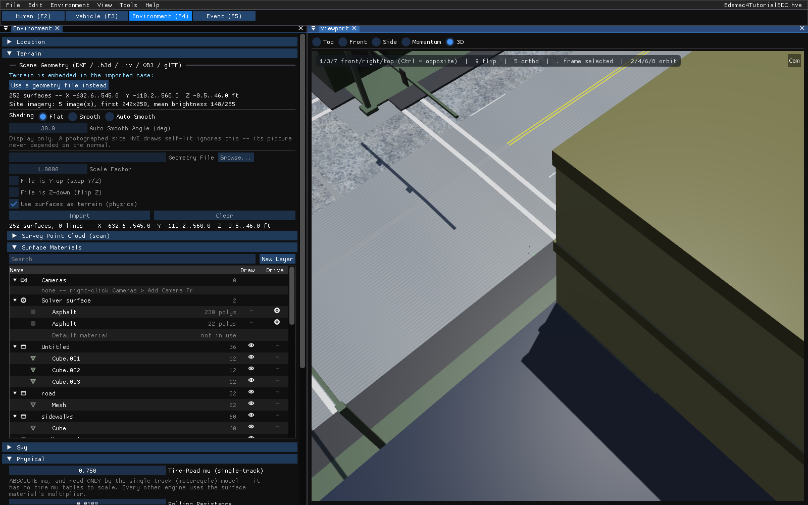
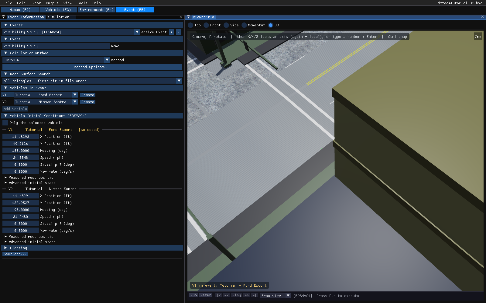
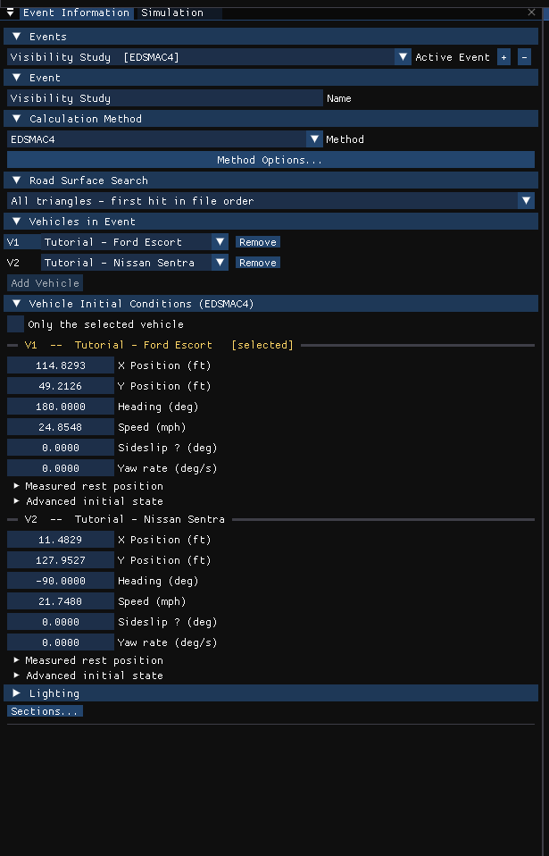
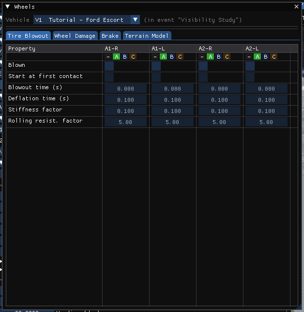

# Chapter 2 — EDSMAC4 Program Input

This chapter defines the objects (vehicles and environment) and the event set-up parameters (positions, driver controls, and so forth) used by the EDSMAC4 analysis. In general, the chapter is divided into the following sections:

- **Objects** — The number of vehicles, and the specific vehicle parameters actually used by EDSMAC4.
- **Events** — The various options available for setting up and executing an EDSMAC4 event.

## Objects Overview

The objects used by the EDSMAC4 model are:

- **Vehicles** — One or more vehicles may be studied by EDSMAC4. The maximum number of vehicles in a single EDSMAC4 event is 20.
- **Environment** — Like the real world, EDSMAC4 has exactly one environment.

> **NOTE:** The environment is used in any reconstruction or simulation model.

The following sections describe how the vehicle and environment provide the required inputs to the EDSMAC4 calculation model.

## Vehicles

EDSMAC4 uses one or more vehicles created in the **Vehicle (F3)** editor. Vehicles are selected from a vehicle database by the following attributes, shown in the **Identity** and **Configuration** sections of the Vehicles panel:

- **Type** — EDSMAC4 supports the following vehicle types: Passenger Car, Pickup, Multi-Purpose (HVE's Sport-Utility), Van, Truck, Trailer, Dolly, Fixed Barrier and Movable Barrier.
- **Make** — EDSMAC4 supports all available vehicle makes.
- **Model** — EDSMAC4 supports all available vehicle models, within the limits defined by number of axles and drive axles; see below.
- **Year** — EDSMAC4 supports all available vehicle years.
- **Body Style** — EDSMAC4 supports all available vehicle body styles (except Class 2 Hinged Drawbar Dolly).

Each vehicle also has the following additional user-editable parameters:

- **Driver Location** — The Driver Location is not used by EDSMAC4. However, if you would like the vehicle to have any steerable axles, Driver Location must not be None.
- **Engine Location** — The Engine Location is not used by EDSMAC4. However, if you would like the Throttle Table to be available during Event mode, Engine Location must not be None.
- **Number of Axles** — EDSMAC4 supports 1-, 2- or 3-axled vehicles.
- **Drive Axle(s)** — The Drive Axle is used by EDSMAC4 to determine which wheels to include in the Throttle Table during Event mode.

!!! note "HVE 2027"
    HVE 2027 checks the vehicles against EDSMAC4's own limits when you choose the method: a non-trailer unit must have 2 or 3 axles, a trailer or dolly 1 to 3, and a Fixed Barrier 0. An incompatible method is shown in the **Method** list marked "N/A for these vehicles", with the reason in its tooltip, and pressing **Run** is refused with the reason in the run status until the vehicles are fixed.

!!! note "HVE 2027"
    HVE 2027 does not run an engine when the throttle table is empty: a vehicle whose event throttle table holds no value above zero is run with Engine Location None, so it coasts. Enter a throttle table only if the vehicle accelerates.

To add a vehicle to the current case:

1. Choose the **Vehicle (F3)** editor tab (or press F3). The Vehicles panel and the viewport are displayed.
2. Click **Add...** at the top of the Vehicles panel. The **Add Vehicle** dialog is displayed.
3. Search the loaded databases (open **Database folders** to add a folder holding HVE `.db` files), or choose one of HVE's built-in generic vehicles under **Built in (no database needed)**, and click **Add**.
4. If desired, modify the Driver Location, Engine Location, Number of Axles and Drive Axle(s) in the **Configuration** section.
5. Edit the vehicle's **Name**. The name does not affect calculations.

*Figure 2-1: The Vehicle (F3) editor in HVE 2027, showing the EDSMAC4 tutorial's Ford Escort.*

The following Vehicle Parameter groups are assigned in the Vehicle editor (the **Size & Weight**, **Inertia** and **Components** sections of the Vehicles panel, and the **Vehicle** menu):

- Sprung Mass — Inertias, Move CG, Inter-vehicle Connections
- Unsprung Mass — Wheel Location, Tire Data, Suspension Data
- Exterior — Overall Dimensions, Stiffness Coefficients
- Steering System

The specific data used in each of the above parameter groups are defined in Tables 2-1 through 2-3.

### Sprung Mass

**Table 2-1: Vehicle Sprung Mass Parameters Used By EDSMAC4**

| Parameter | Description |
|---|---|
| Total Weight | Total vehicle weight |
| Total Yaw Inertia | Rotational inertia about the vehicle-fixed z axis |
| Move CG x,z | Relocates the CG in the vehicle-fixed x and z directions. This entry causes an automatic adjustment of all other vehicle dimensions to reflect the new CG location. |
| Inter-vehicle Connections (x, y, z, Max Articulation Angle) | Vehicle-fixed x,y,z connection coordinates; Maximum Articulation Angle (rear connection) |

#### Inertias

EDSMAC4 uses the total vehicle weight (converted to mass according to the current gravitational constant; see Environment), and the total yaw rotational inertia.

#### Move CG

!!! note "HVE 2027"
    In HVE 2027 the vehicle's weight and yaw inertia are edited in the **Inertia / Mass** dialog (**Edit...** in the Vehicles panel's **Inertia** section), which shows each quantity both TOTAL and SPRUNG. **Move CG** is in the **Event** menu for an EDSMAC or EDSMAC4 event (and in **Event › Crush Profile...**).

Move CG is not used directly by EDSMAC4. Its current value does not show up in the results. However, the Move CG fields may be used to quickly move the vehicle's center of gravity. The x and z coordinates for the wheels are updated to reflect the new CG location.

> **NOTE:** Bilateral symmetry is assumed. In HVE, moving the CG in the +y or −y direction will have no effect on the EDSMAC4 calculations.

#### Geometry File

The Geometry File is not used by EDSMAC4 for physics calculations (it is used for visualization, tessellation in the Vehicle Mesh dialog, and — in the current version — optionally for initializing the collision perimeter; see the **Use Vehicle Geometry for Rho Vector Init** calculation option). *(updated: the current EDSMAC4 can derive initial RHO vector lengths from the vehicle body mesh when this option is checked; see [EDSMAC4 Calculation Options](../../10-calculation-options/CalcOptEDSMAC4.md).)*

#### Inter-vehicle Connections

EDSMAC4 uses the x,y,z Connection Locations when articulated vehicles are simulated. The Maximum Articulation Angle is also used.

The Connection y coordinate is user-editable only in HVE. In HVE 2027 the connections are edited with **Connections...** in the Vehicles panel's **Components** section.

> **NOTE:** Every trailer will have a pre-defined front connection. However, not every tow vehicle has a pre-defined rear connection. Use the Vehicle Editor to confirm the vehicle has a connection.

> **NOTE:** Be sure both vehicles have the proper connections (Hitch/Ball or King Pin/Fifth Wheel).

> **NOTE:** The connection elevation above ground must be the same for the tow vehicle and the trailer. Otherwise, the vehicle will accelerate or decelerate on level ground (the 2-D equations of motion have no way of knowing how to handle non-normal tire forces). *(updated: the current version can automatically reconcile mismatched hitch heights at event initialization via the **Inter-Vehicle Connection** calculation option — the hitch z-coordinates are adjusted, not the vehicle positions; see [EDSMAC4 Calculation Options](../../10-calculation-options/CalcOptEDSMAC4.md).)*

### Unsprung Mass

**Table 2-2: Vehicle Unsprung Mass Parameters Used By EDSMAC4**

| Parameter | Description |
|---|---|
| Wheel Location | The vehicle-fixed x,y,z wheel center coordinates |
| Dual Tire | Flag indicating wheel position has dual tires |
| Tire Radius | Tire radius in unloaded condition (editable in HVE) |
| Tire Slide Friction | The slide coefficient of friction for each tire |
| Tire Friction Table, Test Load/Speed | The load and speed for a given set of friction results (EDSMAC4 uses the middle load and middle speed) |
| Friction In-use Factor | Multiplier for slide friction |
| Tire Cornering Stiffness | Tire lateral force per unit of tire lateral slip for small amounts of lateral slip |
| Cornering Stiffness In-use Factor | Multiplier for Cornering Stiffness |

#### Wheel Location

Unlike previous SMAC models, EDSMAC4 uses the values for the vehicle-fixed x,y,z coordinates of each wheel. This allows the researcher to study the effects of wheels displaced by damage (see Event, this chapter).

Within HVE-2D, wheel x and y coordinates may be changed. Bilateral symmetry is enforced. Within HVE, and in HVE 2027, wheel x,y,z coordinates may be changed independently for each wheel.

#### Tire

Single or dual tires may be supplied at each wheel position. The HVE-2D tire parameters provide the following data groups (additional parameters are available in HVE, but they are not used by EDSMAC4):

- Physical Data
- Friction Table
- Cornering Stiffness Table
- Slip-vs-Rolloff Table

EDSMAC4's use of these parameters is described below.

#### Physical Data

EDSMAC4 uses the unloaded tire radius at each wheel to establish the vehicle's static CG elevation. In HVE, tire unloaded radius is user-editable.

#### Friction Table

EDSMAC4 uses the slide friction coefficient.

EDSMAC4's tire model does not incorporate load dependence. If friction data for more than one load are supplied, EDSMAC4 uses the friction coefficient for the middle load.

> **NOTE:** If there is any doubt about which value is actually used by EDSMAC4, you can check the Vehicle Data output report.

EDSMAC4's tire model has the capability to include speed dependence. If friction data are entered for more than one speed, EDSMAC4 calculates a speed dependence factor (see [Chapter 4 — Calculation Method](04-calculation-method.md)).

Friction In-use Factor, available in HVE, is a convenient way to reduce or increase the slide friction value during the entire run for a specific tire. In HVE 2027 the friction and cornering stiffness tables, each with its **In-Use Factor**, are on the **Friction** and **Cornering** tabs of the **Load & Speed Tables** panel at the bottom of **Vehicle › Editors › Tires...** (the Tire Properties window).

> **NOTE:** During an event, the actual tire-terrain friction used during the current timestep is the product of the slide friction coefficient, the in-use factor and the terrain friction multiplier for the polygon beneath the tire. Mathematically,
>
> $$\mu_{Tire-terrain} = \mu_{Slide} \times InUseFactor \times Mult_{Polygon}$$

#### Cornering Stiffness Table

EDSMAC4 uses the Cornering Stiffness value.

EDSMAC4 does not use the HVE Fy vs Slip Angle table, but instead uses the cornering stiffness parameter directly. If cornering stiffness data for more than one load and/or speed are supplied, EDSMAC4 uses the cornering stiffness for the middle load and/or speed.

> **NOTE:** If there is any question about which value is actually used by EDSMAC4, you can check the Vehicle Data output report.

Cornering stiffness In-use Factor, available in HVE, is a convenient way to reduce or increase the cornering stiffness value during the entire run for a specific tire. *(The original manual said "slide friction value" here; the factor applies to cornering stiffness.)*

> **NOTE:** If you are simulating a vehicle with a flat tire, you'll probably want to reduce the In-use Factor to about 0.1.

#### Slip-vs-Rolloff Table

EDSMAC4 does not use the Slip-Rolloff data.

#### Suspension

The HVE-2D Suspension Model provides the following data:

- Inter-tandem Load Transfer

EDSMAC4 supports all suspension types, including those with tandem axles. However, the suspension at each wheel is not modeled, per se. Rather, roll couple distribution is used.

**Table 2-3: Vehicle Suspension and Steering Parameters Used By EDSMAC4**

| Parameter | Description |
|---|---|
| Inter-tandem Axle Load Transfer | Rear-to-front inter-axle load transfer due to braking of tandem axles |
| Steering Gear Ratio | Ratio of the angle at the steering wheel to the angle at the wheel |

#### Inter-tandem Axle Load Transfer

If three axles are supplied for the vehicle, the vehicle is assumed to have tandem rear axles. In this case, a longitudinal load transfer due to braking may be simulated by supplying an Inter-tandem Load Transfer Coefficient.

In HVE 2027 the coefficient is the **Int. Tandem Load Xfr** row of **Vehicle › Editors › Suspension Data...**.

Studies have shown the value of −0.38 to be representative of typical four-spring suspension systems [4]. The negative sign indicates load transfer from the front to the rear axle.

The value for walking beam suspensions with 100% torque rod effectiveness is 0.0 [14]. For non-perfect torque rods with effectiveness less than 100%, the load transfer is:

$$\left(\frac{AAA}{R}\right)\left(\frac{100 - T_e}{100}\right)$$

where:

- $AAA$ = inter-tandem dimension
- $R$ = tire radius
- $T_e$ = torque rod efficiency

#### Brake

EDSMAC4 does not use the (vehicle) Brake data.

### Exterior

EDSMAC4 uses the following Vehicle Exterior Data:

- Exterior Dimensions
- A and B Stiffness Coefficients

**Table 2-4: Vehicle Exterior Parameters Used By EDSMAC4**

| Parameter | Description |
|---|---|
| CG to Front, Right, Back and Left | The vehicle's exterior dimensions |
| A Stiffness Coefficient | The initial deflection constant for each side. This coefficient represents the force per unit of damage width required to initiate damage. |
| B Stiffness Coefficient | The linear spring rate for each side of the crushed surface. This coefficient represents the force required per inch of crush depth per inch of damage width. |

> **NOTE:** Unlike EDSMAC, EDSMAC4 uses individual stiffness values for the front, sides and back. Note also the use of A and B stiffness coefficients, rather than $K_L$, is unique to EDSMAC4.

!!! note "HVE 2027"
    In HVE 2027 the per-side stiffness is edited from the **Event** menu of an EDSMAC or EDSMAC4 event: **Event › Crush Profile...** opens the **Crush & Geometry** window, whose **CG to Front... / CG to Rear... / CG to Left... / CG to Right...** buttons open a stiffness window for that side with **A Stiffness**, **B Stiffness** and **Kv Stiffness** (EDSMAC4 reads A and B; Kv is EDSMAC's). The values belong to the vehicle, not to the event.

### Steering System Data

EDSMAC4 uses the Steering System to determine which axles are steerable. Only steerable wheels are displayed in the Driver Controls, Steer Table. In addition, if the Steer Table, At Driver option is used, the steering gear ratio parameter is used to compute the steer angle at each steerable tire. In HVE 2027 these are in **Vehicle › Editors › Steering System...** (the **Gear Ratio** row).

*(updated: the current EDSMAC4 can also use the Steering System data in an optional dynamic steer degree of freedom, selected by the Steer DOF calculation option. When Steer DOF is Normal, Append or AutoStart, steer angles are computed from the torques acting on the steering system rather than taken directly from the steer tables.)*

!!! warning "Not in HVE 2027"
    HVE 2027 always runs EDSMAC4 with Steer DOF **Off**, so the steer table is applied as a prescribed steer angle. There is no Steer DOF control for an EDSMAC4 event, and a non-zero Steer DOF stored in an imported HVE case is ignored; the run status says so ("EDSMAC4 steer DOF *n* from the file ignored"). The reason is that EDSMAC4 skips the prescribed steer table under Steer DOF Normal. (The **Steer DOF** column in **Vehicle › Editors › Steering System** is SIMON's.)

### Brake System Data

EDSMAC4 does not use the Brake System data.

## Environment

EDSMAC4 uses the environment set up in the **Environment (F4)** editor. The environment is defined by the following groups of attributes:

- Visual Data
- Physical Data

*Figure 2-2: The Environment (F4) editor in HVE 2027, with the EDSMAC4 tutorial's site loaded.*

### Creating an Environment

A case in HVE 2027 always has exactly one environment; there is nothing to add. To set it up:

1. Choose the **Environment (F4)** editor tab. The Environment panel is displayed.
2. In the **Location** section, enter the site **Name**, **Date**, **Time**, **Latitude** and **Longitude** (or search an address or paste a coordinate).
3. In the **Terrain** section, load the site geometry (**Geometry File** › **Browse...**, then **Import**). DXF, `.h3d`, `.iv`, OBJ and glTF files are read. A case opened from an HVE `.hve` file brings its site with it.
4. In the **Physical** section, edit the wind, atmosphere and **Gravity** for the event.

!!! note "HVE 2027"
    The angle of the earth-fixed X axis from north, the UTC offset and the sun itself are set in the world of the Shader Editor (**View › Shader Editor**), because in HVE 2027 they only light the scene. See [Sun, Sky and World](../../new-features/02-sun-sky-and-world.md).

### Visual Data

The following visual parameters may be edited:

- **Environment Location** — A database containing the name (City/State/Country), Latitude, Longitude and GMT for the selected location.
- **Time and Date** — The local standard time and date for the event.

The visual data are not used by the event; they are provided for studies related to visibility at the time of an event (e.g., avoidability of an accident).

> **NOTE:** The visual data (Location, Time, Date and Angle of earth-fixed X axis) affect the lighting of the event! Depending on your view (Camera Position) the scene may be shaded and difficult to see. If the time is after sundown, the view will be dark.

### Physical Data

The Physical Data groups are:

- Angle of X Axis
- Wind Speed and Direction
- Atmospheric Temperature and Pressure
- Gravity Constant
- Surface Geometry

**Table 2-5: Environment Parameters used by EDSMAC4**

| Parameter | Description |
|---|---|
| Gravitational Constant | The local acceleration of gravity |
| 3-D Surface Geometry (Friction Factor, Elevation, Slope) | The polygon database used to create the environment |

#### Angle Of X Axis

The angle of the X axis is used to position the earth-fixed coordinate system on the surface of the earth.

> **NOTE:** The angle is specified relative to true north. If you are using a compass to determine direction at the scene of an accident, you should provide a local correction factor before entering this angle.

> **NOTE:** The angle of the X axis affects how you visualize an EDSMAC4 event because it affects the location of the sun.

#### Wind Speed and Direction

EDSMAC4 does not use the Wind Speed or Direction.

#### Atmospheric Temperature and Pressure

EDSMAC4 does not use the atmospheric temperature and pressure.

#### Gravitational Constant

The gravitational constant converts mass to force. An object's mass and rotational inertias are properties that are the same throughout the universe; however, the weight of an object is dependent on the local gravitational constant.

> **NOTE:** All user-entered weights are divided by this gravitational constant and stored as mass.

#### 3-D Surface Geometry

The Surface Geometry is used by the tire model in EDSMAC4 to calculate the friction multiplier for the current X,Y position of each tire. In HVE and in HVE 2027, it is also used to calculate the elevation and slope.

If the elevation changes result in a vehicle roll or pitch angle that exceeds the allowable angle, the simulation will terminate and report an "Excessive Roll or Pitch Angle" error condition. This message is issued by HVE/LibHve (during surface-geometry evaluation), not by EDSMAC4 itself, so it does not appear in the EDSMAC4 message catalog in [Chapter 6 — Messages](06-messages.md).

*(updated: the current version can also use water polygons in the terrain, together with the **Hydroplane Model** calculation option, to model reduced tire friction due to hydroplaning; see [EDSMAC4 Calculation Options](../../10-calculation-options/CalcOptEDSMAC4.md).)*

!!! note "HVE 2027"
    Surface friction and standing water are set per surface material: the **Outliner** (View › Outliner) lists the surfaces and the Environment panel's **Selected Surface** section shows the one picked; each is edited on its HVE Surface node in the Shader Editor (**Edit in Shader Editor**). The **Default surface material** covers ground with no surface of its own.

## Event

EDSMAC4 uses the **Event (F5)** editor to create, set up and execute an event. Each of these topics is described below.

*Figure 2-3: The Event (F5) editor in HVE 2027: the Event Information panel (left) and the viewport with the playback bar (right).*

### Creating An Event

An EDSMAC4 event is created in the **Event Information** panel. To create an EDSMAC4 event:

1. Choose the **Event (F5)** editor tab. The Event Information panel is displayed.
2. Click **+** beside **Active Event**. A new event is added and made active.
3. In **Calculation Method**, choose **EDSMAC4** from the **Method** list.
4. Under **Vehicles in Event**, click **Add Vehicle** for each vehicle and choose it in the slot's list.
5. Edit the event **Name**. The name does not affect calculations.

*Figure 2-3a: The Event Information panel for the EDSMAC4 tutorial event.*

> **NOTE:** If you choose a vehicle that is not compatible with EDSMAC4, such as a single-axle hinged drawbar dolly, the Method list marks EDSMAC4 "N/A for these vehicles", with the reason in its tooltip. The event can still be edited; it cannot be run until EDSMAC4-compatible vehicles are selected.

### Setting Up an Event

EDSMAC4 uses the following event set-up options:

- Position/Velocity
- Driver Controls
- Vehicle Mesh
- Wheel (Tire Blow-out and Wheel Displacement)
- Accelerometers

**Table 2-6: Event Set-up Parameters used by EDSMAC4**

| Parameter | Description |
|---|---|
| Vehicle Initial Position | The earth-fixed X,Y coordinates and yaw angle of each vehicle at the start of the simulation |
| Vehicle Initial Velocity | The forward and lateral linear velocities, and the yaw angular velocity, at the start of the run |
| Driver Controls, Steer Table | Steer Table Option; Steering Wheel Angle vs Time or Tire Steer Angle vs Time |
| Driver Controls, Brake Table | Brake Table Option; Wheel Force vs Time or Percent Available Friction vs Time |
| Driver Controls, Throttle Table | Throttle Table Option; Wheel Force vs Time or Percent Available Friction vs Time |
| Vehicle Mesh | Maximum Side Length (Tessellation), Inter-vehicle Friction |
| Wheels, Tire Blowout | Start time, duration, stiffness factor, and rolling resistance factor; available for each tire |
| Wheels, Displacement | Start time, duration, change in x,y,z coordinates, change in camber; available for each tire |
| Accelerometers | The x,y coordinates of up to 5 accelerometers |

#### Position/Velocity

Each vehicle is positioned relative to the earth-fixed coordinate system by supplying the X,Y,Z coordinates of its CG, and the roll ($\phi$), pitch ($\theta$) and yaw ($\psi$) angles about the vehicle's x, y and z axes, respectively.

> **NOTE:** In HVE-2D, Z is equal to the CG height above ground, and roll and pitch are equal to 0.0.

> **NOTE:** In HVE, Z, roll and pitch are supplied automatically by HVE using AutoPosition.

!!! note "HVE 2027"
    For an EDSMAC4 event, auto-positioning is always on, because EDSMAC4 is a planar engine: Z, roll and pitch follow the surface. Enter **X Position**, **Y Position**, **Heading**, **Speed**, **Sideslip** and **Yaw rate** for each vehicle in the **Vehicle Initial Conditions** section of Event Information, or in **Event › Position / Velocity** (Ctrl+P), or move the vehicle in the viewport with the gizmo (G to move, R to rotate). A solved event's initial conditions are locked until you press **Reset**.

The vehicle velocities are supplied in the form of a total velocity and sideslip angle.

> **NOTE:** The vehicle-fixed u (forward) and v (side) velocity components are calculated according to the user-entered total velocity and sideslip angle. Vertical velocity is set to zero.

EDSMAC4 uses the following positions and velocities:

- **Initial Position** — The X,Y coordinates and heading angle of the vehicle at the start of the simulation. Only the initial position is used by EDSMAC4.

    > **NOTE:** Other positions may be supplied as target positions, used to assess how closely the simulated path matches the actual path during a run.

    !!! note "HVE 2027"
        For an EDSMAC4 event, Event Information also has a **Measured rest position** entry per vehicle (Rest X, Rest Y, Rest heading) for comparing the simulated rest position with the evidence. It does not change the simulation.

- **Initial Velocity** — The total velocity and sideslip angle of the vehicle(s) at the start of the simulation.

    > **NOTE:** Initial positions and velocities must be entered for each single or tow vehicle in an EDSMAC4 event.

#### Driver Controls

EDSMAC4 uses the following Driver Controls:

- **Steering** — A table of steering inputs as a function of time. The At Driver and At Axle options are supported.
- **Braking** — A table of braking inputs as a function of time. The Wheel Force and Percent Available Friction options are supported.
- **Throttle** — A table of throttle inputs as a function of time. The Wheel Force and Percent Available Friction options are supported.
- **HVE Driver** — The HVE Driver Model is a closed-loop driver control model that uses driver control attributes to attempt to follow a user-specified path. The path is constructed of Path/Location positions set up by the user. This model is described in detail in Reference [27].

!!! note "HVE 2027"
    The tables are in **Event › Driver Controls** (Ctrl+D), on the **Throttle**, **Brake**, **Steer** and **Gear** tabs, and are stored per event per vehicle. The vehicle being edited is chosen at the top of the window.

    - **Steer** edits the steering-wheel angle table (At Driver; +right). A steer table at the tires (HVE's At Axle) that came from an imported case is shown above it and **overrides** it; it is applied as road-wheel angles.
    - **Brake** offers three **Input Method**s: **Pedal (AT_DRIVER)**, **Wheel Force** and **% of Friction**. EDSMAC4 has no pedal (At Driver) brake or throttle path, so a Pedal table is run as % of Friction and the run status says "EDSMAC4 has no pedal (AT_DRIVER) path: driver input forced to %-friction". Use **% of Friction** (0 = released, 1 = full) or **Wheel Force**. A % of Friction table entered in HVE 2027 applies one value to every wheel; a per-wheel table imported from an HVE case is shown above it and is used instead.
    - **Throttle** works the same way, with **Pedal (AT_DRIVER)** or **% of Friction**. HVE 2027 offers no Wheel Force throttle table.

!!! note "HVE 2027"
    The HVE Driver Model is set up in **Event › Path Follower**. Two differences from HVE:

    - **The driver model turns off per vehicle.** In HVE, the first collision anywhere in the event turns the driver model off for *every* vehicle. In HVE 2027 it turns off for a vehicle at *that vehicle's* first collision force; vehicles that have not yet been struck keep following their paths. This is a deliberate change to EDSMAC4, and the Informative message "HVE Driver Model turned off at impact" is still issued. On EDC's reference cases no EDSMAC4 event uses a path follower, so their results are unaffected.
    - **Keep following through an impact** (Path Follower window, per vehicle, off by default) keeps that vehicle's driver model steering and pedalling toward its path after the impact; the driver comfort-limit termination becomes a warning for that vehicle. HVE does not offer this — a driver model is not validated during a collision — so use it only when the post-impact path is something you are asserting rather than solving.

##### Brake

Typical values for non-braking rolling resistance for passenger car tires are provided below for reference in Table 2-7 [11]. These values should be entered in the Driver Controls, Brake tab using the % of Friction input method.

Representative values for locked-wheel (slide) friction coefficients for passenger car tires on a variety of surfaces are also provided, in Table 2-8 [10]. While the table is very complete, EDC makes no claim as to the accuracy of the data. The user is urged to perform thorough research in order to supply EDSMAC4 with the best possible data.

**Table 2-7: Rolling Resistance Braking Inputs for Pavement [11]**

| Tire/Wheel Condition | % Available Friction |
|---|---|
| Normal Inflation | $0.010/\mu$ |
| Partial Inflation | $0.013/\mu$ |
| Damaged | 0.0 to 1.0 |
| Engine Braking — High Gear | $0.150/\mu$ to $0.200/\mu$ |
| Engine Braking — Low Gear | $0.200/\mu$ to $0.400/\mu$ |

**Table 2-8: Tire-Ground Friction Coefficients on Various Surfaces [10]**

| Surface | Dry <30 mph | Dry >30 mph | Wet <30 mph | Wet >30 mph |
|---|---|---|---|---|
| **Portland Cement** | | | | |
| New, Sharp | 0.80 – 1.20 | 0.70 – 1.00 | 0.50 – 0.80 | 0.40 – 0.75 |
| Traveled | 0.60 – 0.80 | 0.60 – 0.75 | 0.45 – 0.70 | 0.45 – 0.65 |
| Polished | 0.55 – 0.75 | 0.50 – 0.65 | 0.45 – 0.65 | 0.45 – 0.60 |
| **Asphalt or Tar** | | | | |
| New, Sharp | 0.80 – 1.20 | 0.65 – 1.00 | 0.50 – 0.80 | 0.45 – 0.75 |
| Traveled | 0.60 – 0.80 | 0.55 – 0.70 | 0.50 – 0.80 | 0.45 – 0.75 |
| Polished | 0.55 – 0.75 | 0.45 – 0.65 | 0.45 – 0.65 | 0.40 – 0.60 |
| Excess Tar | 0.50 – 0.60 | 0.35 – 0.60 | 0.30 – 0.60 | 0.25 – 0.55 |
| **Gravel** | | | | |
| Packed, Oiled | 0.55 – 0.85 | 0.50 – 0.80 | 0.40 – 0.80 | 0.40 – 0.60 |
| Loose | 0.40 – 0.70 | 0.40 – 0.70 | 0.45 – 0.75 | 0.45 – 0.75 |
| **Cinders** | | | | |
| Packed | 0.50 – 0.70 | 0.50 – 0.70 | 0.65 – 0.75 | 0.65 – 0.75 |
| **Rock** | | | | |
| Crushed | 0.55 – 0.75 | 0.55 – 0.75 | 0.55 – 0.75 | 0.55 – 0.75 |
| **Ice** | | | | |
| Smooth | 0.10 – 0.25 | 0.07 – 0.20 | 0.05 – 0.10 | 0.05 – 0.10 |
| **Snow** | | | | |
| Packed | 0.30 – 0.55 | 0.35 – 0.55 | 0.30 – 0.60 | 0.30 – 0.60 |
| Loose | 0.10 – 0.25 | 0.10 – 0.20 | 0.30 – 0.60 | 0.30 – 0.60 |

#### Damage Profile

EDSMAC4 does not use the (user-entered) Damage Profile data.

> **NOTE:** EDSMAC4 produces a simulated damage profile.

#### Vehicle Mesh

The Vehicle Mesh dialog allows the user to do the following:

- Tessellate the vehicle geometry file (mesh)
- Select a pair of vehicles and edit their inter-vehicle friction properties

The **Tessellation** option allows the user to add additional detail to the 3-D Geometry File (also referred to as a mesh). The option is enabled by clicking on the Tessellate check box. The user then enters a value for the maximum length of a side for any triangle in the mesh. Each triangle is then evaluated, and any side longer than the specified value is cut in half until the resulting triangle has no sides longer than the specified value. The process of creating new and smaller triangles is called tessellation. This process is useful for vehicle meshes having extremely large triangles, especially for Generic Vehicles.

The **Inter-vehicle** option allows the user to choose the value for the coefficient of sliding friction (default 0.55) between the exteriors of the selected pair of objects. *(updated: the original manual associated this coefficient with the **Minimum Velocity for Friction** calculation option; the two quantities were transposed. The inter-vehicle sliding friction coefficient is set per vehicle pair and is not the Minimum Velocity for Friction.)*

!!! note "HVE 2027"
    - **Tessellation** (**Tessellate**, **Max triangle leg**, **Weld distance**) is set as the vehicle's default on the **Collision** tab of **Vehicle › Editors › Vehicle Mesh** (section DyMESH Contact Mesh Preparation), and for this event in **Event › DyMESH Options**, section **Contact Mesh Preparation (per vehicle)**, where **This event states its own preparation** gives the event values that outrank the vehicle's.
    - **Inter-vehicle friction** is in the **EDSMAC Options** window (**Method Options...** in Event Information): **Inter-Vehicle Friction** is the value for every pair, and the **Per-pair override** grid below it sets a value for one ordered pair (blank uses the value above). The same per-pair friction is also shown in **Event › DyMESH Options**.

#### Payload

The Payload Data are not used by EDSMAC4. Payload inertias may be added to the vehicle inertias and the CG may be moved longitudinally and/or vertically using the Move CG dialog.

> **NOTE:** Lateral relocation of the CG is not supported by EDSMAC4.

!!! note "HVE 2027"
    The EDSMAC4 engine in this source does read a payload: **Event › Payload** sets it for this event, and EDSMAC4 adds its mass and moves the CG for it (the payload's effect also appears in the output's payload-corrected kinematics).

#### Collision Pulse

The Collision Pulse data are not used by EDSMAC4.

> **NOTE:** EDSMAC4 produces a collision pulse (time history of longitudinal, lateral and angular velocities) that may be used by other HVE-compatible physics models (i.e., EDHIS and GATB occupant simulation models).

#### Wheels

EDSMAC4 supports the Tire Blowout Model [26] and Wheel Displacement option. These options allow the user to study event-related phenomena at each wheel.

- **Tire Blowout** — The start time, deflation duration, deflated stiffness factor, and deflated rolling resistance factor for a blown tire.
- **Wheel Displacement** — The start time, displacement duration, change in x,y,z coordinates (z is available only in HVE) of the wheel center, and change in camber due to a wheel displacement.

> **NOTE:** This option is particularly useful for collisions in which a wheel was struck and displaced during impact.

> **NOTE:** The Tire Blowout and Wheel Displacement options can be used concurrently.

*Figure 2-4: The Wheels window (Event › Wheels), Tire Blowout tab, for the Ford Escort of the tutorial event.*

!!! note "HVE 2027"
    These are the **Tire Blowout** and **Wheel Damage** tabs of **Event › Wheels** (Ctrl+W). Two facts about EDSMAC4 (the window states them when **View › Show Guidance Text** is checked):

    - EDSMAC4 applies only the x and y displacement and the camber change of a displaced wheel. The **Displacement Z** and **Lock-up** fields are SIMON's; EDSMAC4 does not read them.
    - EDSMAC4 *divides* the rolling resistance by the blowout's **Rolling resist. factor**, so a factor above 1 reduces rolling drag (SIMON multiplies). HVE feeds both programs the same number.

#### Accelerometers

EDSMAC4 allows the user to place virtual accelerometers in the vehicle at up to five vehicle-fixed locations. These accelerometers can be used to track the total acceleration and acceleration components at various locations within the vehicle (e.g., specific seat locations). The accelerometer outputs are included in the Variable Output, Accelerometer group (see [Chapter 3, Variable Output](03-program-output.md#variable-output-table)).

!!! note "HVE 2027"
    Place them with **Event › Accelerometers** (or **Vehicle › Editors › Accelerometers**); they are stored on the vehicle and drawn in the viewport during playback.

### Simulation Controls

EDSMAC4 uses the Vehicle Collision, Separation and Trajectory integration timesteps and the maximum simulation time parameters in the Simulation Controls.

The output time interval is the interval at which output results (positions, velocities, accelerations, forces) are reported. This has a direct effect on the tabular results (see [Chapter 3 — Output, Variable Output](03-program-output.md#variable-output-table)).

!!! note "HVE 2027"
    The simulation controls are in the **Simulation** panel (the tab beside Event Information, or **View › Simulation**), section **Simulation Controls**: **Duration** (maximum simulation time), **Trajectory Timestep**, **Collision Timestep**, **Separation Timestep** and **Output Timestep**, with the termination velocities under **Termination** (**Linear** and **Angular**, each with an **On** box). They are stored per event. EDSMAC4 uses the trajectory step exactly as entered.

**Table 2-9: Simulation Control Parameters used by EDSMAC4**

| Parameter | Description |
|---|---|
| Vehicle Collision Integration Timestep | The integration timestep used during the collision phase |
| Vehicle Separation Integration Timestep | The integration timestep used for the first 100 timesteps of the simulation (or until collision occurs); also used for the first 100 timesteps after the end of the collision phase |
| Vehicle Trajectory Integration Timestep | The integration timestep used before and after the collision phase (after 100 timesteps without collision, as described above) |
| Output Interval | The timestep at which output results are reported |
| Maximum Simulation Time | Maximum length of the run |
| Min Linear Velocity | The linear velocity used to terminate the run (if the linear and angular velocities for both vehicles are simultaneously less than these termination velocities, the run terminates) |
| Min Angular Velocity | The angular velocity used to terminate the run (if the linear and angular velocities for both vehicles are simultaneously less than these termination velocities, the run terminates) |

> **NOTE:** For analyses of gross vehicle motion, damage, and rest position, an output interval of 0.10 sec is generally sufficiently small.

> **NOTE:** For analyses of vehicle accelerations or collision pulses, smaller output intervals are recommended.

> **NOTE:** The output time interval should be an even multiple of the vehicle trajectory integration timestep. For example, if the integration timestep is 0.02, the output interval might be 5 × 0.02, or 0.10.

### Calculation Options

EDSMAC4 has the following calculation option parameters. For the dialog reference (defaults and all current options), see **[EDSMAC4 Calculation Options](../../10-calculation-options/CalcOptEDSMAC4.md)**.

!!! note "HVE 2027"
    The calculation options are in the **EDSMAC Options** window, opened with **Method Options...** under the Method list in Event Information. EDSMAC and EDSMAC4 share the window; every setting listed below is read by EDSMAC4. HVE 2027 labels some of them by the names HVE's own Program Data report uses: **Angular Sweep Interval (deg)** is the Vector Spacing, **Radial Depth Interval** the Vector Adjustment Increment and **Max Pressure Error** the Vector Force Tolerance. The values are stored in SI and shown in the units set in Preferences.

- **Vector Spacing** — This angle determines the angular interval between RHO vectors (see [Calculation Method](04-calculation-method.md)). *(updated: the current program default is 2 degrees; the original manual recommended 1 degree.)*
- **Vector Adjustment Increment** — This increment determines the incremental adjustment for each RHO vector as the collision routine seeks to establish force equilibrium between vehicles. Default 0.20 in.
- **Vector Force Tolerance** — This value is the allowable difference in the force exerted by corresponding RHO vectors for each vehicle. A small value is obviously preferable. In general, it should not exceed 50 lb/in (about 100 N/cm). Default 15 lb/in.
- **Minimum Velocity for Friction** (HVE 2027: **Min Friction Velocity**) — This value represents the minimum relative surface velocity at which the full inter-vehicle friction is achieved. Default 5 in/sec. *(updated: the original manual described this option as setting the inter-vehicle friction coefficient; the two quantities were transposed. This option sets the minimum velocity only — the inter-vehicle friction coefficient is set per vehicle pair.)*
- **Restitution Coefficients** — These three values, $C_0$, $C_1$ and $C_2$, are the constant, linear and quadratic terms used for the parametric restitution model used in EDSMAC4. Defaults 0.04606, 0.0017547 1/in and 0.000016711 1/in². In HVE 2027: **Restitution Constant**, **Restitution Linear Coef** and **Restitution Quadratic Coef**, shown per inch or per cm with the units set in Preferences.
- **Use Vehicle Geometry for Rho Vector Init** *(new)* (HVE 2027: **Initialize from the vehicle mesh**) — Initializes the RHO (crush perimeter) vectors from the vehicle's actual body mesh geometry rather than the idealized rectangle.

    !!! note "HVE 2027"
        A vehicle with no geometry file is given its generic body (HVE's own for a vehicle imported from an HVE case, the modern body otherwise). EDSMAC4 refuses the run if any RHO direction finds no mesh vertex near it, which a coarse body, generic or real, often does; tessellate the vehicle for this event (**Event › DyMESH Options**, Contact Mesh Preparation), and a refused run's status names the vehicle, the empty direction and a triangle leg that works.

- **Steer DOF** *(new)* — Off / Normal / Append / AutoStart; enables the dynamic steer degree of freedom.

    !!! warning "Not in HVE 2027"
        Not offered: HVE 2027 always runs EDSMAC4 with Steer DOF Off (see [Steering System Data](#steering-system-data)).

- **Inter-Vehicle Connection** *(new)* — Selects how mismatched hitch heights between connected vehicles are reconciled at event initialization (hitch z-coordinates are adjusted, not vehicle positions). HVE 2027 offers **Manual (User-Adjusted)**, **Adjust Tow Vehicle**, **Adjust Trailer** and **Adjust Both Equally**. The choice applies only when the two connection heights differ by more than the engine's tolerance, and **Manual** then ends the run with a bad-connection error rather than leaving the mismatch in place.
- **Connection Model** *(new)* — Selects how connection (hitch) constraint stiffness and damping are derived: Use Both Vehicles (derives them from the *lighter* vehicle's weight), Use Heavier Vehicle (default), or Use Tow Veh Properties. In HVE 2027: **Use both vehicles**, **Use heavier vehicle**, **Use tow vehicle properties**. EDSMAC4 has no connection failure time.
- **Hydroplane Model** *(new)* — Off or NASA; applies the NASA hydroplaning model at tires travelling over water polygons.

    !!! note "HVE 2027"
        HVE 2027 lists **Off**, **NASA**, **NASA-TTI (not supported by EDSMAC4)** and **Gallaway (not supported by EDSMAC4)**. EDSMAC4 implements only Off and NASA: either of the other two **refuses the run** before it starts (stop code −5520, hydroplane model not supported). They are listed because an imported case can carry one and the refusal needs to be visible. SIMON accepts all four.

- **Accident History Basis** *(new)* — Impact Force (default) or Acceleration; the criterion used to bound each collision phase in the Accident History report. With the Acceleration basis, the **Threshold (g)** value (default 1 g) is the total acceleration either vehicle must exceed — in addition to the vehicles' perimeters overlapping — for the collision phase to begin, and below which both vehicles must fall for it to end. See [Chapter 4 — Impact and Separation Times](04-calculation-method.md#impact-and-separation-times).

    !!! note "HVE 2027"
        HVE 2027 labels this by what EDSMAC4 does with the stored value. EDSMAC4 *inverts* the stored setting (SIMON does not), so for EDSMAC4 a stored **0 is the Acceleration basis** and 1 is Impact Force; the **Accident history basis** list shows them that way, and **Threshold (g)** is enabled only on the Acceleration basis. New events default to Impact Force. EDC's own EDSMAC4 example cases store 0, so they run — in HVE and in HVE 2027 — on the Acceleration basis. HVE's own Program Data report prints this row the wrong way round; see [Chapter 3 — Program Data](03-program-output.md#program-data).

- **Damage Data Format** *(new)* — Traditional or Collision Data (default), plus the Include Free Space setting. This selects not only the layout of the Damage Data report but the calculation behind it: the PDOF, delta-V and peak acceleration are determined by two different methods and will not agree exactly. See [Chapter 4 — Collision Severity Results](04-calculation-method.md#collision-severity-results-pdof-delta-v-and-peak-acceleration).

    !!! note "HVE 2027"
        HVE 2027 offers **Traditional** and **Collision Data**. **Include Free Space** is not offered; EDSMAC4 always reports crush without free space (actual crush) in HVE 2027.

!!! note "HVE 2027"
    The **EDSMAC Options** window also carries the **Inter-Vehicle Friction** and its per-pair overrides (see [Vehicle Mesh](#vehicle-mesh) above).

### Get Surface Information

Both HVE-2D and HVE use a surface-information search to determine on which environment polygon each tire is riding. This search looks below the X,Y coordinates of each tire contact patch, and uses a user-selectable method to determine the friction and other characteristics of the surface beneath.

The default search method is From Previous Polygon, Sorted (friction zones and water polygons are checked first, then the search spreads outward from the previous polygon). *(updated: the original manual named the plain "From Previous Polygon" method as the default.)*

!!! note "HVE 2027"
    The search method is the **Road Surface Search** section of Event Information: **Default for this method**, **All triangles - first hit in file order**, **Track the previous polygon**, or **Track the previous polygon, friction zones first**. An imported HVE case keeps the method it stored. HVE's "By Elevation" method is not offered; EDSMAC4 refuses it.

### Executing An Event

To execute an EDSMAC4 event, use the playback bar under the viewport. Its buttons have the following functions:

- **Run** — Execute the event. Once the event is solved, Run is disabled until you press Reset.
- **Reset** — Discard the results so the inputs can be edited and the event run again
- **|<** — Jump to the start of the simulation
- **<<** — Step back one output step
- **Play / Pause** — Play the simulation forwards, or pause it
- **>>** — Step forward one output step
- **>|** — Jump to the end of the simulation

**Output › Run Simulation** (Ctrl+R) also runs the active event. The Simulation panel shows the run's progress and its status line.

*Figure 2-5: The playback bar under the viewport: Run, Reset, the playback buttons and the camera list.*

> **NOTE:** A solved event's inputs are locked while its results are on screen. To change any vehicle, environment or event set-up input, press **Reset** first, then **Run** again.

> **NOTE:** Use the **View** menu to choose useful displays, such as **Key Results**, and **View › Scene Display** for **Skidmarks** and the **Velocity** vector.

### Barrier Collisions

The original SMAC collision algorithm was not designed to accommodate barrier collisions (barrier being defined as an infinitely rigid object that absorbs no energy when struck). The reason is clear upon close inspection of the collision algorithm: it requires that both colliding objects be deformable (see references 3, 4, 6 and 7 for a detailed description of the original SMAC collision algorithm).

The collision algorithm developed for EDSMAC4 has been improved significantly. These changes, along with other improvements, allow EDSMAC4 to be used for many barrier and pole impacts. For a complete description of the new algorithm, see references 21 and 22.

> **NOTE:** The use of smaller than normal integration timesteps is sometimes required for impacts with small objects, such as poles. Otherwise, the pole may be completely engulfed by the vehicle before a collision is detected, resulting in a fatal error during the collision phase.

> **NOTE:** Barriers with large aspect ratios (long and skinny) can be problematic, especially if impacted near the ends where there are fewer RHO vectors (see [Chapter 4 — Calculation Method](04-calculation-method.md)). To avoid this, make your barriers square and contact them in the center. You can apply a realistic geometry file so that they "look right."

!!! note "HVE 2027"
    A barrier is a vehicle in HVE 2027: add one and set its **Vehicle Type** in the Vehicles panel's Identity section to **Fixed Barrier** (which must have 0 axles for EDSMAC4) or **Movable Barrier**, then size it in **Size & Weight** and set its stiffness in **Event › Crush Profile...**. HVE's separate Impact Plane / Barrier dialog is not in HVE 2027.

---
*Previous: [Chapter 1 — Program Description](01-program-description.md) — Next: [Chapter 3 — EDSMAC4 Program Output](03-program-output.md)*

<!-- NAV -->

---

← Previous: [Chapter 1 — EDSMAC4 Program Description](01-program-description.md)  |  [Index](README.md)  |  Next: [Chapter 3 — EDSMAC4 Program Output](03-program-output.md) →

<!-- /NAV -->
