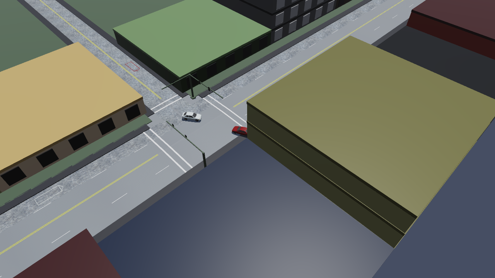
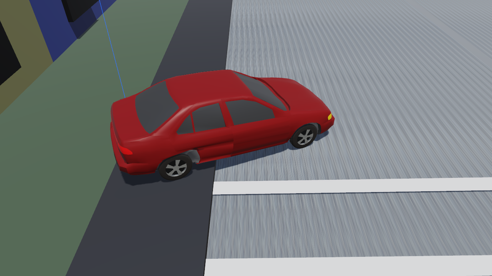

# Chapter 3 — EDSMAC4 Program Output

This chapter defines the outputs available from an EDSMAC4 event. In HVE 2027 the outputs of a solved event are in the **Output** menu of the Event (F5) editor, and the trajectory is played back in the viewport.

## Output Overview

EDSMAC4 produces three types of output reports:

- **Alpha-Numeric Reports** — Reports containing text and numeric information, such as vehicle dimensional parameters
- **Variable Output Tables** — Reports containing tabular simulation results as a function of time
- **Trajectory Simulations** — Dynamic, 3-D visual simulations

To view the alpha-numeric reports in HVE 2027:

1. Solve the event (**Run** on the playback bar).
2. Choose **Output › HVE Reports...**. The **HVE Reports** window is displayed, with one tab per report page that EDSMAC4 built during the run: **ACCIDENT HISTORY**, **DAMAGE DATA**, **DRIVER DATA**, **EVENT DATA**, **ENVIRON DATA**, **MESSAGES**, **PROGRAM DATA**, **REFERENCES** and **VEHICLE DATA**.
3. Click a tab to display that page.

!!! note "HVE 2027"
    These pages are EDSMAC4's own: the engine builds them from its own resource strings at the end of the run, as in HVE, and HVE 2027 displays them. **Save This Page** and **Save All Pages** at the bottom of the window write them to a text file, and **Save Page as HTML** / **Save All Pages as HTML** to an HTML file a browser can print; the window has no Print button. **Output › Accident History Report...** opens this window on its ACCIDENT HISTORY tab. HVE 2027 also has reports of its own built from its results — **Output › Variable Report...** and **Output › Key Results...** — which present the same run in HVE 2027's units and layout.

!!! note "HVE 2027"
    The figures of HVE's report windows that this chapter used to carry are not reproduced; HVE 2027 shows the same pages in the HVE Reports window, laid out as tables from the engine's own report records.

## Alpha-Numeric Reports

EDSMAC4 produces the following alpha-numeric reports:

- **Accident History** — A table of initial, impact, separation and final positions and velocities for each vehicle in the current event
- **Damage Data** — Tables describing the damage sustained by each vehicle: the collision pulses with their start and end times, peak acceleration, peak force, delta-V and PDOF, and the resulting CDC and crush measurements. The layout depends on the Damage Data Format calculation option (see below)
- **Driver Data** — Individual Driver Control tables for steering, braking and throttle used by each vehicle in the current event
- **Environment Data** — Information describing the environment data used by the current EDSMAC4 event
- **Event Data** — A table containing event-related parameters for the current event
- **Messages** — A list of messages produced by the current event
- **Program Data** — A table containing program control information for the current event
- **References** — EDSMAC4's technical references (a page the engine builds; it is listed in HVE 2027's HVE Reports window)
- **Vehicle Data** — A series of tables containing the vehicle data used by the current EDSMAC4 event

### Accident History

The Accident History Report displays a table of initial, impact, separation and final positions and velocities for each vehicle.

In HVE 2027 this is the **ACCIDENT HISTORY** tab of **Output › HVE Reports**, which **Output › Accident History Report...** opens directly.

*(updated: the criterion used to detect the beginning and end of each collision phase reported here is selectable via the **Accident History Basis** calculation option — Impact Force (default) or Acceleration with a threshold in g; see [EDSMAC4 Calculation Options](../../10-calculation-options/CalcOptEDSMAC4.md#accident-history) and, for how the impact and separation times are found, [Chapter 4 — Impact and Separation Times](04-calculation-method.md#impact-and-separation-times).)*

> **NOTE:** Impact and separation are tracked for each *pair* of vehicles, so an event involving three or more vehicles produces one impact and one separation entry for each colliding pair. The impact conditions are those of the pair's **first** contact and are not updated by subsequent contacts between the same pair.

### Damage Data

The Damage Data Report includes the following information:

- **Vehicle Damage Summary** — A table containing the collision ("RHO") vector information in two forms: RHO vector length and angle, and RHO vector x,y endpoint coordinates.

    > **NOTE:** This table is used to define the damage profile.

- **Vehicle Damage Ranges** — A table containing the starting and ending points for each damage range, along with its CDC, PDOF, total delta-V and peak acceleration.

*(updated: the report layout is selectable via the **Damage Data Format** calculation option — Traditional or Collision Data (default); see [EDSMAC4 Calculation Options](../../10-calculation-options/CalcOptEDSMAC4.md#damage-data-format). The description above is the Traditional layout. With the default Collision Data layout the report instead contains:*

- *a **Collision Summary** table listing, for each collision pulse, the vehicle or environment struck, the start and end times and duration of the pulse, the peak acceleration, the peak collision force, the delta-V and the PDOF (for what counts as one pulse, and why intermittent contact is not split into several, see [Chapter 4 — How a pulse is delimited](04-calculation-method.md#how-a-pulse-is-delimited));*
- *a **Damage Profile** table giving the CDC, damage width and offset, and maximum crush for each pulse;*
- *a **Crush** table giving the crush depths across the damaged surface.*

*The two layouts are produced by entirely separate calculations and do not give identical numbers. See [Chapter 4 — Collision Severity Results](04-calculation-method.md#collision-severity-results-pdof-delta-v-and-peak-acceleration) for how the PDOF, delta-V and peak acceleration are determined under each.)*

### Driver Data

The Driver Data report displays a table of user-entered driver control tables for steering, braking and throttle for each vehicle in the event.

### Environment Data

The Environment Data report displays the physical and visual information describing the environment. This information is displayed in two sections:

- **General Environment Data** — Physical parameters describing the environment (Temperature and Pressure are not used in the EDSMAC4 calculations).
- **3-D Environment Terrain Data** — Geometric parameters describing the terrain.

> **NOTE:** A detailed description of the terrain vertex information is not practical owing to its potentially large size (a terrain is often composed of several thousand vertices). However, it is possible to view the terrain information (friction multiplier, slope, elevation, and so forth) beneath each tire at each timestep during the simulation by selecting the tire terrain outputs in the Variable Output, Tires output group (see Variable Output later in this chapter).

### Event Data

The Event Data report displays event-specific information for each vehicle:

- **Accelerometer Data** — Vehicle-fixed coordinates for up to five accelerometers (the acceleration vs. time history for each accelerometer is found in Variable Output, described later in this chapter).
- **Wheel Displacement Data** — User-defined time and displacement parameters for each displaced wheel location.
- **Tire Blow-out** — User-defined time and tire blow-out parameters for each blown tire.

### Messages

The Messages report lists the messages produced during execution of the current event. For a complete listing of messages issued by EDSMAC4, see [Chapter 6](06-messages.md).

!!! note "HVE 2027"
    The run status in the Simulation panel also counts the engine's messages and quotes the first ("2 engine message(s), see the Messages report -- first: ..."), and adds any note HVE 2027 itself made about the inputs, such as a substituted driver input method.

### Program Data

The Program Data Report includes the following information:

- **Simulation Controls** — Integration parameters used for the current event.
- **Collision Parameters** — Parameters used within the collision model.
- **Collision Criteria** — Parameters used to determine which side (front, back, right or left) a RHO vector intersects; used to determine the RHO vector's initial length.

!!! warning "A known HVE report defect, kept as HVE has it"
    The **Accident History Basis** row of the Collision Parameters table prints the *opposite* basis to the one EDSMAC4 used: a run on the Acceleration basis prints "Use Impact Force", and a run on the Impact Force basis prints "Use Impact Acceleration". The row below it, **Coll Accel Threshold**, appears only on the Acceleration basis and is the one to trust. This is in EDSMAC4's own report code, identical in HVE, and HVE 2027 does not change it.

### Vehicle Data

The Vehicle Data Report includes the following information:

- **Vehicle Dimensional and Inertial Properties** — The dimensional and inertial parameters used by each vehicle in the current event.

    > **NOTE:** The yaw inertia displayed in the Vehicle Data report includes the inertial contributions of the unsprung masses. These masses are added to the sprung mass yaw inertia to calculate the total yaw inertia used by EDSMAC4.

- **Tire Properties** — The tire parameters used by each vehicle in the current event.

## Graphic Reports

EDSMAC4 produces no Graphic Output Reports.

> **NOTE:** Graphs of simulation results vs time may be produced using the Variable Output window (see next section); in HVE 2027, **Output › Output Graph...**.

## Variable Output Table

EDSMAC4 produces a Variable Output table containing the time-based simulation results.

!!! note "HVE 2027"
    In HVE 2027 the time-based results are shown in:

    - **Output › Key Results...** — the equivalent of the Variable Output table: one row per output step and one column per selected variable and vehicle, plus each vehicle's key results. **Select Variables...** at the top of the panel (or **Output › Variable Selection...**) opens the **Select Output Variables** window, which chooses the columns; type part of a variable's name — HVE's own names such as V-tot or Delta work too — in the filter box. **Export CSV...** writes the table to a file;
    - **Output › Output Graph...** — selected variables plotted against time (the graph keeps its own selection);
    - **Output › Timestep Data Table...** — the trajectory itself in a fixed long form: time, vehicle, X, Y, heading and speed at every output step, with its own **Export CSV...**;
    - **Output › Variable Report...** — the minimum, maximum and final value of each selected variable.

    Channels that EDSMAC4 never computes are marked "(not computed)" in their names, and **Only variables this run computed** in the Select Output Variables window hides them.

The Variable Output groups produced by EDSMAC4 are as follows:

### Vehicle Output Groups

- **Kinematics** — Position, velocity and acceleration for each vehicle
- **Kinetics** — Summation of collision forces and moments acting at the CG of each vehicle
- **Accelerometers** — Linear acceleration at each user-specified accelerometer location for each vehicle (see [Chapter 2 — Accelerometers](02-program-input.md#accelerometers))
- **Tire** — The tire output parameters existing at the tire contact patch (compare with Wheel output, below)
- **Wheel** — The wheel output parameters existing at the wheel's hub; information about the position of each wheel (compare with Tire output, above)
- **Connections** — Trailer articulation angle and connection forces for each articulated vehicle
- **Driver** — Current levels of driver inputs (steering, braking and throttle)

**Table 3-1: Vehicle Variable Output Data**

| Parameter | Description |
|---|---|
| Vehicle Kinematic Data | X,Y,Z position of CG; $\phi,\theta,\psi$ orientation; total linear velocity, u,v,w components; sideslip angle; r angular velocity; total linear acceleration, forward, side components; $\dot{u}$, $\dot{v}$ linear components; $\dot{r}$ angular component |
| Vehicle Kinetic Data | $\Sigma F_x$, $\Sigma F_y$, $\Sigma M_z$ (collision); $\Sigma F_x$, $\Sigma F_y$, $\Sigma M_z$ (tires); $\Sigma F_x$, $\Sigma F_y$, $\Sigma M_z$ (connection) |
| Accelerometer Data | Total linear acceleration; forward, lateral components of linear acceleration at each user-specified accelerometer location |
| Tire Data | X,Y,Z position of tire contact patch; slip angle; $F'_x$, $F'_y$, $F'_z$; skid flag |
| Wheel Data | x,y,z location of each wheel; $F_x$, $F_y$, $F_z$; steer angle ($\delta$) at each steerable wheel |
| Connection Data | Articulation angle, $F_x$, $F_y$, $F_z$ at each connection |
| Driver Data (*) | Steering wheel angle |

(*) If Driver Control option was At Driver

*Figure 3-9: The Select Output Variables window, which chooses the variables shown in Key Results. Variables are grouped (Kinematics, Kinetics, Driver, and per wheel and tire); before a run it has one vehicle column, after a run one per vehicle.*

## Trajectory Simulation

EDSMAC4 produces a trajectory simulation of the current event. The trajectory simulation is a 3-D visualization of the vehicle position data in the Variable Output table (see previous section).

*Figure 3-10: An EDSMAC4 trajectory simulation in HVE 2027 — the tutorial event at the end of the run.*

### Displaying a Trajectory Simulation

In HVE 2027 the trajectory simulation is the playback of the solved event in the viewport; nothing is calculated during playback. It is controlled with the playback bar under the viewport (see [Chapter 2 — Executing An Event](02-program-input.md#executing-an-event)):

- **|<** — Jump to the start of the simulation
- **<<** — Step back one output step
- **Play / Pause** — Play the simulation forwards, or pause it
- **>>** — Step forward one output step
- **>|** — Jump to the end of the simulation

!!! note "HVE 2027"
    HVE 2027 has no reverse play; step back with **<<**. The camera is chosen in the list on the playback bar (**Free view**, or a camera made in **Tools › Cameras...**). Paths, skidmarks and vectors are switched on in **View › Scene Display**. Several events are played together in the **Playback (F6)** editor, and **File › Record Animation...** writes a video.

### Displaying a Damage Profile Simulation

EDSMAC4 produces a dynamic simulation of the vehicle damage profile. The vehicle is initially displayed in its original shape without damage.

!!! note "HVE 2027"
    HVE 2027 has no separate Damage Profile viewer: the simulated crush is drawn on each vehicle's body in the viewport as the event plays back, so the damage grows through the collision and stays at its final shape afterwards. The crush is drawn from EDSMAC4's own damage record, so its depth on the body matches what the engine reports. **Output › Damage Studio Report...** and **Damage Studio Options...** analyze the final crush.

*Figure 3-12: EDSMAC4's simulated damage drawn on the Nissan Sentra of the tutorial event, after the run.*

---
*Previous: [Chapter 2 — Program Input](02-program-input.md) — Next: [Chapter 4 — Calculation Method](04-calculation-method.md)*

<!-- NAV -->

---

← Previous: [Chapter 2 — EDSMAC4 Program Input](02-program-input.md)  |  [Index](README.md)  |  Next: [Chapter 4 — Calculation Method](04-calculation-method.md) →

<!-- /NAV -->
